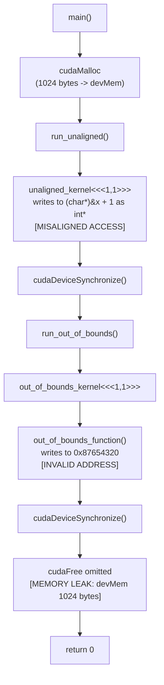
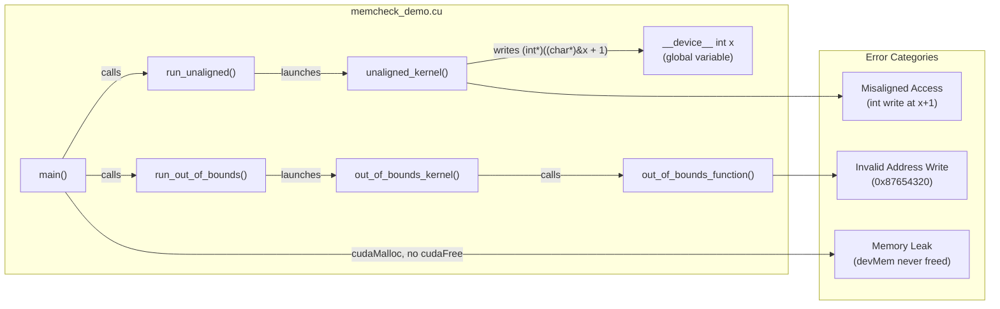

<!-- source: DeepWiki mcp.deepwiki.com · repo NVIDIA/compute-sanitizer-samples · page 3.1 Memcheck Demo · fetched 2026-10-26 -->

# Memcheck Demo

<details>
<summary>Relevant source files</summary>

The following files were used as context for generating this wiki page:

- [Memcheck/Makefile](Memcheck/Makefile)
- [Memcheck/memcheck_demo.cu](Memcheck/memcheck_demo.cu)

</details>


This page covers the `memcheck_demo` program located in `Memcheck/memcheck_demo.cu`. It demonstrates three categories of memory errors that the `compute-sanitizer` memcheck tool can detect: misaligned access, out-of-bounds access, and memory leaks. For information about suppressing known errors reported by memcheck, see the Suppressions Demo ([3.5](#3.5)). For an overview of the tool demo category as a whole, see ([3](#3)).

---

## Purpose and Structure

`memcheck_demo` is a deliberately broken CUDA program. It launches two kernels that perform invalid memory operations and intentionally omits a `cudaFree` call to demonstrate the leak-check feature. The program is designed to be run under `compute-sanitizer` so that each class of error is surfaced and attributed correctly.

**Build artifact:** `memcheck_demo` (single CUDA executable)

**Source files:**

| File | Role |
|---|---|
| `Memcheck/memcheck_demo.cu` | All kernel definitions, host launch functions, and `main` |
| `Memcheck/Makefile` | Build rules, run targets for memcheck and leak-check |

Sources: [Memcheck/memcheck_demo.cu:1-74](), [Memcheck/Makefile:1-68]()

---

## Error Scenarios

The demo covers three distinct error scenarios, each implemented as a separate code construct.

### Scenario 1: Misaligned Memory Access

**Kernel:** `unaligned_kernel`

[Memcheck/memcheck_demo.cu:32-35]()

The device global variable `x` (declared at line 30) is an `int` aligned on a 4-byte boundary. The kernel computes `(char*)&x + 1` — a pointer offset by one byte — and then casts it back to `int*` before writing `42`. Because the resulting address is not 4-byte aligned, this constitutes a misaligned store. Memcheck detects and reports this as a misaligned memory access error.

### Scenario 2: Out-of-Bounds Memory Access

**Kernel:** `out_of_bounds_kernel` → **Device function:** `out_of_bounds_function`

[Memcheck/memcheck_demo.cu:37-45]()

`out_of_bounds_function` writes to the hardcoded address `0x87654320`, which is not a valid mapped GPU memory address. The kernel `out_of_bounds_kernel` simply calls this function. Memcheck reports the invalid address write and, because the error is unrecoverable, terminates the kernel (controlled via the `--destroy-on-device-error kernel` flag).

The call chain is shallow by design: having the actual bad write inside a separate `__device__` function (`out_of_bounds_function`) rather than directly in the kernel body demonstrates that memcheck can report through device function call stacks.

### Scenario 3: Memory Leak

**Host function:** `main`

[Memcheck/memcheck_demo.cu:61-74]()

`main` allocates 1024 bytes of device memory with `cudaMalloc` into `devMem`. The matching `cudaFree(devMem)` call is present in the source but commented out with the annotation `// Omitted to demo leakcheck`. At program exit, this allocation is never freed. Running with `--leak-check=full` causes `compute-sanitizer` to report the leaked allocation, including its size and the callsite where it was allocated.

---

## Program Execution Flow

**Diagram: Execution flow of `memcheck_demo`**



Sources: [Memcheck/memcheck_demo.cu:47-73]()

---

## Code Entity Map

**Diagram: Source symbols and their error categories**



Sources: [Memcheck/memcheck_demo.cu:30-74]()

---

## Running the Demo

The `Makefile` provides two named run targets that invoke `compute-sanitizer` with different flags.

### Build

```
make -C Memcheck
```

This compiles `memcheck_demo.cu` into the `memcheck_demo` executable using `nvcc`.

### Run Targets

| Make Target | Command Invoked | What It Detects |
|---|---|---|
| `run_memcheck` | `compute-sanitizer --destroy-on-device-error kernel memcheck_demo` | Misaligned access, out-of-bounds write |
| `run_leakcheck` | `compute-sanitizer --destroy-on-device-error kernel --leak-check=full memcheck_demo` | All of the above, plus the unreleased `devMem` allocation |

Sources: [Memcheck/Makefile:63-68]()

### Key Flags

| Flag | Effect |
|---|---|
| `--destroy-on-device-error kernel` | Terminates the offending kernel on a device error instead of aborting the entire process; allows subsequent kernels to still run |
| `--leak-check=full` | At program exit, reports all device allocations that were not freed, with allocation call sites |

The `--destroy-on-device-error kernel` flag is significant here: without it, the out-of-bounds write in `out_of_bounds_kernel` would abort the entire process, and the second kernel's error would prevent observing errors from both kernel launches in a single run.

### Debug Build

Passing `dbg=1` to make enables `-G` (device-side debug info) and `-Xcompiler -rdynamic`, which produces more detailed stack traces in sanitizer output.

[Memcheck/Makefile:41-43]()

---

## Error Summary Table

| Error Type | Kernel / Function | Address / Cause | Detected By |
|---|---|---|---|
| Misaligned int store | `unaligned_kernel` | `&x + 1` (1-byte offset) | `memcheck` (default tool) |
| Invalid address write | `out_of_bounds_function` | `0x87654320` (unmapped) | `memcheck` (default tool) |
| Memory leak | `main` | `devMem` (1024 bytes) | `memcheck --leak-check=full` |

Sources: [Memcheck/memcheck_demo.cu:32-45](), [Memcheck/memcheck_demo.cu:61-74]()

---

