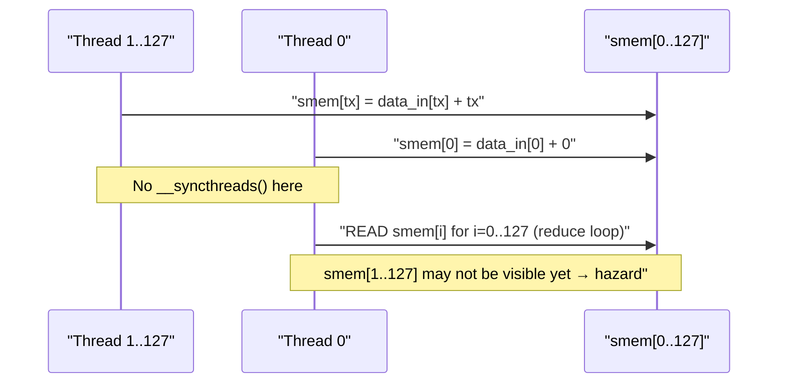
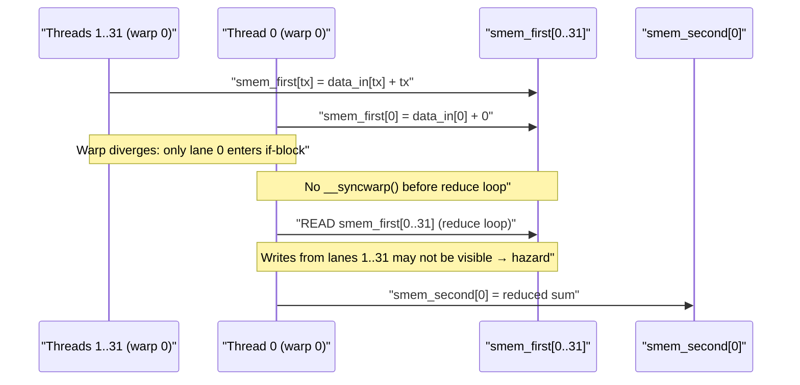
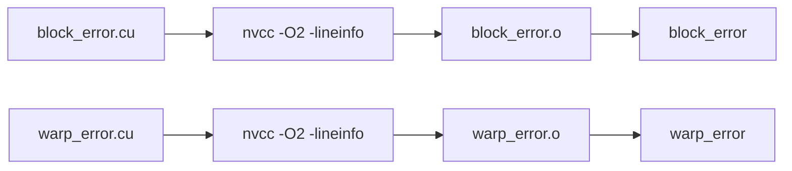

<!-- source: DeepWiki mcp.deepwiki.com · repo NVIDIA/compute-sanitizer-samples · page 3.2 Racecheck Demo · fetched 2026-10-26 -->

# Racecheck Demo

<details>
<summary>Relevant source files</summary>

The following files were used as context for generating this wiki page:

- [Racecheck/Makefile](Racecheck/Makefile)
- [Racecheck/block_error.cu](Racecheck/block_error.cu)
- [Racecheck/warp_error.cu](Racecheck/warp_error.cu)

</details>


This page covers the two programs in the `Racecheck/` directory that demonstrate shared memory race conditions detectable by `compute-sanitizer`'s `racecheck` tool. For the broader context of the demos category, see the compute-sanitizer Tool Demos overview in [section 3](#3). For a different class of synchronization bug (invalid `__syncwarp` / `__syncthreads` usage), see the Synccheck Demo in [section 3.3](#3.3).

---

## Overview

The `Racecheck/` directory contains two standalone CUDA programs:

| Binary | Source File | Race Type | Recommended Report Mode |
|---|---|---|---|
| `block_error` | `Racecheck/block_error.cu` | Block-level write-read hazard on shared memory | `analysis` |
| `warp_error` | `Racecheck/warp_error.cu` | Warp-level write-read hazard on shared memory | `hazard` |

Both programs compute a sum reduction using shared memory, and both contain intentional missing synchronization barriers to trigger races that `racecheck` can catch.

Sources: `Racecheck/Makefile`, `Racecheck/block_error.cu`, `Racecheck/warp_error.cu`

---

## block_error

### What It Does

`Racecheck/block_error.cu` launches a single kernel, `sumKernel`, with 128 threads in one block. The computation proceeds in two logical phases:

1. **Write phase** — every thread writes `data_in[tx] + tx` into `smem[tx]`.
2. **Reduce phase** — only thread 0 loops over all 128 slots of `smem` and accumulates the result into `*sum_out`.

There is no `__syncthreads()` between the write phase and the reduce phase. Thread 0 may begin reading `smem[i]` before thread `i` has committed its write. This is a **write-read hazard** across threads within the same block.

### Race Anatomy

**Race condition diagram: `block_error` / `sumKernel`**



Sources: [Racecheck/block_error.cu:38-54]()

### Key Code Constructs

- `smem[NumThreads]` — block-scoped shared memory array declared at file scope [Racecheck/block_error.cu:35-35]()
- `sumKernel` — the kernel containing the race [Racecheck/block_error.cu:38-54]()
- `NumThreads = 128` — block size constant [Racecheck/block_error.cu:33-33]()
- Missing `__syncthreads()` between line 41 (all threads write) and lines 49–52 (thread 0 reads) [Racecheck/block_error.cu:41-52]()

### How to Run

```
compute-sanitizer --tool racecheck --racecheck-report analysis ./block_error
```

Or via the Makefile target:

```
make run_block_error
```

The `analysis` report mode aggregates all detected hazards and produces a summary report of potential races, which is appropriate here because the race involves many threads writing to many shared memory locations.

Sources: [Racecheck/Makefile:66-68]()

---

## warp_error

### What It Does

`Racecheck/warp_error.cu` launches `sumKernel` with 64 threads (2 warps of 32). The kernel performs a two-level reduction:

1. **Level 1** — all threads write `data_in[tx] + tx` into `smem_first[tx]`.
2. **Level 2** — only the lane-0 thread of each warp (`tx % WarpSize == 0`) reduces its warp's 32 elements from `smem_first` into `smem_second[wx]`.
3. **Final** — after `__syncthreads()`, thread 0 sums `smem_second[0..1]` into `*sum_out`.

The race is in Level 2: the lane-0 thread reads `smem_first[wx * WarpSize + i]` (written by threads 1–31 in the same warp) without a preceding `__syncwarp()`. On Volta and later architectures, threads within a warp can have independent program counters, so there is no implicit ordering guarantee for shared memory stores across divergent paths without `__syncwarp()`.

### Race Anatomy

**Race condition diagram: `warp_error` / `sumKernel`**



Sources: [Racecheck/warp_error.cu:41-70]()

### Key Code Constructs

- `smem_first[NumThreads]` — holds all per-thread input values [Racecheck/warp_error.cu:37-37]()
- `smem_second[Warps]` — holds one partial sum per warp [Racecheck/warp_error.cu:38-38]()
- `sumKernel` — the kernel with the warp-level race [Racecheck/warp_error.cu:41-70]()
- `Warps = 2`, `WarpSize = 32`, `NumThreads = 64` — configuration constants [Racecheck/warp_error.cu:33-35]()
- Missing `__syncwarp()` at the start of the `if (tx % WarpSize == 0)` block, before the inner reduction loop [Racecheck/warp_error.cu:46-58]()
- `__syncthreads()` is present after Level 2 [Racecheck/warp_error.cu:60-60](), which eliminates the race in Level 3 (cross-warp read of `smem_second`), but does not fix the intra-warp hazard in Level 2.

### How to Run

```
compute-sanitizer --tool racecheck --racecheck-report hazard ./warp_error
```

Or via the Makefile target:

```
make run_warp_error
```

The `hazard` report mode emits one report per individual memory hazard event. This is appropriate for the warp-level race because the number of hazardous accesses is small and the report pinpoints the exact instructions involved.

Sources: [Racecheck/Makefile:69-70]()

---

## Comparison of the Two Races

| Attribute | `block_error` | `warp_error` |
|---|---|---|
| Race granularity | Block-level (threads from different warps) | Warp-level (threads within the same warp) |
| Missing barrier | `__syncthreads()` | `__syncwarp()` |
| Hazardous memory | `smem` (global shared array) | `smem_first` (per-thread staging buffer) |
| Racecheck flag | `--racecheck-report analysis` | `--racecheck-report hazard` |
| Number of racing threads | Up to 127 writers vs. 1 reader | Up to 31 writers vs. 1 reader per warp |
| Fix | Insert `__syncthreads()` before thread 0's reduce loop | Insert `__syncwarp()` before lane 0's reduce loop |

Sources: `Racecheck/block_error.cu`, `Racecheck/warp_error.cu`, `Racecheck/Makefile`

---

## Build System

The Makefile produces two independent binaries from two `.cu` files with no shared source.

**Build artifact flow: Racecheck**



| Makefile variable | Value |
|---|---|
| `TARGET_BINARIES` | `block_error warp_error` |
| `COMPILE_FLAGS` (release) | `-O2 -lineinfo` |
| `COMPILE_FLAGS` (debug, `dbg=1`) | `-G -Xcompiler -rdynamic` |
| `SANITIZER_BIN` | `$(SANITIZER_PATH)/compute-sanitizer` |

Pattern rules compile each `.cu` to a `.o` and then link it into the same-named binary [Racecheck/Makefile:48-51]().

Sources: [Racecheck/Makefile:30-70]()

---

