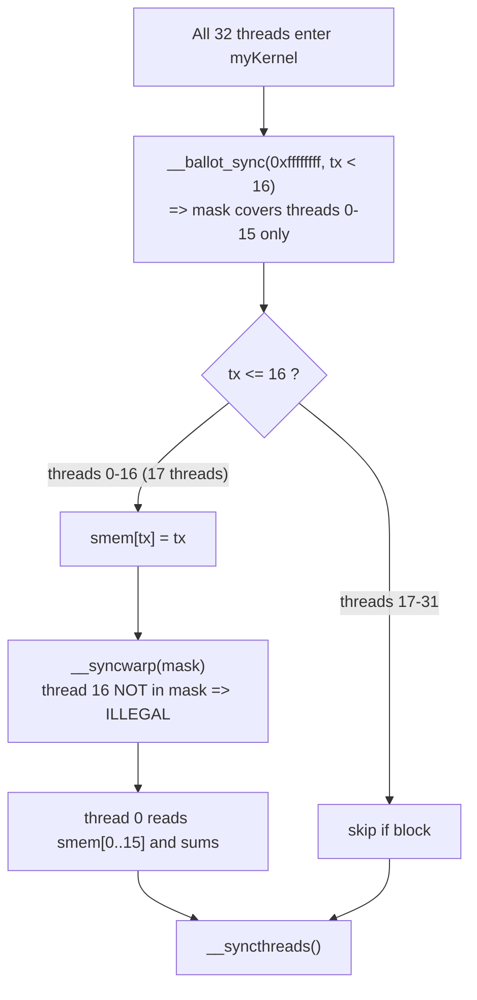
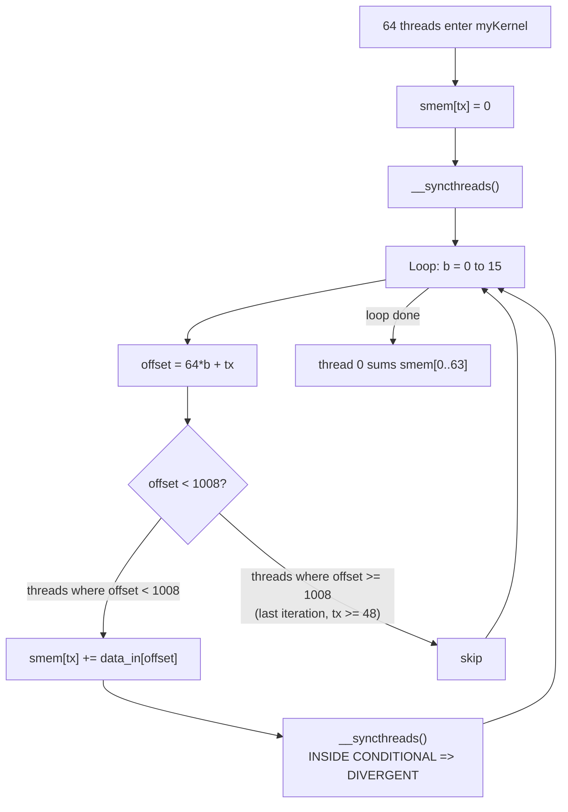
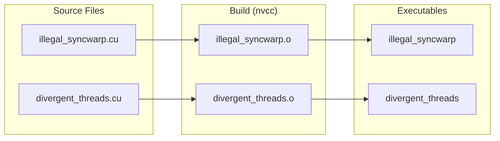

<!-- source: DeepWiki mcp.deepwiki.com · repo NVIDIA/compute-sanitizer-samples · page 3.3 Synccheck Demo · fetched 2026-10-26 -->

# Synccheck Demo

<details>
<summary>Relevant source files</summary>

The following files were used as context for generating this wiki page:

- [Synccheck/Makefile](Synccheck/Makefile)
- [Synccheck/divergent_threads.cu](Synccheck/divergent_threads.cu)
- [Synccheck/illegal_syncwarp.cu](Synccheck/illegal_syncwarp.cu)

</details>


This page describes the two CUDA programs in the `Synccheck/` directory that demonstrate synchronization errors detectable by `compute-sanitizer --tool synccheck`. The programs are self-contained executables that intentionally contain synchronization bugs; they are not sanitizer injection libraries. For general context on how these demos fit into the repository alongside the injection-based samples and NVTX samples, see the [Overview](#1).

---

## Overview

The `synccheck` tool detects two broad classes of warp- and block-level synchronization errors:

| Error class | Triggered by | Demo program |
|---|---|---|
| Illegal `__syncwarp` mask | A thread calls `__syncwarp` with a mask that excludes itself | `illegal_syncwarp` |
| Divergent `__syncthreads` | `__syncthreads` is called inside a conditional that not all threads in the block reach | `divergent_threads` |

Both programs compile to standalone executables and are run under `compute-sanitizer --tool synccheck`.

---

## Program 1: `illegal_syncwarp`

**Source:** [Synccheck/illegal_syncwarp.cu]()

### What the program does

`myKernel` is launched with a single block of 32 threads (`NumThreads = 32`).

**Diagram: Execution flow of `myKernel` in `illegal_syncwarp`**



Sources: [Synccheck/illegal_syncwarp.cu:42-60]()

### Root cause

The mask is computed on [line 42](Synccheck/illegal_syncwarp.cu:42-42) using `__ballot_sync(0xffffffff, tx < (NumThreads / 2))`. Because `NumThreads / 2 = 16`, the ballot selects only threads where `tx < 16` (threads 0–15).

The conditional on [line 44](Synccheck/illegal_syncwarp.cu:44-44) is `tx <= (NumThreads / 2)`, i.e., `tx <= 16`. This admits thread 16 into the block.

Thread 16 then calls `__syncwarp(mask)` on [line 48](Synccheck/illegal_syncwarp.cu:48-48), but it is absent from `mask`. CUDA requires that every thread participating in a `__syncwarp` call must have its bit set in the mask. Synccheck flags this as an illegal syncwarp.

| Thread range | Enters `if (tx <= 16)` | In `mask` (tx < 16) | Calls `__syncwarp(mask)` | Valid? |
|---|---|---|---|---|
| 0–15 | Yes | Yes | Yes | ✓ |
| 16 | Yes | No | Yes | ✗ (illegal) |
| 17–31 | No | No | No | — |

Sources: [Synccheck/illegal_syncwarp.cu:42-58]()

---

## Program 2: `divergent_threads`

**Source:** [Synccheck/divergent_threads.cu]()

### What the program does

`myKernel` is launched with a single block of 64 threads (`NumThreads = 64`) and reads from an integer array of `Size = (NumThreads * DataBlocks) - 16 = 1008` elements, where `DataBlocks = 16`.

The kernel accumulates `data_in` into shared memory `smem` in chunks, one `DataBlocks` iteration at a time.

**Diagram: `myKernel` loop and divergence point in `divergent_threads`**



Sources: [Synccheck/divergent_threads.cu:48-65]()

### Root cause

`__syncthreads()` at [line 54](Synccheck/divergent_threads.cu:54-54) is placed inside `if (offset < Size)`. In the last loop iteration (`b = 15`), `offset = 960 + tx`. Threads where `tx >= 48` produce `offset >= 1008 = Size` and do not enter the conditional. Threads where `tx < 48` do enter it and call `__syncthreads()`.

CUDA requires `__syncthreads()` to be reached by all threads in the block. When some threads skip it due to a divergent condition, the behavior is undefined and synccheck reports a divergent-threads error.

| Iteration (`b`) | Threads entering `if` | Threads skipping `if` | `__syncthreads` divergent? |
|---|---|---|---|
| 0–14 | all 64 | none | No |
| 15 | tx 0–47 (48 threads) | tx 48–63 (16 threads) | **Yes** |

Sources: [Synccheck/divergent_threads.cu:33-65]()

---

## Build System

**Source:** [Synccheck/Makefile]()

Both programs are compiled from a single `.cu` source each using `nvcc`. There are no device-side patch fatbins or shared libraries involved.



Sources: [Synccheck/Makefile:47-61]()

### Build targets

| Make target | Action |
|---|---|
| `all` / `build` | Compiles both executables |
| `clean` | Removes binaries and `.o` files |
| `run_illegal_syncwarp` | Runs `compute-sanitizer --tool synccheck ./illegal_syncwarp` |
| `run_divergent_threads` | Runs `compute-sanitizer --tool synccheck ./divergent_threads` |

The `dbg=1` flag enables `-G` (device debug symbols) and `-Xcompiler -rdynamic` for richer stack traces in sanitizer output [Synccheck/Makefile:41-45]().

---

## Running the Demos

Both programs are invoked the same way — as ordinary CUDA executables under `compute-sanitizer`:

```
compute-sanitizer --tool synccheck ./illegal_syncwarp
compute-sanitizer --tool synccheck ./divergent_threads
```

These correspond to the `run_illegal_syncwarp` and `run_divergent_threads` Makefile targets [Synccheck/Makefile:66-71]().

Synccheck will emit an error report for each violation, identifying the offending thread, the synchronization primitive involved, and the source location (when built with `-G`). No special flags beyond `--tool synccheck` are needed for these demos.

---

## Summary

| Program | Synchronization primitive | Bug pattern | Synccheck error class |
|---|---|---|---|
| `illegal_syncwarp` | `__syncwarp(mask)` | Thread 16 calls `__syncwarp` but is excluded from `mask` | Illegal syncwarp mask |
| `divergent_threads` | `__syncthreads()` | `__syncthreads` placed inside `if (offset < Size)` which not all threads reach | Divergent `__syncthreads` |

Sources: [Synccheck/illegal_syncwarp.cu](), [Synccheck/divergent_threads.cu](), [Synccheck/Makefile]()

---

