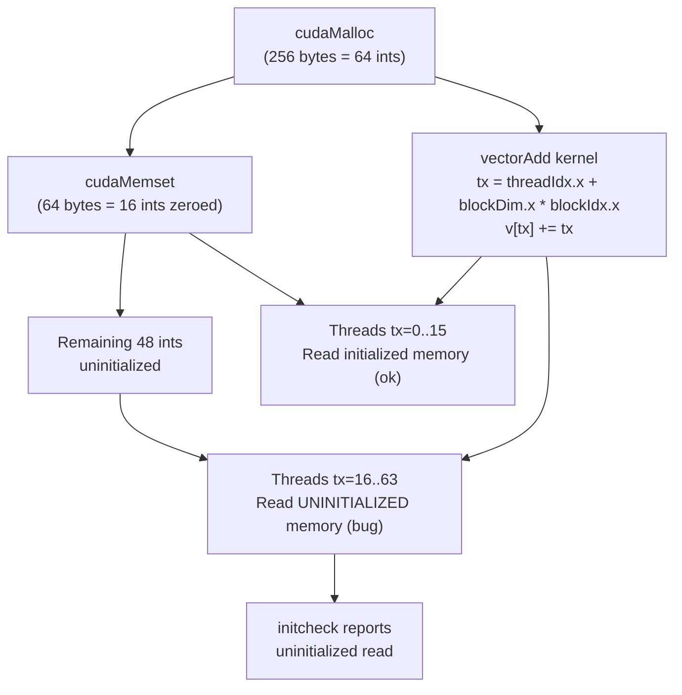
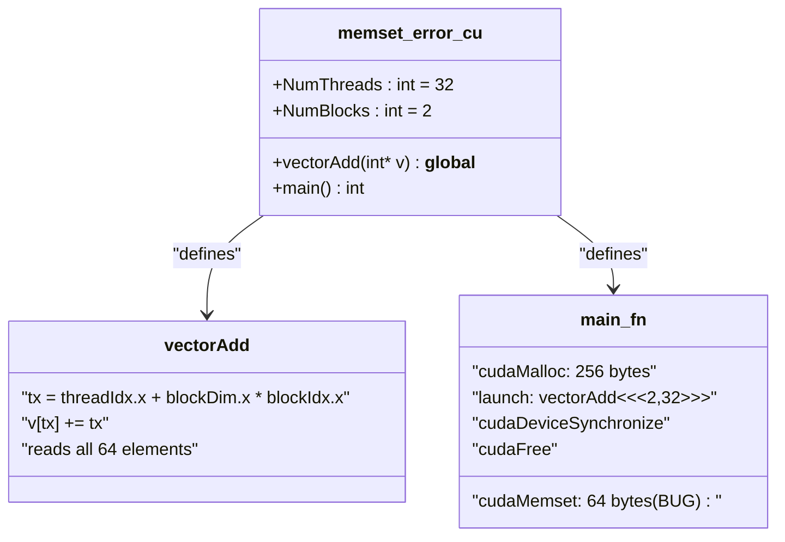
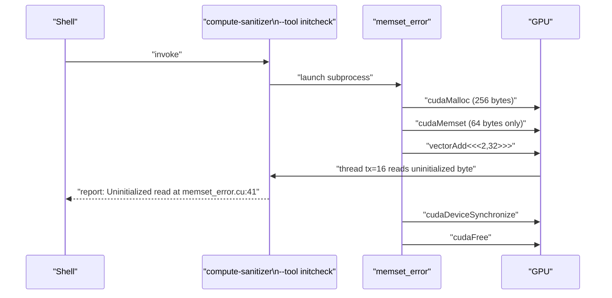

<!-- source: DeepWiki mcp.deepwiki.com · repo NVIDIA/compute-sanitizer-samples · page 3.4 Initcheck Demo · fetched 2026-10-26 -->

# Initcheck Demo

<details>
<summary>Relevant source files</summary>

The following files were used as context for generating this wiki page:

- [Initcheck/Makefile](Initcheck/Makefile)
- [Initcheck/memset_error.cu](Initcheck/memset_error.cu)

</details>


This page describes the `Initcheck` demo, a minimal CUDA program that demonstrates how `compute-sanitizer --tool initcheck` detects reads from uninitialized device memory. The demo is a single source file (`Initcheck/memset_error.cu`) that deliberately introduces a common `cudaMemset` sizing mistake.

For suppression workflows applied to initcheck errors, see [Suppressions Demo](#3.5). For the other compute-sanitizer tool demos (memcheck, racecheck, synccheck), see pages [3.1](#3.1), [3.2](#3.2), and [3.3](#3.3).

---

## The Bug: Incorrect `cudaMemset` Size

The entire demo fits in one file: [Initcheck/memset_error.cu]().

The allocation and initialization sequence is:

| Step | Call | Size Argument |
|------|------|---------------|
| Allocate device memory | `cudaMalloc` | `sizeof(int) * NumBlocks * NumThreads` = **256 bytes** |
| Zero device memory | `cudaMemset` | `NumBlocks * NumThreads` = **64 bytes** (bug) |
| Launch kernel | `vectorAdd<<<NumBlocks, NumThreads>>>` | reads all 64 elements |
| Free memory | `cudaFree` | — |

[Initcheck/memset_error.cu:46-56]()

The constants are defined as:

```
NumThreads = 32
NumBlocks  = 2
```

This means the array holds **64 `int` values (256 bytes)** total. The `cudaMemset` call [Initcheck/memset_error.cu:51]() passes `NumBlocks * NumThreads` — which is `64` — as the byte count. The correct value would be `NumBlocks * NumThreads * sizeof(int)` = `256`. As a result, only the **first 64 bytes (16 integers)** are zeroed; the remaining **192 bytes (48 integers)** are left uninitialized.

---

## Kernel Behavior

**Diagram: Data Flow Through the Bug**



The `vectorAdd` kernel [Initcheck/memset_error.cu:37-42]() computes a linear thread index `tx` and performs `v[tx] += tx`. With 2 blocks of 32 threads each, `tx` ranges from 0 to 63. Threads with `tx >= 16` read memory that was never written by the `cudaMemset` call.

---

## Code Structure

**Diagram: Source Symbols and Their Roles**



Sources: [Initcheck/memset_error.cu:33-59]()

---

## Building and Running

The Makefile [Initcheck/Makefile]() produces a single binary: `memset_error`.

### Build

```
make
```

Or with debug symbols:

```
make dbg=1
```

| Build mode | Flags applied |
|------------|---------------|
| Release (default) | `-O2 -lineinfo` |
| Debug (`dbg=1`) | `-G -Xcompiler -rdynamic` |

### Run Under initcheck

The Makefile provides a convenience target:

```
make run_initcheck
```

which expands to:

```
compute-sanitizer --tool initcheck memset_error
```

[Initcheck/Makefile:66-67]()

**Diagram: Execution Flow Under compute-sanitizer**



Sources: [Initcheck/Makefile:66-67](), [Initcheck/memset_error.cu:48-56]()

---

## Expected initcheck Output

When run under `--tool initcheck`, `compute-sanitizer` reports an error for each thread that reads uninitialized memory. The report identifies:

- **The offending instruction** — the load in `vectorAdd` at [Initcheck/memset_error.cu:41]() (`v[tx] += tx`)
- **The address accessed** — the pointer offset into `d_vec` beyond the zeroed region
- **Which threads triggered it** — threads with `tx` in the range 16–63

The program itself runs to completion without crashing because CUDA does not trap reads of uninitialized memory at runtime; only `compute-sanitizer` intercepts and reports them.

---

## Root Cause Summary

| Property | Value |
|----------|-------|
| Source file | `Initcheck/memset_error.cu` |
| Bug location | [Initcheck/memset_error.cu:51]() |
| Bug type | Missing `* sizeof(int)` in `cudaMemset` byte count |
| Bytes allocated | 256 |
| Bytes initialized | 64 |
| Bytes uninitialized | 192 (48 `int` elements) |
| Kernel reads all | 256 bytes → 48 uninitialized reads per kernel launch |
| Detection tool | `compute-sanitizer --tool initcheck` |

Sources: [Initcheck/memset_error.cu](), [Initcheck/Makefile]()

---

