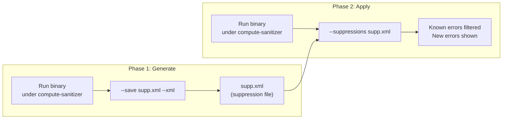
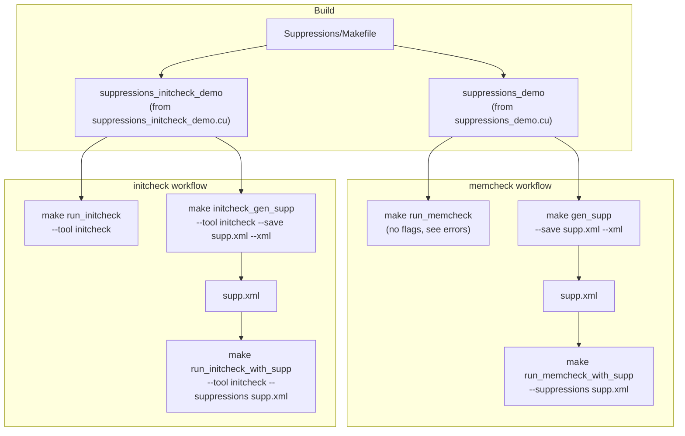
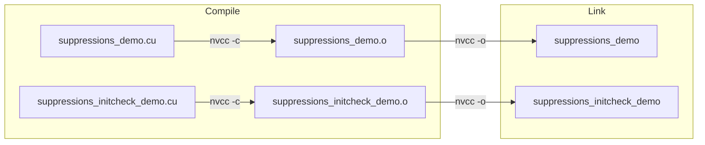

<!-- source: DeepWiki mcp.deepwiki.com · repo NVIDIA/compute-sanitizer-samples · page 3.5 Suppressions Demo · fetched 2026-10-26 -->

# Suppressions Demo

<details>
<summary>Relevant source files</summary>

The following files were used as context for generating this wiki page:

- [Suppressions/Makefile](Suppressions/Makefile)
- [Suppressions/suppressions_demo.cu](Suppressions/suppressions_demo.cu)
- [Suppressions/suppressions_initcheck_demo.cu](Suppressions/suppressions_initcheck_demo.cu)

</details>


## Purpose and Scope

This page documents the two suppression demo programs in the `Suppressions/` directory: `suppressions_demo` (covering `memcheck`) and `suppressions_initcheck_demo` (covering `initcheck`). These demos illustrate the full suppression workflow — generating a suppression file from known errors and then applying that file to silence them in subsequent runs.

This page is about using `compute-sanitizer`'s built-in suppression mechanism. For information about the errors being suppressed in the underlying demos, see the [Memcheck Demo](#3.1) and [Initcheck Demo](#3.4) pages.

---

## Overview

When a CUDA program contains known, accepted errors (or errors from third-party code that cannot be fixed), `compute-sanitizer` allows those errors to be recorded into an XML suppression file and later applied as a filter. The workflow has two phases:

1. **Generate**: Run under `compute-sanitizer` with `--save` and `--xml` to record all detected errors to a file.
2. **Apply**: Re-run under `compute-sanitizer` with `--suppressions` to load that file and silence the matching errors.

The `Suppressions/` directory contains two programs that each demonstrate this workflow for a different tool.

**Suppression workflow diagram:**



Sources: [Suppressions/Makefile:66-82]()

---

## Program Descriptions

### `suppressions_demo` (memcheck)

**File:** [Suppressions/suppressions_demo.cu:1-37]()

This program deliberately probes for the largest allocatable chunk of GPU memory by calling `cudaMalloc` in a loop, starting at `1ull << 45` bytes and decrementing `n` until the call succeeds.

```
while (cudaMalloc(&ptr, 1ull << n) != cudaSuccess) {
    n--;
}
```

[Suppressions/suppressions_demo.cu:32-34]()

The failed `cudaMalloc` attempts are what `memcheck` flags. These are intentional and expected — the point of the demo is to suppress them. The program exits immediately after finding a successful size; the allocation is never freed, but the suppression target is the errors generated during the probing loop.

---

### `suppressions_initcheck_demo` (initcheck)

**File:** [Suppressions/suppressions_initcheck_demo.cu:1-45]()

This program allocates a device array `a` of 123 `int`s, then memsets it with an off-by-one byte count:

```
cudaMemset(a, 0x0, size * sizeof(int) - 1);
```

[Suppressions/suppressions_initcheck_demo.cu:40]()

This leaves the last byte of element 122 uninitialized. The `mult` kernel then reads all 123 elements:

[Suppressions/suppressions_initcheck_demo.cu:28-33]()

`initcheck` detects the read of the uninitialized byte. This error is the target for the initcheck suppression workflow. The program mirrors the pattern from the [Initcheck Demo](#3.4), but here the goal is demonstrating how to suppress the known error rather than discovering it.

---

## Makefile Targets

The `Suppressions/Makefile` defines six operational targets across the two tools.

**Build targets:**

| Target | Output Binary |
|---|---|
| `build` | `suppressions_demo`, `suppressions_initcheck_demo` |
| `clean` | Removes object files and binaries |

**Run targets:**

| Target | Command Issued | Purpose |
|---|---|---|
| `gen_supp` | `compute-sanitizer --save supp.xml --xml suppressions_demo` | Generate memcheck suppression file |
| `run_memcheck` | `compute-sanitizer suppressions_demo` | Run without suppressions (see all errors) |
| `run_memcheck_with_supp` | `compute-sanitizer --suppressions supp.xml suppressions_demo` | Run with suppressions applied |
| `initcheck_gen_supp` | `compute-sanitizer --tool initcheck --save supp.xml --xml suppressions_initcheck_demo` | Generate initcheck suppression file |
| `run_initcheck` | `compute-sanitizer --tool initcheck suppressions_initcheck_demo` | Run without suppressions |
| `run_initcheck_with_supp` | `compute-sanitizer --tool initcheck --suppressions supp.xml suppressions_initcheck_demo` | Run with suppressions applied |

Sources: [Suppressions/Makefile:52-82]()

---

## End-to-End Workflow

The diagram below maps the Makefile targets and source files to the concrete `compute-sanitizer` flags used at each step.



Sources: [Suppressions/Makefile:66-82]()

---

## Key `compute-sanitizer` Flags

| Flag | Role |
|---|---|
| `--save <file>` | Write all detected errors to the given XML file during this run |
| `--xml` | Format the output (and saved file) as XML, required for `--suppressions` to parse it |
| `--suppressions <file>` | Load a previously saved XML file and suppress matching errors |
| `--tool initcheck` | Select the `initcheck` tool instead of the default `memcheck` |

Note that both `--save` and `--xml` must be used together to produce a suppression file that `--suppressions` can consume. The suppression file (`supp.xml`) is shared in name between both workflows in the Makefile — running `initcheck_gen_supp` after `gen_supp` will overwrite the same `supp.xml` file.

Sources: [Suppressions/Makefile:66-82]()

---

## Build System

Both binaries are compiled from a single `.cu` source file each using `nvcc`. No special flags beyond standard includes are needed — neither binary requires sanitizer headers or patch compilation.



The `dbg=1` flag adds `-G -Xcompiler -rdynamic` for debug builds, which is useful for getting more detailed stack frames in the suppression XML output.

Sources: [Suppressions/Makefile:40-54]()

---

