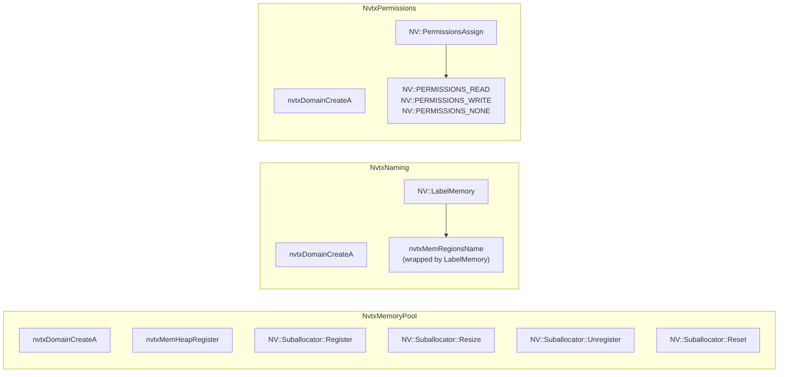

<!-- source: DeepWiki mcp.deepwiki.com · repo NVIDIA/compute-sanitizer-samples · page 4 NVTX API Samples · fetched 2026-10-26 -->

# NVTX API Samples

<details>
<summary>Relevant source files</summary>

The following files were used as context for generating this wiki page:

- [.gitmodules](.gitmodules)
- [NvtxMemoryPool/NvtxMemoryPool.cu](NvtxMemoryPool/NvtxMemoryPool.cu)
- [NvtxNaming/NvtxNaming.cu](NvtxNaming/NvtxNaming.cu)
- [NvtxPermissions/NvtxPermissions.cu](NvtxPermissions/NvtxPermissions.cu)

</details>


This page introduces the three NVTX memory extension samples included in the repository. These samples demonstrate how to use the NVTX memory API to annotate GPU memory allocations with structured metadata — specifically heap boundaries, human-readable labels, and access permission flags — so that `compute-sanitizer` can use that information to report more precise diagnostics.

This page covers only the high-level structure and the NVTX submodule dependency. For detailed documentation of each sample, see:
- [NvtxMemoryPool](#4.1)
- [NvtxNaming](#4.2)
- [NvtxPermissions](#4.3)

For samples that demonstrate the built-in `compute-sanitizer` tools (memcheck, initcheck, racecheck, synccheck) without NVTX, see [compute-sanitizer Tool Demos](#3).

---

## Overview

The NVTX API samples are standalone CUDA executables. Unlike the [Sanitizer Injection API Samples](#2), they do not produce shared libraries and are not injected into other programs. They run directly under `compute-sanitizer` and call NVTX memory extension functions to annotate their own allocations before deliberately triggering detectable violations.

All three samples share the same structural pattern:

**Structural pattern: NVTX API samples**

```mermaid
flowchart TD
    A["main()"] --> B["nvtxDomainCreateA(\"my-domain\")"]
    B --> C["cudaMalloc / cudaFree"]
    C --> D["NVTX memory annotation\n(register, name, or assign permissions)"]
    D --> E["Kernel launch\n(deliberate violation or success case)"]
    E --> F["cudaDeviceSynchronize()"]
    F --> G["compute-sanitizer reports violation\nwith NVTX-annotated context"]
```

Sources: `NvtxMemoryPool/NvtxMemoryPool.cu`, `NvtxNaming/NvtxNaming.cu`, `NvtxPermissions/NvtxPermissions.cu`

---

## NVTX Git Submodule

The NVTX library is included as a git submodule at the root of the repository. It provides the header-only NVTX memory extension API.

| Field | Value |
|---|---|
| Submodule path | `NVTX/` |
| Remote URL | `https://github.com/NVIDIA/NVTX` |
| Branch | `dev-mem-api` |

The `dev-mem-api` branch is a non-default branch that contains experimental memory extension headers, specifically `nvtx3/nvToolsExtMem.h` and `nvtx3/nvToolsExtMemCudaRt.h`, which are used by the samples.

Sources: [.gitmodules:1-4](), [NvtxPermissions/NvtxPermissions.cu:30-31]()

---

## The Three Samples at a Glance

| Sample | Source File | Key NVTX Concept | Kernel | Violation Type |
|---|---|---|---|---|
| `NvtxMemoryPool` | `NvtxMemoryPool/NvtxMemoryPool.cu` | Heap registration and suballocation lifecycle | `Iota` | Out-of-bounds, access after free, access after reset |
| `NvtxNaming` | `NvtxNaming/NvtxNaming.cu` | Named memory regions | *(none)* | Memory leak with named allocation |
| `NvtxPermissions` | `NvtxPermissions/NvtxPermissions.cu` | Per-region read/write/atomic permissions | `IncrementTwice` | Invalid read, write, or atomic on permission-restricted region |

Sources: `NvtxMemoryPool/NvtxMemoryPool.cu`, `NvtxNaming/NvtxNaming.cu`, `NvtxPermissions/NvtxPermissions.cu`

---

## Relationship Between Samples and NVTX API Surface

Each sample targets a distinct portion of the NVTX memory extension API:

**NVTX API surface coverage across samples**



Sources: [NvtxMemoryPool/NvtxMemoryPool.cu:52-89](), [NvtxNaming/NvtxNaming.cu:40-48](), [NvtxPermissions/NvtxPermissions.cu:49-81]()

---

## Common Setup Pattern

Every sample begins by creating an NVTX domain using `nvtxDomainCreateA`. This domain groups all NVTX annotations made by that program and is passed as the first argument to every subsequent NVTX memory API call.

All three samples use the same domain creation call:

[NvtxMemoryPool/NvtxMemoryPool.cu:52-52]()
[NvtxNaming/NvtxNaming.cu:40-40]()
[NvtxPermissions/NvtxPermissions.cu:51-51]()

The CUDA allocation lifecycle (`cudaMalloc`, kernel launch, `cudaDeviceSynchronize`, `cudaFree`) is standard in all samples. The NVTX calls layer semantic information on top of existing allocations — they do not replace or modify the CUDA memory management functions.

Sources: `NvtxMemoryPool/NvtxMemoryPool.cu`, `NvtxNaming/NvtxNaming.cu`, `NvtxPermissions/NvtxPermissions.cu`

---

## How compute-sanitizer Uses the Annotations

Without NVTX annotations, `compute-sanitizer` can detect out-of-bounds accesses, leaks, and permission violations, but its diagnostic messages reference only raw addresses. When NVTX memory annotations are present:

- **Heap/suballocation boundaries** (from `NvtxMemoryPool`) allow `compute-sanitizer` to report accesses against named suballocated regions rather than the underlying raw `cudaMalloc` buffer.
- **Named regions** (from `NvtxNaming`) cause leak-check and initcheck reports to display the user-defined label (e.g. `"My allocation"`) instead of an anonymous address.
- **Permission flags** (from `NvtxPermissions`) allow `compute-sanitizer` to report read/write/atomic violations on regions that are logically restricted even when the underlying GPU memory is otherwise accessible.

The samples intentionally include both valid usage and violation scenarios so that the difference in `compute-sanitizer` output is observable. For example, `NvtxMemoryPool` launches `Iota` successfully with 63 threads before launching it with 64 threads to trigger the out-of-bounds violation [NvtxMemoryPool/NvtxMemoryPool.cu:64-70]().

Sources: [NvtxMemoryPool/NvtxMemoryPool.cu:56-86](), [NvtxNaming/NvtxNaming.cu:43-48](), [NvtxPermissions/NvtxPermissions.cu:57-79]()

---

