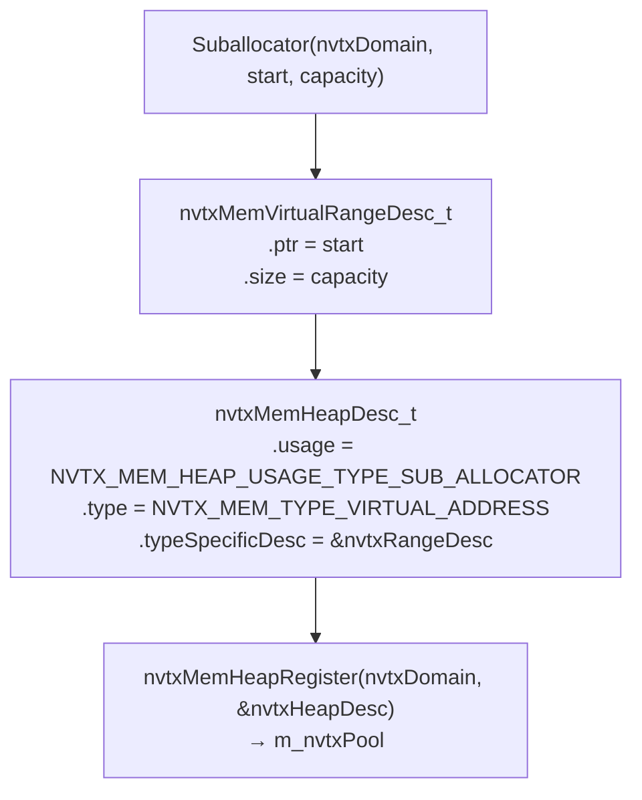

<!-- source: DeepWiki mcp.deepwiki.com · repo NVIDIA/compute-sanitizer-samples · page 4.1 NvtxMemoryPool · fetched 2026-10-26 -->

# NvtxMemoryPool

<details>
<summary>Relevant source files</summary>

The following files were used as context for generating this wiki page:

- [NvtxMemoryPool/Makefile](NvtxMemoryPool/Makefile)
- [NvtxMemoryPool/NvtxMemoryPool.cu](NvtxMemoryPool/NvtxMemoryPool.cu)
- [NvtxMemoryPool/NvtxMemoryPool.h](NvtxMemoryPool/NvtxMemoryPool.h)
- [NvtxMemoryPool/README.md](NvtxMemoryPool/README.md)

</details>


This page covers the `NvtxMemoryPool` sample, which demonstrates how to use the NVTX memory suballocation API to inform compute-sanitizer about the valid bounds of suballocated regions within a larger GPU memory pool. For information about the other NVTX samples that cover region naming and permission flags, see [NvtxNaming](#4.2) and [NvtxPermissions](#4.3).

---

## Overview

A common GPU memory pattern is to allocate one large backing buffer (a "pool") with `cudaMalloc` and then hand out smaller sub-regions from it manually. Because compute-sanitizer only sees the outer `cudaMalloc` allocation, it cannot detect out-of-bounds accesses within sub-regions without additional information.

The NVTX memory API bridges this gap: applications register the pool as a *heap* and register each active sub-region as a *memory region* within that heap. compute-sanitizer (when invoked with `--nvtx=yes`) then treats those sub-regions as the effective allocation bounds and reports violations accordingly.

`NvtxMemoryPool` is a self-contained CUDA executable (not a sanitizer injection library) built from two source files:

| File | Role |
|---|---|
| `NvtxMemoryPool/NvtxMemoryPool.h` | `NV::Suballocator` class — NVTX heap + region lifecycle |
| `NvtxMemoryPool/NvtxMemoryPool.cu` | `main` + `Iota` kernel — exercises the suballocator |

Sources: [NvtxMemoryPool/NvtxMemoryPool.h:1-138](), [NvtxMemoryPool/NvtxMemoryPool.cu:1-90]()

---

## The `NV::Suballocator` Class

`NV::Suballocator` ([NvtxMemoryPool/NvtxMemoryPool.h:42-136]()) is the sole abstraction in this sample. It wraps the NVTX heap and region APIs into a C++ RAII interface.

**Constructor parameters:**

| Parameter | Type | Description |
|---|---|---|
| `nvtxDomain` | `nvtxDomainHandle_t` | NVTX domain to associate with this pool |
| `start` | `void*` | Base pointer of the backing GPU allocation |
| `capacity` | `size_t` | Total size of the backing GPU allocation in bytes |

**Private members:**

| Member | Type | Description |
|---|---|---|
| `m_nvtxDomain` | `nvtxDomainHandle_t` | Stored domain handle |
| `m_start` | `void*` | Stored base pointer |
| `m_capacity` | `size_t` | Stored capacity |
| `m_nvtxPool` | `nvtxMemHeapHandle_t` | Handle returned by `nvtxMemHeapRegister` |

### NVTX API Surface

Each public method on `Suballocator` maps to one NVTX memory API call:

| `Suballocator` method | NVTX API called | Descriptor type used |
|---|---|---|
| Constructor | `nvtxMemHeapRegister` | `nvtxMemHeapDesc_t` + `nvtxMemVirtualRangeDesc_t` |
| Destructor | `nvtxMemHeapUnregister` | — |
| `Reset()` | `nvtxMemHeapReset` | — |
| `Register(ptr, size)` | `nvtxMemRegionsRegister` | `nvtxMemRegionsRegisterBatch_t` + `nvtxMemVirtualRangeDesc_t` |
| `Resize(ptr, newSize)` | `nvtxMemRegionsResize` | `nvtxMemRegionsResizeBatch_t` + `nvtxMemVirtualRangeDesc_t` |
| `Unregister(ptr)` | `nvtxMemRegionsUnregister` | `nvtxMemRegionsUnregisterBatch_t` + `nvtxMemRegionRef_t` |

Sources: [NvtxMemoryPool/NvtxMemoryPool.h:44-136]()

### Constructor Detail

The constructor builds two nested descriptors before calling `nvtxMemHeapRegister`:

**Diagram: Suballocator Constructor — descriptor hierarchy**



Sources: [NvtxMemoryPool/NvtxMemoryPool.h:45-68]()

### Region Registration Detail

`Register(ptr, size)` wraps a single virtual-range descriptor inside a batch descriptor, then calls `nvtxMemRegionsRegister`. The batch descriptor links the region to the pool via `heap = m_nvtxPool`:

```mermaid
graph TD
    reg["Register(ptr, size)"]
    vrd["nvtxMemVirtualRangeDesc_t\n.ptr = ptr\n.size = size"]
    batch["nvtxMemRegionsRegisterBatch_t\n.regionType = NVTX_MEM_TYPE_VIRTUAL_ADDRESS\n.heap = m_nvtxPool\n.regionCount = 1\n.regionDescElements = &nvtxRangeDesc"]
    call["nvtxMemRegionsRegister(m_nvtxDomain, &nvtxRegionsDesc)"]

    reg --> vrd
    vrd --> batch
    batch --> call
```

`Resize` and `Unregister` follow the same pattern with their respective batch descriptor types (`nvtxMemRegionsResizeBatch_t`, `nvtxMemRegionsUnregisterBatch_t`). `Unregister` identifies the region by pointer via `nvtxMemRegionRef_t` rather than a size descriptor.

Sources: [NvtxMemoryPool/NvtxMemoryPool.h:80-129]()

---

## The `Iota` Kernel

`Iota` ([NvtxMemoryPool/NvtxMemoryPool.cu:39-44]()) is the kernel used to exercise the suballocated regions. Each thread writes its global linear index as a `uint8_t` to the corresponding slot:

```
thread i  →  v[i] = (uint8_t)i
```

It has no bounds check of its own; the sample relies entirely on compute-sanitizer (informed by NVTX) to detect overflows.

Sources: [NvtxMemoryPool/NvtxMemoryPool.cu:39-44]()

---

## Main Program: Suballocation Lifecycle Scenarios

`main` ([NvtxMemoryPool/NvtxMemoryPool.cu:46-90]()) demonstrates five sequential scenarios against a single 4096-byte pool.

**Key constants:**

| Constant | Value | Meaning |
|---|---|---|
| `PoolSize` | `4096` bytes | Size of the backing `cudaMalloc` allocation |
| `NumThreads` | `63` | Number of threads in the "normal" launch |
| `AllocSize` | `63` bytes | Size of the suballocation (`NumThreads * sizeof(uint8_t)`) |

The suballocation starts at `pool + 16` (i.e., 16 bytes into the backing buffer).

**Diagram: Scenario sequence in `main`**

```mermaid
sequenceDiagram
    participant main
    participant "NV::Suballocator"
    participant "compute-sanitizer"

    main->>"NV::Suballocator": "Suballocator(domain, pool, 4096)"
    Note over "NV::Suballocator": "nvtxMemHeapRegister → m_nvtxPool"

    main->>"NV::Suballocator": "Register(pool+16, 63)"
    Note over "NV::Suballocator": "nvtxMemRegionsRegister"

    main->>"compute-sanitizer": "Iota<<<1, 63>>>(pool+16)  [SUCCESS]"

    main->>"compute-sanitizer": "Iota<<<1, 64>>>(pool+16)  [VIOLATION: thread 63 OOB]"

    main->>"NV::Suballocator": "Resize(pool+16, 64)"
    Note over "NV::Suballocator": "nvtxMemRegionsResize"

    main->>"compute-sanitizer": "Iota<<<1, 64>>>(pool+16)  [SUCCESS]"

    main->>"NV::Suballocator": "Unregister(pool+16)"
    Note over "NV::Suballocator": "nvtxMemRegionsUnregister"

    main->>"compute-sanitizer": "Iota<<<1, 1>>>(pool+16)   [VIOLATION: access after free]"

    main->>"NV::Suballocator": "Register(pool+16, 63)"
    main->>"NV::Suballocator": "Reset()"
    Note over "NV::Suballocator": "nvtxMemHeapReset"

    main->>"compute-sanitizer": "Iota<<<1, 1>>>(pool+16)   [VIOLATION: access after reset]"

    main->>"NV::Suballocator": "~Suballocator()"
    Note over "NV::Suballocator": "nvtxMemHeapUnregister"
```

Sources: [NvtxMemoryPool/NvtxMemoryPool.cu:46-90]()

### Scenario Summary

| Scenario | API state before launch | Launch config | Expected result |
|---|---|---|---|
| 1 — in-bounds | `Register(pool+16, 63)` | `<<<1, 63>>>` | Success |
| 2 — overflow | same | `<<<1, 64>>>` | **Violation**: thread 63 writes byte at `pool+79`, which is outside the 63-byte region |
| 3 — after resize | `Resize(pool+16, 64)` | `<<<1, 64>>>` | Success |
| 4 — after unregister | `Unregister(pool+16)` | `<<<1, 1>>>` | **Violation**: write to `pool+16`, no active region |
| 5 — after reset | `Register(pool+16, 63)` then `Reset()` | `<<<1, 1>>>` | **Violation**: `Reset()` clears all regions |

Sources: [NvtxMemoryPool/NvtxMemoryPool.cu:56-86](), [NvtxMemoryPool/README.md:1-32]()

---

## NVTX Domain

The sample creates a named NVTX domain with `nvtxDomainCreateA("my-domain")` before constructing the `Suballocator`. All heap and region registrations flow through this domain handle. Passing the domain handle to `Suballocator` ties all NVTX operations to `"my-domain"`.

Sources: [NvtxMemoryPool/NvtxMemoryPool.cu:52-58]()

---

## Expected compute-sanitizer Output

Running the binary under compute-sanitizer with the flags shown below produces exactly 3 errors — one per violation scenario (scenarios 2, 4, and 5):

```
$ compute-sanitizer --nvtx=yes --destroy-on-device-error=kernel --show-backtrace=no ./NvtxMemoryPool
```

| Error | Scenario | Violating address | Thread |
|---|---|---|---|
| Invalid write (1 byte) | Overflow | `pool+0x4f` (byte 79 of pool) | thread (63,0,0) |
| Invalid write (1 byte) | After unregister | `pool+0x10` (byte 16 of pool) | thread (0,0,0) |
| Invalid write (1 byte) | After reset | `pool+0x10` (byte 16 of pool) | thread (0,0,0) |

The flag `--destroy-on-device-error=kernel` prevents the violation from propagating to subsequent memory operations within the same kernel launch — each violating kernel is terminated after its first detected error.

Sources: [NvtxMemoryPool/README.md:11-31]()

---

## Build System

The `Makefile` ([NvtxMemoryPool/Makefile:1-59]()) produces a single binary, `NvtxMemoryPool`, compiled with `nvcc`.

**Key Makefile variables:**

| Variable | Default | Purpose |
|---|---|---|
| `CUDA_PATH` | `/usr/local/cuda` | Path to the CUDA Toolkit |
| `NVTX_PATH` | `../NVTX/c` | Path to the NVTX git submodule |
| `HOST_COMPILER` | `g++` | Host C++ compiler passed to `nvcc -ccbin` |

**Include paths** (`INCLUDE_FLAGS`):
- `$(CUDA_PATH)/include` — CUDA runtime headers
- `$(NVTX_PATH)/include` — NVTX headers (provides `nvtx3/nvToolsExtMem.h`)

The build compiles `NvtxMemoryPool.cu` to `NvtxMemoryPool.o`, then links it to produce the `NvtxMemoryPool` executable. Header dependency tracking is done via `-MMD` and the generated `NvtxMemoryPool.d` file.

Sources: [NvtxMemoryPool/Makefile:30-58]()

---

## Code Entity Map

The diagram below maps the high-level concepts to the specific code symbols in the sample.

```mermaid
graph TD
    subgraph "NvtxMemoryPool.h"
        SA["NV::Suballocator (class)"]
        ctor["Suballocator::Suballocator()\n→ nvtxMemHeapRegister"]
        dtor["Suballocator::~Suballocator()\n→ nvtxMemHeapUnregister"]
        reset["Suballocator::Reset()\n→ nvtxMemHeapReset"]
        reg["Suballocator::Register(ptr,size)\n→ nvtxMemRegionsRegister"]
        rsz["Suballocator::Resize(ptr,size)\n→ nvtxMemRegionsResize"]
        ureg["Suballocator::Unregister(ptr)\n→ nvtxMemRegionsUnregister"]
    end

    subgraph "NvtxMemoryPool.cu"
        iota["Iota(__global__)\nuint8_t v[i] = i"]
        main_fn["main()"]
        domain["nvtxDomainCreateA(\"my-domain\")"]
        pool_alloc["cudaMalloc(&pool, 4096)"]
    end

    main_fn --> domain
    main_fn --> pool_alloc
    main_fn --> SA
    SA --> ctor
    SA --> dtor
    SA --> reset
    SA --> reg
    SA --> rsz
    SA --> ureg
    main_fn --> iota
```

Sources: [NvtxMemoryPool/NvtxMemoryPool.h:42-136](), [NvtxMemoryPool/NvtxMemoryPool.cu:39-90]()

---

