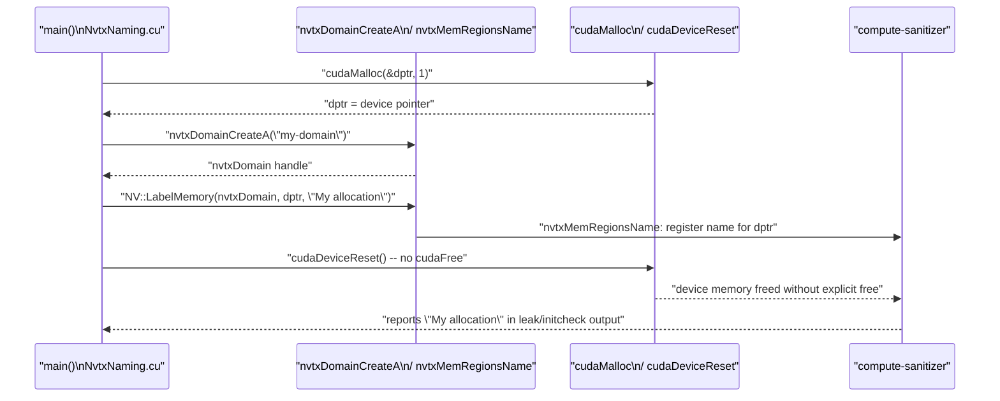

<!-- source: DeepWiki mcp.deepwiki.com · repo NVIDIA/compute-sanitizer-samples · page 4.2 NvtxNaming · fetched 2026-10-26 -->

# NvtxNaming

<details>
<summary>Relevant source files</summary>

The following files were used as context for generating this wiki page:

- [NvtxNaming/Makefile](NvtxNaming/Makefile)
- [NvtxNaming/NvtxNaming.cu](NvtxNaming/NvtxNaming.cu)
- [NvtxNaming/NvtxNaming.h](NvtxNaming/NvtxNaming.h)
- [NvtxNaming/README.md](NvtxNaming/README.md)

</details>


This page covers the `NvtxNaming` sample, which demonstrates how to attach user-defined string labels to GPU memory allocations using the NVTX memory API. Those labels are then surfaced by compute-sanitizer in leak-check and initcheck reports.

For the broader context of NVTX API samples and the NVTX submodule setup, see [NVTX API Samples](#4). For heap registration and suballocator tracking, see [NvtxMemoryPool](#4.1). For permission flags on memory regions, see [NvtxPermissions](#4.3).

---

## Purpose

Without NVTX naming, compute-sanitizer identifies leaked or uninitialized allocations only by their raw device pointer (e.g., `0x7f26c3000000`). With `nvtxMemRegionsName`, each allocation can be associated with a human-readable label that compute-sanitizer includes in its reports.

The `NvtxNaming` sample demonstrates this by:

1. Allocating a 1-byte region with `cudaMalloc`.
2. Labeling it `"My allocation"` via `NV::LabelMemory`.
3. Intentionally leaking it (no `cudaFree` before `cudaDeviceReset`).
4. Showing that compute-sanitizer reports the leak and the unused-memory violation using the label, not just the address.

---

## Key Constructs

| Construct | Location | Role |
|---|---|---|
| `NV::LabelMemory` | `NvtxNaming/NvtxNaming.h:38-53` | Wraps `nvtxMemRegionsName`; assigns an ASCII label to a pointer |
| `nvtxMemRegionNameDesc_t` | NVTX header | Describes a single region-to-name mapping |
| `nvtxMemRegionsNameBatch_t` | NVTX header | Batch descriptor passed to `nvtxMemRegionsName` |
| `nvtxMemRegionsName` | NVTX library | Registers the names with compute-sanitizer |
| `nvtxDomainCreateA` | NVTX library | Creates a domain to scope NVTX annotations |
| `main` | `NvtxNaming/NvtxNaming.cu:38-49` | Drives the full demo: allocate → label → leak |

---

## Code Flow

**Diagram: End-to-end flow from allocation to sanitizer report**



Sources: `NvtxNaming/NvtxNaming.cu`, `NvtxNaming/NvtxNaming.h`, `NvtxNaming/README.md`

---

## `NV::LabelMemory` Implementation

`NV::LabelMemory` [NvtxNaming/NvtxNaming.h:38-53]() is a thin inline wrapper. It fills two NVTX structures and calls the underlying API in a single batch of one region.

**Diagram: Struct population inside `NV::LabelMemory`**

```mermaid
graph TD
    LM["NV::LabelMemory(nvtxDomain, ptr, name)"]

    subgraph desc["nvtxMemRegionNameDesc_t  nvtxLabelDesc"]
        F1["regionRefType =\nNVTX_MEM_REGION_REF_TYPE_POINTER"]
        F2["nameType =\nNVTX_MESSAGE_TYPE_ASCII"]
        F3["region.pointer = ptr"]
        F4["name.ascii = name"]
    end

    subgraph batch["nvtxMemRegionsNameBatch_t  nvtxRegionsDesc"]
        B1["extCompatID = NVTX_EXT_COMPATID_MEM"]
        B2["structSize = sizeof(nvtxRegionsDesc)"]
        B3["regionCount = 1"]
        B4["regionElementSize = sizeof(nvtxLabelDesc)"]
        B5["regionElements = &nvtxLabelDesc"]
    end

    call["nvtxMemRegionsName(nvtxDomain, &nvtxRegionsDesc)"]

    LM --> desc
    LM --> batch
    batch --> call
    desc --> batch
```

Sources: `NvtxNaming/NvtxNaming.h:38-53`

The two key fields in `nvtxMemRegionNameDesc_t` are:

| Field | Value used | Meaning |
|---|---|---|
| `regionRefType` | `NVTX_MEM_REGION_REF_TYPE_POINTER` | Identify the region by its raw pointer |
| `nameType` | `NVTX_MESSAGE_TYPE_ASCII` | Label is a plain C string |
| `region.pointer` | `ptr` | The device pointer being labeled |
| `name.ascii` | `name` | The human-readable label string |

---

## `main` Walkthrough

[NvtxNaming/NvtxNaming.cu:38-49]()

```
1. nvtxDomainCreateA("my-domain")       -- create NVTX domain
2. cudaMalloc(&dptr, 1)                 -- allocate 1 byte on device
3. NV::LabelMemory(nvtxDomain, dptr,    -- register label with NVTX/sanitizer
                   "My allocation")
4. cudaDeviceReset()                    -- implicit device free, no cudaFree
```

The intentional omission of `cudaFree` before `cudaDeviceReset` creates two simultaneously detectable conditions:
- A **memory leak** (never explicitly freed).
- **Unused (uninitialized) memory** (never written).

---

## compute-sanitizer Integration

The `--nvtx=yes` flag is required to activate NVTX memory label support in compute-sanitizer. Two tools can consume the label information.

### Leak Check

```
compute-sanitizer --nvtx=yes --leak-check=full \
  --destroy-on-device-error=kernel --show-backtrace=no ./NvtxNaming
```

Expected output ([NvtxNaming/README.md:6-11]()):

```
========= COMPUTE-SANITIZER
========= Leaked 1 bytes at 0x7f26c3000000 called My allocation
=========
========= LEAK SUMMARY: 1 bytes leaked in 1 allocations
========= ERROR SUMMARY: 1 error
```

Without `NV::LabelMemory`, the report would only show the raw address and no `called My allocation` annotation.

### Initcheck (Unused Memory)

```
compute-sanitizer --nvtx=yes --tool=initcheck \
  --track-unused-memory=yes --destroy-on-device-error=kernel \
  --show-backtrace=no ./NvtxNaming
```

Expected output ([NvtxNaming/README.md:13-20]()):

```
========= COMPUTE-SANITIZER
=========  Unused memory in allocation 0x7efc4d000000 called My allocation of size 1
=========     Not written any memory.
=========     100% of allocation were unused.
=========
========= ERROR SUMMARY: 1 error
```

### Flag Summary

| Flag | Purpose |
|---|---|
| `--nvtx=yes` | Enable NVTX annotation consumption |
| `--leak-check=full` | Report all leaked allocations at program end |
| `--tool=initcheck` | Switch to initcheck mode |
| `--track-unused-memory=yes` | Report regions never written |
| `--destroy-on-device-error=kernel` | Isolate device errors to a single kernel |
| `--show-backtrace=no` | Suppress stack traces for cleaner output |

Sources: `NvtxNaming/README.md`

---

## Build System

[NvtxNaming/Makefile:1-58]()

The sample produces a single binary `NvtxNaming` compiled from `NvtxNaming.cu` using `nvcc`.

| Variable | Default | Purpose |
|---|---|---|
| `CUDA_PATH` | `/usr/local/cuda` | CUDA Toolkit root |
| `NVTX_PATH` | `../NVTX/c` | NVTX git submodule root |
| `HOST_COMPILER` | `g++` | C++ host compiler |
| `INCLUDE_FLAGS` | `-I$(CUDA_PATH)/include -I$(NVTX_PATH)/include` | Header search paths |
| `COMPILE_FLAGS` | `-MMD` | Enable dependency tracking |

Build steps:

```
make          # produces ./NvtxNaming
make clean    # removes NvtxNaming, NvtxNaming.o, NvtxNaming.d
```

The `-MMD` flag causes `nvcc` to emit `NvtxNaming.d`, which is included at the bottom of the Makefile [NvtxNaming/Makefile:58]() so that changes to `NvtxNaming.h` or NVTX headers trigger a rebuild automatically.

Sources: `NvtxNaming/Makefile`

---

