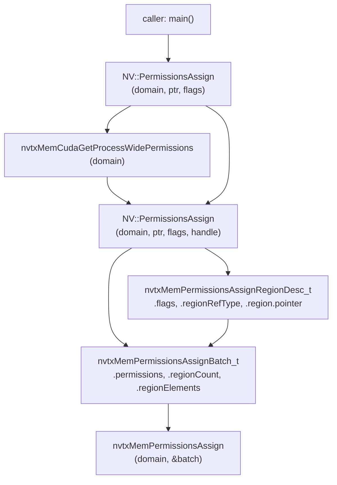
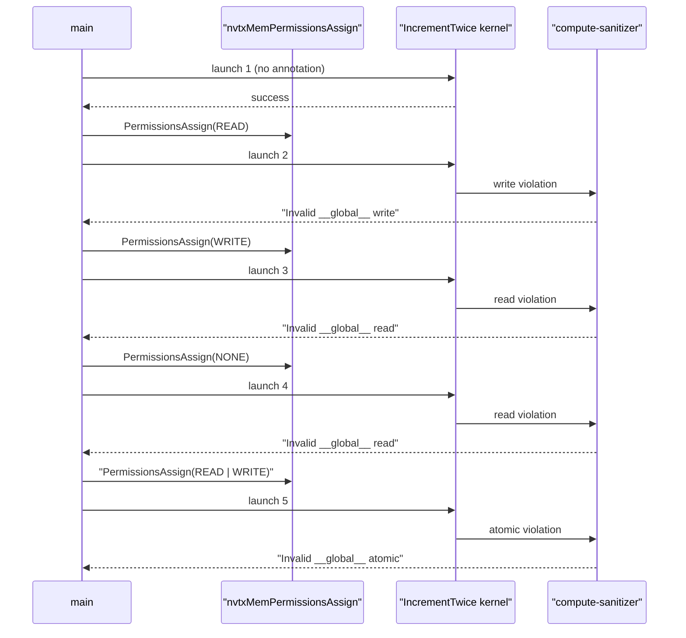

<!-- source: DeepWiki mcp.deepwiki.com · repo NVIDIA/compute-sanitizer-samples · page 4.3 NvtxPermissions · fetched 2026-10-26 -->

# NvtxPermissions

<details>
<summary>Relevant source files</summary>

The following files were used as context for generating this wiki page:

- [NvtxPermissions/Makefile](NvtxPermissions/Makefile)
- [NvtxPermissions/NvtxPermissions.cu](NvtxPermissions/NvtxPermissions.cu)
- [NvtxPermissions/NvtxPermissions.h](NvtxPermissions/NvtxPermissions.h)
- [NvtxPermissions/README.md](NvtxPermissions/README.md)

</details>


This page covers the `NvtxPermissions` sample, which demonstrates how to annotate GPU memory regions with access permission flags using the NVTX Memory Permissions API, and how compute-sanitizer detects violations of those flags at runtime.

For background on the NVTX git submodule and the other NVTX samples in this repo, see the NVTX API Samples overview ([4](#4)), NvtxMemoryPool ([4.1](#4.1)), and NvtxNaming ([4.2](#4.2)).

---

## Overview

The sample uses two NVTX headers — `nvToolsExtMem.h` and `nvToolsExtMemCudaRt.h` — to declare memory access permissions on a `cudaMalloc`-ed region. It then launches the same kernel five times under different permission configurations, each time demonstrating a different class of access violation that compute-sanitizer will detect.

The sample produces a single binary, `NvtxPermissions`, which is run under `compute-sanitizer` with `--nvtx=yes` to activate NVTX-annotation-aware checking.

---

## Key Code Entities

| Symbol | Location | Role |
|---|---|---|
| `NV::Permissions` | `NvtxPermissions.h:41-48` | Enum wrapping NVTX permission flag constants |
| `NV::PermissionsAssign` | `NvtxPermissions.h:50-73` | Helper that registers a permission region via NVTX |
| `IncrementTwice` | `NvtxPermissions.cu:42-47` | Kernel performing a load, a store, and an atomic on a single pointer |
| `nvtxMemPermissionsAssign` | NVTX library | Core NVTX API call that commits the permission annotation |
| `nvtxMemCudaGetProcessWidePermissions` | NVTX library | Returns the process-wide permissions handle for a given domain |

---

## The `NV::Permissions` Enum

Defined in [NvtxPermissions/NvtxPermissions.h:41-48](), the `NV::Permissions` enum is a thin wrapper over the raw NVTX permission flag constants:

| Enum Value | Underlying Constant | Meaning |
|---|---|---|
| `PERMISSIONS_NONE` | `NVTX_MEM_PERMISSIONS_REGION_FLAGS_NONE` | No access allowed |
| `PERMISSIONS_READ` | `NVTX_MEM_PERMISSIONS_REGION_FLAGS_READ` | Read access allowed |
| `PERMISSIONS_WRITE` | `NVTX_MEM_PERMISSIONS_REGION_FLAGS_WRITE` | Write access allowed |
| `PERMISSIONS_ATOMIC` | `NVTX_MEM_PERMISSIONS_REGION_FLAGS_ATOMIC` | Atomic access allowed |
| `PERMISSIONS_RESET` | `NVTX_MEM_PERMISSIONS_REGION_FLAGS_RESET` | Clears all permission annotations for the region |

Flags are combined with bitwise OR. For example, `NV::PERMISSIONS_READ | NV::PERMISSIONS_WRITE` allows reads and writes but not atomics.

---

## `NV::PermissionsAssign`

[NvtxPermissions/NvtxPermissions.h:50-73]()

Two overloads are provided.

**Two-argument overload** (pointer + flags):
1. Calls `nvtxMemCudaGetProcessWidePermissions(nvtxDomain)` to obtain the process-wide `nvtxMemPermissionsHandle_t`.
2. Delegates to the four-argument overload.

**Four-argument overload** (pointer + flags + explicit handle):
1. Fills a `nvtxMemPermissionsAssignRegionDesc_t` struct, setting `flags`, `regionRefType = NVTX_MEM_REGION_REF_TYPE_POINTER`, and `region.pointer = ptr`.
2. Fills a `nvtxMemPermissionsAssignBatch_t` struct referencing the region descriptor.
3. Calls `nvtxMemPermissionsAssign(nvtxDomain, &nvtxRegionsDesc)` to register the permission annotation with the NVTX runtime.

**`PermissionsAssign` call chain diagram:**



Sources: `NvtxPermissions/NvtxPermissions.h:50-73`

---

## The `IncrementTwice` Kernel

[NvtxPermissions/NvtxPermissions.cu:42-47]()

```
__global__ void IncrementTwice(unsigned int* v)
```

On a single pointer `v`, the kernel performs three distinct memory operations in sequence:

| Operation | Instruction type | Violation if... |
|---|---|---|
| `unsigned int i = *v` | global read (load) | region lacks `PERMISSIONS_READ` |
| `*v = i + 1u` | global write (store) | region lacks `PERMISSIONS_WRITE` |
| `atomicAdd(v, 1u)` | global atomic | region lacks `PERMISSIONS_ATOMIC` |

Because all three operations are on the same pointer, a single permission configuration can trigger multiple violations. The `--destroy-on-device-error=kernel` flag used in the README causes the kernel to be terminated at the first violation, so only the earliest-triggered error is reported per launch.

---

## Test Scenarios

The `main()` function in [NvtxPermissions/NvtxPermissions.cu:49-82]() runs five launches of `IncrementTwice` on the same allocation, changing the permission annotation before each:

| Launch | Permission Flags | Expected Violations |
|---|---|---|
| 1 | *(none assigned)* | None — default behavior, all accesses succeed |
| 2 | `PERMISSIONS_READ` | Write violation (`*v = i + 1u`) |
| 3 | `PERMISSIONS_WRITE` | Read violation (`i = *v`) |
| 4 | `PERMISSIONS_NONE` | Read violation (`i = *v`) — kernel aborts before write/atomic |
| 5 | `PERMISSIONS_READ \| PERMISSIONS_WRITE` | Atomic violation (`atomicAdd`) |

**Scenario flow diagram:**



Sources: `NvtxPermissions/NvtxPermissions.cu:49-82`, `NvtxPermissions/README.md`

---

## Expected compute-sanitizer Output

Running as described in [NvtxPermissions/README.md]():

```
compute-sanitizer --nvtx=yes --destroy-on-device-error=kernel --show-backtrace=no ./NvtxPermissions
```

Produces four errors — one per violating launch:

```
========= Invalid __global__ write of size 4 bytes
=========     at 0x90 in IncrementTwice(unsigned int*)
=========     Address 0x... is not writable
=========
========= Invalid __global__ read of size 4 bytes
=========     at 0x20 in IncrementTwice(unsigned int*)
=========     Address 0x... is not readable
=========
========= Invalid __global__ read of size 4 bytes
=========     at 0x20 in IncrementTwice(unsigned int*)
=========     Address 0x... is not readable
=========
========= Invalid __global__ atomic of size 4 bytes
=========     at 0xa0 in IncrementTwice(unsigned int*)
=========     Address 0x... is not readable/writable with atomic operations
=========
========= ERROR SUMMARY: 4 errors
```

The `--destroy-on-device-error=kernel` flag is important here: without it, a single kernel launch could produce multiple errors from the same violation chain. With it, each violating kernel is terminated at its first offending instruction, resulting in exactly one error per launch.

---

## Build System

[NvtxPermissions/Makefile]()

The Makefile produces a single binary from one `.cu` source file.

| Variable | Default | Purpose |
|---|---|---|
| `CUDA_PATH` | `/usr/local/cuda` | Location of CUDA Toolkit |
| `NVTX_PATH` | `../NVTX/c` | Path to NVTX git submodule |
| `HOST_COMPILER` | `g++` | Host-side C++ compiler |
| `NVCC` | `$(CUDA_PATH)/bin/nvcc` | CUDA compiler driver |

Include flags pull in both `$(CUDA_PATH)/include` and `$(NVTX_PATH)/include`. Unlike the Sanitizer Injection API samples (see [2](#2)), there is no device-side patch fatbin and no `--compile-as-tools-patch` flag — the NVTX API is purely a host-side annotation mechanism.

```
make --quiet
```

produces the `NvtxPermissions` binary. `make clean` removes the binary and intermediate `.o`/`.d` files.

Sources: `NvtxPermissions/Makefile`