# Page: Overview

# Overview

<details>
<summary>Relevant source files</summary>

The following files were used as context for generating this wiki page:

- [.gitignore](.gitignore)
- [.gitmodules](.gitmodules)
- [README.md](README.md)

</details>


This page describes the purpose, structure, and contents of the `compute-sanitizer-samples` repository. It serves as a navigational entry point to the three distinct categories of samples contained within. For implementation details of any specific category, follow the links to their dedicated pages.

## Purpose

The repository provides working reference implementations that demonstrate three distinct APIs related to NVIDIA Compute Sanitizer:

1. **Sanitizer Injection API** — shared libraries loaded by `compute-sanitizer` at runtime to perform custom instrumentation.
2. **compute-sanitizer Tool Demos** — standalone CUDA programs that exercise the built-in `memcheck`, `racecheck`, `synccheck`, and `initcheck` tools.
3. **NVTX Memory API Samples** — CUDA programs that annotate memory using the NVTX library so that `compute-sanitizer` can provide richer diagnostics.

Sources: [README.md:1-7]()

---

## Repository Structure

The top-level layout of the repository groups samples by API category. The NVTX samples carry an external dependency via a Git submodule.

**Diagram: Top-Level Directory and Artifact Mapping**

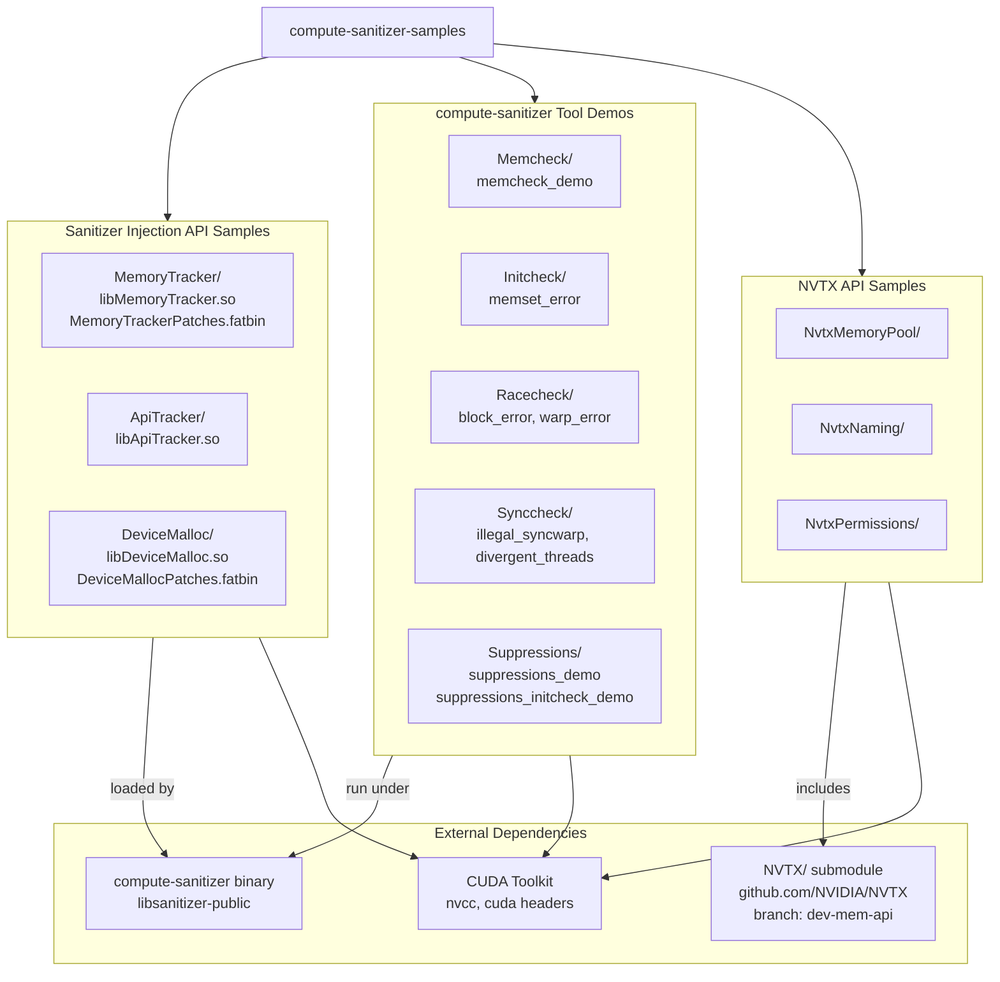

Sources: [README.md:1-7](), [.gitmodules:1-4]()

---

## Sample Categories

### 1. Sanitizer Injection API Samples

These samples produce shared libraries (`.so` files) that are loaded into a target process by `compute-sanitizer` using the `--injection` flag. They use `sanitizerSubscribe` to register callbacks on CUDA runtime events and, in some cases, patch device-side instructions by compiling a `.fatbin` with `--compile-as-tools-patch`.

| Sample | Primary Build Artifact(s) | What It Tracks |
|---|---|---|
| `MemoryTracker` | `libMemoryTracker.so`, `MemoryTrackerPatches.fatbin` | Every global, shared, and local memory access per kernel |
| `ApiTracker` | `libApiTracker.so` | CUDA Runtime API calls and their return codes |
| `DeviceMalloc` | `libDeviceMalloc.so`, `DeviceMallocPatches.fatbin` | Device-side `malloc`, `free`, and `__nv_aligned_device_malloc` calls |

For the shared architecture of these libraries (callback subscription, module patching, lifecycle), see [Sanitizer Injection API Samples](#2). For individual samples, see [MemoryTracker](#2.1), [ApiTracker](#2.2), and [DeviceMalloc](#2.3).

---

### 2. compute-sanitizer Tool Demos

These are standalone CUDA executables that contain intentional errors. They are meant to be run under `compute-sanitizer` to illustrate what each built-in tool detects and how to interpret its output.

| Demo Program | Tool | Error Demonstrated |
|---|---|---|
| `memcheck_demo` | `memcheck` | Misaligned write, out-of-bounds write, memory leak |
| `memset_error` | `initcheck` | Under-sized `cudaMemset` leaves bytes uninitialized |
| `block_error` | `racecheck` | Block-level race condition across unsynchronized threads |
| `warp_error` | `racecheck` | Warp-level race due to missing warp synchronization |
| `illegal_syncwarp` | `synccheck` | `__syncwarp` mask that excludes an active thread |
| `divergent_threads` | `synccheck` | `__syncthreads` inside a divergent conditional |
| `suppressions_demo` | `memcheck` + suppressions | Suppression file workflow with `--save`/`--suppressions` |
| `suppressions_initcheck_demo` | `initcheck` + suppressions | Same suppression workflow for initcheck errors |

For details, see [compute-sanitizer Tool Demos](#3).

---

### 3. NVTX API Samples

These samples demonstrate the NVTX Memory Extension API, which allows a CUDA application to annotate memory regions so that `compute-sanitizer` can attribute diagnostics to user-defined labels, pools, and access permissions.

| Sample | Key API Usage | What It Shows |
|---|---|---|
| `NvtxMemoryPool` | `nvtxMemHeapRegister` | Suballocator heap registration and bounds checking |
| `NvtxNaming` | `nvtxMemRegionsName` | Named allocations in leak-check and initcheck reports |
| `NvtxPermissions` | `nvtxMemRegionsSetPermissions` | Per-region read/write/atomic permission enforcement |

For details, see [NVTX API Samples](#4).

---

## External Dependencies

**Diagram: Dependency Resolution**

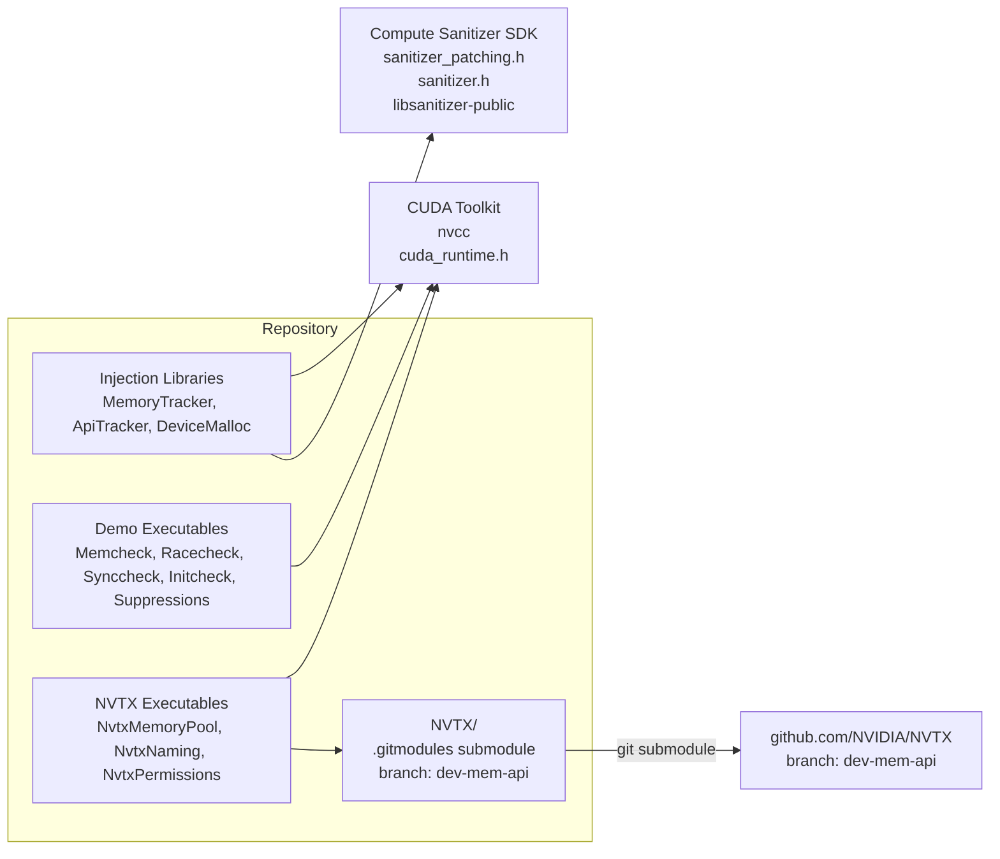

| Dependency | How It Is Consumed | Used By |
|---|---|---|
| CUDA Toolkit (`nvcc`, `cuda_runtime.h`) | System installation, referenced by all Makefiles | All samples |
| Compute Sanitizer SDK (`sanitizer.h`, `sanitizer_patching.h`, `libsanitizer-public`) | Include/link paths in injection library Makefiles | Injection API samples |
| NVTX submodule (`NVTX/`, branch `dev-mem-api`) | Git submodule at repo root, header-only include | NVTX API samples |

The NVTX submodule is declared in [.gitmodules:1-4]() and must be initialized (`git submodule update --init`) before building the NVTX samples.

Sources: [.gitmodules:1-4](), [README.md:1-7]()

---

# Page: Sanitizer Injection API Samples

# Sanitizer Injection API Samples

<details>
<summary>Relevant source files</summary>

The following files were used as context for generating this wiki page:

- [ApiTracker/ApiTracker.cpp](ApiTracker/ApiTracker.cpp)
- [DeviceMalloc/DeviceMalloc.cpp](DeviceMalloc/DeviceMalloc.cpp)
- [DeviceMalloc/DeviceMalloc.h](DeviceMalloc/DeviceMalloc.h)
- [DeviceMalloc/DeviceMallocPatches.cu](DeviceMalloc/DeviceMallocPatches.cu)
- [DeviceMalloc/Makefile](DeviceMalloc/Makefile)
- [MemoryTracker/MemoryTracker.cpp](MemoryTracker/MemoryTracker.cpp)

</details>


This page describes the architecture and conventions shared by all three injection-library samples in the repository: **MemoryTracker**, **ApiTracker**, and **DeviceMalloc**. These samples are built as shared libraries (`.so` files) that are loaded into the target process at runtime by `compute-sanitizer`. The page focuses on the structural patterns common to all three. For the specifics of each sample, see:

- [MemoryTracker](#2.1) — global/shared/local memory access recording
- [ApiTracker](#2.2) — CUDA runtime API call logging
- [DeviceMalloc](#2.3) — device-side `malloc`/`free` monitoring

---

## What an Injection Library Does

When `compute-sanitizer` is invoked with `--injection-path` or using a built-in tool, it loads a shared library into the target process before the application runs. The library registers a callback function with the Sanitizer API. From that point on, `compute-sanitizer` calls that function whenever notable events occur — module loads, kernel launches, and synchronization points — giving the library a chance to instrument GPU code or collect data.

**Diagram: Runtime loading and callback flow**

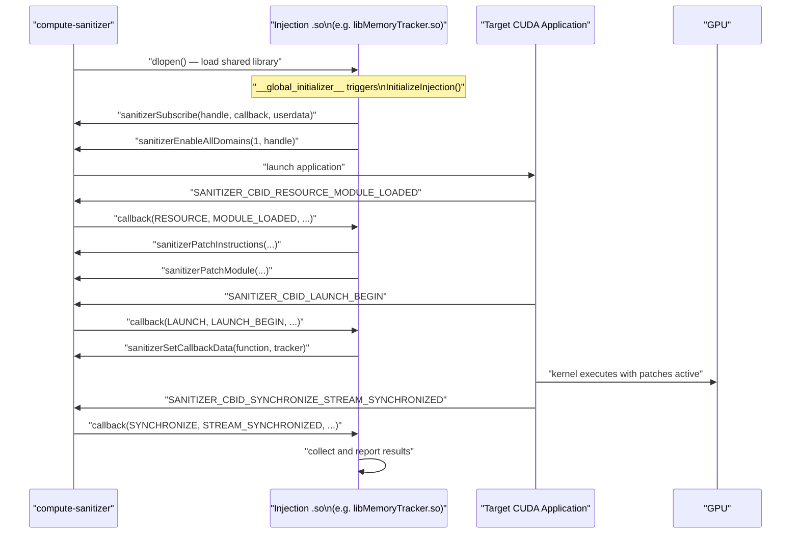

Sources: [MemoryTracker/MemoryTracker.cpp:286-297](), [ApiTracker/ApiTracker.cpp:56-66](), [DeviceMalloc/DeviceMalloc.cpp:196-206]()

---

## The Bootstrap Pattern

Every injection library must register itself with the Sanitizer before the application code runs. All three samples use the same idiom: a file-scope integer variable initialized by calling `InitializeInjection()`.

```
// All three files end with this pattern:
int InitializeInjection()  { ... }
int __global_initializer__ = InitializeInjection();
```

Because C++ initializes file-scope variables with dynamic initializers before `main()` is entered, `InitializeInjection()` runs automatically as soon as the shared library is loaded into the process. The return value is discarded; the variable `__global_initializer__` exists only to trigger the call.

Inside `InitializeInjection()`, each sample calls:

1. `sanitizerSubscribe(&handle, callbackFn, userdata)` — registers the callback and stores a `Sanitizer_SubscriberHandle`
2. Either `sanitizerEnableAllDomains(1, handle)` or `sanitizerEnableDomain(1, handle, domain)` — selects which callback domains to receive

| Sample | Subscribe call | Domain activation |
|---|---|---|
| MemoryTracker | `MemoryTrackerCallback`, `&tracker` | `sanitizerEnableAllDomains` |
| ApiTracker | `ApiTrackerCallback`, `nullptr` | `sanitizerEnableDomain(..., SANITIZER_CB_DOMAIN_RUNTIME_API)` |
| DeviceMalloc | `cbFunction`, `nullptr` | `sanitizerEnableAllDomains` |

Sources: [MemoryTracker/MemoryTracker.cpp:286-297](), [ApiTracker/ApiTracker.cpp:56-66](), [DeviceMalloc/DeviceMalloc.cpp:196-206]()

---

## Callback Domains

The Sanitizer API dispatches events grouped into *domains*. Each callback receives a `Sanitizer_CallbackDomain` enum value and a `Sanitizer_CallbackId` enum value identifying the precise event.

**Diagram: Callback domain and event mapping to handler functions**

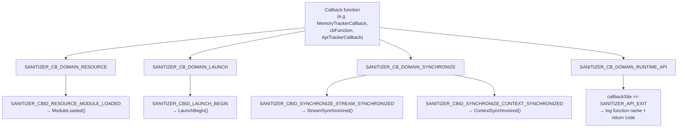

The `SANITIZER_CB_DOMAIN_RUNTIME_API` domain is used exclusively by ApiTracker. The `RESOURCE`, `LAUNCH`, and `SYNCHRONIZE` domains form the core lifecycle used by MemoryTracker and DeviceMalloc.

Sources: [MemoryTracker/MemoryTracker.cpp:226-284](), [ApiTracker/ApiTracker.cpp:35-54](), [DeviceMalloc/DeviceMalloc.cpp:146-194]()

---

## The Module-Patch-Launch-Synchronize Lifecycle

The two samples that instrument device code (MemoryTracker and DeviceMalloc) follow a four-stage lifecycle:

### Stage 1 — Module Loaded

When the Sanitizer reports `SANITIZER_CBID_RESOURCE_MODULE_LOADED`, the library receives a `Sanitizer_ResourceModuleData*` containing the loaded CUDA module. The handler:

1. Calls `sanitizerAddPatchesFromFile("*.fatbin", 0)` to load the pre-compiled patch functions into the runtime
2. Calls `sanitizerPatchInstructions(SANITIZER_INSTRUCTION_*, module, "PatchFunctionName")` once per instruction class to be intercepted
3. Calls `sanitizerPatchModule(module)` to apply all registered patches to the module's PTX/SASS

| Sample | Instruction types patched |
|---|---|
| MemoryTracker | `GLOBAL_MEMORY_ACCESS`, `SHARED_MEMORY_ACCESS`, `LOCAL_MEMORY_ACCESS`, `MEMCPY_ASYNC` |
| DeviceMalloc | `DEVICE_SIDE_MALLOC`, `DEVICE_SIDE_FREE`, `DEVICE_ALIGNED_MALLOC` |

Sources: [MemoryTracker/MemoryTracker.cpp:77-90](), [DeviceMalloc/DeviceMalloc.cpp:116-128]()

### Stage 2 — Launch Begin

When `SANITIZER_CBID_LAUNCH_BEGIN` fires, a `Sanitizer_LaunchData*` provides the `CUcontext`, `CUfunction`, stream handle, and function name. The handler:

1. Allocates a per-launch tracking buffer in device-accessible memory using `sanitizerAlloc` (MemoryTracker) or `sanitizerAllocHost` (DeviceMalloc)
2. Initializes the buffer and copies it to the device
3. Calls `sanitizerSetCallbackData(function, tracker)` (MemoryTracker) or `sanitizerSetLaunchCallbackData(hLaunch, function, stream, tracker)` (DeviceMalloc) — this makes the tracker pointer available to device-side patch functions as their `userdata` argument

Sources: [MemoryTracker/MemoryTracker.cpp:105-133](), [DeviceMalloc/DeviceMalloc.cpp:130-144]()

### Stage 3 — Kernel Execution

While the kernel runs, every patched instruction calls the corresponding device-side patch function (compiled into the `.fatbin`). The patch function receives `userdata` (the tracker pointer), records data atomically, and returns `SANITIZER_PATCH_SUCCESS`.

### Stage 4 — Synchronization

On `SANITIZER_CBID_SYNCHRONIZE_STREAM_SYNCHRONIZED` or `SANITIZER_CBID_SYNCHRONIZE_CONTEXT_SYNCHRONIZED`, the host copies the accumulated device data back and reports or processes it.

Sources: [MemoryTracker/MemoryTracker.cpp:174-224](), [DeviceMalloc/DeviceMalloc.cpp:60-92]()

---

## Build Artifacts

Each injection sample produces either one or two build artifacts:

| Sample | Host artifact | Device artifact |
|---|---|---|
| MemoryTracker | `libMemoryTracker.so` | `MemoryTrackerPatches.fatbin` |
| ApiTracker | `libApiTracker.so` | *(none — no device patching)* |
| DeviceMalloc | `libDeviceMalloc.so` | `DeviceMallocPatches.fatbin` |

The host library is compiled with `g++` using `-fPIC -shared` and links against `-lsanitizer-public` from `$(SANITIZER_PATH)`. The device fatbin is compiled with `nvcc --fatbin --compile-as-tools-patch` and targets all architectures listed in `GENCODE_FLAGS`. Both artifacts must be present in the same directory at runtime for module patching to succeed.

**Diagram: Build artifact relationships**

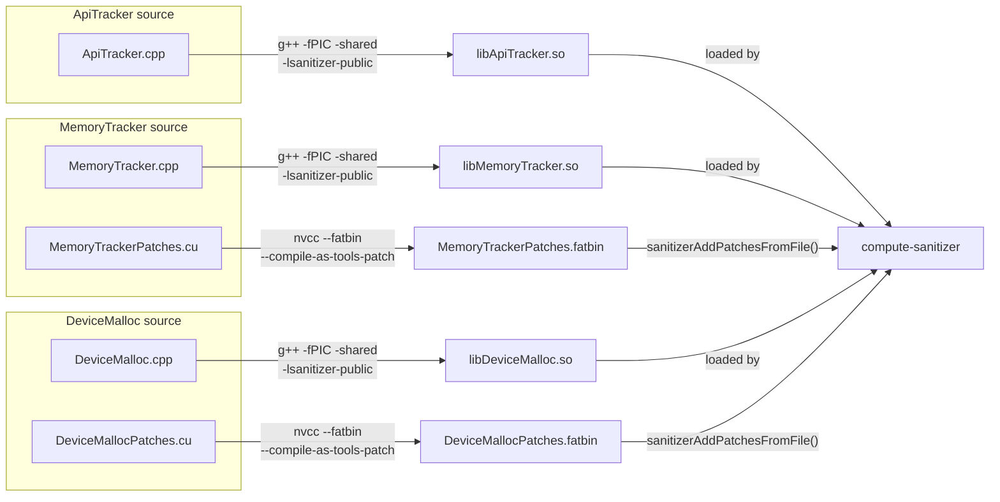

Sources: [DeviceMalloc/Makefile:38-81]()

---

## Summary of Sanitizer API Calls Used

The following table lists every Sanitizer API function used across the injection samples and where each appears:

| API Function | Purpose | Used In |
|---|---|---|
| `sanitizerSubscribe` | Register callback | All three |
| `sanitizerEnableAllDomains` | Enable all callback domains | MemoryTracker, DeviceMalloc |
| `sanitizerEnableDomain` | Enable a single domain | ApiTracker |
| `sanitizerAddPatchesFromFile` | Load `.fatbin` patch functions | MemoryTracker, DeviceMalloc |
| `sanitizerPatchInstructions` | Bind patch function to instruction class | MemoryTracker, DeviceMalloc |
| `sanitizerPatchModule` | Apply all patches to module | MemoryTracker, DeviceMalloc |
| `sanitizerAlloc` | Allocate device-accessible memory | MemoryTracker |
| `sanitizerAllocHost` | Allocate host memory accessible from device | DeviceMalloc |
| `sanitizerMemset` | Zero device memory | MemoryTracker |
| `sanitizerMemcpyHostToDeviceAsync` | Copy tracker to device | MemoryTracker |
| `sanitizerMemcpyDeviceToHost` | Copy results back to host | MemoryTracker |
| `sanitizerSetCallbackData` | Bind userdata to a kernel function | MemoryTracker |
| `sanitizerSetLaunchCallbackData` | Bind userdata to a specific launch | DeviceMalloc |
| `sanitizerFree` | Free sanitizer-managed memory | MemoryTracker |

Sources: [MemoryTracker/MemoryTracker.cpp:77-133](), [MemoryTracker/MemoryTracker.cpp:174-224](), [MemoryTracker/MemoryTracker.cpp:286-297](), [ApiTracker/ApiTracker.cpp:56-66](), [DeviceMalloc/DeviceMalloc.cpp:116-206]()

---

# Page: MemoryTracker

# MemoryTracker

<details>
<summary>Relevant source files</summary>

The following files were used as context for generating this wiki page:

- [MemoryTracker/Makefile](MemoryTracker/Makefile)
- [MemoryTracker/MemoryTracker.cpp](MemoryTracker/MemoryTracker.cpp)
- [MemoryTracker/MemoryTracker.h](MemoryTracker/MemoryTracker.h)
- [MemoryTracker/MemoryTrackerPatches.cu](MemoryTracker/MemoryTrackerPatches.cu)

</details>


## Purpose and Scope

This page provides an end-to-end overview of the **MemoryTracker** sample: what it does, its two build artifacts, the shared data structures, and the complete flow from module instrumentation through kernel execution to host-side memory access reporting.

- For the common injection library bootstrap pattern shared across all samples, see [Sanitizer Injection API Samples](#2).
- For the host-side implementation in detail, see [Host-Side Implementation](#2.1.1).
- For the device-side patch functions in detail, see [Device-Side Patch Functions](#2.1.2).
- For the build system, see [Build System](#2.1.3).

---

## What MemoryTracker Does

MemoryTracker is a Compute Sanitizer injection library that intercepts every memory access — global, shared, local, and `memcpy.async` — made by any GPU kernel running under `compute-sanitizer`. For each access it records:

| Field | Meaning |
|---|---|
| `address` | Memory address accessed |
| `accessSize` | Access width in bytes |
| `flags` | Read / Write / Atomic (via `SANITIZER_MEMORY_DEVICE_FLAG_*`) |
| `threadId` | `threadIdx` of the accessing thread |
| `type` | `Global`, `Shared`, or `Local` |

After each stream or context synchronization, the data is copied back to the host and printed to `stdout` (or a file named by `OUT_FILE_NAME`). The maximum number of recorded accesses per kernel launch defaults to 1024 and can be overridden via `MEM_ACCESS_SIZE`.

---

## Build Artifacts

The sample produces two independent files:

| Artifact | Source | Compiler | Role |
|---|---|---|---|
| `libMemoryTracker.so` | `MemoryTracker.cpp` | `g++` | Host injection library loaded by `compute-sanitizer` |
| `MemoryTrackerPatches.fatbin` | `MemoryTrackerPatches.cu` | `nvcc` | Device patch functions injected into user kernels at runtime |

Both are built by [MemoryTracker/Makefile]().

**Diagram: Build Artifacts and Their Sources**

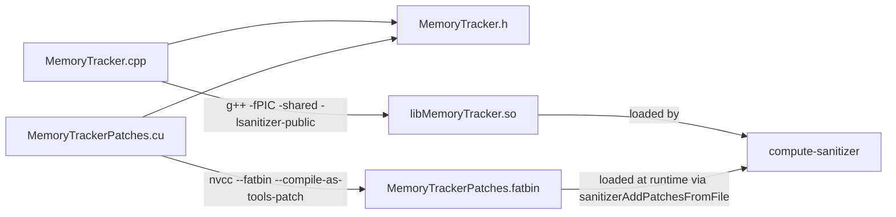

Sources: [MemoryTracker/Makefile:72-81]()

---

## Shared Data Structures

Both the host and device sides share types defined in [MemoryTracker/MemoryTracker.h]().

**`MemoryAccessType`** — an enum classifying which memory space was accessed:

```
Global | Shared | Local
```

**`MemoryAccess`** — one record per intercepted instruction:

| Field | Type | Description |
|---|---|---|
| `address` | `uint64_t` | Target address |
| `accessSize` | `uint32_t` | Bytes accessed |
| `flags` | `uint32_t` | Read/Write/Atomic bitmask |
| `threadId` | `dim3` | `threadIdx` at access time |
| `type` | `MemoryAccessType` | Memory space |

**`MemoryAccessTracker`** — the per-launch control structure written by device code and read back by host code:

| Field | Type | Description |
|---|---|---|
| `currentEntry` | `uint32_t` | Atomic slot counter (incremented by device) |
| `maxEntry` | `uint32_t` | Buffer capacity (overflow guard) |
| `accesses` | `MemoryAccess*` | Device pointer to the record array |

Sources: [MemoryTracker/MemoryTracker.h:34-57]()

---

## End-to-End Flow

**Diagram: MemoryTracker Lifecycle**

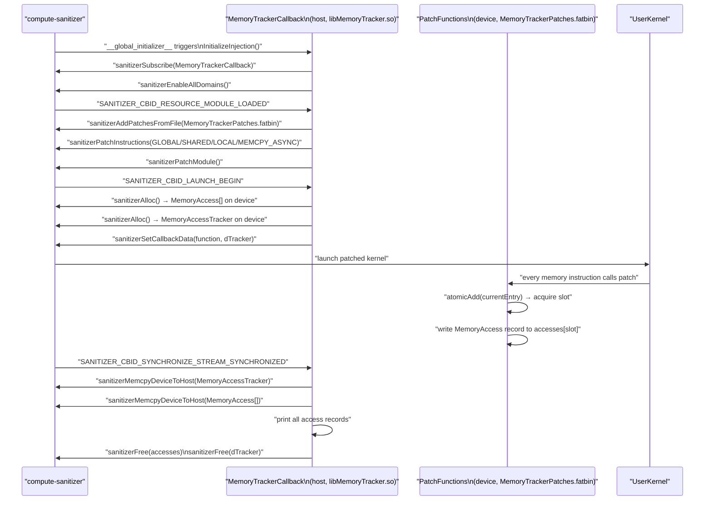

Sources: [MemoryTracker/MemoryTracker.cpp:77-224](), [MemoryTracker/MemoryTrackerPatches.cu:32-101]()

---

## Host-Side Structure Map

The host side organizes per-launch tracker pointers in a two-level map so that data can be recovered on either a stream-level or context-level synchronization event.

**Diagram: CallbackTracker Internal Structure**

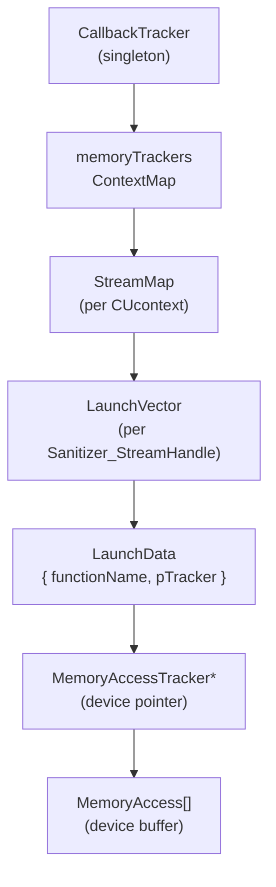

Sources: [MemoryTracker/MemoryTracker.cpp:38-75]()

---

## Patch Function Dispatch

Each patched instruction type calls a named `extern "C"` device function. The sanitizer runtime routes the call to the appropriate function by name, as registered via `sanitizerPatchInstructions`.

| Instruction Type | Sanitizer Constant | Patch Function | Memory Type Recorded |
|---|---|---|---|
| Global load/store | `SANITIZER_INSTRUCTION_GLOBAL_MEMORY_ACCESS` | `MemoryGlobalAccessCallback` | `Global` |
| Shared load/store | `SANITIZER_INSTRUCTION_SHARED_MEMORY_ACCESS` | `MemorySharedAccessCallback` | `Shared` |
| Local load/store | `SANITIZER_INSTRUCTION_LOCAL_MEMORY_ACCESS` | `MemoryLocalAccessCallback` | `Local` |
| `memcpy.async` | `SANITIZER_INSTRUCTION_MEMCPY_ASYNC` | `MemcpyAsyncCallback` | `Global` (src) + `Shared` (dst) |

`MemcpyAsyncCallback` is distinct: it records two accesses per instruction — a read from the global source (`src`) and a write to the shared destination (`dst`). The other three callbacks each delegate directly to `CommonCallback` with their respective `MemoryAccessType`.

Sources: [MemoryTracker/MemoryTracker.cpp:85-89](), [MemoryTracker/MemoryTrackerPatches.cu:59-101]()

---

## Environment Variables

| Variable | Default | Effect |
|---|---|---|
| `MEM_ACCESS_SIZE` | `1024` | Maximum `MemoryAccess` records per kernel launch |
| `OUT_FILE_NAME` | _(none)_ | If set, output is written to this file instead of `stdout` |

Sources: [MemoryTracker/MemoryTracker.cpp:92-103](), [MemoryTracker/MemoryTracker.cpp:55-67]()

---

## Output Format

After synchronization, for each kernel launch the host prints a block of the form:

```
Kernel Launch: <functionName>
  Memory accesses: <count>
  [0] Read access of global memory by thread (tx,ty,tz) at address 0x<addr> (size is N bytes)
  [1] Write access of shared memory by thread (tx,ty,tz) at address 0x<addr> (size is N bytes)
  ...
```

Access type strings (`Read`, `Write`, `Atomic`, `Unknown`) are derived from the `flags` field by `GetMemoryRWString`. Memory space strings (`global`, `shared`, `local`) are derived from `MemoryAccessType` by `GetMemoryTypeString`.

If `currentEntry` exceeds `maxEntry` at readback time, only `maxEntry` records are reported; excess accesses are silently dropped on the device side.

Sources: [MemoryTracker/MemoryTracker.cpp:135-213]()

---

# Page: Host-Side Implementation

# Host-Side Implementation

<details>
<summary>Relevant source files</summary>

The following files were used as context for generating this wiki page:

- [MemoryTracker/MemoryTracker.cpp](MemoryTracker/MemoryTracker.cpp)
- [MemoryTracker/MemoryTracker.h](MemoryTracker/MemoryTracker.h)

</details>


This page covers all host-side logic in [MemoryTracker/MemoryTracker.cpp](), including the `CallbackTracker` singleton, the `MemoryTrackerCallback` dispatcher, module instrumentation, per-launch tracker allocation, synchronization-triggered data collection, and result reporting. For the device-side patch functions that run inside kernels and populate the tracking buffers, see [Device-Side Patch Functions](#2.1.2). For the build system, see [Build System](#2.1.3).

---

## Shared Data Structures

The header [MemoryTracker/MemoryTracker.h]() defines the structures shared between host and device code.

| Type | Kind | Fields | Purpose |
|---|---|---|---|
| `MemoryAccessType` | `enum class` | `Global`, `Shared`, `Local` | Categorizes the memory space of an access |
| `MemoryAccess` | `struct` | `address`, `accessSize`, `flags`, `threadId`, `type` | One recorded memory access event |
| `MemoryAccessTracker` | `struct` | `currentEntry`, `maxEntry`, `accesses` | Device-resident control block; `accesses` points to a `MemoryAccess` array |

`MemoryAccessTracker` is the object that device patch functions write into atomically. The host allocates it before each kernel launch and reads it back after synchronization.

**Data structure diagram:**

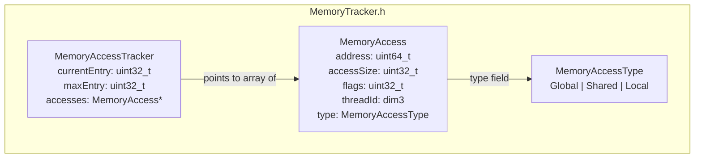

Sources: [MemoryTracker/MemoryTracker.h:34-57]()

---

## Host-Side Type Hierarchy

[MemoryTracker/MemoryTracker.cpp]() defines a layered map structure to associate in-flight kernel launches with their device-side tracker pointers.

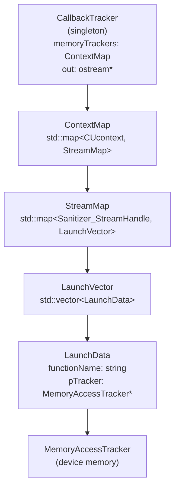

- `CallbackTracker` is the root singleton holding all live tracking state.
- Each context maps to a `StreamMap`; each stream maps to a `LaunchVector`.
- Each element of `LaunchVector` is a `LaunchData`, which pairs the kernel's human-readable name with the raw device pointer to its `MemoryAccessTracker`.

Sources: [MemoryTracker/MemoryTracker.cpp:38-75]()

---

## CallbackTracker Singleton

`CallbackTracker` [MemoryTracker/MemoryTracker.cpp:48-75]() is a simple singleton accessed via `CallbackTracker::GetInstance()`. Its constructor checks the `OUT_FILE_NAME` environment variable:

- If set, output is directed to the named file via `std::ofstream`.
- If unset, output goes to `std::cout`.

The singleton is constructed once on first access and its address is passed as `userdata` to every sanitizer callback.

Sources: [MemoryTracker/MemoryTracker.cpp:48-75]()

---

## Bootstrap: `InitializeInjection` and `__global_initializer__`

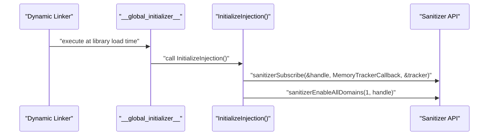

[MemoryTracker/MemoryTracker.cpp:286-297]() defines:

```
int __global_initializer__ = InitializeInjection();
```

This file-scope variable initialization runs when `libMemoryTracker.so` is loaded by `compute-sanitizer`. `InitializeInjection` obtains the `CallbackTracker` singleton, then calls `sanitizerSubscribe` to register `MemoryTrackerCallback` with the singleton as `userdata`, and `sanitizerEnableAllDomains` to activate all callback domains in one call.

Sources: [MemoryTracker/MemoryTracker.cpp:286-297]()

---

## `MemoryTrackerCallback` Dispatcher

`MemoryTrackerCallback` [MemoryTracker/MemoryTracker.cpp:226-284]() is the single callback entry point registered with the sanitizer. It dispatches on two levels: `domain` then `cbid`.

**Dispatch table:**

| `domain` | `cbid` | Handler called |
|---|---|---|
| `SANITIZER_CB_DOMAIN_RESOURCE` | `SANITIZER_CBID_RESOURCE_MODULE_LOADED` | `ModuleLoaded(pModuleData)` |
| `SANITIZER_CB_DOMAIN_LAUNCH` | `SANITIZER_CBID_LAUNCH_BEGIN` | `LaunchBegin(callbackTracker, context, function, functionName, hStream)` |
| `SANITIZER_CB_DOMAIN_SYNCHRONIZE` | `SANITIZER_CBID_SYNCHRONIZE_STREAM_SYNCHRONIZED` | `StreamSynchronized(callbackTracker, context, hStream)` |
| `SANITIZER_CB_DOMAIN_SYNCHRONIZE` | `SANITIZER_CBID_SYNCHRONIZE_CONTEXT_SYNCHRONIZED` | `ContextSynchronized(callbackTracker, context)` |

All other `domain`/`cbid` combinations fall through to `default: break`.

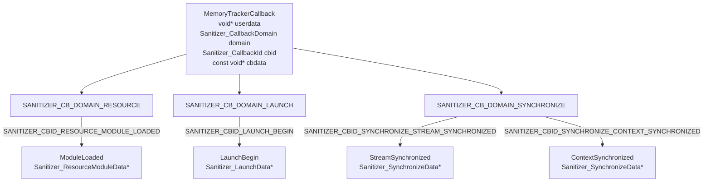

Sources: [MemoryTracker/MemoryTracker.cpp:226-284]()

---

## `ModuleLoaded`: Module Instrumentation

`ModuleLoaded` [MemoryTracker/MemoryTracker.cpp:77-90]() is called every time a CUDA module is loaded. It performs four instrumentation steps:

1. **Load patch code** — `sanitizerAddPatchesFromFile("MemoryTrackerPatches.fatbin", 0)` makes the device-side patch functions available.
2. **Patch global memory accesses** — `sanitizerPatchInstructions(SANITIZER_INSTRUCTION_GLOBAL_MEMORY_ACCESS, module, "MemoryGlobalAccessCallback")`
3. **Patch shared memory accesses** — `sanitizerPatchInstructions(SANITIZER_INSTRUCTION_SHARED_MEMORY_ACCESS, module, "MemorySharedAccessCallback")`
4. **Patch local memory accesses** — `sanitizerPatchInstructions(SANITIZER_INSTRUCTION_LOCAL_MEMORY_ACCESS, module, "MemoryLocalAccessCallback")`
5. **Patch async memcpy** — `sanitizerPatchInstructions(SANITIZER_INSTRUCTION_MEMCPY_ASYNC, module, "MemcpyAsyncCallback")`
6. **Finalize** — `sanitizerPatchModule(module)` commits all patches to the module.

If `sanitizerAddPatchesFromFile` fails (e.g., the `.fatbin` is missing or targets the wrong SM architecture), a diagnostic is printed to `std::cerr` and instrumentation is skipped silently for that module.

Sources: [MemoryTracker/MemoryTracker.cpp:77-90]()

---

## `LaunchBegin`: Per-Kernel Tracker Allocation

`LaunchBegin` [MemoryTracker/MemoryTracker.cpp:105-133]() runs before every kernel launch. Its job is to allocate device-side tracking buffers and associate them with the kernel.

**Steps:**

1. Determine buffer capacity via `GetMemAccessSize()`, which reads the `MEM_ACCESS_SIZE` environment variable (default: 1024 entries) [MemoryTracker/MemoryTracker.cpp:92-103]().
2. Allocate a `MemoryAccess[MemAccessSize]` array in device memory with `sanitizerAlloc`.
3. Zero-initialize the array with `sanitizerMemset(..., stream)`.
4. Build a host-local `MemoryAccessTracker` (`currentEntry=0`, `maxEntry=MemAccessSize`, `accesses=<device ptr>`).
5. Allocate a device-side `MemoryAccessTracker` with `sanitizerAlloc` and copy the host struct to device with `sanitizerMemcpyHostToDeviceAsync(..., stream)`.
6. Call `sanitizerSetCallbackData(function, dTracker)` — this is the mechanism by which the device patch functions receive `dTracker` as their `userdata` argument.
7. Append a `LaunchData{functionName, dTracker}` to `pCallbackTracker->memoryTrackers[context][stream]`.

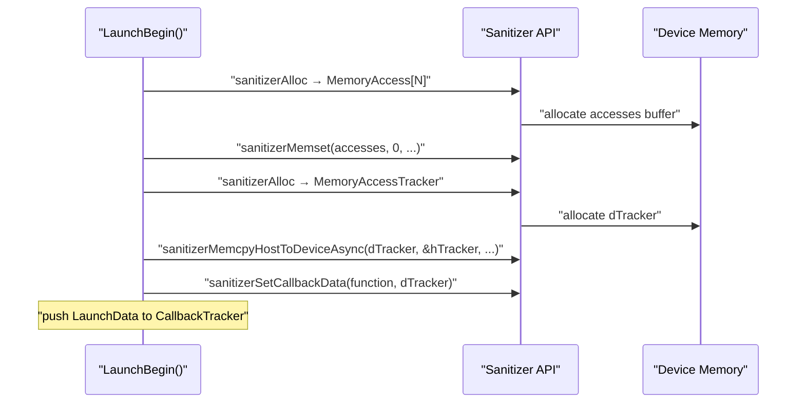

Sources: [MemoryTracker/MemoryTracker.cpp:105-133]()

---

## `StreamSynchronized` and `ContextSynchronized`: Data Collection

Once a stream or context synchronization point is reached, the device has finished executing all queued kernels and the buffers can be safely read back.

### `StreamSynchronized` [MemoryTracker/MemoryTracker.cpp:174-214]()

Iterates over all `LaunchData` entries recorded for `(context, stream)`:

1. Prints the kernel's `functionName`.
2. Calls `sanitizerMemcpyDeviceToHost(&hTracker, tracker.pTracker, ...)` to retrieve the `MemoryAccessTracker` (which contains the final `currentEntry` count).
3. Computes `numEntries = min(currentEntry, maxEntry)` — if the buffer overflowed, only up to `maxEntry` entries are reported.
4. Calls `sanitizerMemcpyDeviceToHost(accesses.data(), hTracker.accesses, ...)` to retrieve the actual `MemoryAccess` records.
5. Prints each access using `GetMemoryRWString` and `GetMemoryTypeString`.
6. Frees device memory with `sanitizerFree(context, hTracker.accesses)` and `sanitizerFree(context, tracker.pTracker)`.
7. Clears the `LaunchVector` for the stream.

### `ContextSynchronized` [MemoryTracker/MemoryTracker.cpp:216-224]()

A thin wrapper that iterates over all streams in `memoryTrackers[context]` and calls `StreamSynchronized` for each one.

Sources: [MemoryTracker/MemoryTracker.cpp:174-224]()

---

## Output Reporting Helpers

Two static helper functions format access records for printing:

| Function | Input | Returns |
|---|---|---|
| `GetMemoryRWString` | `uint32_t flags` | `"Read"`, `"Write"`, `"Atomic"`, or `"Unknown"` based on `SANITIZER_MEMORY_DEVICE_FLAG_READ` / `SANITIZER_MEMORY_DEVICE_FLAG_WRITE` bits |
| `GetMemoryTypeString` | `MemoryAccessType type` | `"local"`, `"shared"`, or `"global"` |

Example output line (produced in `StreamSynchronized`):

```
  [0] Read access of global memory by thread (0,0,0) at address 0x7f... (size is 4 bytes)
```

Sources: [MemoryTracker/MemoryTracker.cpp:135-172](), [MemoryTracker/MemoryTracker.cpp:196-207]()

---

## End-to-End Lifecycle Summary

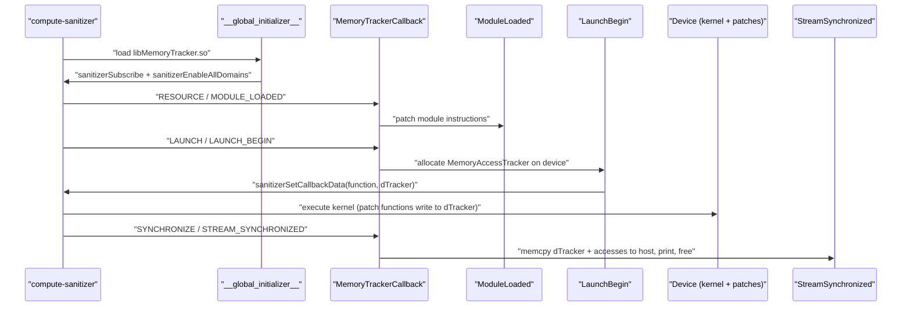

Sources: [MemoryTracker/MemoryTracker.cpp:77-297]()

---

## Sanitizer API Calls Reference

The following table lists every Sanitizer API function used in `MemoryTracker.cpp` and where it is called.

| API Function | Call Site | Purpose |
|---|---|---|
| `sanitizerSubscribe` | `InitializeInjection` | Register `MemoryTrackerCallback` with the sanitizer runtime |
| `sanitizerEnableAllDomains` | `InitializeInjection` | Enable all callback domains for the subscriber |
| `sanitizerAddPatchesFromFile` | `ModuleLoaded` | Load device patch functions from `MemoryTrackerPatches.fatbin` |
| `sanitizerPatchInstructions` | `ModuleLoaded` (×4) | Redirect each instruction class to a named patch function |
| `sanitizerPatchModule` | `ModuleLoaded` | Commit all pending patches to the module |
| `sanitizerAlloc` | `LaunchBegin` (×2) | Allocate device-accessible memory for tracker structs |
| `sanitizerMemset` | `LaunchBegin` | Zero-initialize the `MemoryAccess` array on device |
| `sanitizerMemcpyHostToDeviceAsync` | `LaunchBegin` | Copy initialized `MemoryAccessTracker` to device |
| `sanitizerSetCallbackData` | `LaunchBegin` | Bind `dTracker` as userdata for patch function calls |
| `sanitizerMemcpyDeviceToHost` | `StreamSynchronized` (×2) | Read back tracker header and access records |
| `sanitizerFree` | `StreamSynchronized` (×2) | Release device-side tracker and access array |

Sources: [MemoryTracker/MemoryTracker.cpp:77-297]()

---

# Page: Device-Side Patch Functions

# Device-Side Patch Functions

<details>
<summary>Relevant source files</summary>

The following files were used as context for generating this wiki page:

- [MemoryTracker/MemoryTracker.h](MemoryTracker/MemoryTracker.h)
- [MemoryTracker/MemoryTrackerPatches.cu](MemoryTracker/MemoryTrackerPatches.cu)

</details>


This page covers the device-side code in [MemoryTracker/MemoryTrackerPatches.cu](), which implements the GPU-resident patch functions injected into instrumented kernels by the MemoryTracker sample. These functions run on the device at the point of each memory instruction and populate a shared tracking buffer.

For the host-side code that allocates the tracking buffer and reads results after synchronization, see [Host-Side Implementation](#2.1.1). For the build system that compiles this file into `MemoryTrackerPatches.fatbin`, see [Build System](#2.1.3). For the overall MemoryTracker architecture, see [MemoryTracker](#2.1).

---

## Shared Data Structures

Both the host and device sides share a common header, [MemoryTracker/MemoryTracker.h](), which defines the structures exchanged through the `userdata` pointer.

| Type | Role |
|---|---|
| `MemoryAccessType` | Enum distinguishing `Global`, `Shared`, and `Local` access categories |
| `MemoryAccess` | One record per intercepted memory instruction |
| `MemoryAccessTracker` | Root tracking object passed as `userdata` to each patch |

### `MemoryAccess` Fields

[MemoryTracker/MemoryTracker.h:43-49]()

| Field | Type | Description |
|---|---|---|
| `address` | `uint64_t` | Address of the memory operand |
| `accessSize` | `uint32_t` | Size of the access in bytes |
| `flags` | `uint32_t` | Sanitizer-provided flags (e.g. `SANITIZER_MEMORY_DEVICE_FLAG_READ` / `_WRITE`) |
| `threadId` | `dim3` | Thread index within the block at the time of access |
| `type` | `MemoryAccessType` | Global / Shared / Local classification |

### `MemoryAccessTracker` Fields

[MemoryTracker/MemoryTracker.h:52-57]()

| Field | Type | Description |
|---|---|---|
| `currentEntry` | `uint32_t` | Atomic counter; next available slot index |
| `maxEntry` | `uint32_t` | Capacity of the `accesses` array |
| `accesses` | `MemoryAccess*` | Device-side array allocated by the host before kernel launch |

Sources: [MemoryTracker/MemoryTracker.h:34-57]()

---

## Function Hierarchy

**Diagram: Patch Function Call Graph**

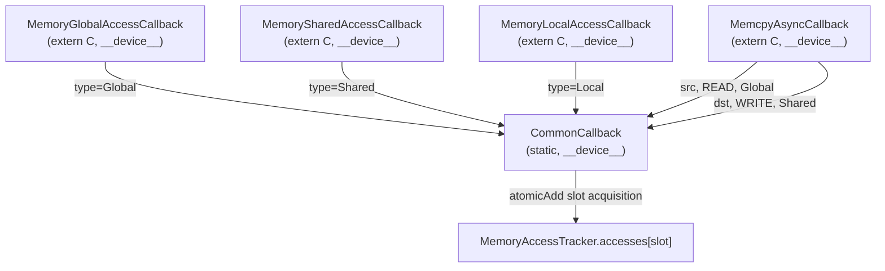

Sources: [MemoryTracker/MemoryTrackerPatches.cu:32-101]()

---

## `CommonCallback` — Internal Device Helper

[MemoryTracker/MemoryTrackerPatches.cu:32-57]()

`CommonCallback` is a `static __device__` function (not exported, not patched itself). It is the single write path into the tracking buffer. All four public patch entry points delegate to it.

**Signature:**
```
SanitizerPatchResult CommonCallback(
    void* userdata,
    uint64_t pc,
    void* ptr,
    uint32_t accessSize,
    uint32_t flags,
    MemoryAccessType type)
```

### Slot Acquisition

[MemoryTracker/MemoryTrackerPatches.cu:43]()

```
uint32_t old = atomicAdd(&(pTracker->currentEntry), 1);
```

`atomicAdd` on `currentEntry` guarantees each thread receives a unique slot index, even when thousands of threads call the patch concurrently. The pre-increment value `old` becomes the thread's exclusive write index into `pTracker->accesses`.

### Buffer Overflow Guard

[MemoryTracker/MemoryTrackerPatches.cu:45-47]()

If `old >= pTracker->maxEntry`, the function returns `SANITIZER_PATCH_SUCCESS` immediately without writing. This is a silent drop: once the buffer is full, additional accesses in that kernel launch are not recorded. The host side can detect overflow by checking whether `currentEntry > maxEntry` after synchronization.

### Record Population

[MemoryTracker/MemoryTrackerPatches.cu:49-54]()

When a valid slot is obtained, the function writes directly into `pTracker->accesses[old]`:

| Field written | Source |
|---|---|
| `address` | `(uint64_t)(uintptr_t)ptr` |
| `accessSize` | `accessSize` parameter |
| `flags` | `flags` parameter |
| `threadId` | Built-in `threadIdx` |
| `type` | `type` parameter (passed by each entry point) |

Sources: [MemoryTracker/MemoryTrackerPatches.cu:32-57]()

---

## Public Patch Entry Points

All public callbacks are declared `extern "C" __device__ __noinline__`. The `extern "C"` linkage ensures the symbol names are unmangled, which is required for the sanitizer runtime to locate them by name during module instrumentation. The `__noinline__` attribute prevents the compiler from inlining these into the instrumented application's code.

**Diagram: Entry Points, Signatures, and Delegation**

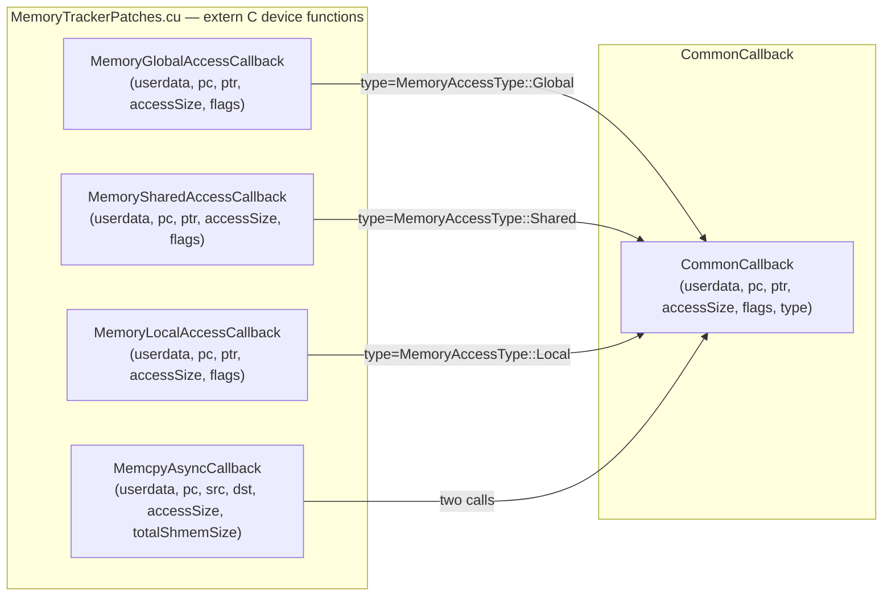

Sources: [MemoryTracker/MemoryTrackerPatches.cu:59-101]()

### `MemoryGlobalAccessCallback`

[MemoryTracker/MemoryTrackerPatches.cu:59-68]()

Intercepts global memory loads and stores. Delegates directly to `CommonCallback` with `MemoryAccessType::Global`.

### `MemorySharedAccessCallback`

[MemoryTracker/MemoryTrackerPatches.cu:70-79]()

Intercepts shared memory loads and stores. Delegates to `CommonCallback` with `MemoryAccessType::Shared`.

### `MemoryLocalAccessCallback`

[MemoryTracker/MemoryTrackerPatches.cu:81-90]()

Intercepts local memory (register spill/fill) loads and stores. Delegates to `CommonCallback` with `MemoryAccessType::Local`.

### `MemcpyAsyncCallback` — Dual-Access Recording

[MemoryTracker/MemoryTrackerPatches.cu:92-101]()

`MemcpyAsyncCallback` handles `cp.async` instructions, which transfer data from global memory directly into shared memory. Its signature differs from the three single-address callbacks:

```
SanitizerPatchResult MemcpyAsyncCallback(
    void* userdata,
    uint64_t pc,
    void* src,      // global source address (may be null)
    uint32_t dst,   // shared memory destination offset
    uint32_t accessSize,
    uint32_t totalShmemSize)
```

Because `cp.async` involves two distinct memory spaces simultaneously, `MemcpyAsyncCallback` calls `CommonCallback` **twice**:

1. **Source (read):** If `src` is non-null, records `src` with `SANITIZER_MEMORY_DEVICE_FLAG_READ` and `MemoryAccessType::Global`.
2. **Destination (write):** Always records `(void*)dst` with `SANITIZER_MEMORY_DEVICE_FLAG_WRITE` and `MemoryAccessType::Shared`.

The `src` null check guards against the case where no global source is involved in the async copy operation.

Sources: [MemoryTracker/MemoryTrackerPatches.cu:92-101]()

---

## Return Value

All patch functions return `SanitizerPatchResult`, which is always `SANITIZER_PATCH_SUCCESS` in this implementation. The sanitizer runtime uses this return value to decide whether to allow or abort the memory operation being patched; `SANITIZER_PATCH_SUCCESS` signals that the original operation should proceed normally.

Sources: [MemoryTracker/MemoryTrackerPatches.cu:32-101]()

---

## Concurrency Model

**Diagram: Concurrent Slot Acquisition**

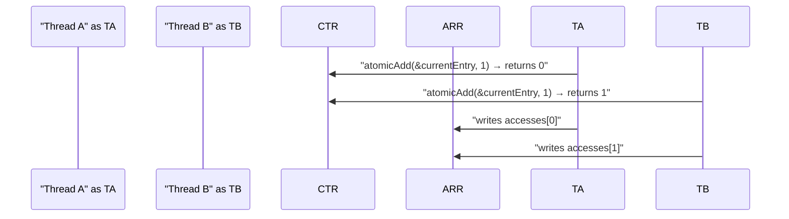

Each thread independently increments `currentEntry` via `atomicAdd` and receives a unique pre-increment value. There is no locking; threads write to non-overlapping slots in `accesses[]`. If `currentEntry` reaches or exceeds `maxEntry` before a thread's `atomicAdd`, that thread skips its write and returns immediately.

Sources: [MemoryTracker/MemoryTrackerPatches.cu:43-47]()

---

# Page: Build System

# Build System

<details>
<summary>Relevant source files</summary>

The following files were used as context for generating this wiki page:

- [MemoryTracker/Makefile](MemoryTracker/Makefile)

</details>


This page describes the `MemoryTracker` Makefile — its two independent build tracks, compiler flags, multi-architecture GPU code generation, and debug options. For details on what each build artifact does at runtime, see the host-side implementation ([2.1.1](#2.1.1)) and the device-side patch functions ([2.1.2](#2.1.2)).

---

## Overview

The `MemoryTracker` build produces exactly two artifacts from two independent source files using two different compilers. Neither artifact depends on the other at build time.

| Artifact | Source | Compiler | Purpose |
|---|---|---|---|
| `libMemoryTracker.so` | `MemoryTracker.cpp` | `g++` | Shared library loaded by `compute-sanitizer` at runtime |
| `MemoryTrackerPatches.fatbin` | `MemoryTrackerPatches.cu` | `nvcc` | Device-side patch code embedded/loaded by the host library |

The `build` target in [MemoryTracker/Makefile:72]() declares both as prerequisites:

```
build: libMemoryTracker.so MemoryTrackerPatches.fatbin
```

**Two-Track Build Flow**

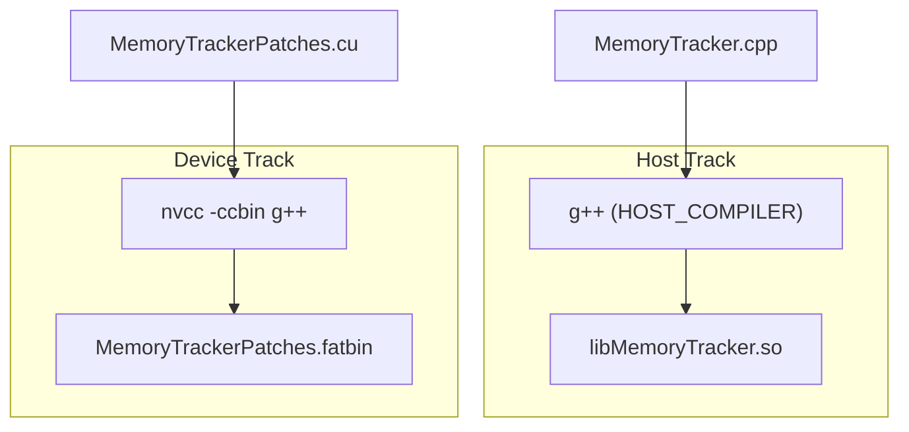

Sources: [MemoryTracker/Makefile:34-35](), [MemoryTracker/Makefile:72-78]()

---

## Toolchain Configuration

[MemoryTracker/Makefile:31-35]()

| Variable | Default Value | Role |
|---|---|---|
| `CUDA_PATH` | `/usr/local/cuda` | Root of CUDA Toolkit installation |
| `SANITIZER_PATH` | `$(CUDA_PATH)/compute-sanitizer` | Compute Sanitizer headers and libraries |
| `HOST_COMPILER` | `g++` | C++ compiler used for the host track |
| `NVCC` | `$(CUDA_PATH)/bin/nvcc -ccbin $(HOST_COMPILER)` | CUDA compiler; delegates host compilation to `g++` |

`NVCC` is configured with `-ccbin $(HOST_COMPILER)`, meaning `nvcc` uses `g++` as its host compiler backend.

---

## Include and Link Flags

### Include Flags

[MemoryTracker/Makefile:37]()

`INCLUDE_FLAGS` adds two directories:

| Flag | Directory | Contents |
|---|---|---|
| `-I$(CUDA_PATH)/include` | CUDA Toolkit headers | `cuda.h`, `cuda_runtime.h`, etc. |
| `-I$(SANITIZER_PATH)/include` | Compute Sanitizer headers | `sanitizer_patching.h`, `sanitizer_callbacks.h`, etc. |

`INCLUDE_FLAGS` is applied to **both** the host and device compile rules.

### Link Flags (Host Track Only)

[MemoryTracker/Makefile:39-40]()

| Flag | Purpose |
|---|---|
| `-L$(SANITIZER_PATH)` | Library search path for the Sanitizer runtime |
| `-fPIC` | Position-independent code, required for shared libraries |
| `-shared` | Produce a shared library (`.so`) |
| `-lsanitizer-public` | Links `libsanitizer-public`, providing the Sanitizer injection API |

These flags are exclusive to the `libMemoryTracker.so` rule. The device track (`MemoryTrackerPatches.fatbin`) does not link against any host libraries.

---

## Device Compilation Flags

[MemoryTracker/Makefile:42-43]()

`NVCC_FLAGS` controls the device-side compilation:

| Flag | Purpose |
|---|---|
| `--fatbin` | Produce a `.fatbin` file rather than an object or executable |
| `--compile-as-tools-patch` | Compile device code as a Sanitizer patch; enables access to `sanitizer_patching.h` intrinsics and the `__sanitizer_builtin_*` builtins required by patch functions |

`--compile-as-tools-patch` is the critical flag that distinguishes patch device code from ordinary CUDA device code. Without it, the patch entry points (`MemoryGlobalAccessCallback`, etc.) cannot use the Sanitizer patching intrinsics.

**Compilation Pipeline for MemoryTrackerPatches.fatbin**

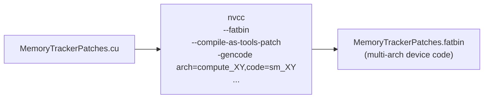

Sources: [MemoryTracker/Makefile:42-43](), [MemoryTracker/Makefile:77-78]()

---

## Multi-Architecture GPU Code Generation

[MemoryTracker/Makefile:52-65]()

`GENCODE_FLAGS` is constructed dynamically based on the host architecture.

### Default SMS Lists

| Architecture | `SMS` list |
|---|---|
| `aarch64` | `53 61 70 72 75 80 86 87 90` |
| x86-64 (all others) | `52 60 70 75 80 86 90` |

`TARGET_ARCH` is detected at build time via `uname -m`.

### Flag Generation

For each SM version in `SMS`, the Makefile emits a `-gencode` flag for real SASS code:

```
-gencode arch=compute_<sm>,code=sm_<sm>
```

After iterating all SM versions, it appends one additional flag using the **highest SM** version, targeting PTX:

```
-gencode arch=compute_<HIGHEST_SM>,code=compute_<HIGHEST_SM>
```

This PTX entry ensures **forward compatibility**: GPUs with SM architectures newer than the highest listed SM can JIT-compile the PTX at runtime.

**GENCODE_FLAGS Construction**

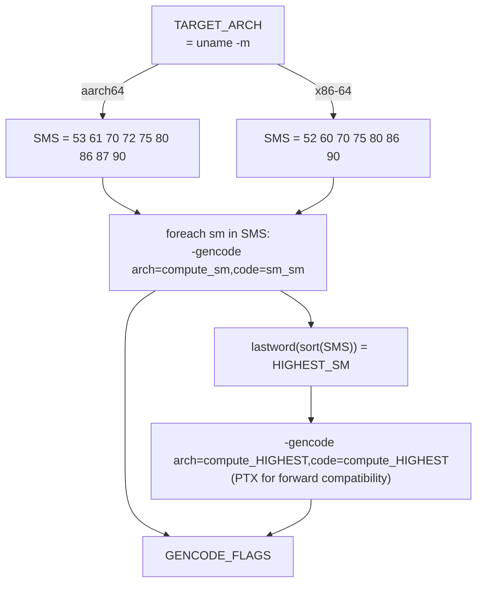

Sources: [MemoryTracker/Makefile:52-65]()

---

## Debug Build Option

[MemoryTracker/Makefile:45-47]()

Passing `dbg=1` on the `make` command line appends debug flags to `NVCC_FLAGS`:

| Flag | Effect |
|---|---|
| `-g` | Host-side debug information |
| `-G` | Device-side debug information (disables optimizations on device code) |

Usage:

```
make dbg=1
```

These flags apply only to the device-side (`nvcc`) compilation. The host-side `g++` rule does not have a corresponding debug toggle in this Makefile.

---

## Build Rules Summary

The following diagram maps each Make target to its rule components:

```mermaid
flowchart TD
    ALL["all"] --> BUILD["build"]
    BUILD --> SO_TARGET["libMemoryTracker.so"]
    BUILD --> FATBIN_TARGET["MemoryTrackerPatches.fatbin"]

    SO_TARGET -->|"recipe"| SO_CMD["HOST_COMPILER\n+ INCLUDE_FLAGS\n+ LINK_FLAGS (-fPIC -shared)\n+ LINK_LIBS (-lsanitizer-public)"]
    SO_CMD -->|"input"| SO_SRC["MemoryTracker.cpp"]

    FATBIN_TARGET -->|"recipe"| FATBIN_CMD["NVCC\n+ NVCC_FLAGS (--fatbin --compile-as-tools-patch)\n+ GENCODE_FLAGS\n+ INCLUDE_FLAGS"]
    FATBIN_CMD -->|"input"| FATBIN_SRC["MemoryTrackerPatches.cu"]

    CLEAN["clean"] -->|"removes"| ARTIFACTS["libMemoryTracker.so\nMemoryTrackerPatches.fatbin"]
    CLOBBER["clobber"] --> CLEAN
```

Sources: [MemoryTracker/Makefile:70-83]()

---

# Page: ApiTracker

# ApiTracker

<details>
<summary>Relevant source files</summary>

The following files were used as context for generating this wiki page:

- [ApiTracker/ApiTracker.cpp](ApiTracker/ApiTracker.cpp)
- [ApiTracker/Makefile](ApiTracker/Makefile)

</details>


This page describes the **ApiTracker** injection library sample: its purpose, runtime behavior, callback logic, and build system. ApiTracker is the simplest of the three injection library samples — it has no device-side code and produces a single build artifact. For the broader injection API architecture common to all three samples, see [Sanitizer Injection API Samples](#2). For a sample that adds device-side patching on top of the same callback foundation, see [MemoryTracker](#2.1).

---

## Purpose

ApiTracker demonstrates the minimum viable use of the Sanitizer Injection API. When loaded by `compute-sanitizer`, it intercepts every CUDA Runtime API call made by the target application and prints the function name and `cudaError_t` return code to stdout on each API exit.

---

## Runtime Behavior

**Callback flow diagram:**

```mermaid
sequenceDiagram
    participant "compute-sanitizer" as CS
    participant "libApiTracker.so" as LIB
    participant "Target Application" as APP

    CS->>LIB: "dlopen(libApiTracker.so)"
    Note over LIB: "__global_initializer__ triggers InitializeInjection()"
    LIB->>CS: "sanitizerSubscribe(&handle, ApiTrackerCallback, nullptr)"
    LIB->>CS: "sanitizerEnableDomain(1, handle, SANITIZER_CB_DOMAIN_RUNTIME_API)"
    APP->>CS: "cudaSomeApiCall(...)"
    CS->>LIB: "ApiTrackerCallback(SANITIZER_API_ENTER)"
    Note over LIB: "callbackSite == SANITIZER_API_ENTER → return immediately"
    CS->>APP: "(executes API call)"
    CS->>LIB: "ApiTrackerCallback(SANITIZER_API_EXIT)"
    Note over LIB: "reads functionName + functionReturnValue"
    LIB->>LIB: "std::cout << functionName << returnValue"
```

Sources: [ApiTracker/ApiTracker.cpp:35-66]()

---

## Code Structure

ApiTracker consists of a single source file.

| File | Role |
|---|---|
| `ApiTracker/ApiTracker.cpp` | All host-side logic: callback, subscription, self-registration |
| `ApiTracker/Makefile` | Build rules producing `libApiTracker.so` |

There is no device-side code and no `.fatbin` artifact, unlike [MemoryTracker](#2.1) or [DeviceMalloc](#2.3).

---

## Self-Registration Pattern

**Global initializer diagram:**

```mermaid
graph TD
    GI["__global_initializer__\n(static int, file scope)"]
    II["InitializeInjection()"]
    SS["sanitizerSubscribe(\n  &handle,\n  ApiTrackerCallback,\n  nullptr\n)"]
    ED["sanitizerEnableDomain(\n  1,\n  handle,\n  SANITIZER_CB_DOMAIN_RUNTIME_API\n)"]

    GI -->|"initialized by"| II
    II --> SS
    II --> ED
```

[ApiTracker/ApiTracker.cpp:56-66]()

The line:

```
int __global_initializer__ = InitializeInjection();
```

is a file-scope variable whose initializer runs automatically when the shared library is loaded. No explicit `main()` or external call is needed. This is the same bootstrap pattern used by all three injection library samples (see [Sanitizer Injection API Samples](#2)).

`InitializeInjection` allocates a `Sanitizer_SubscriberHandle`, passes `ApiTrackerCallback` as the callback function with `nullptr` as userdata, then enables exactly one domain: `SANITIZER_CB_DOMAIN_RUNTIME_API`.

Sources: [ApiTracker/ApiTracker.cpp:56-66]()

---

## Callback Implementation

**Callback logic diagram:**

```mermaid
flowchart TD
    ENTRY["ApiTrackerCallback(\n  userdata,\n  domain,\n  cbid,\n  cbdata\n)"]
    CHK_DOM{"domain ==\nSANITIZER_CB_DOMAIN_RUNTIME_API?"}
    CHK_SITE{"callbackSite ==\nSANITIZER_API_ENTER?"}
    CAST["cast cbdata →\nSanitizer_CallbackData*"]
    READ["read functionName\nread *(cudaError_t*)functionReturnValue"]
    PRINT["std::cout <<\nfunctionName << returnValue"]
    RET_DOM["return (ignore)"]
    RET_ENTER["return (ignore)"]

    ENTRY --> CHK_DOM
    CHK_DOM -->|"no"| RET_DOM
    CHK_DOM -->|"yes"| CAST
    CAST --> CHK_SITE
    CHK_SITE -->|"yes"| RET_ENTER
    CHK_SITE -->|"no (EXIT)"| READ
    READ --> PRINT
```

Sources: [ApiTracker/ApiTracker.cpp:35-54]()

### Key fields of `Sanitizer_CallbackData`

| Field | Type | Usage in ApiTracker |
|---|---|---|
| `callbackSite` | `Sanitizer_ApiCallbackSite` | Guards against `SANITIZER_API_ENTER`; only `SANITIZER_API_EXIT` proceeds |
| `functionName` | `const char*` | Printed as the API name |
| `functionReturnValue` | `const void*` | Cast to `cudaError_t*` and dereferenced for the return code |

The `cbid` argument (identifying the specific API being called) and the `userdata` pointer (passed as `nullptr` at subscription time) are both unused.

Sources: [ApiTracker/ApiTracker.cpp:35-54]()

---

## Build System

ApiTracker is a pure host-side library compiled entirely by `g++`.

```mermaid
graph LR
    SRC["ApiTracker.cpp"]
    LIB["libApiTracker.so"]
    INCS["-I$(CUDA_PATH)/include\n-I$(SANITIZER_PATH)/include"]
    FLAGS["-fPIC -shared"]
    LINK["-L$(SANITIZER_PATH)\n-lsanitizer-public"]

    SRC --> LIB
    INCS -->|"include flags"| LIB
    FLAGS -->|"link flags"| LIB
    LINK -->|"link libs"| LIB
```

Sources: [ApiTracker/Makefile:37-48]()

### Build variables

| Variable | Default | Purpose |
|---|---|---|
| `CUDA_PATH` | `/usr/local/cuda` | Root of the CUDA Toolkit |
| `SANITIZER_PATH` | `$(CUDA_PATH)/compute-sanitizer` | Headers and `libsanitizer-public` |
| `HOST_COMPILER` | `g++` | The only compiler used — no `nvcc` |

### Build commands

| Target | Command |
|---|---|
| `build` / `all` | Compiles `ApiTracker.cpp` → `libApiTracker.so` |
| `clean` / `clobber` | Removes `libApiTracker.so` |

Unlike MemoryTracker, there is no `GENCODE_FLAGS`, no `--compile-as-tools-patch`, and no `.fatbin` target, because ApiTracker has no device-side instrumentation.

Sources: [ApiTracker/Makefile:30-53]()

---

## Usage

Load the library via `compute-sanitizer`:

```
compute-sanitizer --injection-path libApiTracker.so <target_application>
```

Each CUDA Runtime API call made by `<target_application>` will produce a line on stdout of the form:

```
API call to cudaMalloc (return code 0)
API call to cudaLaunchKernel (return code 0)
...
```

The return code `0` corresponds to `cudaSuccess`. Non-zero codes indicate a CUDA error returned by that specific API call.

---

# Page: DeviceMalloc

# DeviceMalloc

<details>
<summary>Relevant source files</summary>

The following files were used as context for generating this wiki page:

- [DeviceMalloc/DeviceMalloc.cpp](DeviceMalloc/DeviceMalloc.cpp)
- [DeviceMalloc/DeviceMalloc.h](DeviceMalloc/DeviceMalloc.h)
- [DeviceMalloc/DeviceMallocPatches.cu](DeviceMalloc/DeviceMallocPatches.cu)
- [DeviceMalloc/Makefile](DeviceMalloc/Makefile)

</details>


## Purpose and Scope

This page covers the **DeviceMalloc** injection library sample, which demonstrates how to intercept device-side heap allocation instructions (`malloc`, `free`, `__nv_aligned_device_malloc`) using the Sanitizer Injection API. The library patches those instructions in loaded modules, collects per-call data on the device, and streams it to the host via a volatile doorbell flag and a background polling thread.

For background on the shared injection library architecture (subscription, callback domains, module patching), see the [Sanitizer Injection API Samples overview](#2). For a simpler patching example that does not use a background thread, see [MemoryTracker](#2.1).

---

## Build Artifacts

The sample produces two files:

| Artifact | Compiler | Purpose |
|---|---|---|
| `libDeviceMalloc.so` | `g++` | Host-side injection library loaded by `compute-sanitizer` |
| `DeviceMallocPatches.fatbin` | `nvcc --fatbin --compile-as-tools-patch` | Device-side patch functions embedded as a fatbinary |

Both are declared as the `build` target in [DeviceMalloc/Makefile:72]().

**Build diagram: artifacts and source files**

```mermaid
graph LR
    CPP["DeviceMalloc.cpp"]
    CU["DeviceMallocPatches.cu"]
    H["DeviceMalloc.h"]
    SO["libDeviceMalloc.so"]
    FAT["DeviceMallocPatches.fatbin"]

    H --> CPP
    H --> CU
    CPP -->|"g++ -shared -fPIC -lsanitizer-public"| SO
    CU -->|"nvcc --fatbin --compile-as-tools-patch"| FAT
```

Sources: [DeviceMalloc/Makefile:72-78]()

---

## Data Structures

Both host and device code share the structures defined in [DeviceMalloc/DeviceMalloc.h]().

**`EventData`** — one record per intercepted allocation or free call [DeviceMalloc/DeviceMalloc.h:39-45]():

| Field | Type | Populated by |
|---|---|---|
| `instructionId` | `Sanitizer_InstructionId` | Patch function (identifies malloc / free / aligned_malloc) |
| `address` | `uint64_t` | Pointer returned (malloc/aligned_malloc) or pointer passed (free) |
| `size` | `uint64_t` | Allocation size; **not filled** for `DeviceFree` |

**`EventTracker`** — per-launch shared buffer [DeviceMalloc/DeviceMalloc.h:48-55]():

| Field | Type | Role |
|---|---|---|
| `events[kMaxEvents]` | `EventData[256]` | Ring of event slots |
| `currentIndex` | `uint32_t` | Atomic slot counter (device writes) |
| `numEvents` | `uint32_t` | Count of committed events (device writes) |
| `doorbell` | `volatile bool` | Synchronization flag between device and host |

`kMaxEvents` is 256 [DeviceMalloc/DeviceMalloc.h:37]().

---

## Device-Side Patch Functions

[DeviceMalloc/DeviceMallocPatches.cu]() implements three `extern "C"` patch entry points, each following the same pattern: acquire a slot → fill `EventData` → commit.

**Patch functions registered on the three instruction types:**

| Patch function | Instruction type constant | Records `size`? |
|---|---|---|
| `DeviceMalloc` | `SANITIZER_INSTRUCTION_DEVICE_SIDE_MALLOC` | Yes |
| `DeviceFree` | `SANITIZER_INSTRUCTION_DEVICE_SIDE_FREE` | No |
| `AlignedMalloc` | `SANITIZER_INSTRUCTION_DEVICE_ALIGNED_MALLOC` | Yes |

### Atomic Slot Acquisition — `GetEventIndex`

[DeviceMalloc/DeviceMallocPatches.cu:47-67]()

Each thread calls `atomicAdd(&tracker.currentIndex, 1)` to claim an exclusive slot index. If the returned index is `>= kMaxEvents`, the buffer is full; the thread spins on `*(volatile uint32_t*)&tracker.currentIndex` until the host resets `currentIndex` below `kMaxEvents`.

### Committing an Event — `IncrementNumEvents`

[DeviceMalloc/DeviceMallocPatches.cu:69-80]()

After writing to `tracker.events[idx]`, the thread calls `__threadfence()` to order the write before the counter increment, then does `atomicAdd(&tracker.numEvents, 1)`. When `numEvents` reaches `kMaxEvents - 1`, the last writing thread becomes responsible for flushing the buffer.

### Device-Side Buffer Flush — `FlushData`

[DeviceMalloc/DeviceMallocPatches.cu:31-45]()

```
__threadfence_system()    // flush all prior writes to host-visible memory
tracker.doorbell = true   // signal the host
while (tracker.doorbell)  // spin until host clears the flag
tracker.numEvents = 0
__threadfence()
tracker.currentIndex = 0  // allow other threads to proceed
```

The `__threadfence_system()` is required to ensure `events[]` writes are visible to host CPU before the doorbell is raised.

**Diagram: device-side event recording flow**

```mermaid
sequenceDiagram
    participant T as "Device Thread"
    participant ET as "EventTracker (pinned memory)"
    participant BG as "Worker Thread (host)"

    T->>ET: "atomicAdd(&currentIndex, 1) → idx"
    T->>ET: "write events[idx].{instructionId, address, size}"
    T->>ET: "__threadfence()"
    T->>ET: "atomicAdd(&numEvents, 1) → old"
    alt "old == kMaxEvents - 1 (buffer full)"
        T->>ET: "__threadfence_system()"
        T->>ET: "doorbell = true"
        T-->>BG: "(volatile flag visible to host)"
        BG->>ET: "FlushTracker() — print events"
        BG->>ET: "currentIndex = 0; numEvents = 0; doorbell = false"
        T->>ET: "(spin exits) numEvents = 0; currentIndex = 0"
    end
```

Sources: [DeviceMalloc/DeviceMallocPatches.cu:31-80]()

---

## Host-Side Implementation

[DeviceMalloc/DeviceMalloc.cpp]() handles subscription, per-launch buffer allocation, doorbell polling, and output.

### Initialization — `InitializeInjection`

[DeviceMalloc/DeviceMalloc.cpp:196-206]()

`sanitizerSubscribe` registers `cbFunction` as the callback handler, and `sanitizerEnableAllDomains` activates all three domains (RESOURCE, LAUNCH, SYNCHRONIZE). The function is called via:

```cpp
int __global_initializer__ = InitializeInjection();
```

This is a global-scope C++ initializer that runs when the shared library is loaded by `compute-sanitizer`, before any CUDA context exists.

### Module Instrumentation — `ModuleLoaded`

[DeviceMalloc/DeviceMalloc.cpp:116-128]()

Triggered by `SANITIZER_CBID_RESOURCE_MODULE_LOADED`. Registers patches from `DeviceMallocPatches.fatbin` and calls `sanitizerPatchInstructions` once per instruction type, mapping each type to its corresponding device patch function name:

| `sanitizerPatchInstructions` call | Patch name string |
|---|---|
| `SANITIZER_INSTRUCTION_DEVICE_SIDE_MALLOC` | `"DeviceMalloc"` |
| `SANITIZER_INSTRUCTION_DEVICE_SIDE_FREE` | `"DeviceFree"` |
| `SANITIZER_INSTRUCTION_DEVICE_ALIGNED_MALLOC` | `"AlignedMalloc"` |

`sanitizerPatchModule` finalizes the instrumentation.

### Per-Launch Buffer Allocation — `LaunchBegin`

[DeviceMalloc/DeviceMalloc.cpp:130-143]()

On `SANITIZER_CBID_LAUNCH_BEGIN`, the host allocates a zero-initialized `EventTracker` in pinned host memory via `sanitizerAllocHost`. The pointer is passed to `sanitizerSetLaunchCallbackData`, making it the `userdata` pointer that device patch functions receive. It is also appended to the global `trackers` vector.

> **Note:** The comment in the source marks the `trackers.push_back` call as not thread-safe [DeviceMalloc/DeviceMalloc.cpp:142]().

### Synchronization Flush — `FlushData`

[DeviceMalloc/DeviceMalloc.cpp:86-92]()

On `SANITIZER_CBID_SYNCHRONIZE_STREAM_SYNCHRONIZED` or `SANITIZER_CBID_SYNCHRONIZE_CONTEXT_SYNCHRONIZED`, `FlushData` iterates all trackers and calls `FlushTracker` on each. This handles the case where the kernel completed without filling the buffer to capacity (so the device-side flush path was never triggered).

### Output — `FlushTracker`

[DeviceMalloc/DeviceMalloc.cpp:60-84]()

Iterates `tracker.events[0..numEvents-1]` and prints one line per event, formatting differs by `instructionId`:

| Instruction | Output format |
|---|---|
| `SANITIZER_INSTRUCTION_DEVICE_SIDE_MALLOC` | `malloc(<size>) = 0x<address>` |
| `SANITIZER_INSTRUCTION_DEVICE_SIDE_FREE` | `free(0x<address>)` |
| `SANITIZER_INSTRUCTION_DEVICE_ALIGNED_MALLOC` | `__nv_aligned_device_malloc(<size>) = 0x<address>` |

### Background Thread — `Worker` and `Work`

[DeviceMalloc/DeviceMalloc.cpp:39-114]()

A global `Worker` instance owns a `std::thread` running `Work`. The thread loops every second, polling each tracker's `doorbell` flag. When `doorbell` is `true`, it calls `FlushTracker`, then resets `currentIndex`, `numEvents`, and `doorbell` to zero/false, unblocking the spinning device threads.

The thread is stopped cleanly when the `Worker` destructor calls `exitSignal.set_value()`, which causes `futureObj.wait_for(...)` to return a non-timeout status, exiting the loop.

**Diagram: host-side component relationships**

```mermaid
graph TD
    GI["__global_initializer__\n= InitializeInjection()"]
    SUB["sanitizerSubscribe\n(cbFunction, nullptr)"]
    CB["cbFunction\n(domain, cbid, cbdata)"]

    subgraph RESOURCE_domain["SANITIZER_CB_DOMAIN_RESOURCE"]
        ML["ModuleLoaded()\nsanitizerAddPatchesFromFile\nsanitizerPatchInstructions x3\nsanitizerPatchModule"]
    end

    subgraph LAUNCH_domain["SANITIZER_CB_DOMAIN_LAUNCH"]
        LB["LaunchBegin()\nsanitizerAllocHost → EventTracker*\nsanitizerSetLaunchCallbackData\ntrackers.push_back"]
    end

    subgraph SYNC_domain["SANITIZER_CB_DOMAIN_SYNCHRONIZE"]
        FD["FlushData()\n→ FlushTracker() per tracker"]
    end

    subgraph Worker_thread["Worker (background thread)"]
        WK["Work(futureObj)\npoll doorbell every 1s\n→ FlushTracker + reset"]
    end

    GI --> SUB
    SUB --> CB
    CB --> ML
    CB --> LB
    CB --> FD
    LB -->|"populates trackers[]"| WK
```

Sources: [DeviceMalloc/DeviceMalloc.cpp:39-206]()

---

## End-to-End Lifecycle

**Diagram: full lifecycle from library load to event output**

```mermaid
sequenceDiagram
    participant CS as "compute-sanitizer"
    participant H as "libDeviceMalloc.so (host)"
    participant FAT as "DeviceMallocPatches.fatbin"
    participant D as "GPU kernel"

    CS->>H: "dlopen → __global_initializer__ runs"
    H->>CS: "sanitizerSubscribe(cbFunction)"
    CS->>H: "RESOURCE_MODULE_LOADED"
    H->>FAT: "sanitizerAddPatchesFromFile"
    H->>CS: "sanitizerPatchInstructions x3 + sanitizerPatchModule"
    CS->>H: "LAUNCH_BEGIN"
    H->>CS: "sanitizerAllocHost → EventTracker*"
    H->>CS: "sanitizerSetLaunchCallbackData(pTracker)"
    CS->>D: "launch patched kernel"
    D->>D: "DeviceMalloc/DeviceFree/AlignedMalloc patch fires"
    D->>D: "GetEventIndex (atomicAdd)"
    D->>D: "write EventData to events[idx]"
    D->>D: "IncrementNumEvents"
    alt "buffer full"
        D->>H: "doorbell = true (volatile, via __threadfence_system)"
        H->>H: "Worker polls doorbell → FlushTracker → print"
        H->>D: "doorbell = false; reset counters"
    end
    CS->>H: "SYNCHRONIZE_STREAM_SYNCHRONIZED"
    H->>H: "FlushData() → FlushTracker for remaining events"
```

Sources: [DeviceMalloc/DeviceMalloc.cpp](), [DeviceMalloc/DeviceMallocPatches.cu]()

---

## Build System Details

[DeviceMalloc/Makefile]() follows the same two-track pattern used by MemoryTracker (see [2.1.3](#2.1.3)).

| Variable | Value | Purpose |
|---|---|---|
| `LINK_FLAGS` | `-L$(SANITIZER_PATH) -fPIC -shared` | Produces a shared library |
| `LINK_LIBS` | `-lsanitizer-public` | Links against the Sanitizer API |
| `NVCC_FLAGS` | `--fatbin --compile-as-tools-patch` | Produces a fatbinary for patch use |
| `GENCODE_FLAGS` | Per-`SMS` arch list | Multi-architecture SASS + PTX forward-compat |

The `dbg=1` make variable adds `-g -G` to `NVCC_FLAGS` for device debug symbols [DeviceMalloc/Makefile:45-47]().

**Running the sample:**

```
compute-sanitizer --injection-library-path ./libDeviceMalloc.so <target_executable>
```

`DeviceMallocPatches.fatbin` must reside in the working directory at runtime, as it is loaded by filename via `sanitizerAddPatchesFromFile("DeviceMallocPatches.fatbin", 0)` [DeviceMalloc/DeviceMalloc.cpp:119]().

Sources: [DeviceMalloc/Makefile:30-83](), [DeviceMalloc/DeviceMalloc.cpp:119]()

---

# Page: compute-sanitizer Tool Demos

# compute-sanitizer Tool Demos

<details>
<summary>Relevant source files</summary>

The following files were used as context for generating this wiki page:

- [Initcheck/Makefile](Initcheck/Makefile)
- [Memcheck/Makefile](Memcheck/Makefile)
- [Racecheck/Makefile](Racecheck/Makefile)
- [Racecheck/block_error.cu](Racecheck/block_error.cu)
- [Racecheck/warp_error.cu](Racecheck/warp_error.cu)
- [Suppressions/Makefile](Suppressions/Makefile)
- [Suppressions/suppressions_demo.cu](Suppressions/suppressions_demo.cu)
- [Suppressions/suppressions_initcheck_demo.cu](Suppressions/suppressions_initcheck_demo.cu)
- [Synccheck/Makefile](Synccheck/Makefile)
- [Synccheck/divergent_threads.cu](Synccheck/divergent_threads.cu)
- [Synccheck/illegal_syncwarp.cu](Synccheck/illegal_syncwarp.cu)

</details>


## Purpose and Scope

This section covers the collection of standalone CUDA programs that demonstrate the **built-in tools** of the `compute-sanitizer` binary. Each program is a deliberately flawed CUDA application, written to trigger a specific class of error that one of the four built-in tools (memcheck, racecheck, synccheck, initcheck) is designed to detect. The Suppressions subdirectory adds a cross-cutting workflow for filtering known errors.

These programs differ fundamentally from the Sanitizer Injection API samples (see [Sanitizer Injection API Samples](#2)): they are ordinary CUDA executables that require no changes to build or link against sanitizer libraries. The sanitizer observes them entirely at runtime by running `compute-sanitizer <binary>`.

---

## Directory Structure and Binaries

Each tool has its own subdirectory containing one or more `.cu` source files and a `Makefile`.

| Directory | Binary / Binaries | Tool Demonstrated |
|---|---|---|
| `Memcheck/` | `memcheck_demo` | `memcheck` (default tool) |
| `Racecheck/` | `block_error`, `warp_error` | `--tool racecheck` |
| `Synccheck/` | `illegal_syncwarp`, `divergent_threads` | `--tool synccheck` |
| `Initcheck/` | `memset_error` | `--tool initcheck` |
| `Suppressions/` | `suppressions_demo`, `suppressions_initcheck_demo` | suppression workflow |

Sources: [Memcheck/Makefile:52-52](), [Racecheck/Makefile:54-54](), [Synccheck/Makefile:54-54](), [Initcheck/Makefile:54-54](), [Suppressions/Makefile:52-54]()

---

## Tool Summary

The following table describes what each built-in tool detects, mapped to the demo program(s) that exercise it.

| Tool | `--tool` flag | What it detects | Demo program(s) |
|---|---|---|---|
| **memcheck** | *(default)* | Out-of-bounds accesses, misaligned accesses, memory leaks | `memcheck_demo` |
| **racecheck** | `--tool racecheck` | Shared memory hazards (RAW, WAW, WAR) between threads | `block_error`, `warp_error` |
| **synccheck** | `--tool synccheck` | Invalid or divergent synchronization barriers | `illegal_syncwarp`, `divergent_threads` |
| **initcheck** | `--tool initcheck` | Reads from uninitialized device memory | `memset_error`, `suppressions_initcheck_demo` |

---

## Common Build Structure

All five Makefiles follow the same pattern. They use `nvcc` backed by `g++` and include a shared set of variables and targets.

**Diagram: Common Makefile layout across all demo directories**

```mermaid
flowchart TD
    vars["Variables\nCUDA_PATH, SANITIZER_PATH, SANITIZER_BIN\nHOST_COMPILER, NVCC, COMPILE_FLAGS"]
    pattern["Pattern rules\n%.o: %.cu\n%: %.o"]
    build["build target\n→ produces binaries"]
    run["run_* targets\n→ invoke compute-sanitizer"]
    dbg["dbg=1\n→ adds -G -Xcompiler -rdynamic"]

    vars --> pattern --> build --> run
    dbg --> build
```

The `SANITIZER_BIN` variable resolves to `$(CUDA_PATH)/compute-sanitizer/compute-sanitizer`, making the run targets self-contained.

Sources: [Memcheck/Makefile:31-68](), [Racecheck/Makefile:31-70](), [Synccheck/Makefile:31-70](), [Initcheck/Makefile:31-67](), [Suppressions/Makefile:31-82]()

---

## How the Demos Are Run

Each Makefile exposes one or more `run_*` targets that call `compute-sanitizer` with tool-specific flags. The table below maps each run target to its invocation.

| Makefile | `make` target | Command invoked |
|---|---|---|
| `Memcheck/Makefile` | `run_memcheck` | `compute-sanitizer --destroy-on-device-error kernel memcheck_demo` |
| `Memcheck/Makefile` | `run_leakcheck` | `compute-sanitizer --destroy-on-device-error kernel --leak-check=full memcheck_demo` |
| `Racecheck/Makefile` | `run_block_error` | `compute-sanitizer --tool racecheck --racecheck-report analysis block_error` |
| `Racecheck/Makefile` | `run_warp_error` | `compute-sanitizer --tool racecheck --racecheck-report hazard warp_error` |
| `Synccheck/Makefile` | `run_divergent_threads` | `compute-sanitizer --tool synccheck divergent_threads` |
| `Synccheck/Makefile` | `run_illegal_syncwarp` | `compute-sanitizer --tool synccheck illegal_syncwarp` |
| `Initcheck/Makefile` | `run_initcheck` | `compute-sanitizer --tool initcheck memset_error` |
| `Suppressions/Makefile` | `gen_supp` | `compute-sanitizer --save supp.xml --xml suppressions_demo` |
| `Suppressions/Makefile` | `run_memcheck_with_supp` | `compute-sanitizer --suppressions supp.xml suppressions_demo` |
| `Suppressions/Makefile` | `initcheck_gen_supp` | `compute-sanitizer --tool initcheck --save supp.xml --xml suppressions_initcheck_demo` |
| `Suppressions/Makefile` | `run_initcheck_with_supp` | `compute-sanitizer --tool initcheck --suppressions supp.xml suppressions_initcheck_demo` |

Sources: [Memcheck/Makefile:64-68](), [Racecheck/Makefile:66-70](), [Synccheck/Makefile:66-70](), [Initcheck/Makefile:66-67](), [Suppressions/Makefile:66-82]()

---

## Demo-to-Error-Class Mapping

The diagram below maps each source file to the specific error class it demonstrates, and to the sanitizer flag used to detect it.

**Diagram: Source files, error types, and sanitizer flags**

```mermaid
flowchart LR
    subgraph memcheck_group["Memcheck/"]
        memcheck_demo["memcheck_demo.cu\n(unaligned write, OOB write, memory leak)"]
    end

    subgraph racecheck_group["Racecheck/"]
        block_error["block_error.cu\nsumKernel: RAW hazard on smem\n(no __syncthreads before reduction)"]
        warp_error["warp_error.cu\nsumKernel: warp-level RAW on smem_second\n(no warp sync before inter-warp access)"]
    end

    subgraph synccheck_group["Synccheck/"]
        illegal_syncwarp["illegal_syncwarp.cu\nmyKernel: __syncwarp mask excludes\nthread 16 already in conditional"]
        divergent_threads["divergent_threads.cu\nmyKernel: __syncthreads inside\ndata-dependent conditional loop"]
    end

    subgraph initcheck_group["Initcheck/"]
        memset_error["memset_error.cu\nvectorAdd: reads uninitialized bytes\n(cudaMemset size off by some bytes)"]
    end

    subgraph suppression_group["Suppressions/"]
        suppressions_demo["suppressions_demo.cu\nmain: cudaMalloc loop\n(memcheck scenario)"]
        suppressions_initcheck_demo["suppressions_initcheck_demo.cu\nmult kernel: reads uninitialized byte\n(cudaMemset size - 1)"]
    end

    memcheck_demo -->|"default tool\n--leak-check=full"| CS["compute-sanitizer"]
    block_error -->|"--tool racecheck\n--racecheck-report analysis"| CS
    warp_error -->|"--tool racecheck\n--racecheck-report hazard"| CS
    illegal_syncwarp -->|"--tool synccheck"| CS
    divergent_threads -->|"--tool synccheck"| CS
    memset_error -->|"--tool initcheck"| CS
    suppressions_demo -->|"default tool\n--save/--suppressions"| CS
    suppressions_initcheck_demo -->|"--tool initcheck\n--save/--suppressions"| CS
```

Sources: [Racecheck/block_error.cu:37-53](), [Racecheck/warp_error.cu:41-69](), [Synccheck/illegal_syncwarp.cu:37-61](), [Synccheck/divergent_threads.cu:40-66](), [Suppressions/suppressions_demo.cu:28-37](), [Suppressions/suppressions_initcheck_demo.cu:28-45]()

---

## Suppression Workflow Overview

The `Suppressions/` directory demonstrates a two-phase workflow that is tool-agnostic:

1. **Generate** a suppression file by running the program with `--save supp.xml --xml`. The sanitizer writes an XML description of every error it observed.
2. **Apply** the suppression file on subsequent runs with `--suppressions supp.xml`. Errors matching entries in the file are silently filtered from output.

This workflow is demonstrated for both `memcheck` (using `suppressions_demo`) and `initcheck` (using `suppressions_initcheck_demo`), showing that the suppression mechanism is consistent across tools.

Sources: [Suppressions/Makefile:66-82](), [Suppressions/suppressions_demo.cu:28-37](), [Suppressions/suppressions_initcheck_demo.cu:28-45]()

---

## Child Pages

Detailed descriptions of each demo are in the following sub-pages:

- [Memcheck Demo](#3.1) — `memcheck_demo`: misaligned writes, out-of-bounds accesses, memory leaks
- [Racecheck Demo](#3.2) — `block_error`, `warp_error`: shared memory read-after-write hazards
- [Synccheck Demo](#3.3) — `illegal_syncwarp`, `divergent_threads`: barrier misuse
- [Initcheck Demo](#3.4) — `memset_error`: uninitialized memory reads
- [Suppressions Demo](#3.5) — `suppressions_demo`, `suppressions_initcheck_demo`: generating and applying suppression files

---

# Page: Memcheck Demo

# Memcheck Demo

<details>
<summary>Relevant source files</summary>

The following files were used as context for generating this wiki page:

- [Memcheck/Makefile](Memcheck/Makefile)
- [Memcheck/memcheck_demo.cu](Memcheck/memcheck_demo.cu)

</details>


This page covers the `memcheck_demo` program located in `Memcheck/memcheck_demo.cu`. It demonstrates three categories of memory errors that the `compute-sanitizer` memcheck tool can detect: misaligned access, out-of-bounds access, and memory leaks. For information about suppressing known errors reported by memcheck, see the Suppressions Demo ([3.5](#3.5)). For an overview of the tool demo category as a whole, see ([3](#3)).

---

## Purpose and Structure

`memcheck_demo` is a deliberately broken CUDA program. It launches two kernels that perform invalid memory operations and intentionally omits a `cudaFree` call to demonstrate the leak-check feature. The program is designed to be run under `compute-sanitizer` so that each class of error is surfaced and attributed correctly.

**Build artifact:** `memcheck_demo` (single CUDA executable)

**Source files:**

| File | Role |
|---|---|
| `Memcheck/memcheck_demo.cu` | All kernel definitions, host launch functions, and `main` |
| `Memcheck/Makefile` | Build rules, run targets for memcheck and leak-check |

Sources: [Memcheck/memcheck_demo.cu:1-74](), [Memcheck/Makefile:1-68]()

---

## Error Scenarios

The demo covers three distinct error scenarios, each implemented as a separate code construct.

### Scenario 1: Misaligned Memory Access

**Kernel:** `unaligned_kernel`

[Memcheck/memcheck_demo.cu:32-35]()

The device global variable `x` (declared at line 30) is an `int` aligned on a 4-byte boundary. The kernel computes `(char*)&x + 1` — a pointer offset by one byte — and then casts it back to `int*` before writing `42`. Because the resulting address is not 4-byte aligned, this constitutes a misaligned store. Memcheck detects and reports this as a misaligned memory access error.

### Scenario 2: Out-of-Bounds Memory Access

**Kernel:** `out_of_bounds_kernel` → **Device function:** `out_of_bounds_function`

[Memcheck/memcheck_demo.cu:37-45]()

`out_of_bounds_function` writes to the hardcoded address `0x87654320`, which is not a valid mapped GPU memory address. The kernel `out_of_bounds_kernel` simply calls this function. Memcheck reports the invalid address write and, because the error is unrecoverable, terminates the kernel (controlled via the `--destroy-on-device-error kernel` flag).

The call chain is shallow by design: having the actual bad write inside a separate `__device__` function (`out_of_bounds_function`) rather than directly in the kernel body demonstrates that memcheck can report through device function call stacks.

### Scenario 3: Memory Leak

**Host function:** `main`

[Memcheck/memcheck_demo.cu:61-74]()

`main` allocates 1024 bytes of device memory with `cudaMalloc` into `devMem`. The matching `cudaFree(devMem)` call is present in the source but commented out with the annotation `// Omitted to demo leakcheck`. At program exit, this allocation is never freed. Running with `--leak-check=full` causes `compute-sanitizer` to report the leaked allocation, including its size and the callsite where it was allocated.

---

## Program Execution Flow

**Diagram: Execution flow of `memcheck_demo`**

```mermaid
flowchart TD
    main["main()"]
    malloc["cudaMalloc\n(1024 bytes -> devMem)"]
    run_unaligned["run_unaligned()"]
    run_oob["run_out_of_bounds()"]
    unaligned_kernel["unaligned_kernel<<<1,1>>>\nwrites to (char*)&x + 1 as int*\n[MISALIGNED ACCESS]"]
    oob_kernel["out_of_bounds_kernel<<<1,1>>>"]
    oob_function["out_of_bounds_function()\nwrites to 0x87654320\n[INVALID ADDRESS]"]
    sync1["cudaDeviceSynchronize()"]
    sync2["cudaDeviceSynchronize()"]
    nofree["cudaFree omitted\n[MEMORY LEAK: devMem 1024 bytes]"]
    ret["return 0"]

    main --> malloc
    malloc --> run_unaligned
    run_unaligned --> unaligned_kernel
    unaligned_kernel --> sync1
    sync1 --> run_oob
    run_oob --> oob_kernel
    oob_kernel --> oob_function
    oob_function --> sync2
    sync2 --> nofree
    nofree --> ret
```

Sources: [Memcheck/memcheck_demo.cu:47-73]()

---

## Code Entity Map

**Diagram: Source symbols and their error categories**

```mermaid
graph LR
    subgraph "memcheck_demo.cu"
        x["__device__ int x\n(global variable)"]
        uk["unaligned_kernel()"]
        oobf["out_of_bounds_function()"]
        oobk["out_of_bounds_kernel()"]
        ru["run_unaligned()"]
        rob["run_out_of_bounds()"]
        main_fn["main()"]
    end

    subgraph "Error Categories"
        E1["Misaligned Access\n(int write at x+1)"]
        E2["Invalid Address Write\n(0x87654320)"]
        E3["Memory Leak\n(devMem never freed)"]
    end

    uk -->|"writes (int*)((char*)&x + 1)"| x
    uk --> E1
    oobf --> E2
    oobk -->|"calls"| oobf
    ru -->|"launches"| uk
    rob -->|"launches"| oobk
    main_fn -->|"calls"| ru
    main_fn -->|"calls"| rob
    main_fn -->|"cudaMalloc, no cudaFree"| E3
```

Sources: [Memcheck/memcheck_demo.cu:30-74]()

---

## Running the Demo

The `Makefile` provides two named run targets that invoke `compute-sanitizer` with different flags.

### Build

```
make -C Memcheck
```

This compiles `memcheck_demo.cu` into the `memcheck_demo` executable using `nvcc`.

### Run Targets

| Make Target | Command Invoked | What It Detects |
|---|---|---|
| `run_memcheck` | `compute-sanitizer --destroy-on-device-error kernel memcheck_demo` | Misaligned access, out-of-bounds write |
| `run_leakcheck` | `compute-sanitizer --destroy-on-device-error kernel --leak-check=full memcheck_demo` | All of the above, plus the unreleased `devMem` allocation |

Sources: [Memcheck/Makefile:63-68]()

### Key Flags

| Flag | Effect |
|---|---|
| `--destroy-on-device-error kernel` | Terminates the offending kernel on a device error instead of aborting the entire process; allows subsequent kernels to still run |
| `--leak-check=full` | At program exit, reports all device allocations that were not freed, with allocation call sites |

The `--destroy-on-device-error kernel` flag is significant here: without it, the out-of-bounds write in `out_of_bounds_kernel` would abort the entire process, and the second kernel's error would prevent observing errors from both kernel launches in a single run.

### Debug Build

Passing `dbg=1` to make enables `-G` (device-side debug info) and `-Xcompiler -rdynamic`, which produces more detailed stack traces in sanitizer output.

[Memcheck/Makefile:41-43]()

---

## Error Summary Table

| Error Type | Kernel / Function | Address / Cause | Detected By |
|---|---|---|---|
| Misaligned int store | `unaligned_kernel` | `&x + 1` (1-byte offset) | `memcheck` (default tool) |
| Invalid address write | `out_of_bounds_function` | `0x87654320` (unmapped) | `memcheck` (default tool) |
| Memory leak | `main` | `devMem` (1024 bytes) | `memcheck --leak-check=full` |

Sources: [Memcheck/memcheck_demo.cu:32-45](), [Memcheck/memcheck_demo.cu:61-74]()

---

# Page: Racecheck Demo

# Racecheck Demo

<details>
<summary>Relevant source files</summary>

The following files were used as context for generating this wiki page:

- [Racecheck/Makefile](Racecheck/Makefile)
- [Racecheck/block_error.cu](Racecheck/block_error.cu)
- [Racecheck/warp_error.cu](Racecheck/warp_error.cu)

</details>


This page covers the two programs in the `Racecheck/` directory that demonstrate shared memory race conditions detectable by `compute-sanitizer`'s `racecheck` tool. For the broader context of the demos category, see the compute-sanitizer Tool Demos overview in [section 3](#3). For a different class of synchronization bug (invalid `__syncwarp` / `__syncthreads` usage), see the Synccheck Demo in [section 3.3](#3.3).

---

## Overview

The `Racecheck/` directory contains two standalone CUDA programs:

| Binary | Source File | Race Type | Recommended Report Mode |
|---|---|---|---|
| `block_error` | `Racecheck/block_error.cu` | Block-level write-read hazard on shared memory | `analysis` |
| `warp_error` | `Racecheck/warp_error.cu` | Warp-level write-read hazard on shared memory | `hazard` |

Both programs compute a sum reduction using shared memory, and both contain intentional missing synchronization barriers to trigger races that `racecheck` can catch.

Sources: `Racecheck/Makefile`, `Racecheck/block_error.cu`, `Racecheck/warp_error.cu`

---

## block_error

### What It Does

`Racecheck/block_error.cu` launches a single kernel, `sumKernel`, with 128 threads in one block. The computation proceeds in two logical phases:

1. **Write phase** — every thread writes `data_in[tx] + tx` into `smem[tx]`.
2. **Reduce phase** — only thread 0 loops over all 128 slots of `smem` and accumulates the result into `*sum_out`.

There is no `__syncthreads()` between the write phase and the reduce phase. Thread 0 may begin reading `smem[i]` before thread `i` has committed its write. This is a **write-read hazard** across threads within the same block.

### Race Anatomy

**Race condition diagram: `block_error` / `sumKernel`**

```mermaid
sequenceDiagram
    participant T1 as "Thread 1..127"
    participant T0 as "Thread 0"
    participant SM as "smem[0..127]"

    T1->>SM: "smem[tx] = data_in[tx] + tx"
    T0->>SM: "smem[0] = data_in[0] + 0"
    Note over T1,T0: No __syncthreads() here
    T0->>SM: "READ smem[i] for i=0..127 (reduce loop)"
    Note over T0,SM: smem[1..127] may not be visible yet → hazard"
```

Sources: [Racecheck/block_error.cu:38-54]()

### Key Code Constructs

- `smem[NumThreads]` — block-scoped shared memory array declared at file scope [Racecheck/block_error.cu:35-35]()
- `sumKernel` — the kernel containing the race [Racecheck/block_error.cu:38-54]()
- `NumThreads = 128` — block size constant [Racecheck/block_error.cu:33-33]()
- Missing `__syncthreads()` between line 41 (all threads write) and lines 49–52 (thread 0 reads) [Racecheck/block_error.cu:41-52]()

### How to Run

```
compute-sanitizer --tool racecheck --racecheck-report analysis ./block_error
```

Or via the Makefile target:

```
make run_block_error
```

The `analysis` report mode aggregates all detected hazards and produces a summary report of potential races, which is appropriate here because the race involves many threads writing to many shared memory locations.

Sources: [Racecheck/Makefile:66-68]()

---

## warp_error

### What It Does

`Racecheck/warp_error.cu` launches `sumKernel` with 64 threads (2 warps of 32). The kernel performs a two-level reduction:

1. **Level 1** — all threads write `data_in[tx] + tx` into `smem_first[tx]`.
2. **Level 2** — only the lane-0 thread of each warp (`tx % WarpSize == 0`) reduces its warp's 32 elements from `smem_first` into `smem_second[wx]`.
3. **Final** — after `__syncthreads()`, thread 0 sums `smem_second[0..1]` into `*sum_out`.

The race is in Level 2: the lane-0 thread reads `smem_first[wx * WarpSize + i]` (written by threads 1–31 in the same warp) without a preceding `__syncwarp()`. On Volta and later architectures, threads within a warp can have independent program counters, so there is no implicit ordering guarantee for shared memory stores across divergent paths without `__syncwarp()`.

### Race Anatomy

**Race condition diagram: `warp_error` / `sumKernel`**

```mermaid
sequenceDiagram
    participant Lanes as "Threads 1..31 (warp 0)"
    participant Lane0 as "Thread 0 (warp 0)"
    participant SF as "smem_first[0..31]"
    participant SS as "smem_second[0]"

    Lanes->>SF: "smem_first[tx] = data_in[tx] + tx"
    Lane0->>SF: "smem_first[0] = data_in[0] + 0"
    Note over Lanes,Lane0: Warp diverges: only lane 0 enters if-block"
    Note over Lane0,SF: No __syncwarp() before reduce loop"
    Lane0->>SF: "READ smem_first[0..31] (reduce loop)"
    Note over Lane0,SF: Writes from lanes 1..31 may not be visible → hazard"
    Lane0->>SS: "smem_second[0] = reduced sum"
```

Sources: [Racecheck/warp_error.cu:41-70]()

### Key Code Constructs

- `smem_first[NumThreads]` — holds all per-thread input values [Racecheck/warp_error.cu:37-37]()
- `smem_second[Warps]` — holds one partial sum per warp [Racecheck/warp_error.cu:38-38]()
- `sumKernel` — the kernel with the warp-level race [Racecheck/warp_error.cu:41-70]()
- `Warps = 2`, `WarpSize = 32`, `NumThreads = 64` — configuration constants [Racecheck/warp_error.cu:33-35]()
- Missing `__syncwarp()` at the start of the `if (tx % WarpSize == 0)` block, before the inner reduction loop [Racecheck/warp_error.cu:46-58]()
- `__syncthreads()` is present after Level 2 [Racecheck/warp_error.cu:60-60](), which eliminates the race in Level 3 (cross-warp read of `smem_second`), but does not fix the intra-warp hazard in Level 2.

### How to Run

```
compute-sanitizer --tool racecheck --racecheck-report hazard ./warp_error
```

Or via the Makefile target:

```
make run_warp_error
```

The `hazard` report mode emits one report per individual memory hazard event. This is appropriate for the warp-level race because the number of hazardous accesses is small and the report pinpoints the exact instructions involved.

Sources: [Racecheck/Makefile:69-70]()

---

## Comparison of the Two Races

| Attribute | `block_error` | `warp_error` |
|---|---|---|
| Race granularity | Block-level (threads from different warps) | Warp-level (threads within the same warp) |
| Missing barrier | `__syncthreads()` | `__syncwarp()` |
| Hazardous memory | `smem` (global shared array) | `smem_first` (per-thread staging buffer) |
| Racecheck flag | `--racecheck-report analysis` | `--racecheck-report hazard` |
| Number of racing threads | Up to 127 writers vs. 1 reader | Up to 31 writers vs. 1 reader per warp |
| Fix | Insert `__syncthreads()` before thread 0's reduce loop | Insert `__syncwarp()` before lane 0's reduce loop |

Sources: `Racecheck/block_error.cu`, `Racecheck/warp_error.cu`, `Racecheck/Makefile`

---

## Build System

The Makefile produces two independent binaries from two `.cu` files with no shared source.

**Build artifact flow: Racecheck**

```mermaid
graph LR
    BEsrc["block_error.cu"]
    WEsrc["warp_error.cu"]
    nvcc1["nvcc -O2 -lineinfo"]
    nvcc2["nvcc -O2 -lineinfo"]
    BEobj["block_error.o"]
    WEobj["warp_error.o"]
    BEbin["block_error"]
    WEbin["warp_error"]

    BEsrc --> nvcc1 --> BEobj --> BEbin
    WEsrc --> nvcc2 --> WEobj --> WEbin
```

| Makefile variable | Value |
|---|---|
| `TARGET_BINARIES` | `block_error warp_error` |
| `COMPILE_FLAGS` (release) | `-O2 -lineinfo` |
| `COMPILE_FLAGS` (debug, `dbg=1`) | `-G -Xcompiler -rdynamic` |
| `SANITIZER_BIN` | `$(SANITIZER_PATH)/compute-sanitizer` |

Pattern rules compile each `.cu` to a `.o` and then link it into the same-named binary [Racecheck/Makefile:48-51]().

Sources: [Racecheck/Makefile:30-70]()

---

# Page: Synccheck Demo

# Synccheck Demo

<details>
<summary>Relevant source files</summary>

The following files were used as context for generating this wiki page:

- [Synccheck/Makefile](Synccheck/Makefile)
- [Synccheck/divergent_threads.cu](Synccheck/divergent_threads.cu)
- [Synccheck/illegal_syncwarp.cu](Synccheck/illegal_syncwarp.cu)

</details>


This page describes the two CUDA programs in the `Synccheck/` directory that demonstrate synchronization errors detectable by `compute-sanitizer --tool synccheck`. The programs are self-contained executables that intentionally contain synchronization bugs; they are not sanitizer injection libraries. For general context on how these demos fit into the repository alongside the injection-based samples and NVTX samples, see the [Overview](#1).

---

## Overview

The `synccheck` tool detects two broad classes of warp- and block-level synchronization errors:

| Error class | Triggered by | Demo program |
|---|---|---|
| Illegal `__syncwarp` mask | A thread calls `__syncwarp` with a mask that excludes itself | `illegal_syncwarp` |
| Divergent `__syncthreads` | `__syncthreads` is called inside a conditional that not all threads in the block reach | `divergent_threads` |

Both programs compile to standalone executables and are run under `compute-sanitizer --tool synccheck`.

---

## Program 1: `illegal_syncwarp`

**Source:** [Synccheck/illegal_syncwarp.cu]()

### What the program does

`myKernel` is launched with a single block of 32 threads (`NumThreads = 32`).

**Diagram: Execution flow of `myKernel` in `illegal_syncwarp`**

```mermaid
flowchart TD
    A["All 32 threads enter myKernel"] --> B["__ballot_sync(0xffffffff, tx < 16)\n=> mask covers threads 0-15 only"]
    B --> C{"tx <= 16 ?"}
    C -- "threads 0-16 (17 threads)" --> D["smem[tx] = tx"]
    D --> E["__syncwarp(mask)\nthread 16 NOT in mask => ILLEGAL"]
    E --> F["thread 0 reads smem[0..15] and sums"]
    C -- "threads 17-31" --> G["skip if block"]
    F --> H["__syncthreads()"]
    G --> H
```

Sources: [Synccheck/illegal_syncwarp.cu:42-60]()

### Root cause

The mask is computed on [line 42](Synccheck/illegal_syncwarp.cu:42-42) using `__ballot_sync(0xffffffff, tx < (NumThreads / 2))`. Because `NumThreads / 2 = 16`, the ballot selects only threads where `tx < 16` (threads 0–15).

The conditional on [line 44](Synccheck/illegal_syncwarp.cu:44-44) is `tx <= (NumThreads / 2)`, i.e., `tx <= 16`. This admits thread 16 into the block.

Thread 16 then calls `__syncwarp(mask)` on [line 48](Synccheck/illegal_syncwarp.cu:48-48), but it is absent from `mask`. CUDA requires that every thread participating in a `__syncwarp` call must have its bit set in the mask. Synccheck flags this as an illegal syncwarp.

| Thread range | Enters `if (tx <= 16)` | In `mask` (tx < 16) | Calls `__syncwarp(mask)` | Valid? |
|---|---|---|---|---|
| 0–15 | Yes | Yes | Yes | ✓ |
| 16 | Yes | No | Yes | ✗ (illegal) |
| 17–31 | No | No | No | — |

Sources: [Synccheck/illegal_syncwarp.cu:42-58]()

---

## Program 2: `divergent_threads`

**Source:** [Synccheck/divergent_threads.cu]()

### What the program does

`myKernel` is launched with a single block of 64 threads (`NumThreads = 64`) and reads from an integer array of `Size = (NumThreads * DataBlocks) - 16 = 1008` elements, where `DataBlocks = 16`.

The kernel accumulates `data_in` into shared memory `smem` in chunks, one `DataBlocks` iteration at a time.

**Diagram: `myKernel` loop and divergence point in `divergent_threads`**

```mermaid
flowchart TD
    A["64 threads enter myKernel"] --> B["smem[tx] = 0"]
    B --> C["__syncthreads()"]
    C --> D["Loop: b = 0 to 15"]
    D --> E["offset = 64*b + tx"]
    E --> F{"offset < 1008?"}
    F -- "threads where offset < 1008" --> G["smem[tx] += data_in[offset]"]
    G --> H["__syncthreads()\nINSIDE CONDITIONAL => DIVERGENT"]
    H --> D
    F -- "threads where offset >= 1008\n(last iteration, tx >= 48)" --> I["skip"]
    I --> D
    D -- "loop done" --> J["thread 0 sums smem[0..63]"]
```

Sources: [Synccheck/divergent_threads.cu:48-65]()

### Root cause

`__syncthreads()` at [line 54](Synccheck/divergent_threads.cu:54-54) is placed inside `if (offset < Size)`. In the last loop iteration (`b = 15`), `offset = 960 + tx`. Threads where `tx >= 48` produce `offset >= 1008 = Size` and do not enter the conditional. Threads where `tx < 48` do enter it and call `__syncthreads()`.

CUDA requires `__syncthreads()` to be reached by all threads in the block. When some threads skip it due to a divergent condition, the behavior is undefined and synccheck reports a divergent-threads error.

| Iteration (`b`) | Threads entering `if` | Threads skipping `if` | `__syncthreads` divergent? |
|---|---|---|---|
| 0–14 | all 64 | none | No |
| 15 | tx 0–47 (48 threads) | tx 48–63 (16 threads) | **Yes** |

Sources: [Synccheck/divergent_threads.cu:33-65]()

---

## Build System

**Source:** [Synccheck/Makefile]()

Both programs are compiled from a single `.cu` source each using `nvcc`. There are no device-side patch fatbins or shared libraries involved.

```mermaid
flowchart LR
    subgraph "Source Files"
        S1["illegal_syncwarp.cu"]
        S2["divergent_threads.cu"]
    end
    subgraph "Build (nvcc)"
        O1["illegal_syncwarp.o"]
        O2["divergent_threads.o"]
    end
    subgraph "Executables"
        B1["illegal_syncwarp"]
        B2["divergent_threads"]
    end
    S1 --> O1 --> B1
    S2 --> O2 --> B2
```

Sources: [Synccheck/Makefile:47-61]()

### Build targets

| Make target | Action |
|---|---|
| `all` / `build` | Compiles both executables |
| `clean` | Removes binaries and `.o` files |
| `run_illegal_syncwarp` | Runs `compute-sanitizer --tool synccheck ./illegal_syncwarp` |
| `run_divergent_threads` | Runs `compute-sanitizer --tool synccheck ./divergent_threads` |

The `dbg=1` flag enables `-G` (device debug symbols) and `-Xcompiler -rdynamic` for richer stack traces in sanitizer output [Synccheck/Makefile:41-45]().

---

## Running the Demos

Both programs are invoked the same way — as ordinary CUDA executables under `compute-sanitizer`:

```
compute-sanitizer --tool synccheck ./illegal_syncwarp
compute-sanitizer --tool synccheck ./divergent_threads
```

These correspond to the `run_illegal_syncwarp` and `run_divergent_threads` Makefile targets [Synccheck/Makefile:66-71]().

Synccheck will emit an error report for each violation, identifying the offending thread, the synchronization primitive involved, and the source location (when built with `-G`). No special flags beyond `--tool synccheck` are needed for these demos.

---

## Summary

| Program | Synchronization primitive | Bug pattern | Synccheck error class |
|---|---|---|---|
| `illegal_syncwarp` | `__syncwarp(mask)` | Thread 16 calls `__syncwarp` but is excluded from `mask` | Illegal syncwarp mask |
| `divergent_threads` | `__syncthreads()` | `__syncthreads` placed inside `if (offset < Size)` which not all threads reach | Divergent `__syncthreads` |

Sources: [Synccheck/illegal_syncwarp.cu](), [Synccheck/divergent_threads.cu](), [Synccheck/Makefile]()

---

# Page: Initcheck Demo

# Initcheck Demo

<details>
<summary>Relevant source files</summary>

The following files were used as context for generating this wiki page:

- [Initcheck/Makefile](Initcheck/Makefile)
- [Initcheck/memset_error.cu](Initcheck/memset_error.cu)

</details>


This page describes the `Initcheck` demo, a minimal CUDA program that demonstrates how `compute-sanitizer --tool initcheck` detects reads from uninitialized device memory. The demo is a single source file (`Initcheck/memset_error.cu`) that deliberately introduces a common `cudaMemset` sizing mistake.

For suppression workflows applied to initcheck errors, see [Suppressions Demo](#3.5). For the other compute-sanitizer tool demos (memcheck, racecheck, synccheck), see pages [3.1](#3.1), [3.2](#3.2), and [3.3](#3.3).

---

## The Bug: Incorrect `cudaMemset` Size

The entire demo fits in one file: [Initcheck/memset_error.cu]().

The allocation and initialization sequence is:

| Step | Call | Size Argument |
|------|------|---------------|
| Allocate device memory | `cudaMalloc` | `sizeof(int) * NumBlocks * NumThreads` = **256 bytes** |
| Zero device memory | `cudaMemset` | `NumBlocks * NumThreads` = **64 bytes** (bug) |
| Launch kernel | `vectorAdd<<<NumBlocks, NumThreads>>>` | reads all 64 elements |
| Free memory | `cudaFree` | — |

[Initcheck/memset_error.cu:46-56]()

The constants are defined as:

```
NumThreads = 32
NumBlocks  = 2
```

This means the array holds **64 `int` values (256 bytes)** total. The `cudaMemset` call [Initcheck/memset_error.cu:51]() passes `NumBlocks * NumThreads` — which is `64` — as the byte count. The correct value would be `NumBlocks * NumThreads * sizeof(int)` = `256`. As a result, only the **first 64 bytes (16 integers)** are zeroed; the remaining **192 bytes (48 integers)** are left uninitialized.

---

## Kernel Behavior

**Diagram: Data Flow Through the Bug**

```mermaid
flowchart TD
    A["cudaMalloc\n(256 bytes = 64 ints)"]
    B["cudaMemset\n(64 bytes = 16 ints zeroed)"]
    C["Remaining 48 ints\nuninitialized"]
    D["vectorAdd kernel\ntx = threadIdx.x + blockDim.x * blockIdx.x\nv[tx] += tx"]
    E1["Threads tx=0..15\nRead initialized memory (ok)"]
    E2["Threads tx=16..63\nRead UNINITIALIZED memory (bug)"]
    F["initcheck reports\nuninitialized read"]

    A --> B
    B --> C
    A --> D
    B --> E1
    C --> E2
    D --> E1
    D --> E2
    E2 --> F
```

The `vectorAdd` kernel [Initcheck/memset_error.cu:37-42]() computes a linear thread index `tx` and performs `v[tx] += tx`. With 2 blocks of 32 threads each, `tx` ranges from 0 to 63. Threads with `tx >= 16` read memory that was never written by the `cudaMemset` call.

---

## Code Structure

**Diagram: Source Symbols and Their Roles**

```mermaid
classDiagram
    class memset_error_cu {
        +NumThreads : int = 32
        +NumBlocks : int = 2
        +vectorAdd(int* v) __global__
        +main() int
    }

    class vectorAdd {
        "tx = threadIdx.x + blockDim.x * blockIdx.x"
        "v[tx] += tx"
        "reads all 64 elements"
    }

    class main_fn {
        "cudaMalloc: 256 bytes"
        "cudaMemset: 64 bytes (BUG)"
        "launch: vectorAdd<<<2,32>>>"
        "cudaDeviceSynchronize"
        "cudaFree"
    }

    memset_error_cu --> vectorAdd : "defines"
    memset_error_cu --> main_fn : "defines"
```

Sources: [Initcheck/memset_error.cu:33-59]()

---

## Building and Running

The Makefile [Initcheck/Makefile]() produces a single binary: `memset_error`.

### Build

```
make
```

Or with debug symbols:

```
make dbg=1
```

| Build mode | Flags applied |
|------------|---------------|
| Release (default) | `-O2 -lineinfo` |
| Debug (`dbg=1`) | `-G -Xcompiler -rdynamic` |

### Run Under initcheck

The Makefile provides a convenience target:

```
make run_initcheck
```

which expands to:

```
compute-sanitizer --tool initcheck memset_error
```

[Initcheck/Makefile:66-67]()

**Diagram: Execution Flow Under compute-sanitizer**

```mermaid
sequenceDiagram
    participant shell as "Shell"
    participant cs as "compute-sanitizer\n--tool initcheck"
    participant exe as "memset_error"
    participant gpu as "GPU"

    shell->>cs: "invoke"
    cs->>exe: "launch subprocess"
    exe->>gpu: "cudaMalloc (256 bytes)"
    exe->>gpu: "cudaMemset (64 bytes only)"
    exe->>gpu: "vectorAdd<<<2,32>>>"
    gpu->>cs: "thread tx=16 reads uninitialized byte"
    cs-->>shell: "report: Uninitialized read at memset_error.cu:41"
    exe->>gpu: "cudaDeviceSynchronize"
    exe->>gpu: "cudaFree"
```

Sources: [Initcheck/Makefile:66-67](), [Initcheck/memset_error.cu:48-56]()

---

## Expected initcheck Output

When run under `--tool initcheck`, `compute-sanitizer` reports an error for each thread that reads uninitialized memory. The report identifies:

- **The offending instruction** — the load in `vectorAdd` at [Initcheck/memset_error.cu:41]() (`v[tx] += tx`)
- **The address accessed** — the pointer offset into `d_vec` beyond the zeroed region
- **Which threads triggered it** — threads with `tx` in the range 16–63

The program itself runs to completion without crashing because CUDA does not trap reads of uninitialized memory at runtime; only `compute-sanitizer` intercepts and reports them.

---

## Root Cause Summary

| Property | Value |
|----------|-------|
| Source file | `Initcheck/memset_error.cu` |
| Bug location | [Initcheck/memset_error.cu:51]() |
| Bug type | Missing `* sizeof(int)` in `cudaMemset` byte count |
| Bytes allocated | 256 |
| Bytes initialized | 64 |
| Bytes uninitialized | 192 (48 `int` elements) |
| Kernel reads all | 256 bytes → 48 uninitialized reads per kernel launch |
| Detection tool | `compute-sanitizer --tool initcheck` |

Sources: [Initcheck/memset_error.cu](), [Initcheck/Makefile]()

---

# Page: Suppressions Demo

# Suppressions Demo

<details>
<summary>Relevant source files</summary>

The following files were used as context for generating this wiki page:

- [Suppressions/Makefile](Suppressions/Makefile)
- [Suppressions/suppressions_demo.cu](Suppressions/suppressions_demo.cu)
- [Suppressions/suppressions_initcheck_demo.cu](Suppressions/suppressions_initcheck_demo.cu)

</details>


## Purpose and Scope

This page documents the two suppression demo programs in the `Suppressions/` directory: `suppressions_demo` (covering `memcheck`) and `suppressions_initcheck_demo` (covering `initcheck`). These demos illustrate the full suppression workflow — generating a suppression file from known errors and then applying that file to silence them in subsequent runs.

This page is about using `compute-sanitizer`'s built-in suppression mechanism. For information about the errors being suppressed in the underlying demos, see the [Memcheck Demo](#3.1) and [Initcheck Demo](#3.4) pages.

---

## Overview

When a CUDA program contains known, accepted errors (or errors from third-party code that cannot be fixed), `compute-sanitizer` allows those errors to be recorded into an XML suppression file and later applied as a filter. The workflow has two phases:

1. **Generate**: Run under `compute-sanitizer` with `--save` and `--xml` to record all detected errors to a file.
2. **Apply**: Re-run under `compute-sanitizer` with `--suppressions` to load that file and silence the matching errors.

The `Suppressions/` directory contains two programs that each demonstrate this workflow for a different tool.

**Suppression workflow diagram:**

```mermaid
flowchart LR
    subgraph "Phase 1: Generate"
        A["Run binary\nunder compute-sanitizer"] --> B["--save supp.xml --xml"]
        B --> C["supp.xml\n(suppression file)"]
    end
    subgraph "Phase 2: Apply"
        D["Run binary\nunder compute-sanitizer"] --> E["--suppressions supp.xml"]
        E --> F["Known errors filtered\nNew errors shown"]
    end
    C --> E
```

Sources: [Suppressions/Makefile:66-82]()

---

## Program Descriptions

### `suppressions_demo` (memcheck)

**File:** [Suppressions/suppressions_demo.cu:1-37]()

This program deliberately probes for the largest allocatable chunk of GPU memory by calling `cudaMalloc` in a loop, starting at `1ull << 45` bytes and decrementing `n` until the call succeeds.

```
while (cudaMalloc(&ptr, 1ull << n) != cudaSuccess) {
    n--;
}
```

[Suppressions/suppressions_demo.cu:32-34]()

The failed `cudaMalloc` attempts are what `memcheck` flags. These are intentional and expected — the point of the demo is to suppress them. The program exits immediately after finding a successful size; the allocation is never freed, but the suppression target is the errors generated during the probing loop.

---

### `suppressions_initcheck_demo` (initcheck)

**File:** [Suppressions/suppressions_initcheck_demo.cu:1-45]()

This program allocates a device array `a` of 123 `int`s, then memsets it with an off-by-one byte count:

```
cudaMemset(a, 0x0, size * sizeof(int) - 1);
```

[Suppressions/suppressions_initcheck_demo.cu:40]()

This leaves the last byte of element 122 uninitialized. The `mult` kernel then reads all 123 elements:

[Suppressions/suppressions_initcheck_demo.cu:28-33]()

`initcheck` detects the read of the uninitialized byte. This error is the target for the initcheck suppression workflow. The program mirrors the pattern from the [Initcheck Demo](#3.4), but here the goal is demonstrating how to suppress the known error rather than discovering it.

---

## Makefile Targets

The `Suppressions/Makefile` defines six operational targets across the two tools.

**Build targets:**

| Target | Output Binary |
|---|---|
| `build` | `suppressions_demo`, `suppressions_initcheck_demo` |
| `clean` | Removes object files and binaries |

**Run targets:**

| Target | Command Issued | Purpose |
|---|---|---|
| `gen_supp` | `compute-sanitizer --save supp.xml --xml suppressions_demo` | Generate memcheck suppression file |
| `run_memcheck` | `compute-sanitizer suppressions_demo` | Run without suppressions (see all errors) |
| `run_memcheck_with_supp` | `compute-sanitizer --suppressions supp.xml suppressions_demo` | Run with suppressions applied |
| `initcheck_gen_supp` | `compute-sanitizer --tool initcheck --save supp.xml --xml suppressions_initcheck_demo` | Generate initcheck suppression file |
| `run_initcheck` | `compute-sanitizer --tool initcheck suppressions_initcheck_demo` | Run without suppressions |
| `run_initcheck_with_supp` | `compute-sanitizer --tool initcheck --suppressions supp.xml suppressions_initcheck_demo` | Run with suppressions applied |

Sources: [Suppressions/Makefile:52-82]()

---

## End-to-End Workflow

The diagram below maps the Makefile targets and source files to the concrete `compute-sanitizer` flags used at each step.

```mermaid
flowchart TD
    subgraph "Build"
        MK["Suppressions/Makefile"] --> SD["suppressions_demo\n(from suppressions_demo.cu)"]
        MK --> SID["suppressions_initcheck_demo\n(from suppressions_initcheck_demo.cu)"]
    end

    subgraph "memcheck workflow"
        SD --> RM["make run_memcheck\n(no flags, see errors)"]
        SD --> GS["make gen_supp\n--save supp.xml --xml"]
        GS --> SUPPXML["supp.xml"]
        SUPPXML --> RMS["make run_memcheck_with_supp\n--suppressions supp.xml"]
    end

    subgraph "initcheck workflow"
        SID --> RI["make run_initcheck\n--tool initcheck"]
        SID --> IGS["make initcheck_gen_supp\n--tool initcheck --save supp.xml --xml"]
        IGS --> SUPPXML2["supp.xml"]
        SUPPXML2 --> RIS["make run_initcheck_with_supp\n--tool initcheck --suppressions supp.xml"]
    end
```

Sources: [Suppressions/Makefile:66-82]()

---

## Key `compute-sanitizer` Flags

| Flag | Role |
|---|---|
| `--save <file>` | Write all detected errors to the given XML file during this run |
| `--xml` | Format the output (and saved file) as XML, required for `--suppressions` to parse it |
| `--suppressions <file>` | Load a previously saved XML file and suppress matching errors |
| `--tool initcheck` | Select the `initcheck` tool instead of the default `memcheck` |

Note that both `--save` and `--xml` must be used together to produce a suppression file that `--suppressions` can consume. The suppression file (`supp.xml`) is shared in name between both workflows in the Makefile — running `initcheck_gen_supp` after `gen_supp` will overwrite the same `supp.xml` file.

Sources: [Suppressions/Makefile:66-82]()

---

## Build System

Both binaries are compiled from a single `.cu` source file each using `nvcc`. No special flags beyond standard includes are needed — neither binary requires sanitizer headers or patch compilation.

```mermaid
flowchart LR
    subgraph "Compile"
        A["suppressions_demo.cu"] -->|"nvcc -c"| B["suppressions_demo.o"]
        C["suppressions_initcheck_demo.cu"] -->|"nvcc -c"| D["suppressions_initcheck_demo.o"]
    end
    subgraph "Link"
        B -->|"nvcc -o"| E["suppressions_demo"]
        D -->|"nvcc -o"| F["suppressions_initcheck_demo"]
    end
```

The `dbg=1` flag adds `-G -Xcompiler -rdynamic` for debug builds, which is useful for getting more detailed stack frames in the suppression XML output.

Sources: [Suppressions/Makefile:40-54]()

---

# Page: NVTX API Samples

# NVTX API Samples

<details>
<summary>Relevant source files</summary>

The following files were used as context for generating this wiki page:

- [.gitmodules](.gitmodules)
- [NvtxMemoryPool/NvtxMemoryPool.cu](NvtxMemoryPool/NvtxMemoryPool.cu)
- [NvtxNaming/NvtxNaming.cu](NvtxNaming/NvtxNaming.cu)
- [NvtxPermissions/NvtxPermissions.cu](NvtxPermissions/NvtxPermissions.cu)

</details>


This page introduces the three NVTX memory extension samples included in the repository. These samples demonstrate how to use the NVTX memory API to annotate GPU memory allocations with structured metadata — specifically heap boundaries, human-readable labels, and access permission flags — so that `compute-sanitizer` can use that information to report more precise diagnostics.

This page covers only the high-level structure and the NVTX submodule dependency. For detailed documentation of each sample, see:
- [NvtxMemoryPool](#4.1)
- [NvtxNaming](#4.2)
- [NvtxPermissions](#4.3)

For samples that demonstrate the built-in `compute-sanitizer` tools (memcheck, initcheck, racecheck, synccheck) without NVTX, see [compute-sanitizer Tool Demos](#3).

---

## Overview

The NVTX API samples are standalone CUDA executables. Unlike the [Sanitizer Injection API Samples](#2), they do not produce shared libraries and are not injected into other programs. They run directly under `compute-sanitizer` and call NVTX memory extension functions to annotate their own allocations before deliberately triggering detectable violations.

All three samples share the same structural pattern:

**Structural pattern: NVTX API samples**

```mermaid
flowchart TD
    A["main()"] --> B["nvtxDomainCreateA(\"my-domain\")"]
    B --> C["cudaMalloc / cudaFree"]
    C --> D["NVTX memory annotation\n(register, name, or assign permissions)"]
    D --> E["Kernel launch\n(deliberate violation or success case)"]
    E --> F["cudaDeviceSynchronize()"]
    F --> G["compute-sanitizer reports violation\nwith NVTX-annotated context"]
```

Sources: `NvtxMemoryPool/NvtxMemoryPool.cu`, `NvtxNaming/NvtxNaming.cu`, `NvtxPermissions/NvtxPermissions.cu`

---

## NVTX Git Submodule

The NVTX library is included as a git submodule at the root of the repository. It provides the header-only NVTX memory extension API.

| Field | Value |
|---|---|
| Submodule path | `NVTX/` |
| Remote URL | `https://github.com/NVIDIA/NVTX` |
| Branch | `dev-mem-api` |

The `dev-mem-api` branch is a non-default branch that contains experimental memory extension headers, specifically `nvtx3/nvToolsExtMem.h` and `nvtx3/nvToolsExtMemCudaRt.h`, which are used by the samples.

Sources: [.gitmodules:1-4](), [NvtxPermissions/NvtxPermissions.cu:30-31]()

---

## The Three Samples at a Glance

| Sample | Source File | Key NVTX Concept | Kernel | Violation Type |
|---|---|---|---|---|
| `NvtxMemoryPool` | `NvtxMemoryPool/NvtxMemoryPool.cu` | Heap registration and suballocation lifecycle | `Iota` | Out-of-bounds, access after free, access after reset |
| `NvtxNaming` | `NvtxNaming/NvtxNaming.cu` | Named memory regions | *(none)* | Memory leak with named allocation |
| `NvtxPermissions` | `NvtxPermissions/NvtxPermissions.cu` | Per-region read/write/atomic permissions | `IncrementTwice` | Invalid read, write, or atomic on permission-restricted region |

Sources: `NvtxMemoryPool/NvtxMemoryPool.cu`, `NvtxNaming/NvtxNaming.cu`, `NvtxPermissions/NvtxPermissions.cu`

---

## Relationship Between Samples and NVTX API Surface

Each sample targets a distinct portion of the NVTX memory extension API:

**NVTX API surface coverage across samples**

```mermaid
graph LR
    subgraph "NvtxMemoryPool"
        NMP_D["nvtxDomainCreateA"]
        NMP_H["nvtxMemHeapRegister"]
        NMP_R["NV::Suballocator::Register"]
        NMP_SZ["NV::Suballocator::Resize"]
        NMP_U["NV::Suballocator::Unregister"]
        NMP_RST["NV::Suballocator::Reset"]
    end

    subgraph "NvtxNaming"
        NN_D["nvtxDomainCreateA"]
        NN_L["NV::LabelMemory"]
        NN_WRAP["nvtxMemRegionsName\n(wrapped by LabelMemory)"]
        NN_L --> NN_WRAP
    end

    subgraph "NvtxPermissions"
        NP_D["nvtxDomainCreateA"]
        NP_P["NV::PermissionsAssign"]
        NP_ENUM["NV::PERMISSIONS_READ\nNV::PERMISSIONS_WRITE\nNV::PERMISSIONS_NONE"]
        NP_P --> NP_ENUM
    end
```

Sources: [NvtxMemoryPool/NvtxMemoryPool.cu:52-89](), [NvtxNaming/NvtxNaming.cu:40-48](), [NvtxPermissions/NvtxPermissions.cu:49-81]()

---

## Common Setup Pattern

Every sample begins by creating an NVTX domain using `nvtxDomainCreateA`. This domain groups all NVTX annotations made by that program and is passed as the first argument to every subsequent NVTX memory API call.

All three samples use the same domain creation call:

[NvtxMemoryPool/NvtxMemoryPool.cu:52-52]()
[NvtxNaming/NvtxNaming.cu:40-40]()
[NvtxPermissions/NvtxPermissions.cu:51-51]()

The CUDA allocation lifecycle (`cudaMalloc`, kernel launch, `cudaDeviceSynchronize`, `cudaFree`) is standard in all samples. The NVTX calls layer semantic information on top of existing allocations — they do not replace or modify the CUDA memory management functions.

Sources: `NvtxMemoryPool/NvtxMemoryPool.cu`, `NvtxNaming/NvtxNaming.cu`, `NvtxPermissions/NvtxPermissions.cu`

---

## How compute-sanitizer Uses the Annotations

Without NVTX annotations, `compute-sanitizer` can detect out-of-bounds accesses, leaks, and permission violations, but its diagnostic messages reference only raw addresses. When NVTX memory annotations are present:

- **Heap/suballocation boundaries** (from `NvtxMemoryPool`) allow `compute-sanitizer` to report accesses against named suballocated regions rather than the underlying raw `cudaMalloc` buffer.
- **Named regions** (from `NvtxNaming`) cause leak-check and initcheck reports to display the user-defined label (e.g. `"My allocation"`) instead of an anonymous address.
- **Permission flags** (from `NvtxPermissions`) allow `compute-sanitizer` to report read/write/atomic violations on regions that are logically restricted even when the underlying GPU memory is otherwise accessible.

The samples intentionally include both valid usage and violation scenarios so that the difference in `compute-sanitizer` output is observable. For example, `NvtxMemoryPool` launches `Iota` successfully with 63 threads before launching it with 64 threads to trigger the out-of-bounds violation [NvtxMemoryPool/NvtxMemoryPool.cu:64-70]().

Sources: [NvtxMemoryPool/NvtxMemoryPool.cu:56-86](), [NvtxNaming/NvtxNaming.cu:43-48](), [NvtxPermissions/NvtxPermissions.cu:57-79]()

---

# Page: NvtxMemoryPool

# NvtxMemoryPool

<details>
<summary>Relevant source files</summary>

The following files were used as context for generating this wiki page:

- [NvtxMemoryPool/Makefile](NvtxMemoryPool/Makefile)
- [NvtxMemoryPool/NvtxMemoryPool.cu](NvtxMemoryPool/NvtxMemoryPool.cu)
- [NvtxMemoryPool/NvtxMemoryPool.h](NvtxMemoryPool/NvtxMemoryPool.h)
- [NvtxMemoryPool/README.md](NvtxMemoryPool/README.md)

</details>


This page covers the `NvtxMemoryPool` sample, which demonstrates how to use the NVTX memory suballocation API to inform compute-sanitizer about the valid bounds of suballocated regions within a larger GPU memory pool. For information about the other NVTX samples that cover region naming and permission flags, see [NvtxNaming](#4.2) and [NvtxPermissions](#4.3).

---

## Overview

A common GPU memory pattern is to allocate one large backing buffer (a "pool") with `cudaMalloc` and then hand out smaller sub-regions from it manually. Because compute-sanitizer only sees the outer `cudaMalloc` allocation, it cannot detect out-of-bounds accesses within sub-regions without additional information.

The NVTX memory API bridges this gap: applications register the pool as a *heap* and register each active sub-region as a *memory region* within that heap. compute-sanitizer (when invoked with `--nvtx=yes`) then treats those sub-regions as the effective allocation bounds and reports violations accordingly.

`NvtxMemoryPool` is a self-contained CUDA executable (not a sanitizer injection library) built from two source files:

| File | Role |
|---|---|
| `NvtxMemoryPool/NvtxMemoryPool.h` | `NV::Suballocator` class — NVTX heap + region lifecycle |
| `NvtxMemoryPool/NvtxMemoryPool.cu` | `main` + `Iota` kernel — exercises the suballocator |

Sources: [NvtxMemoryPool/NvtxMemoryPool.h:1-138](), [NvtxMemoryPool/NvtxMemoryPool.cu:1-90]()

---

## The `NV::Suballocator` Class

`NV::Suballocator` ([NvtxMemoryPool/NvtxMemoryPool.h:42-136]()) is the sole abstraction in this sample. It wraps the NVTX heap and region APIs into a C++ RAII interface.

**Constructor parameters:**

| Parameter | Type | Description |
|---|---|---|
| `nvtxDomain` | `nvtxDomainHandle_t` | NVTX domain to associate with this pool |
| `start` | `void*` | Base pointer of the backing GPU allocation |
| `capacity` | `size_t` | Total size of the backing GPU allocation in bytes |

**Private members:**

| Member | Type | Description |
|---|---|---|
| `m_nvtxDomain` | `nvtxDomainHandle_t` | Stored domain handle |
| `m_start` | `void*` | Stored base pointer |
| `m_capacity` | `size_t` | Stored capacity |
| `m_nvtxPool` | `nvtxMemHeapHandle_t` | Handle returned by `nvtxMemHeapRegister` |

### NVTX API Surface

Each public method on `Suballocator` maps to one NVTX memory API call:

| `Suballocator` method | NVTX API called | Descriptor type used |
|---|---|---|
| Constructor | `nvtxMemHeapRegister` | `nvtxMemHeapDesc_t` + `nvtxMemVirtualRangeDesc_t` |
| Destructor | `nvtxMemHeapUnregister` | — |
| `Reset()` | `nvtxMemHeapReset` | — |
| `Register(ptr, size)` | `nvtxMemRegionsRegister` | `nvtxMemRegionsRegisterBatch_t` + `nvtxMemVirtualRangeDesc_t` |
| `Resize(ptr, newSize)` | `nvtxMemRegionsResize` | `nvtxMemRegionsResizeBatch_t` + `nvtxMemVirtualRangeDesc_t` |
| `Unregister(ptr)` | `nvtxMemRegionsUnregister` | `nvtxMemRegionsUnregisterBatch_t` + `nvtxMemRegionRef_t` |

Sources: [NvtxMemoryPool/NvtxMemoryPool.h:44-136]()

### Constructor Detail

The constructor builds two nested descriptors before calling `nvtxMemHeapRegister`:

**Diagram: Suballocator Constructor — descriptor hierarchy**

```mermaid
graph TD
    ctor["Suballocator(nvtxDomain, start, capacity)"]
    rd["nvtxMemVirtualRangeDesc_t\n.ptr = start\n.size = capacity"]
    hd["nvtxMemHeapDesc_t\n.usage = NVTX_MEM_HEAP_USAGE_TYPE_SUB_ALLOCATOR\n.type = NVTX_MEM_TYPE_VIRTUAL_ADDRESS\n.typeSpecificDesc = &nvtxRangeDesc"]
    reg["nvtxMemHeapRegister(nvtxDomain, &nvtxHeapDesc)\n→ m_nvtxPool"]

    ctor --> rd
    rd --> hd
    hd --> reg
```

Sources: [NvtxMemoryPool/NvtxMemoryPool.h:45-68]()

### Region Registration Detail

`Register(ptr, size)` wraps a single virtual-range descriptor inside a batch descriptor, then calls `nvtxMemRegionsRegister`. The batch descriptor links the region to the pool via `heap = m_nvtxPool`:

```mermaid
graph TD
    reg["Register(ptr, size)"]
    vrd["nvtxMemVirtualRangeDesc_t\n.ptr = ptr\n.size = size"]
    batch["nvtxMemRegionsRegisterBatch_t\n.regionType = NVTX_MEM_TYPE_VIRTUAL_ADDRESS\n.heap = m_nvtxPool\n.regionCount = 1\n.regionDescElements = &nvtxRangeDesc"]
    call["nvtxMemRegionsRegister(m_nvtxDomain, &nvtxRegionsDesc)"]

    reg --> vrd
    vrd --> batch
    batch --> call
```

`Resize` and `Unregister` follow the same pattern with their respective batch descriptor types (`nvtxMemRegionsResizeBatch_t`, `nvtxMemRegionsUnregisterBatch_t`). `Unregister` identifies the region by pointer via `nvtxMemRegionRef_t` rather than a size descriptor.

Sources: [NvtxMemoryPool/NvtxMemoryPool.h:80-129]()

---

## The `Iota` Kernel

`Iota` ([NvtxMemoryPool/NvtxMemoryPool.cu:39-44]()) is the kernel used to exercise the suballocated regions. Each thread writes its global linear index as a `uint8_t` to the corresponding slot:

```
thread i  →  v[i] = (uint8_t)i
```

It has no bounds check of its own; the sample relies entirely on compute-sanitizer (informed by NVTX) to detect overflows.

Sources: [NvtxMemoryPool/NvtxMemoryPool.cu:39-44]()

---

## Main Program: Suballocation Lifecycle Scenarios

`main` ([NvtxMemoryPool/NvtxMemoryPool.cu:46-90]()) demonstrates five sequential scenarios against a single 4096-byte pool.

**Key constants:**

| Constant | Value | Meaning |
|---|---|---|
| `PoolSize` | `4096` bytes | Size of the backing `cudaMalloc` allocation |
| `NumThreads` | `63` | Number of threads in the "normal" launch |
| `AllocSize` | `63` bytes | Size of the suballocation (`NumThreads * sizeof(uint8_t)`) |

The suballocation starts at `pool + 16` (i.e., 16 bytes into the backing buffer).

**Diagram: Scenario sequence in `main`**

```mermaid
sequenceDiagram
    participant main
    participant "NV::Suballocator"
    participant "compute-sanitizer"

    main->>"NV::Suballocator": "Suballocator(domain, pool, 4096)"
    Note over "NV::Suballocator": "nvtxMemHeapRegister → m_nvtxPool"

    main->>"NV::Suballocator": "Register(pool+16, 63)"
    Note over "NV::Suballocator": "nvtxMemRegionsRegister"

    main->>"compute-sanitizer": "Iota<<<1, 63>>>(pool+16)  [SUCCESS]"

    main->>"compute-sanitizer": "Iota<<<1, 64>>>(pool+16)  [VIOLATION: thread 63 OOB]"

    main->>"NV::Suballocator": "Resize(pool+16, 64)"
    Note over "NV::Suballocator": "nvtxMemRegionsResize"

    main->>"compute-sanitizer": "Iota<<<1, 64>>>(pool+16)  [SUCCESS]"

    main->>"NV::Suballocator": "Unregister(pool+16)"
    Note over "NV::Suballocator": "nvtxMemRegionsUnregister"

    main->>"compute-sanitizer": "Iota<<<1, 1>>>(pool+16)   [VIOLATION: access after free]"

    main->>"NV::Suballocator": "Register(pool+16, 63)"
    main->>"NV::Suballocator": "Reset()"
    Note over "NV::Suballocator": "nvtxMemHeapReset"

    main->>"compute-sanitizer": "Iota<<<1, 1>>>(pool+16)   [VIOLATION: access after reset]"

    main->>"NV::Suballocator": "~Suballocator()"
    Note over "NV::Suballocator": "nvtxMemHeapUnregister"
```

Sources: [NvtxMemoryPool/NvtxMemoryPool.cu:46-90]()

### Scenario Summary

| Scenario | API state before launch | Launch config | Expected result |
|---|---|---|---|
| 1 — in-bounds | `Register(pool+16, 63)` | `<<<1, 63>>>` | Success |
| 2 — overflow | same | `<<<1, 64>>>` | **Violation**: thread 63 writes byte at `pool+79`, which is outside the 63-byte region |
| 3 — after resize | `Resize(pool+16, 64)` | `<<<1, 64>>>` | Success |
| 4 — after unregister | `Unregister(pool+16)` | `<<<1, 1>>>` | **Violation**: write to `pool+16`, no active region |
| 5 — after reset | `Register(pool+16, 63)` then `Reset()` | `<<<1, 1>>>` | **Violation**: `Reset()` clears all regions |

Sources: [NvtxMemoryPool/NvtxMemoryPool.cu:56-86](), [NvtxMemoryPool/README.md:1-32]()

---

## NVTX Domain

The sample creates a named NVTX domain with `nvtxDomainCreateA("my-domain")` before constructing the `Suballocator`. All heap and region registrations flow through this domain handle. Passing the domain handle to `Suballocator` ties all NVTX operations to `"my-domain"`.

Sources: [NvtxMemoryPool/NvtxMemoryPool.cu:52-58]()

---

## Expected compute-sanitizer Output

Running the binary under compute-sanitizer with the flags shown below produces exactly 3 errors — one per violation scenario (scenarios 2, 4, and 5):

```
$ compute-sanitizer --nvtx=yes --destroy-on-device-error=kernel --show-backtrace=no ./NvtxMemoryPool
```

| Error | Scenario | Violating address | Thread |
|---|---|---|---|
| Invalid write (1 byte) | Overflow | `pool+0x4f` (byte 79 of pool) | thread (63,0,0) |
| Invalid write (1 byte) | After unregister | `pool+0x10` (byte 16 of pool) | thread (0,0,0) |
| Invalid write (1 byte) | After reset | `pool+0x10` (byte 16 of pool) | thread (0,0,0) |

The flag `--destroy-on-device-error=kernel` prevents the violation from propagating to subsequent memory operations within the same kernel launch — each violating kernel is terminated after its first detected error.

Sources: [NvtxMemoryPool/README.md:11-31]()

---

## Build System

The `Makefile` ([NvtxMemoryPool/Makefile:1-59]()) produces a single binary, `NvtxMemoryPool`, compiled with `nvcc`.

**Key Makefile variables:**

| Variable | Default | Purpose |
|---|---|---|
| `CUDA_PATH` | `/usr/local/cuda` | Path to the CUDA Toolkit |
| `NVTX_PATH` | `../NVTX/c` | Path to the NVTX git submodule |
| `HOST_COMPILER` | `g++` | Host C++ compiler passed to `nvcc -ccbin` |

**Include paths** (`INCLUDE_FLAGS`):
- `$(CUDA_PATH)/include` — CUDA runtime headers
- `$(NVTX_PATH)/include` — NVTX headers (provides `nvtx3/nvToolsExtMem.h`)

The build compiles `NvtxMemoryPool.cu` to `NvtxMemoryPool.o`, then links it to produce the `NvtxMemoryPool` executable. Header dependency tracking is done via `-MMD` and the generated `NvtxMemoryPool.d` file.

Sources: [NvtxMemoryPool/Makefile:30-58]()

---

## Code Entity Map

The diagram below maps the high-level concepts to the specific code symbols in the sample.

```mermaid
graph TD
    subgraph "NvtxMemoryPool.h"
        SA["NV::Suballocator (class)"]
        ctor["Suballocator::Suballocator()\n→ nvtxMemHeapRegister"]
        dtor["Suballocator::~Suballocator()\n→ nvtxMemHeapUnregister"]
        reset["Suballocator::Reset()\n→ nvtxMemHeapReset"]
        reg["Suballocator::Register(ptr,size)\n→ nvtxMemRegionsRegister"]
        rsz["Suballocator::Resize(ptr,size)\n→ nvtxMemRegionsResize"]
        ureg["Suballocator::Unregister(ptr)\n→ nvtxMemRegionsUnregister"]
    end

    subgraph "NvtxMemoryPool.cu"
        iota["Iota(__global__)\nuint8_t v[i] = i"]
        main_fn["main()"]
        domain["nvtxDomainCreateA(\"my-domain\")"]
        pool_alloc["cudaMalloc(&pool, 4096)"]
    end

    main_fn --> domain
    main_fn --> pool_alloc
    main_fn --> SA
    SA --> ctor
    SA --> dtor
    SA --> reset
    SA --> reg
    SA --> rsz
    SA --> ureg
    main_fn --> iota
```

Sources: [NvtxMemoryPool/NvtxMemoryPool.h:42-136](), [NvtxMemoryPool/NvtxMemoryPool.cu:39-90]()

---

# Page: NvtxNaming

# NvtxNaming

<details>
<summary>Relevant source files</summary>

The following files were used as context for generating this wiki page:

- [NvtxNaming/Makefile](NvtxNaming/Makefile)
- [NvtxNaming/NvtxNaming.cu](NvtxNaming/NvtxNaming.cu)
- [NvtxNaming/NvtxNaming.h](NvtxNaming/NvtxNaming.h)
- [NvtxNaming/README.md](NvtxNaming/README.md)

</details>


This page covers the `NvtxNaming` sample, which demonstrates how to attach user-defined string labels to GPU memory allocations using the NVTX memory API. Those labels are then surfaced by compute-sanitizer in leak-check and initcheck reports.

For the broader context of NVTX API samples and the NVTX submodule setup, see [NVTX API Samples](#4). For heap registration and suballocator tracking, see [NvtxMemoryPool](#4.1). For permission flags on memory regions, see [NvtxPermissions](#4.3).

---

## Purpose

Without NVTX naming, compute-sanitizer identifies leaked or uninitialized allocations only by their raw device pointer (e.g., `0x7f26c3000000`). With `nvtxMemRegionsName`, each allocation can be associated with a human-readable label that compute-sanitizer includes in its reports.

The `NvtxNaming` sample demonstrates this by:

1. Allocating a 1-byte region with `cudaMalloc`.
2. Labeling it `"My allocation"` via `NV::LabelMemory`.
3. Intentionally leaking it (no `cudaFree` before `cudaDeviceReset`).
4. Showing that compute-sanitizer reports the leak and the unused-memory violation using the label, not just the address.

---

## Key Constructs

| Construct | Location | Role |
|---|---|---|
| `NV::LabelMemory` | `NvtxNaming/NvtxNaming.h:38-53` | Wraps `nvtxMemRegionsName`; assigns an ASCII label to a pointer |
| `nvtxMemRegionNameDesc_t` | NVTX header | Describes a single region-to-name mapping |
| `nvtxMemRegionsNameBatch_t` | NVTX header | Batch descriptor passed to `nvtxMemRegionsName` |
| `nvtxMemRegionsName` | NVTX library | Registers the names with compute-sanitizer |
| `nvtxDomainCreateA` | NVTX library | Creates a domain to scope NVTX annotations |
| `main` | `NvtxNaming/NvtxNaming.cu:38-49` | Drives the full demo: allocate → label → leak |

---

## Code Flow

**Diagram: End-to-end flow from allocation to sanitizer report**

```mermaid
sequenceDiagram
    participant main as "main()\nNvtxNaming.cu"
    participant nvtx as "nvtxDomainCreateA\n/ nvtxMemRegionsName"
    participant cuda as "cudaMalloc\n/ cudaDeviceReset"
    participant sanitizer as "compute-sanitizer"

    main->>cuda: "cudaMalloc(&dptr, 1)"
    cuda-->>main: "dptr = device pointer"
    main->>nvtx: "nvtxDomainCreateA(\"my-domain\")"
    nvtx-->>main: "nvtxDomain handle"
    main->>nvtx: "NV::LabelMemory(nvtxDomain, dptr, \"My allocation\")"
    nvtx->>sanitizer: "nvtxMemRegionsName: register name for dptr"
    main->>cuda: "cudaDeviceReset() -- no cudaFree"
    cuda-->>sanitizer: "device memory freed without explicit free"
    sanitizer-->>main: "reports \"My allocation\" in leak/initcheck output"
```

Sources: `NvtxNaming/NvtxNaming.cu`, `NvtxNaming/NvtxNaming.h`, `NvtxNaming/README.md`

---

## `NV::LabelMemory` Implementation

`NV::LabelMemory` [NvtxNaming/NvtxNaming.h:38-53]() is a thin inline wrapper. It fills two NVTX structures and calls the underlying API in a single batch of one region.

**Diagram: Struct population inside `NV::LabelMemory`**

```mermaid
graph TD
    LM["NV::LabelMemory(nvtxDomain, ptr, name)"]

    subgraph desc["nvtxMemRegionNameDesc_t  nvtxLabelDesc"]
        F1["regionRefType =\nNVTX_MEM_REGION_REF_TYPE_POINTER"]
        F2["nameType =\nNVTX_MESSAGE_TYPE_ASCII"]
        F3["region.pointer = ptr"]
        F4["name.ascii = name"]
    end

    subgraph batch["nvtxMemRegionsNameBatch_t  nvtxRegionsDesc"]
        B1["extCompatID = NVTX_EXT_COMPATID_MEM"]
        B2["structSize = sizeof(nvtxRegionsDesc)"]
        B3["regionCount = 1"]
        B4["regionElementSize = sizeof(nvtxLabelDesc)"]
        B5["regionElements = &nvtxLabelDesc"]
    end

    call["nvtxMemRegionsName(nvtxDomain, &nvtxRegionsDesc)"]

    LM --> desc
    LM --> batch
    batch --> call
    desc --> batch
```

Sources: `NvtxNaming/NvtxNaming.h:38-53`

The two key fields in `nvtxMemRegionNameDesc_t` are:

| Field | Value used | Meaning |
|---|---|---|
| `regionRefType` | `NVTX_MEM_REGION_REF_TYPE_POINTER` | Identify the region by its raw pointer |
| `nameType` | `NVTX_MESSAGE_TYPE_ASCII` | Label is a plain C string |
| `region.pointer` | `ptr` | The device pointer being labeled |
| `name.ascii` | `name` | The human-readable label string |

---

## `main` Walkthrough

[NvtxNaming/NvtxNaming.cu:38-49]()

```
1. nvtxDomainCreateA("my-domain")       -- create NVTX domain
2. cudaMalloc(&dptr, 1)                 -- allocate 1 byte on device
3. NV::LabelMemory(nvtxDomain, dptr,    -- register label with NVTX/sanitizer
                   "My allocation")
4. cudaDeviceReset()                    -- implicit device free, no cudaFree
```

The intentional omission of `cudaFree` before `cudaDeviceReset` creates two simultaneously detectable conditions:
- A **memory leak** (never explicitly freed).
- **Unused (uninitialized) memory** (never written).

---

## compute-sanitizer Integration

The `--nvtx=yes` flag is required to activate NVTX memory label support in compute-sanitizer. Two tools can consume the label information.

### Leak Check

```
compute-sanitizer --nvtx=yes --leak-check=full \
  --destroy-on-device-error=kernel --show-backtrace=no ./NvtxNaming
```

Expected output ([NvtxNaming/README.md:6-11]()):

```
========= COMPUTE-SANITIZER
========= Leaked 1 bytes at 0x7f26c3000000 called My allocation
=========
========= LEAK SUMMARY: 1 bytes leaked in 1 allocations
========= ERROR SUMMARY: 1 error
```

Without `NV::LabelMemory`, the report would only show the raw address and no `called My allocation` annotation.

### Initcheck (Unused Memory)

```
compute-sanitizer --nvtx=yes --tool=initcheck \
  --track-unused-memory=yes --destroy-on-device-error=kernel \
  --show-backtrace=no ./NvtxNaming
```

Expected output ([NvtxNaming/README.md:13-20]()):

```
========= COMPUTE-SANITIZER
=========  Unused memory in allocation 0x7efc4d000000 called My allocation of size 1
=========     Not written any memory.
=========     100% of allocation were unused.
=========
========= ERROR SUMMARY: 1 error
```

### Flag Summary

| Flag | Purpose |
|---|---|
| `--nvtx=yes` | Enable NVTX annotation consumption |
| `--leak-check=full` | Report all leaked allocations at program end |
| `--tool=initcheck` | Switch to initcheck mode |
| `--track-unused-memory=yes` | Report regions never written |
| `--destroy-on-device-error=kernel` | Isolate device errors to a single kernel |
| `--show-backtrace=no` | Suppress stack traces for cleaner output |

Sources: `NvtxNaming/README.md`

---

## Build System

[NvtxNaming/Makefile:1-58]()

The sample produces a single binary `NvtxNaming` compiled from `NvtxNaming.cu` using `nvcc`.

| Variable | Default | Purpose |
|---|---|---|
| `CUDA_PATH` | `/usr/local/cuda` | CUDA Toolkit root |
| `NVTX_PATH` | `../NVTX/c` | NVTX git submodule root |
| `HOST_COMPILER` | `g++` | C++ host compiler |
| `INCLUDE_FLAGS` | `-I$(CUDA_PATH)/include -I$(NVTX_PATH)/include` | Header search paths |
| `COMPILE_FLAGS` | `-MMD` | Enable dependency tracking |

Build steps:

```
make          # produces ./NvtxNaming
make clean    # removes NvtxNaming, NvtxNaming.o, NvtxNaming.d
```

The `-MMD` flag causes `nvcc` to emit `NvtxNaming.d`, which is included at the bottom of the Makefile [NvtxNaming/Makefile:58]() so that changes to `NvtxNaming.h` or NVTX headers trigger a rebuild automatically.

Sources: `NvtxNaming/Makefile`

---

# Page: NvtxPermissions

# NvtxPermissions

<details>
<summary>Relevant source files</summary>

The following files were used as context for generating this wiki page:

- [NvtxPermissions/Makefile](NvtxPermissions/Makefile)
- [NvtxPermissions/NvtxPermissions.cu](NvtxPermissions/NvtxPermissions.cu)
- [NvtxPermissions/NvtxPermissions.h](NvtxPermissions/NvtxPermissions.h)
- [NvtxPermissions/README.md](NvtxPermissions/README.md)

</details>


This page covers the `NvtxPermissions` sample, which demonstrates how to annotate GPU memory regions with access permission flags using the NVTX Memory Permissions API, and how compute-sanitizer detects violations of those flags at runtime.

For background on the NVTX git submodule and the other NVTX samples in this repo, see the NVTX API Samples overview ([4](#4)), NvtxMemoryPool ([4.1](#4.1)), and NvtxNaming ([4.2](#4.2)).

---

## Overview

The sample uses two NVTX headers — `nvToolsExtMem.h` and `nvToolsExtMemCudaRt.h` — to declare memory access permissions on a `cudaMalloc`-ed region. It then launches the same kernel five times under different permission configurations, each time demonstrating a different class of access violation that compute-sanitizer will detect.

The sample produces a single binary, `NvtxPermissions`, which is run under `compute-sanitizer` with `--nvtx=yes` to activate NVTX-annotation-aware checking.

---

## Key Code Entities

| Symbol | Location | Role |
|---|---|---|
| `NV::Permissions` | `NvtxPermissions.h:41-48` | Enum wrapping NVTX permission flag constants |
| `NV::PermissionsAssign` | `NvtxPermissions.h:50-73` | Helper that registers a permission region via NVTX |
| `IncrementTwice` | `NvtxPermissions.cu:42-47` | Kernel performing a load, a store, and an atomic on a single pointer |
| `nvtxMemPermissionsAssign` | NVTX library | Core NVTX API call that commits the permission annotation |
| `nvtxMemCudaGetProcessWidePermissions` | NVTX library | Returns the process-wide permissions handle for a given domain |

---

## The `NV::Permissions` Enum

Defined in [NvtxPermissions/NvtxPermissions.h:41-48](), the `NV::Permissions` enum is a thin wrapper over the raw NVTX permission flag constants:

| Enum Value | Underlying Constant | Meaning |
|---|---|---|
| `PERMISSIONS_NONE` | `NVTX_MEM_PERMISSIONS_REGION_FLAGS_NONE` | No access allowed |
| `PERMISSIONS_READ` | `NVTX_MEM_PERMISSIONS_REGION_FLAGS_READ` | Read access allowed |
| `PERMISSIONS_WRITE` | `NVTX_MEM_PERMISSIONS_REGION_FLAGS_WRITE` | Write access allowed |
| `PERMISSIONS_ATOMIC` | `NVTX_MEM_PERMISSIONS_REGION_FLAGS_ATOMIC` | Atomic access allowed |
| `PERMISSIONS_RESET` | `NVTX_MEM_PERMISSIONS_REGION_FLAGS_RESET` | Clears all permission annotations for the region |

Flags are combined with bitwise OR. For example, `NV::PERMISSIONS_READ | NV::PERMISSIONS_WRITE` allows reads and writes but not atomics.

---

## `NV::PermissionsAssign`

[NvtxPermissions/NvtxPermissions.h:50-73]()

Two overloads are provided.

**Two-argument overload** (pointer + flags):
1. Calls `nvtxMemCudaGetProcessWidePermissions(nvtxDomain)` to obtain the process-wide `nvtxMemPermissionsHandle_t`.
2. Delegates to the four-argument overload.

**Four-argument overload** (pointer + flags + explicit handle):
1. Fills a `nvtxMemPermissionsAssignRegionDesc_t` struct, setting `flags`, `regionRefType = NVTX_MEM_REGION_REF_TYPE_POINTER`, and `region.pointer = ptr`.
2. Fills a `nvtxMemPermissionsAssignBatch_t` struct referencing the region descriptor.
3. Calls `nvtxMemPermissionsAssign(nvtxDomain, &nvtxRegionsDesc)` to register the permission annotation with the NVTX runtime.

**`PermissionsAssign` call chain diagram:**

```mermaid
flowchart TD
    caller["caller: main()"]
    pa2["NV::PermissionsAssign\n(domain, ptr, flags)"]
    pa4["NV::PermissionsAssign\n(domain, ptr, flags, handle)"]
    gpwp["nvtxMemCudaGetProcessWidePermissions\n(domain)"]
    desc1["nvtxMemPermissionsAssignRegionDesc_t\n.flags, .regionRefType, .region.pointer"]
    desc2["nvtxMemPermissionsAssignBatch_t\n.permissions, .regionCount, .regionElements"]
    nvtxapi["nvtxMemPermissionsAssign\n(domain, &batch)"]

    caller --> pa2
    pa2 --> gpwp
    gpwp --> pa4
    pa2 --> pa4
    pa4 --> desc1
    pa4 --> desc2
    desc1 --> desc2
    desc2 --> nvtxapi
```

Sources: `NvtxPermissions/NvtxPermissions.h:50-73`

---

## The `IncrementTwice` Kernel

[NvtxPermissions/NvtxPermissions.cu:42-47]()

```
__global__ void IncrementTwice(unsigned int* v)
```

On a single pointer `v`, the kernel performs three distinct memory operations in sequence:

| Operation | Instruction type | Violation if... |
|---|---|---|
| `unsigned int i = *v` | global read (load) | region lacks `PERMISSIONS_READ` |
| `*v = i + 1u` | global write (store) | region lacks `PERMISSIONS_WRITE` |
| `atomicAdd(v, 1u)` | global atomic | region lacks `PERMISSIONS_ATOMIC` |

Because all three operations are on the same pointer, a single permission configuration can trigger multiple violations. The `--destroy-on-device-error=kernel` flag used in the README causes the kernel to be terminated at the first violation, so only the earliest-triggered error is reported per launch.

---

## Test Scenarios

The `main()` function in [NvtxPermissions/NvtxPermissions.cu:49-82]() runs five launches of `IncrementTwice` on the same allocation, changing the permission annotation before each:

| Launch | Permission Flags | Expected Violations |
|---|---|---|
| 1 | *(none assigned)* | None — default behavior, all accesses succeed |
| 2 | `PERMISSIONS_READ` | Write violation (`*v = i + 1u`) |
| 3 | `PERMISSIONS_WRITE` | Read violation (`i = *v`) |
| 4 | `PERMISSIONS_NONE` | Read violation (`i = *v`) — kernel aborts before write/atomic |
| 5 | `PERMISSIONS_READ \| PERMISSIONS_WRITE` | Atomic violation (`atomicAdd`) |

**Scenario flow diagram:**

```mermaid
sequenceDiagram
    participant main
    participant NVTX as "nvtxMemPermissionsAssign"
    participant GPU as "IncrementTwice kernel"
    participant CS as "compute-sanitizer"

    main->>GPU: launch 1 (no annotation)
    GPU-->>main: success

    main->>NVTX: PermissionsAssign(READ)
    main->>GPU: launch 2
    GPU->>CS: write violation
    CS-->>main: "Invalid __global__ write"

    main->>NVTX: PermissionsAssign(WRITE)
    main->>GPU: launch 3
    GPU->>CS: read violation
    CS-->>main: "Invalid __global__ read"

    main->>NVTX: PermissionsAssign(NONE)
    main->>GPU: launch 4
    GPU->>CS: read violation
    CS-->>main: "Invalid __global__ read"

    main->>NVTX: "PermissionsAssign(READ | WRITE)"
    main->>GPU: launch 5
    GPU->>CS: atomic violation
    CS-->>main: "Invalid __global__ atomic"
```

Sources: `NvtxPermissions/NvtxPermissions.cu:49-82`, `NvtxPermissions/README.md`

---

## Expected compute-sanitizer Output

Running as described in [NvtxPermissions/README.md]():

```
compute-sanitizer --nvtx=yes --destroy-on-device-error=kernel --show-backtrace=no ./NvtxPermissions
```

Produces four errors — one per violating launch:

```
========= Invalid __global__ write of size 4 bytes
=========     at 0x90 in IncrementTwice(unsigned int*)
=========     Address 0x... is not writable
=========
========= Invalid __global__ read of size 4 bytes
=========     at 0x20 in IncrementTwice(unsigned int*)
=========     Address 0x... is not readable
=========
========= Invalid __global__ read of size 4 bytes
=========     at 0x20 in IncrementTwice(unsigned int*)
=========     Address 0x... is not readable
=========
========= Invalid __global__ atomic of size 4 bytes
=========     at 0xa0 in IncrementTwice(unsigned int*)
=========     Address 0x... is not readable/writable with atomic operations
=========
========= ERROR SUMMARY: 4 errors
```

The `--destroy-on-device-error=kernel` flag is important here: without it, a single kernel launch could produce multiple errors from the same violation chain. With it, each violating kernel is terminated at its first offending instruction, resulting in exactly one error per launch.

---

## Build System

[NvtxPermissions/Makefile]()

The Makefile produces a single binary from one `.cu` source file.

| Variable | Default | Purpose |
|---|---|---|
| `CUDA_PATH` | `/usr/local/cuda` | Location of CUDA Toolkit |
| `NVTX_PATH` | `../NVTX/c` | Path to NVTX git submodule |
| `HOST_COMPILER` | `g++` | Host-side C++ compiler |
| `NVCC` | `$(CUDA_PATH)/bin/nvcc` | CUDA compiler driver |

Include flags pull in both `$(CUDA_PATH)/include` and `$(NVTX_PATH)/include`. Unlike the Sanitizer Injection API samples (see [2](#2)), there is no device-side patch fatbin and no `--compile-as-tools-patch` flag — the NVTX API is purely a host-side annotation mechanism.

```
make --quiet
```

produces the `NvtxPermissions` binary. `make clean` removes the binary and intermediate `.o`/`.d` files.

Sources: `NvtxPermissions/Makefile`