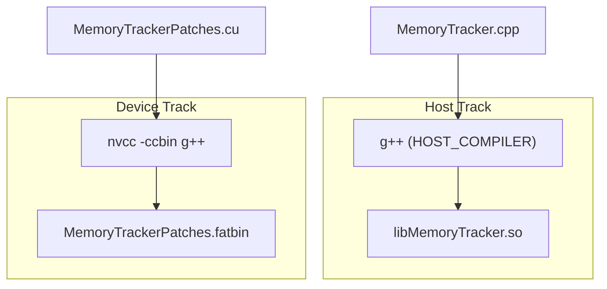
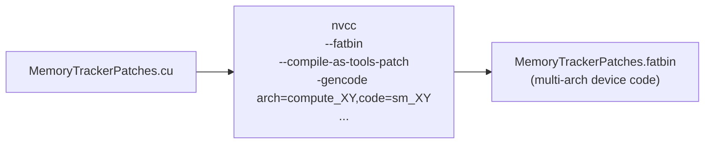
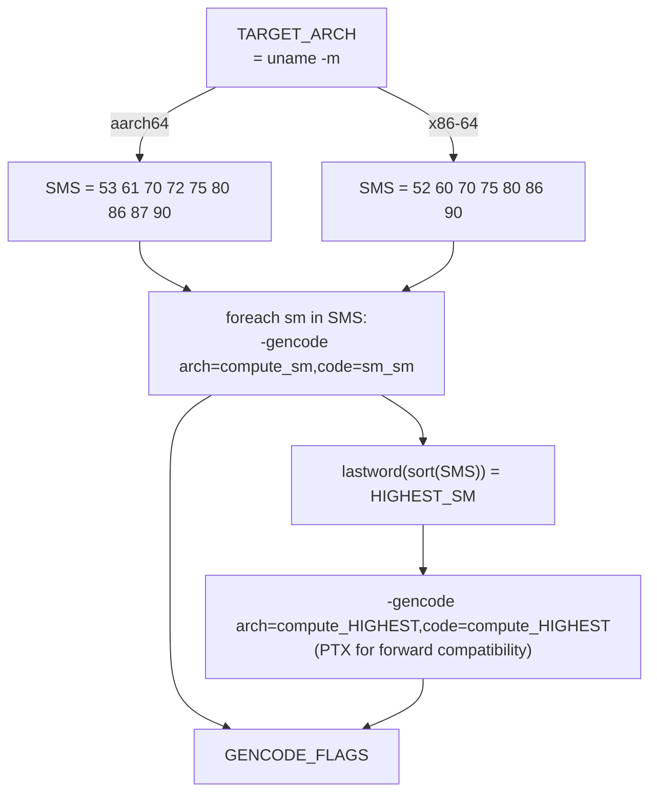
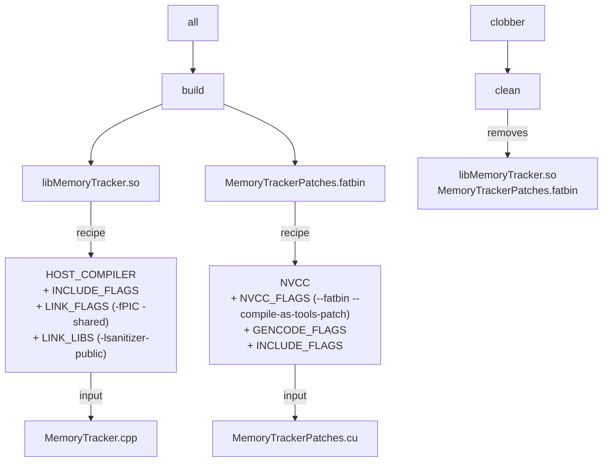

<!-- source: DeepWiki mcp.deepwiki.com · repo NVIDIA/compute-sanitizer-samples · extra page Build System · fetched 2026-10-26 -->

# Build System

<details>
<summary>Relevant source files</summary>

The following files were used as context for generating this wiki page:

- [MemoryTracker/Makefile](MemoryTracker/Makefile)

</details>


This page describes the `MemoryTracker` Makefile — its two independent build tracks, compiler flags, multi-architecture GPU code generation, and debug options. For details on what each build artifact does at runtime, see the host-side implementation ([2.1.1](#2.1.1)) and the device-side patch functions ([2.1.2](#2.1.2)).

---

## Overview

The `MemoryTracker` build produces exactly two artifacts from two independent source files using two different compilers. Neither artifact depends on the other at build time.

| Artifact | Source | Compiler | Purpose |
|---|---|---|---|
| `libMemoryTracker.so` | `MemoryTracker.cpp` | `g++` | Shared library loaded by `compute-sanitizer` at runtime |
| `MemoryTrackerPatches.fatbin` | `MemoryTrackerPatches.cu` | `nvcc` | Device-side patch code embedded/loaded by the host library |

The `build` target in [MemoryTracker/Makefile:72]() declares both as prerequisites:

```
build: libMemoryTracker.so MemoryTrackerPatches.fatbin
```

**Two-Track Build Flow**



Sources: [MemoryTracker/Makefile:34-35](), [MemoryTracker/Makefile:72-78]()

---

## Toolchain Configuration

[MemoryTracker/Makefile:31-35]()

| Variable | Default Value | Role |
|---|---|---|
| `CUDA_PATH` | `/usr/local/cuda` | Root of CUDA Toolkit installation |
| `SANITIZER_PATH` | `$(CUDA_PATH)/compute-sanitizer` | Compute Sanitizer headers and libraries |
| `HOST_COMPILER` | `g++` | C++ compiler used for the host track |
| `NVCC` | `$(CUDA_PATH)/bin/nvcc -ccbin $(HOST_COMPILER)` | CUDA compiler; delegates host compilation to `g++` |

`NVCC` is configured with `-ccbin $(HOST_COMPILER)`, meaning `nvcc` uses `g++` as its host compiler backend.

---

## Include and Link Flags

### Include Flags

[MemoryTracker/Makefile:37]()

`INCLUDE_FLAGS` adds two directories:

| Flag | Directory | Contents |
|---|---|---|
| `-I$(CUDA_PATH)/include` | CUDA Toolkit headers | `cuda.h`, `cuda_runtime.h`, etc. |
| `-I$(SANITIZER_PATH)/include` | Compute Sanitizer headers | `sanitizer_patching.h`, `sanitizer_callbacks.h`, etc. |

`INCLUDE_FLAGS` is applied to **both** the host and device compile rules.

### Link Flags (Host Track Only)

[MemoryTracker/Makefile:39-40]()

| Flag | Purpose |
|---|---|
| `-L$(SANITIZER_PATH)` | Library search path for the Sanitizer runtime |
| `-fPIC` | Position-independent code, required for shared libraries |
| `-shared` | Produce a shared library (`.so`) |
| `-lsanitizer-public` | Links `libsanitizer-public`, providing the Sanitizer injection API |

These flags are exclusive to the `libMemoryTracker.so` rule. The device track (`MemoryTrackerPatches.fatbin`) does not link against any host libraries.

---

## Device Compilation Flags

[MemoryTracker/Makefile:42-43]()

`NVCC_FLAGS` controls the device-side compilation:

| Flag | Purpose |
|---|---|
| `--fatbin` | Produce a `.fatbin` file rather than an object or executable |
| `--compile-as-tools-patch` | Compile device code as a Sanitizer patch; enables access to `sanitizer_patching.h` intrinsics and the `__sanitizer_builtin_*` builtins required by patch functions |

`--compile-as-tools-patch` is the critical flag that distinguishes patch device code from ordinary CUDA device code. Without it, the patch entry points (`MemoryGlobalAccessCallback`, etc.) cannot use the Sanitizer patching intrinsics.

**Compilation Pipeline for MemoryTrackerPatches.fatbin**



Sources: [MemoryTracker/Makefile:42-43](), [MemoryTracker/Makefile:77-78]()

---

## Multi-Architecture GPU Code Generation

[MemoryTracker/Makefile:52-65]()

`GENCODE_FLAGS` is constructed dynamically based on the host architecture.

### Default SMS Lists

| Architecture | `SMS` list |
|---|---|
| `aarch64` | `53 61 70 72 75 80 86 87 90` |
| x86-64 (all others) | `52 60 70 75 80 86 90` |

`TARGET_ARCH` is detected at build time via `uname -m`.

### Flag Generation

For each SM version in `SMS`, the Makefile emits a `-gencode` flag for real SASS code:

```
-gencode arch=compute_<sm>,code=sm_<sm>
```

After iterating all SM versions, it appends one additional flag using the **highest SM** version, targeting PTX:

```
-gencode arch=compute_<HIGHEST_SM>,code=compute_<HIGHEST_SM>
```

This PTX entry ensures **forward compatibility**: GPUs with SM architectures newer than the highest listed SM can JIT-compile the PTX at runtime.

**GENCODE_FLAGS Construction**



Sources: [MemoryTracker/Makefile:52-65]()

---

## Debug Build Option

[MemoryTracker/Makefile:45-47]()

Passing `dbg=1` on the `make` command line appends debug flags to `NVCC_FLAGS`:

| Flag | Effect |
|---|---|
| `-g` | Host-side debug information |
| `-G` | Device-side debug information (disables optimizations on device code) |

Usage:

```
make dbg=1
```

These flags apply only to the device-side (`nvcc`) compilation. The host-side `g++` rule does not have a corresponding debug toggle in this Makefile.

---

## Build Rules Summary

The following diagram maps each Make target to its rule components:



Sources: [MemoryTracker/Makefile:70-83]()

---

