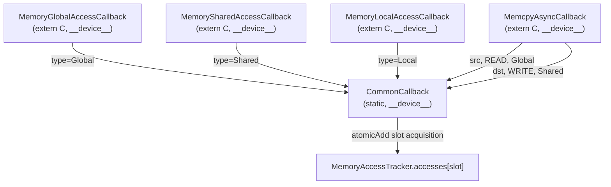
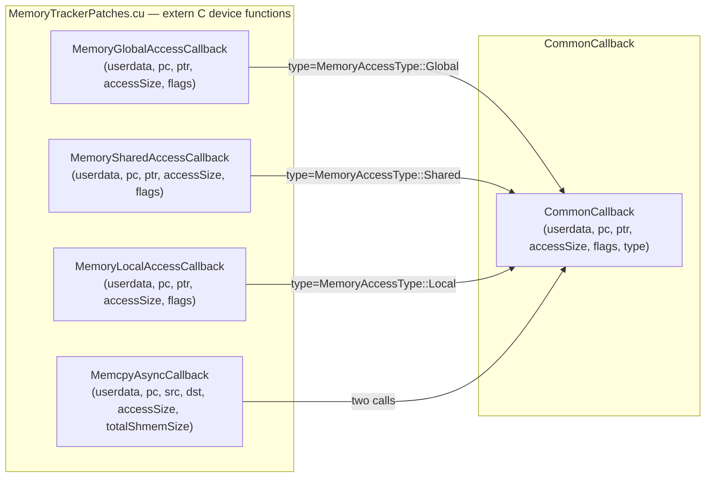
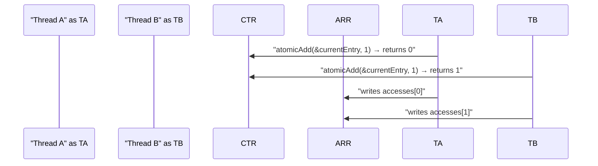

<!-- source: DeepWiki mcp.deepwiki.com · repo NVIDIA/compute-sanitizer-samples · extra page Device-Side Patch Functions · fetched 2026-10-26 -->

# Device-Side Patch Functions

<details>
<summary>Relevant source files</summary>

The following files were used as context for generating this wiki page:

- [MemoryTracker/MemoryTracker.h](MemoryTracker/MemoryTracker.h)
- [MemoryTracker/MemoryTrackerPatches.cu](MemoryTracker/MemoryTrackerPatches.cu)

</details>


This page covers the device-side code in [MemoryTracker/MemoryTrackerPatches.cu](), which implements the GPU-resident patch functions injected into instrumented kernels by the MemoryTracker sample. These functions run on the device at the point of each memory instruction and populate a shared tracking buffer.

For the host-side code that allocates the tracking buffer and reads results after synchronization, see [Host-Side Implementation](#2.1.1). For the build system that compiles this file into `MemoryTrackerPatches.fatbin`, see [Build System](#2.1.3). For the overall MemoryTracker architecture, see [MemoryTracker](#2.1).

---

## Shared Data Structures

Both the host and device sides share a common header, [MemoryTracker/MemoryTracker.h](), which defines the structures exchanged through the `userdata` pointer.

| Type | Role |
|---|---|
| `MemoryAccessType` | Enum distinguishing `Global`, `Shared`, and `Local` access categories |
| `MemoryAccess` | One record per intercepted memory instruction |
| `MemoryAccessTracker` | Root tracking object passed as `userdata` to each patch |

### `MemoryAccess` Fields

[MemoryTracker/MemoryTracker.h:43-49]()

| Field | Type | Description |
|---|---|---|
| `address` | `uint64_t` | Address of the memory operand |
| `accessSize` | `uint32_t` | Size of the access in bytes |
| `flags` | `uint32_t` | Sanitizer-provided flags (e.g. `SANITIZER_MEMORY_DEVICE_FLAG_READ` / `_WRITE`) |
| `threadId` | `dim3` | Thread index within the block at the time of access |
| `type` | `MemoryAccessType` | Global / Shared / Local classification |

### `MemoryAccessTracker` Fields

[MemoryTracker/MemoryTracker.h:52-57]()

| Field | Type | Description |
|---|---|---|
| `currentEntry` | `uint32_t` | Atomic counter; next available slot index |
| `maxEntry` | `uint32_t` | Capacity of the `accesses` array |
| `accesses` | `MemoryAccess*` | Device-side array allocated by the host before kernel launch |

Sources: [MemoryTracker/MemoryTracker.h:34-57]()

---

## Function Hierarchy

**Diagram: Patch Function Call Graph**



Sources: [MemoryTracker/MemoryTrackerPatches.cu:32-101]()

---

## `CommonCallback` — Internal Device Helper

[MemoryTracker/MemoryTrackerPatches.cu:32-57]()

`CommonCallback` is a `static __device__` function (not exported, not patched itself). It is the single write path into the tracking buffer. All four public patch entry points delegate to it.

**Signature:**
```
SanitizerPatchResult CommonCallback(
    void* userdata,
    uint64_t pc,
    void* ptr,
    uint32_t accessSize,
    uint32_t flags,
    MemoryAccessType type)
```

### Slot Acquisition

[MemoryTracker/MemoryTrackerPatches.cu:43]()

```
uint32_t old = atomicAdd(&(pTracker->currentEntry), 1);
```

`atomicAdd` on `currentEntry` guarantees each thread receives a unique slot index, even when thousands of threads call the patch concurrently. The pre-increment value `old` becomes the thread's exclusive write index into `pTracker->accesses`.

### Buffer Overflow Guard

[MemoryTracker/MemoryTrackerPatches.cu:45-47]()

If `old >= pTracker->maxEntry`, the function returns `SANITIZER_PATCH_SUCCESS` immediately without writing. This is a silent drop: once the buffer is full, additional accesses in that kernel launch are not recorded. The host side can detect overflow by checking whether `currentEntry > maxEntry` after synchronization.

### Record Population

[MemoryTracker/MemoryTrackerPatches.cu:49-54]()

When a valid slot is obtained, the function writes directly into `pTracker->accesses[old]`:

| Field written | Source |
|---|---|
| `address` | `(uint64_t)(uintptr_t)ptr` |
| `accessSize` | `accessSize` parameter |
| `flags` | `flags` parameter |
| `threadId` | Built-in `threadIdx` |
| `type` | `type` parameter (passed by each entry point) |

Sources: [MemoryTracker/MemoryTrackerPatches.cu:32-57]()

---

## Public Patch Entry Points

All public callbacks are declared `extern "C" __device__ __noinline__`. The `extern "C"` linkage ensures the symbol names are unmangled, which is required for the sanitizer runtime to locate them by name during module instrumentation. The `__noinline__` attribute prevents the compiler from inlining these into the instrumented application's code.

**Diagram: Entry Points, Signatures, and Delegation**



Sources: [MemoryTracker/MemoryTrackerPatches.cu:59-101]()

### `MemoryGlobalAccessCallback`

[MemoryTracker/MemoryTrackerPatches.cu:59-68]()

Intercepts global memory loads and stores. Delegates directly to `CommonCallback` with `MemoryAccessType::Global`.

### `MemorySharedAccessCallback`

[MemoryTracker/MemoryTrackerPatches.cu:70-79]()

Intercepts shared memory loads and stores. Delegates to `CommonCallback` with `MemoryAccessType::Shared`.

### `MemoryLocalAccessCallback`

[MemoryTracker/MemoryTrackerPatches.cu:81-90]()

Intercepts local memory (register spill/fill) loads and stores. Delegates to `CommonCallback` with `MemoryAccessType::Local`.

### `MemcpyAsyncCallback` — Dual-Access Recording

[MemoryTracker/MemoryTrackerPatches.cu:92-101]()

`MemcpyAsyncCallback` handles `cp.async` instructions, which transfer data from global memory directly into shared memory. Its signature differs from the three single-address callbacks:

```
SanitizerPatchResult MemcpyAsyncCallback(
    void* userdata,
    uint64_t pc,
    void* src,      // global source address (may be null)
    uint32_t dst,   // shared memory destination offset
    uint32_t accessSize,
    uint32_t totalShmemSize)
```

Because `cp.async` involves two distinct memory spaces simultaneously, `MemcpyAsyncCallback` calls `CommonCallback` **twice**:

1. **Source (read):** If `src` is non-null, records `src` with `SANITIZER_MEMORY_DEVICE_FLAG_READ` and `MemoryAccessType::Global`.
2. **Destination (write):** Always records `(void*)dst` with `SANITIZER_MEMORY_DEVICE_FLAG_WRITE` and `MemoryAccessType::Shared`.

The `src` null check guards against the case where no global source is involved in the async copy operation.

Sources: [MemoryTracker/MemoryTrackerPatches.cu:92-101]()

---

## Return Value

All patch functions return `SanitizerPatchResult`, which is always `SANITIZER_PATCH_SUCCESS` in this implementation. The sanitizer runtime uses this return value to decide whether to allow or abort the memory operation being patched; `SANITIZER_PATCH_SUCCESS` signals that the original operation should proceed normally.

Sources: [MemoryTracker/MemoryTrackerPatches.cu:32-101]()

---

## Concurrency Model

**Diagram: Concurrent Slot Acquisition**



Each thread independently increments `currentEntry` via `atomicAdd` and receives a unique pre-increment value. There is no locking; threads write to non-overlapping slots in `accesses[]`. If `currentEntry` reaches or exceeds `maxEntry` before a thread's `atomicAdd`, that thread skips its write and returns immediately.

Sources: [MemoryTracker/MemoryTrackerPatches.cu:43-47]()

---

