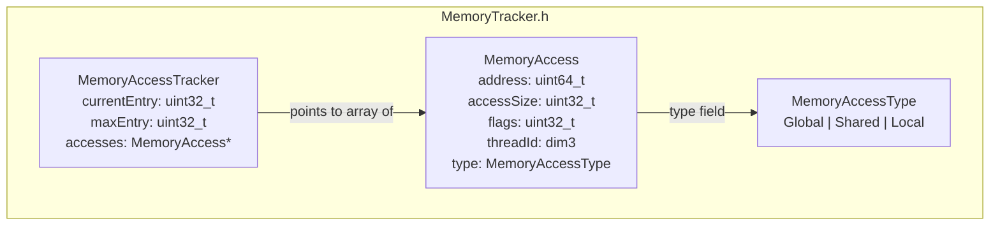
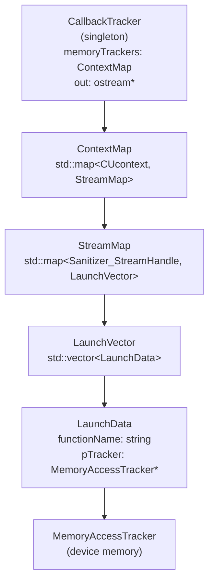
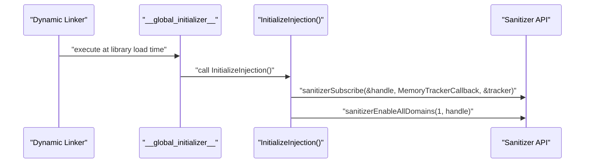
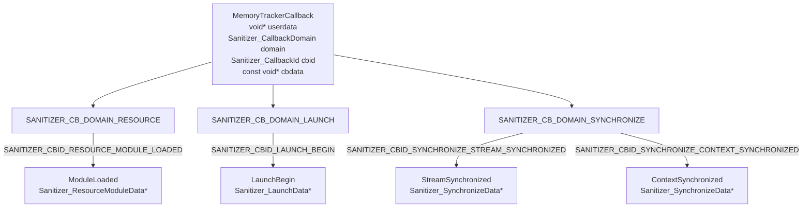
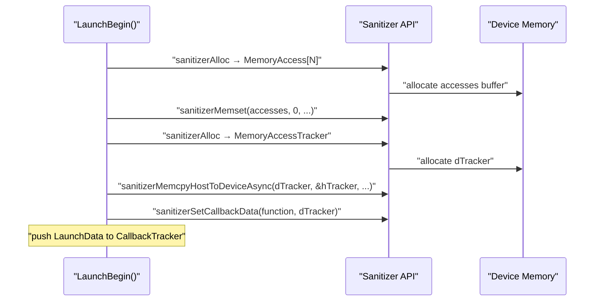
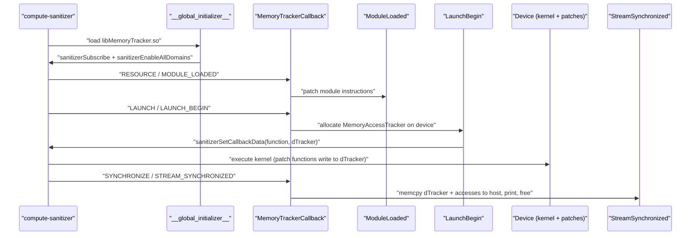

<!-- source: DeepWiki mcp.deepwiki.com · repo NVIDIA/compute-sanitizer-samples · extra page Host-Side Implementation · fetched 2026-10-26 -->

# Host-Side Implementation

<details>
<summary>Relevant source files</summary>

The following files were used as context for generating this wiki page:

- [MemoryTracker/MemoryTracker.cpp](MemoryTracker/MemoryTracker.cpp)
- [MemoryTracker/MemoryTracker.h](MemoryTracker/MemoryTracker.h)

</details>


This page covers all host-side logic in [MemoryTracker/MemoryTracker.cpp](), including the `CallbackTracker` singleton, the `MemoryTrackerCallback` dispatcher, module instrumentation, per-launch tracker allocation, synchronization-triggered data collection, and result reporting. For the device-side patch functions that run inside kernels and populate the tracking buffers, see [Device-Side Patch Functions](#2.1.2). For the build system, see [Build System](#2.1.3).

---

## Shared Data Structures

The header [MemoryTracker/MemoryTracker.h]() defines the structures shared between host and device code.

| Type | Kind | Fields | Purpose |
|---|---|---|---|
| `MemoryAccessType` | `enum class` | `Global`, `Shared`, `Local` | Categorizes the memory space of an access |
| `MemoryAccess` | `struct` | `address`, `accessSize`, `flags`, `threadId`, `type` | One recorded memory access event |
| `MemoryAccessTracker` | `struct` | `currentEntry`, `maxEntry`, `accesses` | Device-resident control block; `accesses` points to a `MemoryAccess` array |

`MemoryAccessTracker` is the object that device patch functions write into atomically. The host allocates it before each kernel launch and reads it back after synchronization.

**Data structure diagram:**



Sources: [MemoryTracker/MemoryTracker.h:34-57]()

---

## Host-Side Type Hierarchy

[MemoryTracker/MemoryTracker.cpp]() defines a layered map structure to associate in-flight kernel launches with their device-side tracker pointers.



- `CallbackTracker` is the root singleton holding all live tracking state.
- Each context maps to a `StreamMap`; each stream maps to a `LaunchVector`.
- Each element of `LaunchVector` is a `LaunchData`, which pairs the kernel's human-readable name with the raw device pointer to its `MemoryAccessTracker`.

Sources: [MemoryTracker/MemoryTracker.cpp:38-75]()

---

## CallbackTracker Singleton

`CallbackTracker` [MemoryTracker/MemoryTracker.cpp:48-75]() is a simple singleton accessed via `CallbackTracker::GetInstance()`. Its constructor checks the `OUT_FILE_NAME` environment variable:

- If set, output is directed to the named file via `std::ofstream`.
- If unset, output goes to `std::cout`.

The singleton is constructed once on first access and its address is passed as `userdata` to every sanitizer callback.

Sources: [MemoryTracker/MemoryTracker.cpp:48-75]()

---

## Bootstrap: `InitializeInjection` and `__global_initializer__`



[MemoryTracker/MemoryTracker.cpp:286-297]() defines:

```
int __global_initializer__ = InitializeInjection();
```

This file-scope variable initialization runs when `libMemoryTracker.so` is loaded by `compute-sanitizer`. `InitializeInjection` obtains the `CallbackTracker` singleton, then calls `sanitizerSubscribe` to register `MemoryTrackerCallback` with the singleton as `userdata`, and `sanitizerEnableAllDomains` to activate all callback domains in one call.

Sources: [MemoryTracker/MemoryTracker.cpp:286-297]()

---

## `MemoryTrackerCallback` Dispatcher

`MemoryTrackerCallback` [MemoryTracker/MemoryTracker.cpp:226-284]() is the single callback entry point registered with the sanitizer. It dispatches on two levels: `domain` then `cbid`.

**Dispatch table:**

| `domain` | `cbid` | Handler called |
|---|---|---|
| `SANITIZER_CB_DOMAIN_RESOURCE` | `SANITIZER_CBID_RESOURCE_MODULE_LOADED` | `ModuleLoaded(pModuleData)` |
| `SANITIZER_CB_DOMAIN_LAUNCH` | `SANITIZER_CBID_LAUNCH_BEGIN` | `LaunchBegin(callbackTracker, context, function, functionName, hStream)` |
| `SANITIZER_CB_DOMAIN_SYNCHRONIZE` | `SANITIZER_CBID_SYNCHRONIZE_STREAM_SYNCHRONIZED` | `StreamSynchronized(callbackTracker, context, hStream)` |
| `SANITIZER_CB_DOMAIN_SYNCHRONIZE` | `SANITIZER_CBID_SYNCHRONIZE_CONTEXT_SYNCHRONIZED` | `ContextSynchronized(callbackTracker, context)` |

All other `domain`/`cbid` combinations fall through to `default: break`.



Sources: [MemoryTracker/MemoryTracker.cpp:226-284]()

---

## `ModuleLoaded`: Module Instrumentation

`ModuleLoaded` [MemoryTracker/MemoryTracker.cpp:77-90]() is called every time a CUDA module is loaded. It performs four instrumentation steps:

1. **Load patch code** — `sanitizerAddPatchesFromFile("MemoryTrackerPatches.fatbin", 0)` makes the device-side patch functions available.
2. **Patch global memory accesses** — `sanitizerPatchInstructions(SANITIZER_INSTRUCTION_GLOBAL_MEMORY_ACCESS, module, "MemoryGlobalAccessCallback")`
3. **Patch shared memory accesses** — `sanitizerPatchInstructions(SANITIZER_INSTRUCTION_SHARED_MEMORY_ACCESS, module, "MemorySharedAccessCallback")`
4. **Patch local memory accesses** — `sanitizerPatchInstructions(SANITIZER_INSTRUCTION_LOCAL_MEMORY_ACCESS, module, "MemoryLocalAccessCallback")`
5. **Patch async memcpy** — `sanitizerPatchInstructions(SANITIZER_INSTRUCTION_MEMCPY_ASYNC, module, "MemcpyAsyncCallback")`
6. **Finalize** — `sanitizerPatchModule(module)` commits all patches to the module.

If `sanitizerAddPatchesFromFile` fails (e.g., the `.fatbin` is missing or targets the wrong SM architecture), a diagnostic is printed to `std::cerr` and instrumentation is skipped silently for that module.

Sources: [MemoryTracker/MemoryTracker.cpp:77-90]()

---

## `LaunchBegin`: Per-Kernel Tracker Allocation

`LaunchBegin` [MemoryTracker/MemoryTracker.cpp:105-133]() runs before every kernel launch. Its job is to allocate device-side tracking buffers and associate them with the kernel.

**Steps:**

1. Determine buffer capacity via `GetMemAccessSize()`, which reads the `MEM_ACCESS_SIZE` environment variable (default: 1024 entries) [MemoryTracker/MemoryTracker.cpp:92-103]().
2. Allocate a `MemoryAccess[MemAccessSize]` array in device memory with `sanitizerAlloc`.
3. Zero-initialize the array with `sanitizerMemset(..., stream)`.
4. Build a host-local `MemoryAccessTracker` (`currentEntry=0`, `maxEntry=MemAccessSize`, `accesses=<device ptr>`).
5. Allocate a device-side `MemoryAccessTracker` with `sanitizerAlloc` and copy the host struct to device with `sanitizerMemcpyHostToDeviceAsync(..., stream)`.
6. Call `sanitizerSetCallbackData(function, dTracker)` — this is the mechanism by which the device patch functions receive `dTracker` as their `userdata` argument.
7. Append a `LaunchData{functionName, dTracker}` to `pCallbackTracker->memoryTrackers[context][stream]`.



Sources: [MemoryTracker/MemoryTracker.cpp:105-133]()

---

## `StreamSynchronized` and `ContextSynchronized`: Data Collection

Once a stream or context synchronization point is reached, the device has finished executing all queued kernels and the buffers can be safely read back.

### `StreamSynchronized` [MemoryTracker/MemoryTracker.cpp:174-214]()

Iterates over all `LaunchData` entries recorded for `(context, stream)`:

1. Prints the kernel's `functionName`.
2. Calls `sanitizerMemcpyDeviceToHost(&hTracker, tracker.pTracker, ...)` to retrieve the `MemoryAccessTracker` (which contains the final `currentEntry` count).
3. Computes `numEntries = min(currentEntry, maxEntry)` — if the buffer overflowed, only up to `maxEntry` entries are reported.
4. Calls `sanitizerMemcpyDeviceToHost(accesses.data(), hTracker.accesses, ...)` to retrieve the actual `MemoryAccess` records.
5. Prints each access using `GetMemoryRWString` and `GetMemoryTypeString`.
6. Frees device memory with `sanitizerFree(context, hTracker.accesses)` and `sanitizerFree(context, tracker.pTracker)`.
7. Clears the `LaunchVector` for the stream.

### `ContextSynchronized` [MemoryTracker/MemoryTracker.cpp:216-224]()

A thin wrapper that iterates over all streams in `memoryTrackers[context]` and calls `StreamSynchronized` for each one.

Sources: [MemoryTracker/MemoryTracker.cpp:174-224]()

---

## Output Reporting Helpers

Two static helper functions format access records for printing:

| Function | Input | Returns |
|---|---|---|
| `GetMemoryRWString` | `uint32_t flags` | `"Read"`, `"Write"`, `"Atomic"`, or `"Unknown"` based on `SANITIZER_MEMORY_DEVICE_FLAG_READ` / `SANITIZER_MEMORY_DEVICE_FLAG_WRITE` bits |
| `GetMemoryTypeString` | `MemoryAccessType type` | `"local"`, `"shared"`, or `"global"` |

Example output line (produced in `StreamSynchronized`):

```
  [0] Read access of global memory by thread (0,0,0) at address 0x7f... (size is 4 bytes)
```

Sources: [MemoryTracker/MemoryTracker.cpp:135-172](), [MemoryTracker/MemoryTracker.cpp:196-207]()

---

## End-to-End Lifecycle Summary



Sources: [MemoryTracker/MemoryTracker.cpp:77-297]()

---

## Sanitizer API Calls Reference

The following table lists every Sanitizer API function used in `MemoryTracker.cpp` and where it is called.

| API Function | Call Site | Purpose |
|---|---|---|
| `sanitizerSubscribe` | `InitializeInjection` | Register `MemoryTrackerCallback` with the sanitizer runtime |
| `sanitizerEnableAllDomains` | `InitializeInjection` | Enable all callback domains for the subscriber |
| `sanitizerAddPatchesFromFile` | `ModuleLoaded` | Load device patch functions from `MemoryTrackerPatches.fatbin` |
| `sanitizerPatchInstructions` | `ModuleLoaded` (×4) | Redirect each instruction class to a named patch function |
| `sanitizerPatchModule` | `ModuleLoaded` | Commit all pending patches to the module |
| `sanitizerAlloc` | `LaunchBegin` (×2) | Allocate device-accessible memory for tracker structs |
| `sanitizerMemset` | `LaunchBegin` | Zero-initialize the `MemoryAccess` array on device |
| `sanitizerMemcpyHostToDeviceAsync` | `LaunchBegin` | Copy initialized `MemoryAccessTracker` to device |
| `sanitizerSetCallbackData` | `LaunchBegin` | Bind `dTracker` as userdata for patch function calls |
| `sanitizerMemcpyDeviceToHost` | `StreamSynchronized` (×2) | Read back tracker header and access records |
| `sanitizerFree` | `StreamSynchronized` (×2) | Release device-side tracker and access array |

Sources: [MemoryTracker/MemoryTracker.cpp:77-297]()

---

