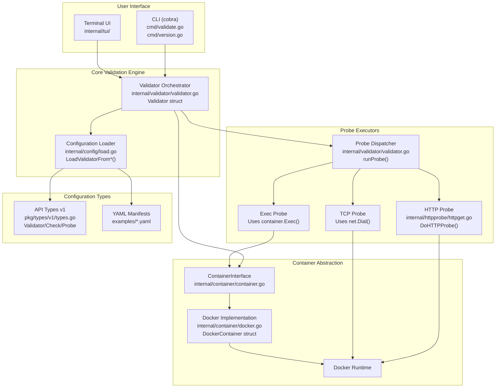
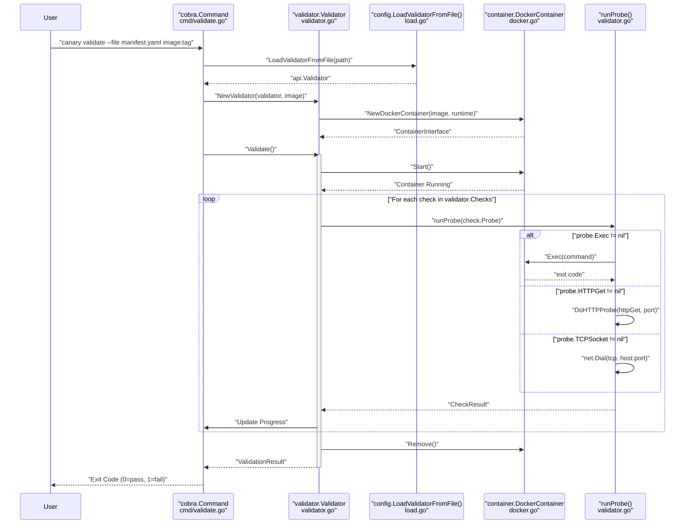
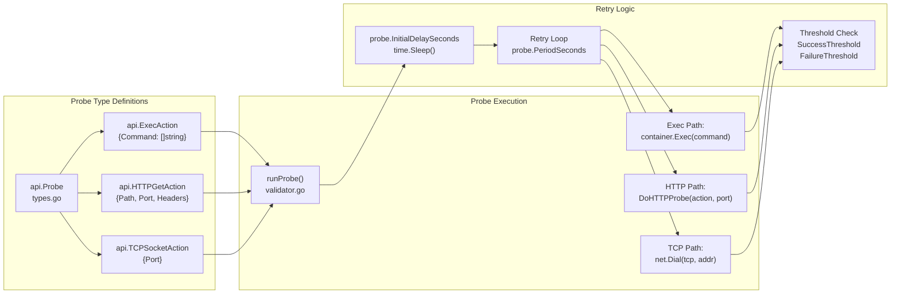

<!-- source: DeepWiki mcp.deepwiki.com · repo NVIDIA/container-canary · page 1 Overview · fetched 2026-10-26 -->

# Overview

<details>
<summary>Relevant source files</summary>

The following files were used as context for generating this wiki page:

- [CONTRIBUTING.md](CONTRIBUTING.md)
- [Makefile](Makefile)
- [README.md](README.md)
- [go.mod](go.mod)
- [main.go](main.go)

</details>


This document provides a comprehensive overview of Container Canary, a container validation tool designed to ensure container images meet platform-specific requirements. It covers the project's purpose, core concepts, system architecture, and key components. For installation instructions, see [Installation](#1.1). For getting started with validation, see [Quick Start](#1.2). For detailed CLI usage, see [CLI Reference](#2.1).

## What is Container Canary

Container Canary is a validation tool for container images in bring-your-own-container (BYOC) computing environments. It validates whether container images conform to platform-specific requirements by executing a set of checks defined in a declarative YAML manifest. [README.md:1-20]()

The tool addresses a common challenge: compute platforms like Kubeflow, SageMaker, and others allow users to provide custom container images but require those images to meet specific constraints such as:
- Running as a non-root user with specific UID. [README.md:55-57]()
- Exposing services on designated ports. [README.md:52]()
- Having home directories in specific locations. [README.md:56]()
- Installing required packages. [README.md:18]()
- Setting proper HTTP headers for iframe compatibility. [README.md:54]()

Container Canary records these requirements as versioned manifests and validates containers against them, particularly useful in CI/CD pipelines to prevent regressions. [README.md:20-21]()

**Sources**: [README.md:1-21](), [cmd/root.go:26-38]()

## Core Concepts

Container Canary operates on four fundamental concepts:

| Concept | Description | Code Entity |
|---------|-------------|-------------|
| **Validator** | A manifest defining platform requirements and runtime configuration | `api.Validator` struct in [pkg/types/v1/types.go:23-35]() |
| **Check** | An individual validation test with a name, description, and probe | `api.Check` struct in [pkg/types/v1/types.go:37-43]() |
| **Probe** | The actual test mechanism (exec, HTTP, or TCP) with timing parameters | `api.Probe` struct in [pkg/types/v1/types.go:45-56]() |
| **Validation** | The process of starting a container and executing all checks against it | `Validator.Validate()` in [internal/validator/validator.go:53-112]() |

**Sources**: [README.md:145-287](), [pkg/types/v1/types.go:23-56](), [internal/validator/validator.go:53-112]()

## System Architecture

The following diagram shows the high-level architecture and how components interact:

Title: High-Level System Architecture


**Sources**: [cmd/validate.go:1-90](), [cmd/version.go:1-40](), [internal/validator/validator.go:1-219](), [internal/config/load.go:1-75](), [internal/httpprobe/httpget.go:1-95](), [internal/container/container.go:1-35](), [internal/container/docker.go:1-140](), [pkg/types/v1/types.go:1-75]()

## Validation Workflow

Container Canary follows a sequential validation workflow:

Title: Validation Sequence Diagram


**Sources**: [cmd/validate.go:50-90](), [internal/validator/validator.go:53-112](), [internal/config/load.go:34-42](), [internal/container/docker.go:53-85](), [internal/httpprobe/httpget.go:34-95]()

## Key Components

### Validator Orchestrator

The `Validator` struct in [internal/validator/validator.go:33-40]() is the central orchestration component. It manages:
- Container lifecycle (start, stop, cleanup). [internal/validator/validator.go:56-111]()
- Sequential execution of checks. [internal/validator/validator.go:68-76]()
- Probe routing based on type. [internal/validator/validator.go:149-178]()
- Result aggregation and reporting. [internal/validator/validator.go:78-81]()

Key methods:
- `Validate()`: Main entry point that executes all checks. [internal/validator/validator.go:53-112]()
- `runProbe()`: Dispatches to appropriate probe executor. [internal/validator/validator.go:149-178]()
- `runCheck()`: Executes a single check with retry logic. [internal/validator/validator.go:114-147]()

### Configuration Loader

The configuration system in [internal/config/load.go]() supports three loading mechanisms:

| Function | Purpose | Source Type |
|----------|---------|-------------|
| `LoadValidatorFromFile(path)` | Load from local YAML file | Filesystem |
| `LoadValidatorFromURL(url)` | Load from remote URL | HTTP/HTTPS |
| `LoadValidatorFromBytes(data)` | Load from memory | In-memory bytes |

All converge on `LoadValidatorFromBytes()` which uses `yaml.Unmarshal()` to parse into `api.Validator` structs. [internal/config/load.go:66-74]()

### Container Abstraction

The container abstraction in [internal/container/container.go:27-33]() defines the `ContainerInterface`:

```go
type ContainerInterface interface {
	Start() error
	Remove() error
	Exec(command []string) (int, error)
}
```

The Docker implementation in [internal/container/docker.go:33-41]() (`DockerContainer` struct) provides concrete methods using Docker CLI commands:
- `Start()`: Executes `docker run` with configured ports, volumes, environment variables. [internal/container/docker.go:53-85]()
- `Remove()`: Executes `docker rm -f`. [internal/container/docker.go:87-95]()
- `Exec()`: Executes `docker exec` and returns exit code. [internal/container/docker.go:97-124]()

**Sources**: [internal/validator/validator.go:33-178](), [internal/config/load.go:34-75](), [internal/container/container.go:27-33](), [internal/container/docker.go:33-124]()

## Probe Types and Executors

Container Canary supports three probe types, each mapped to specific validation strategies:

Title: Probe Execution Flow


### Exec Probe
Executes commands inside the container via `container.Exec()`. Returns success if exit code is 0. [internal/validator/validator.go:155-160]()

**Use Cases**: Validate user, UID, home directory, installed packages, filesystem state. [README.md:77-101]()

### HTTP Probe  
Performs HTTP GET requests via `DoHTTPProbe()` in [internal/httpprobe/httpget.go:34-95](). Validates:
- Response status code < 300. [internal/httpprobe/httpget.go:78]()
- Optional request headers. [internal/httpprobe/httpget.go:53-56]()
- Optional response header matching. [internal/httpprobe/httpget.go:82-92]()

**Use Cases**: Validate HTTP service availability, routing, CORS headers. [README.md:102-125]()

### TCP Probe
Attempts TCP connection using `net.Dial()`. Returns success if connection established. [internal/validator/validator.go:171-175]()

**Use Cases**: Validate port availability, TCP service listening. [README.md:261-268]()

**Sources**: [internal/validator/validator.go:149-178](), [internal/httpprobe/httpget.go:34-95](), [pkg/types/v1/types.go:45-75](), [README.md:221-268]()

## Technology Stack

Container Canary is built with the following dependencies:

| Dependency | Purpose | Version |
|------------|---------|---------|
| Go | Implementation language | 1.25.0 |
| github.com/spf13/cobra | CLI framework | v1.10.2 |
| github.com/charmbracelet/bubbletea | Terminal UI framework | v0.25.0 |
| github.com/charmbracelet/lipgloss | TUI styling | v0.5.0 |
| gopkg.in/yaml.v3 | YAML parsing | v3.0.1 |
| k8s.io/api | Kubernetes probe types | v0.23.3 |
| github.com/stretchr/testify | Testing framework | v1.11.1 |
| github.com/google/uuid | UUID generation | v1.6.0 |

The project reuses Kubernetes API types (`k8s.io/api`) to maintain compatibility with existing Kubernetes probe definitions, reducing the learning curve for users familiar with Kubernetes. [go.mod:15](), [README.md:128]()

**Sources**: [go.mod:1-53]()

## Build and Distribution

Container Canary uses a comprehensive build system:

- **Build Tool**: Makefile in root directory. [Makefile:1-48]()
- **Cross-Compilation**: Builds for Linux (amd64/arm64), macOS (amd64/arm64), Windows (amd64). [Makefile:23-29]()
- **Version Embedding**: Linker flags inject version, commit hash, and build time. [Makefile:7-10]()
- **CI/CD**: GitHub Actions workflows for testing, linting, and releases. [README.md:3]()
- **Static Linking**: Linux binaries use `CGO_ENABLED=0` for portability. [Makefile:25-26]()

For build instructions, see [Building from Source](#4.1). For CI/CD details, see [CI/CD and Releases](#6).

**Sources**: [Makefile:1-48](), [CONTRIBUTING.md:9-16]()

## Next Steps

- **Installation**: See [Installation](#1.1) for download and setup instructions.
- **Quick Start**: See [Quick Start](#1.2) for a simple validation example.
- **Writing Manifests**: See [Writing Validator Manifests](#2.2) for creating custom validators.
- **Architecture Deep Dive**: See [Architecture](#3) for detailed component architecture.
- **API Reference**: See [API Reference](#5) for complete type definitions.
- **Developer Guide**: See [Developer Guide](#4) for development and contribution guidelines.

**Sources**: [README.md:22-40](), [CONTRIBUTING.md:1-94]()

---

