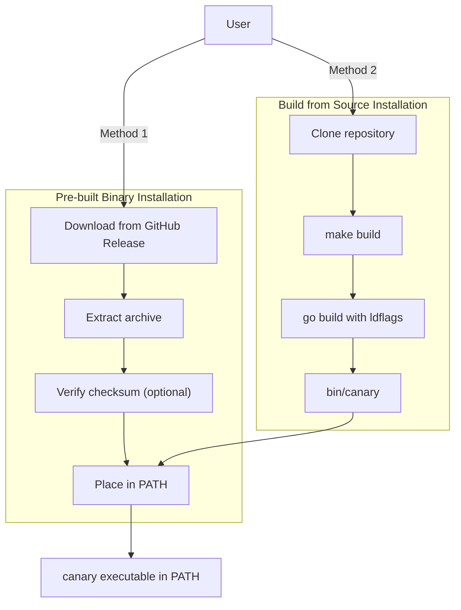
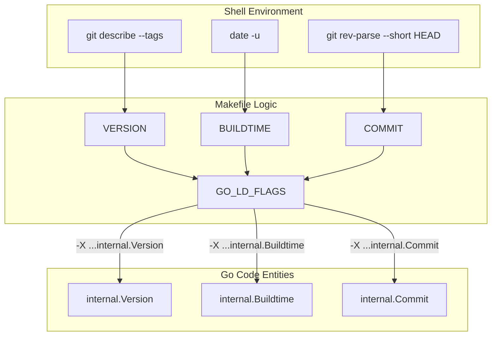

<!-- source: DeepWiki mcp.deepwiki.com · repo NVIDIA/container-canary · page 1.1 Installation · fetched 2026-10-26 -->

# Installation

<details>
<summary>Relevant source files</summary>

The following files were used as context for generating this wiki page:

- [.github/workflows/upload-release-assets.yaml](.github/workflows/upload-release-assets.yaml)
- [CONTRIBUTING.md](CONTRIBUTING.md)
- [Makefile](Makefile)
- [README.md](README.md)
- [main.go](main.go)

</details>


This document describes how to install `container-canary` on your system. It covers two installation methods: downloading pre-built binaries from releases, and building from source. For information about using `container-canary` after installation, see [Quick Start](). For detailed development setup including testing infrastructure, see [Building from Source]().

## Installation Methods Overview

Container-canary can be installed through two primary methods:

1.  **Pre-built Binaries** (Recommended): Download platform-specific binaries from GitHub releases.
2.  **Build from Source**: Compile the tool locally using the Go toolchain and `make`.

### Installation Flow

**Sources**: [README.md:42-44](), [Makefile:14-19](), [CONTRIBUTING.md:9-16]()

---

## Installing from Pre-built Binaries

The recommended installation method is to download pre-built binaries from the GitHub releases page [README.md:44]().

### Supported Platforms

The project uses a `package` target in the `Makefile` to cross-compile for multiple architectures [Makefile:23-29]().

| Platform | Architecture | Binary Name |
| :--- | :--- | :--- |
| Linux | AMD64 | `canary_linux_amd64` |
| Linux | ARM64 | `canary_linux_arm64` |
| macOS | AMD64 (Intel) | `canary_darwin_amd64` |
| macOS | ARM64 (Apple Silicon) | `canary_darwin_arm64` |
| Windows | AMD64 | `canary_windows_amd64.exe` |

**Sources**: [Makefile:24-28]()

### Download and Install

1.  **Navigate to the releases page**: Visit `https://github.com/NVIDIA/container-canary/releases`.
2.  **Download the appropriate binary** for your platform from the latest release assets.
3.  **Verify the checksum** (optional): The CI pipeline calculates SHA256 hashes for all assets during the release process [.github/workflows/upload-release-assets.yaml:35-40]().
4.  **Make the binary executable** (Linux/macOS only):
    ```bash
    chmod +x canary_linux_amd64
    ```
5.  **Move to a directory in your PATH**:
    ```bash
    sudo mv canary_linux_amd64 /usr/local/bin/canary
    ```

### Linux Static Binaries
Linux builds explicitly set `CGO_ENABLED=0` in the `Makefile` [Makefile:25-26](). This avoids dynamic linking against `libc`, preventing "version `GLIBC_X.XX' not found" errors when running the binary on systems older than the build environment [Makefile:20-22]().

**Sources**: [Makefile:20-26](), [.github/workflows/upload-release-assets.yaml:35-40]()

---

## Building from Source

Building from source requires the Go toolchain. The project currently targets Go version `1.26.x` in CI [.github/workflows/upload-release-assets.yaml:31]().

### Prerequisites
*   **Go**: 1.26.x (as specified in CI)
*   **Make**: Used for task running [CONTRIBUTING.md:7]()
*   **Docker**: Required for running tests [CONTRIBUTING.md:20-24]()

### Build Architecture
The build process uses `go build` with specific `-ldflags` to inject versioning metadata into the `internal` package [Makefile:7-10]().


**Sources**: [Makefile:1-10](), [CONTRIBUTING.md:11-16]()

### Build Commands

1.  **Clone the repository**:
    ```bash
    git clone https://github.com/NVIDIA/container-canary.git
    cd container-canary
    ```
2.  **Standard Build**:
    Builds the binary for the current platform and places it in `bin/canary` [Makefile:14-15]().
    ```bash
    make build
    ```
3.  **Multi-platform Build**:
    Produces binaries for all supported OS/Arch combinations [Makefile:23-29]().
    ```bash
    make package
    ```

**Sources**: [Makefile:14-29](), [CONTRIBUTING.md:9-16]()

---

## Verification and Testing

After installation or building, verify the installation by checking the version and running the test suite.

### Version Check
The `canary version` command (entry point in `main.go` calling `cmd.Execute()`) will display the metadata injected during the build [main.go:22-24]().

### Running Tests
Tests require specific container images to be built locally first using the `testprep` target [CONTRIBUTING.md:20-23]().

1.  **Prepare test containers**:
    ```bash
    make testprep
    ```
    This builds `container-canary/kubeflow:shouldpass` and `container-canary/kubeflow:shouldfail` using Docker [Makefile:36-38]().

2.  **Execute tests**:
    ```bash
    make test
    ```
    This runs `go test -v ./...` [Makefile:33-34]().

**Sources**: [Makefile:33-39](), [CONTRIBUTING.md:20-37](), [main.go:22-24]()

---

## Next Steps

- [Quick Start](): Run your first validation against a container image.
- [CLI Reference](): Explore the `validate` and `schema-validate` commands.
- [Developer Guide](): Detailed information on contributing and code quality standards.

---

