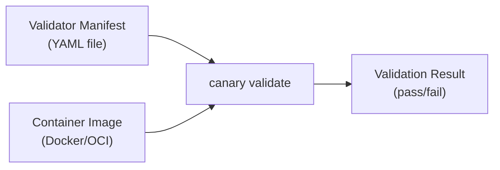

<!-- source: DeepWiki mcp.deepwiki.com · repo NVIDIA/container-canary · page 1.2 Quick Start · fetched 2026-10-26 -->

# Quick Start

<details>
<summary>Relevant source files</summary>

The following files were used as context for generating this wiki page:

- [CONTRIBUTING.md](CONTRIBUTING.md)
- [README.md](README.md)
- [cmd/validate.go](cmd/validate.go)
- [examples/kubeflow.yaml](examples/kubeflow.yaml)

</details>


This guide provides a hands-on introduction to using container-canary by walking through a simple validation example. After completing this guide, you will understand how to validate a container image against a set of requirements defined in a YAML manifest.

**Prerequisites**: Ensure you have installed container-canary by following the instructions in [1.1. Installation]().

**Scope**: This guide covers basic validation workflows using pre-built example manifests. For comprehensive information about writing your own validator manifests, see [2.2. Writing Validator Manifests](). For complete CLI command reference, see [2.1. CLI Reference]().

---

## Basic Validation Workflow

Container-canary validates container images through a three-step process:



**Sources**: [README.md:9-16]()

---

## Your First Validation

Let's start with a simple example that validates any container. This example uses the `awesome.yaml` manifest, which runs three trivial checks that always pass.

### Step 1: Review the Manifest

The `awesome.yaml` manifest defines three checks that execute simple shell commands:

| Check Name | Description | Probe Type | Command |
|------------|-------------|------------|---------|
| packages | 📦 Required packages are installed | exec | `true` |
| services | 🤖 Expected services are running | exec | `true` |
| awesome | 🎉 Your container is awesome | exec | `true` |

Each check uses the `exec` probe type to run commands inside the container. The `true` command always exits with code 0, causing the checks to pass.

**Sources**: [README.md:9-16]()

### Step 2: Run the Validation

Execute the validation command against any container image. The `validate` command is defined in `cmd/validate.go` [cmd/validate.go:29-61]().

```bash
canary validate --file examples/awesome.yaml your/container:latest
```

**Expected output**:
```
Validating your/container:latest against awesome
 📦 Required packages are installed                  [passed]
 🤖 Expected services are running                    [passed]
 🎉 Your container is awesome                        [passed]
validation passed
```

The `--file` flag specifies the validator manifest path [cmd/validate.go:87-87](). The final argument is the container image to validate [cmd/validate.go:45-45]().

**Sources**: [README.md:9-16](), [cmd/validate.go:29-90]()

### Step 3: Using Remote Manifests

Manifests can also be loaded from URLs, eliminating the need to download them locally. The CLI handles both local paths and URLs via the `validator.Validate` function [cmd/validate.go:51-51]().

```bash
canary validate \
  --file https://raw.githubusercontent.com/NVIDIA/container-canary/main/examples/awesome.yaml \
  your/container:latest
```

This is useful for CI/CD pipelines or sharing validation specifications across teams.

**Sources**: [cmd/validate.go:51-51](), [cmd/validate.go:87-87]()

---

## Validation Execution Flow

The following diagram shows the internal execution flow when you run a validation, mapping the process to actual code entities:

```mermaid
sequenceDiagram
    participant User
    participant CLI["CLI<br/>cmd/validate.go"]
    participant ValidatorPkg["validator.Validate()<br/>internal/validator/validator.go"]
    participant ContainerInt["container.ContainerInterface<br/>internal/container/interface.go"]
    participant Docker["docker.Docker (Implementation)<br/>internal/container/docker/docker.go"]
    
    User->>CLI: "canary validate --file manifest.yaml image:tag"
    CLI->>CLI: "imageArg() check for Docker"
    CLI->>ValidatorPkg: "validator.Validate(image, file, ...)"
    
    ValidatorPkg->>ContainerInt: "NewContainer(image, ...)"
    ContainerInt->>Docker: "Create & Start Container"
    
    loop "For each Check in Validator.Checks"
        ValidatorPkg->>ValidatorPkg: "runCheck(check)"
        ValidatorPkg->>Docker: "Execute Probe (Exec/HTTP/TCP)"
        Docker-->>ValidatorPkg: "Probe Result"
    end
    
    ValidatorPkg->>Docker: "Remove container"
    ValidatorPkg-->>CLI: "bool (success/fail)"
    CLI-->>User: "Exit 0 or 1"
```

**Key Components**:

| Component | Code Entity | Responsibility |
|-----------|-----------|----------------|
| CLI Command | `validateCmd` [cmd/validate.go:29]() | Parses flags and orchestrates validation |
| Validation Entry | `validator.Validate` [internal/validator/validator.go]() | High-level orchestration of the validation lifecycle |
| Image Check | `imageArg` [cmd/validate.go:63]() | Validates image existence and Docker availability |
| Container Abstraction | `ContainerInterface` [internal/container/interface.go]() | Interface for container operations (Start, Stop, Exec) |

**Sources**: [cmd/validate.go:29-90](), [internal/validator/validator.go]()

---

## Understanding Validation Results

### Successful Validation

When all checks pass, the `RunE` function returns `nil` [cmd/validate.go:59-59](), resulting in an exit code of `0`.

```
validation passed
```

### Failed Validation

If any check fails, the `validator.Validate` function returns `false` [cmd/validate.go:51-51](), and the CLI returns a "validation failed" error [cmd/validate.go:57-57](), resulting in an exit code of `1`.

**Sources**: [cmd/validate.go:51-60]()

---

## A Real-World Example: Kubeflow

The Kubeflow example demonstrates more sophisticated validation using multiple probe types.

### Validation Command

```bash
canary validate \
  --file examples/kubeflow.yaml \
  public.ecr.aws/j1r0q0g6/notebooks/notebook-servers/jupyter-scipy:v1.5.0-rc.1
```

### Checks Performed

The Kubeflow manifest validates requirements such as user identity, home directory location, and network service availability.

| Check | Description | Probe Type | Purpose |
|-------|-------------|------------|---------|
| user | 👩 User is jovyan | `exec` | Verifies `whoami` returns `jovyan` [examples/kubeflow.yaml:15-22]() |
| uid | 🆔 User ID is 1000 | `exec` | Validates UID for volume permissions [examples/kubeflow.yaml:23-30]() |
| home | 🏠 Home directory is /home/jovyan | `exec` | Ensures `$HOME` is set correctly [examples/kubeflow.yaml:31-38]() |
| http | 🌏 Exposes HTTP on port 8888 | `httpGet` | Tests web service availability [examples/kubeflow.yaml:39-45]() |
| NB_PREFIX | 🧭 Correctly routes the NB_PREFIX | `httpGet` | Validates URL routing configuration [examples/kubeflow.yaml:46-52]() |
| allow-origin-all | 🔓 Sets CORS header | `httpGet` | Checks `Access-Control-Allow-Origin` [examples/kubeflow.yaml:53-65]() |

**Manifest structure breakdown**:

```mermaid
graph TB
    Manifest["kubeflow.yaml"]
    Env["Env Vars<br/>NB_PREFIX: /hub/jovyan/"]
    Ports["Ports<br/>8888/TCP"]
    Volumes["Volumes<br/>/home/jovyan"]
    Checks["Checks"]
    
    Manifest --> Env
    Manifest --> Ports
    Manifest --> Volumes
    Manifest --> Checks
    
    Env --- [examples/kubeflow.yaml:6-8]
    Ports --- [examples/kubeflow.yaml:9-11]
    Volumes --- [examples/kubeflow.yaml:12-13]
    Checks --- [examples/kubeflow.yaml:14-66]
```

**Sources**: [examples/kubeflow.yaml:1-65](), [README.md:46-142]()

---

## Common CLI Patterns

### Validate with Local Manifest
```bash
canary validate --file path/to/manifest.yaml image:tag
```

### Validate with Debug Mode
The `--debug` flag keeps the container running on failure, allowing you to manually inspect the state [cmd/validate.go:88-88]().
```bash
canary validate --file manifest.yaml --debug image:tag
```

### Custom Startup Timeout
If a container takes a long time to initialize, use `--startup-timeout` (default is 10s) [cmd/validate.go:89-89]().
```bash
canary validate --file manifest.yaml --startup-timeout 30 image:tag
```

**Sources**: [cmd/validate.go:85-90]()

---

## Next Steps

1. **Explore More Examples**: Review additional manifests in the `examples/` directory.
2. **Write Your Own Manifest**: Learn the complete manifest structure in [2.2. Writing Validator Manifests]().
3. **Understand Probe Types**: Deep dive into `exec`, `httpGet`, and `tcpSocket` probes in [2.2.2. Probe Types]().
4. **Integrate into CI/CD**: See how to use `make testprep` to build test images for validation in [4.2. Running Tests]() and [CONTRIBUTING.MD:20-29]().

**Sources**: [README.md:144-144](), [CONTRIBUTING.md:20-29]()

---

