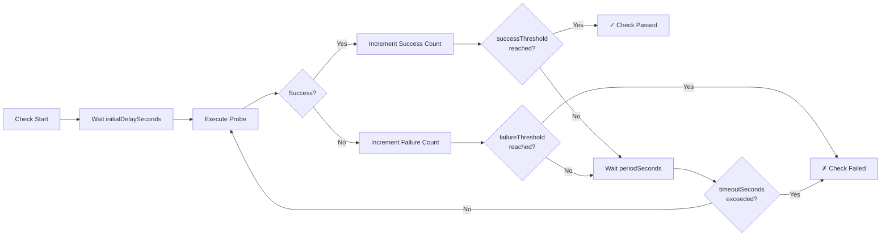
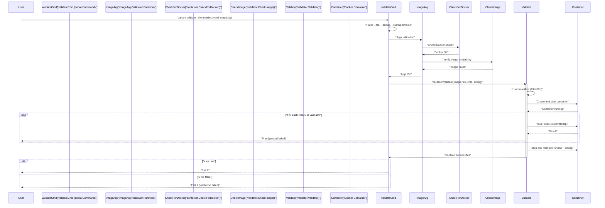
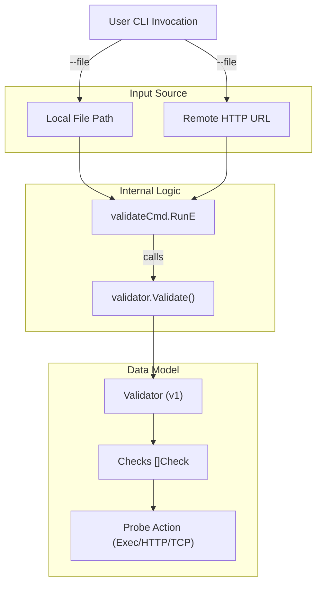

<!-- source: DeepWiki mcp.deepwiki.com · repo NVIDIA/container-canary · page 2 User Guide · fetched 2026-10-26 -->

# User Guide

<details>
<summary>Relevant source files</summary>

The following files were used as context for generating this wiki page:

- [CONTRIBUTING.md](CONTRIBUTING.md)
- [README.md](README.md)
- [cmd/validate.go](cmd/validate.go)
- [examples/kubeflow.yaml](examples/kubeflow.yaml)

</details>


This guide provides comprehensive documentation for using `container-canary` to validate container images against platform requirements. It covers the basic validation workflow, command-line usage, manifest creation, and practical examples for real-world scenarios.

For command-line flag details and options, see [CLI Reference](#2.1). For in-depth manifest authoring, see [Writing Validator Manifests](#2.2). For detailed API schemas, see [API Reference](#5).

## Overview

Container Canary validates container images by:
1. Loading a validator manifest (YAML file) that defines requirements.
2. Starting the target container with specified runtime configuration.
3. Executing a series of checks using probes (`exec`, `httpGet`, `tcpSocket`).
4. Reporting pass/fail results for each check.
5. Cleaning up container resources.

The validation workflow is designed to be deterministic and reproducible, making it ideal for CI/CD environments to avoid regressions in containers [README.md:18-20]().

**Sources**: [README.md:1-20](), [cmd/validate.go:29-61]()

## Core Concepts

### Validator Manifests

Validator manifests are YAML files that describe container requirements. Each manifest contains:

| Component | Purpose | Required |
|-----------|---------|----------|
| Metadata | `name`, `description`, `documentation` links | Yes |
| Runtime Options | `env`, `ports`, `volumes`, `command` | No |
| Checks | List of validation probes to execute | Yes |

**Sources**: [README.md:145-162](), [examples/kubeflow.yaml:1-14]()

### Probe Types

Container Canary supports three probe mechanisms, each suited to different validation scenarios:

| Probe Type | Use Case | Success Condition |
|------------|----------|-------------------|
| `exec` | Validate internal container state (user, filesystem, processes) | Command exits with status code 0 |
| `httpGet` | Validate HTTP services and response headers | HTTP status < 400 and optional header matching |
| `tcpSocket` | Validate network service availability | TCP connection succeeds |

**Sources**: [README.md:211-268](), [examples/kubeflow.yaml:15-65]()

### Validation Lifecycle

Each check executes according to a configurable lifecycle involving delays, timeouts, and thresholds [README.md:270-286]().



**Sources**: [README.md:270-286]()

## Basic Validation Workflow

### Command Structure

The basic validation command follows this pattern:

```console
$ canary validate --file <manifest-path-or-url> <image-reference>
```

### Workflow Diagram

The following diagram maps the CLI execution to the internal Go functions and entities.



**Sources**: [cmd/validate.go:29-90](), [README.md:9-16]()

## Manifest Loading and Configuration

Container Canary supports loading manifests from the local filesystem or via HTTP(S) URLs [cmd/validate.go:87]().



**Sources**: [cmd/validate.go:37-51](), [README.md:145-208]()

## Example: Validating a Kubeflow Container

The Kubeflow example validates requirements like running as user `jovyan` (UID 1000), having a specific home directory, and exposing port 8888 with correct CORS headers [README.md:46-60]().

### Requirements Mapping

| Requirement | Probe Implementation | File Reference |
|-------------|----------------------|----------------|
| User is `jovyan` | `exec: command: ["whoami"]` | [examples/kubeflow.yaml:15-22]() |
| UID is 1000 | `exec: command: ["id", "grep", "uid=1000"]` | [examples/kubeflow.yaml:23-30]() |
| HTTP Port 8888 | `httpGet: port: 8888` | [examples/kubeflow.yaml:39-45]() |
| CORS Header | `httpGet: responseHttpHeaders: Access-Control-Allow-Origin` | [examples/kubeflow.yaml:53-65]() |

**Sources**: [README.md:45-141](), [examples/kubeflow.yaml:1-65]()

## Command-Line Options

### Flags

| Flag | Type | Default | Description |
|------|------|---------|-------------|
| `--file` | string | (empty) | **Required**. Path or URL of a manifest to validate against. |
| `--debug` | bool | `false` | Keep container running on failure for debugging. |
| `--startup-timeout` | int | `10` | Maximum time (in seconds) to wait for the container to start up. |

**Sources**: [cmd/validate.go:85-90]()

## Understanding Results and Debugging

### Exit Codes
- **0**: All checks passed [cmd/validate.go:59-60]().
- **1**: One or more checks failed, or a technical error occurred (e.g., Docker not found) [cmd/validate.go:56-58](), [cmd/validate.go:81]().

### Debugging
Using the `--debug` flag prevents the `validator` from removing the container upon failure [cmd/validate.go:88](). This allows users to inspect the container state using standard Docker tools while the validation environment is still active.

**Sources**: [cmd/validate.go:29-61](), [README.md:288-294]()

## Next Steps

- For detailed command-line reference, see [CLI Reference](#2.1)
- For comprehensive manifest authoring guide, see [Writing Validator Manifests](#2.2)
- For real-world examples, see [Example Validators](#2.3)
- For developer setup and testing, see [Developer Guide](#4)

---

