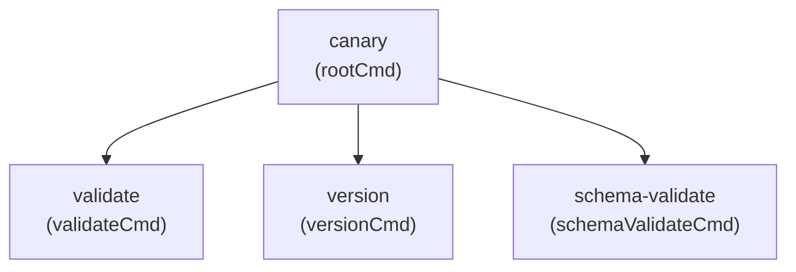
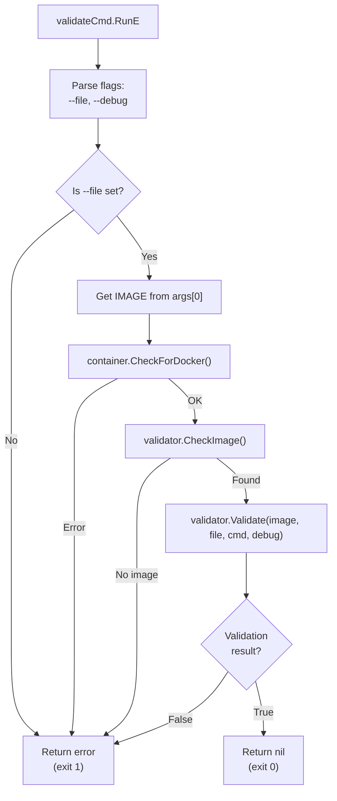
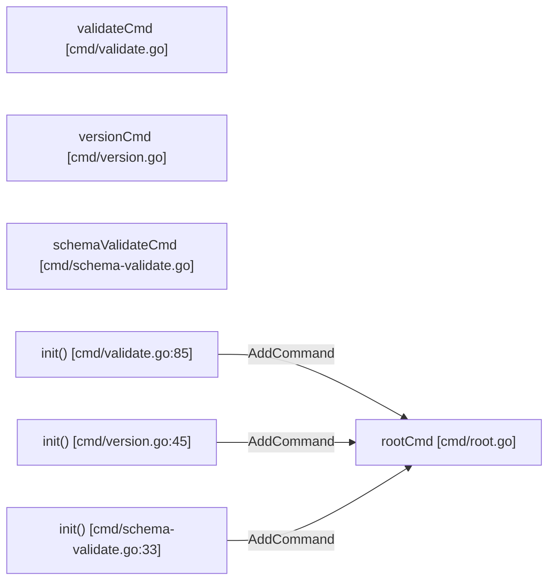

<!-- source: DeepWiki mcp.deepwiki.com · repo NVIDIA/container-canary · page 2.1 CLI Reference · fetched 2026-10-26 -->

# CLI Reference

<details>
<summary>Relevant source files</summary>

The following files were used as context for generating this wiki page:

- [cmd/root.go](cmd/root.go)
- [cmd/schema-validate.go](cmd/schema-validate.go)
- [cmd/validate.go](cmd/validate.go)
- [cmd/validate_test.go](cmd/validate_test.go)
- [cmd/version.go](cmd/version.go)

</details>


## Purpose and Scope

This document provides a complete reference for the `container-canary` command-line interface. It details all available commands, their flags, arguments, and usage patterns. For information about writing validator manifests to use with the CLI, see [Writing Validator Manifests](#2.2). For architectural details about how the CLI integrates with the validation system, see [System Components](#3.1).

## Command Structure

Container-canary uses the Cobra framework [cmd/root.go:23]() to provide a hierarchical command structure. The CLI consists of a root command (`canary`) with three subcommands: `validate`, `version`, and `schema-validate`.



**Sources:** [cmd/root.go:27-39](), [cmd/validate.go:29-35](), [cmd/version.go:27-39](), [cmd/schema-validate.go:18-31]()

## Root Command: `canary`

The root command provides the entry point to the CLI and displays help information when invoked without subcommands.

### Usage

```bash
canary [command]
```

### Description

The root command identifies `container-canary` as "A little bird to validate your containers" [cmd/root.go:29](). It explains the tool's purpose: validating whether custom container images are compatible with various compute platforms that support "Bring your own container" models [cmd/root.go:30-33]().

### Implementation Details

| Property | Value | Source |
|----------|-------|--------|
| Command Name | `canary` | [cmd/root.go:28]() |
| Entry Point | `rootCmd.Execute()` | [cmd/root.go:43-48]() |
| Framework | Cobra | [cmd/root.go:23]() |

**Sources:** [cmd/root.go:27-60]()

## Validate Command: `canary validate`

The `validate` command executes container validation against a specified manifest. This is the primary command for running validation checks.

### Usage

```bash
canary validate [flags] IMAGE
```

### Arguments

| Argument | Required | Description |
|----------|----------|-------------|
| `IMAGE` | Yes | Container image name with optional tag (e.g., `myorg/mycontainer:rev`) |

The image argument is validated through the `imageArg` function [cmd/validate.go:63-83](), which:
1. Ensures exactly one image argument is provided [cmd/validate.go:64-70]().
2. Verifies Docker is available via `container.CheckForDocker()` [cmd/validate.go:72-74]().
3. Confirms the image exists using `validator.CheckImage(cmd, image, "docker")` [cmd/validate.go:78-82]().

### Flags

| Flag | Type | Default | Description |
|------|------|---------|-------------|
| `--file` | string | (none) | **Required.** Path or URL to a validator manifest [cmd/validate.go:87](). |
| `--debug` | bool | `false` | Keep the container running after validation failure for debugging purposes [cmd/validate.go:88](). |
| `--startup-timeout` | int | `10` | Maximum time in seconds to wait for the container to start [cmd/validate.go:89](). |

### Execution Flow

The `validate` command follows this execution sequence:



**Sources:** [cmd/validate.go:36-60](), [cmd/validate.go:63-83]()

## Schema Validate Command: `canary schema-validate`

The `schema-validate` command validates one or more manifest files against the published Validator JSON Schema.

### Usage

```bash
canary schema-validate manifest [manifest...] [flags]
```

### Flags

| Flag | Type | Default | Description |
|------|------|---------|-------------|
| `--schema` | string | `schema.Path` | Path to the Validator JSON Schema [cmd/schema-validate.go:35](). |

### Implementation Details

The command iterates through the provided arguments and calls `schema.ValidateFile` for each manifest [cmd/schema-validate.go:23-27](). If all manifests pass, it prints "schema validation passed" [cmd/schema-validate.go:28]().

**Sources:** [cmd/schema-validate.go:18-36]()

## Version Command: `canary version`

The `version` command displays build information and metadata about the `container-canary` binary.

### Usage

```bash
canary version
```

### Output Fields

The command displays the following information from the `internal` package:

| Field | Code Entity | Source |
|-------|-------------|--------|
| Version | `internal.Version` | [cmd/version.go:33]() |
| Go version | `internal.GoVersion` | [cmd/version.go:34]() |
| Commit | `internal.Commit` | [cmd/version.go:35]() |
| OS/Arch | `internal.Os` / `internal.Arch` | [cmd/version.go:36]() |
| Built | `internal.Buildtime` | [cmd/version.go:37]() |

**Sources:** [cmd/version.go:27-39]()

## Command Initialization and Registration

All commands are registered with the `rootCmd` during package initialization.



### Persistent Flags
The `validate` command defines persistent flags for `--file`, `--debug`, and `--startup-timeout` in its `init()` function [cmd/validate.go:87-89]().

**Sources:** [cmd/validate.go:85-90](), [cmd/version.go:45-47](), [cmd/schema-validate.go:33-36]()

## Error Handling

The CLI implements comprehensive error handling with specific exit paths:

| Error Scenario | Code Path | Exit Status |
|----------------|-----------|-------------|
| Command Execution Error | `rootCmd.Execute()` | `os.Exit(1)` [cmd/root.go:44-47]() |
| Validation Failure | `validator.Validate()` returns `false` | `errors.New("validation failed")` [cmd/validate.go:56-58]() |
| Missing Manifest | `file == ""` | `errors.New("you must specify a manifest...")` [cmd/validate.go:41-43]() |
| Image Check Failure | `validator.CheckImage()` returns `false` | `fmt.Errorf("no such image: %s", image)` [cmd/validate.go:78-82]() |

**Sources:** [cmd/root.go:43-48](), [cmd/validate.go:36-60](), [cmd/validate.go:63-83]()

---

