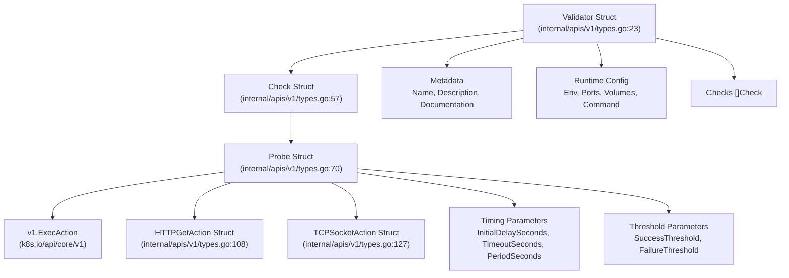
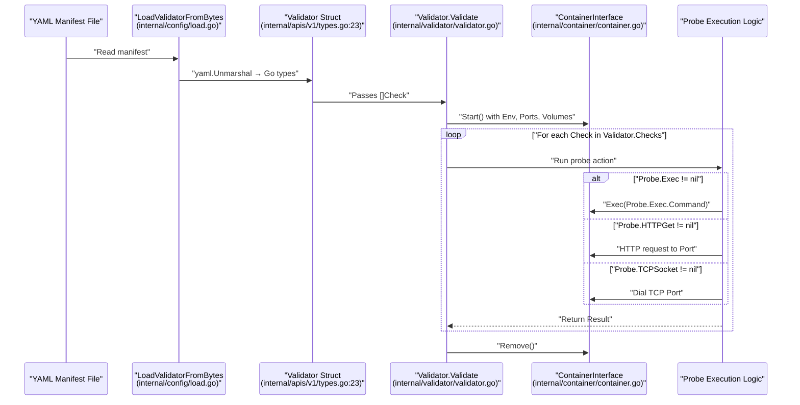

<!-- source: DeepWiki mcp.deepwiki.com · repo NVIDIA/container-canary · page 2.2 Writing Validator Manifests · fetched 2026-10-26 -->

# Writing Validator Manifests

<details>
<summary>Relevant source files</summary>

The following files were used as context for generating this wiki page:

- [CONTRIBUTING.md](CONTRIBUTING.md)
- [README.md](README.md)
- [internal/apis/v1/types.go](internal/apis/v1/types.go)
- [schema/container-canary.nvidia.com/v1/validator.schema.json](schema/container-canary.nvidia.com/v1/validator.schema.json)

</details>


This guide provides an overview of creating validator manifests for container-canary. Validator manifests are YAML files that define container requirements as executable checks. For detailed information about specific aspects of manifests, see:
- Manifest structure and metadata: [Manifest Structure](#2.2.1)
- Probe types and their use cases: [Probe Types](#2.2.2)
- Probe timing and retry configuration: [Probe Configuration](#2.2.3)

## Purpose and Scope

Validator manifests are the core configuration files that define container validation requirements. They translate platform documentation (e.g., "must run as user jovyan") into executable validation checks. This page explains the conceptual model behind manifests and provides guidance on creating effective validators. Implementation details and complete API references are covered in child pages and [API Reference](#5).

**Sources**: [README.md:18-20](), [README.md:145-148]()

## Manifest Fundamentals

### What is a Validator Manifest

A validator manifest is a declarative YAML file that specifies:
1. **What to validate**: The container requirements (user, ports, services) [README.md:18-21]()
2. **How to validate**: The probe mechanisms (exec, HTTP, TCP) [README.md:33-36]()
3. **Runtime environment**: Container configuration needed for validation (environment variables, ports, volumes) [README.md:28-32]()

Manifests enable versioning of container requirements and automated regression testing in CI pipelines [README.md:20-21]().

**Sources**: [README.md:18-21](), [README.md:28-36]()

### Manifest Type System

Container-canary uses Go structs defined in `internal/apis/v1/types.go` to provide type-safe manifest parsing. The type hierarchy follows Kubernetes API conventions:

**Manifest Entity Mapping**


**Sources**: [internal/apis/v1/types.go:23-140]()

### Manifest to Execution Flow

The following diagram shows how manifest elements map to runtime execution:

**Code Entity Interaction Flow**


**Sources**: [internal/apis/v1/types.go:23-140](), [README.md:145-148](), [schema/container-canary.nvidia.com/v1/validator.schema.json:1-105]()

## Creating Your First Manifest

### Starting from Examples

The simplest starting point is a basic manifest that runs a command and checks a condition:

```yaml
apiVersion: container-canary.nvidia.com/v1
kind: Validator
name: basic-check
description: A simple example
checks:
  - name: verify-true
    description: 📦 Verify the true command works
    probe:
      exec:
        command:
          - /bin/sh
          - -c
          - "true"
```

This minimal manifest demonstrates the required API versioning fields (`apiVersion`, `kind`), metadata, and a simple `exec` probe [schema/container-canary.nvidia.com/v1/validator.schema.json:7-11]().

**Sources**: [schema/container-canary.nvidia.com/v1/validator.schema.json:7-19](), [README.md:63-126]()

### Anatomy of a Check

Each `Check` struct consists of three primary parts:

| Component | Purpose | Code Pointer |
|-----------|---------|--------------|
| `name` | Unique identifier for the check | [internal/apis/v1/types.go:60]() |
| `description` | Human-readable output text | [internal/apis/v1/types.go:63]() |
| `probe` | The validation mechanism (Exec, HTTP, TCP) | [internal/apis/v1/types.go:67]() |

**Sources**: [internal/apis/v1/types.go:57-68]()

## Manifest Structure Patterns

### The Kubeflow Pattern

The Kubeflow example demonstrates a production-grade validation pattern:

1. **Metadata Layer**: Uses `name`, `description`, and `documentation` to link to requirements [internal/apis/v1/types.go:23-34]().
2. **Runtime Environment**: Sets `env`, `ports`, and `volumes` to mirror the platform [internal/apis/v1/types.go:39-47]().
3. **Layered Validation**: Checks progress from basic system identity (UID/User) to complex application state (HTTP headers) [README.md:77-126]().

**Sources**: [README.md:46-126](), [internal/apis/v1/types.go:23-55]()

### Check Ordering Strategy

Checks execute sequentially as they appear in the `Checks` slice [internal/apis/v1/types.go:37](). It is recommended to order them as follows:
1. **Identity/Environment**: User, UID, and shell environment [README.md:78-101]().
2. **Connectivity**: TCP and basic HTTP availability [README.md:102-115]().
3. **Behavioral**: Response headers and specific path routing [README.md:116-125]().

**Sources**: [README.md:77-126](), [internal/apis/v1/types.go:37]()

## Runtime Configuration

### Mimicking the Target Platform

The `Validator` struct includes fields to replicate the container's production environment:
- `Env`: A list of `v1.EnvVar` [internal/apis/v1/types.go:40]().
- `Ports`: A list of `v1.ServicePort` [internal/apis/v1/types.go:43]().
- `Volumes`: A list of `Volume` structs for mount paths [internal/apis/v1/types.go:46]().
- `Command`: An optional entrypoint override [internal/apis/v1/types.go:50]().

**Sources**: [internal/apis/v1/types.go:39-55]()

## Probe Selection Guide

| Validation Goal | Probe Action | Example Field |
|-----------------|--------------|---------------|
| System Identity | `exec` | `probe.exec.command` [internal/apis/v1/types.go:83]() |
| Port Connectivity | `tcpSocket` | `probe.tcpSocket.port` [internal/apis/v1/types.go:87]() |
| Web Service | `httpGet` | `probe.httpGet.path` [internal/apis/v1/types.go:85]() |
| Response Headers| `httpGet` | `probe.httpGet.responseHttpHeaders` [internal/apis/v1/types.go:124]() |

Detailed probe configuration is covered in [Probe Types](#2.2.2).

**Sources**: [internal/apis/v1/types.go:83-87](), [internal/apis/v1/types.go:124]()

## Validation Best Practices

### Use Descriptive Names and Emojis
The `description` field is what the user sees in the TUI or CLI output. Using emojis helps distinguish different check types (e.g., 🆔 for UID, 🌏 for HTTP) [README.md:135-140]().

### Set Appropriate Thresholds
The `Probe` struct defaults to 1 for `SuccessThreshold` and `FailureThreshold` [internal/apis/v1/types.go:96-97](). For services with long startup times, increase `failureThreshold` or `initialDelaySeconds` [internal/apis/v1/types.go:71,79]().

### YAML Unmarshaling and Defaults
The `UnmarshalYAML` function in `internal/apis/v1/types.go` ensures that even if timing parameters are omitted in YAML, they default to safe values (e.g., `TimeoutSeconds: 30`) [internal/apis/v1/types.go:90-106]().

**Sources**: [internal/apis/v1/types.go:70-106](), [README.md:132-142]()

---

