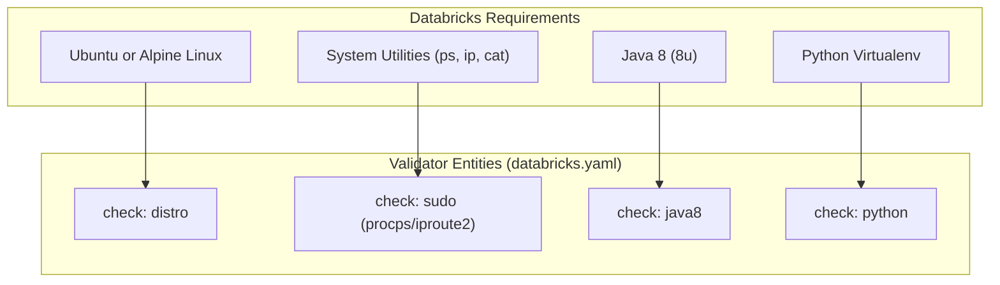
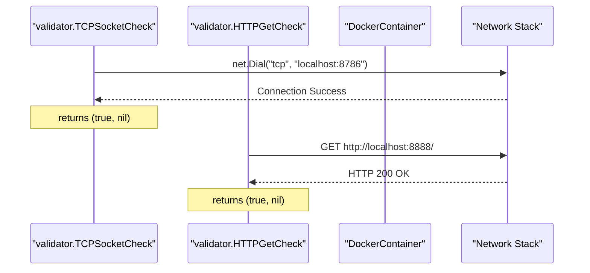

<!-- source: DeepWiki mcp.deepwiki.com · repo NVIDIA/container-canary · page 2.3 Example Validators · fetched 2026-10-26 -->

# Example Validators

<details>
<summary>Relevant source files</summary>

The following files were used as context for generating this wiki page:

- [examples/awesome.yaml](examples/awesome.yaml)
- [examples/binder.yaml](examples/binder.yaml)
- [examples/dask-scheduler.yaml](examples/dask-scheduler.yaml)
- [examples/databricks.yaml](examples/databricks.yaml)
- [examples/gpu.yaml](examples/gpu.yaml)
- [examples/kubeflow.yaml](examples/kubeflow.yaml)
- [internal/container/docker.go](internal/container/docker.go)
- [internal/container/docker_test.go](internal/container/docker_test.go)
- [internal/validator/tcp.go](internal/validator/tcp.go)

</details>


This page showcases real-world validator manifest examples with detailed explanations of their structure, checks, and use cases. These examples demonstrate how to translate platform requirements into executable validation specifications.

## GPU Support Example

The `gpu.yaml` manifest demonstrates how to pass extra flags to the underlying container runtime, specifically for hardware acceleration.

### Manifest Structure
[examples/gpu.yaml:1-18]()

```yaml
apiVersion: container-canary.nvidia.com/v1
kind: Validator
name: gpu
description: A GPU example to show you can pass extra flags to Docker
command:
- "sleep"
- "30"
dockerRunOptions:
- "--gpus"
- "all"
checks:
  - name: nvidia-smi
    description: 📦 Can run nvidia-smi
    probe:
      exec:
        command:
          - /usr/bin/nvidia-smi
      initialDelaySeconds: 1
```

### Implementation Detail: Runtime Options
The `dockerRunOptions` field [examples/gpu.yaml:8-10]() is passed directly to the `DockerContainer` struct [internal/container/docker.go:23](). When the container starts, these options are appended to the `docker run` command arguments [internal/container/docker.go:51-53]().

**Sources:** [examples/gpu.yaml:1-18](), [internal/container/docker.go:23-53]()

---

## Databricks Custom Container Example

The Databricks validator follows the [official requirements](https://docs.databricks.com/clusters/custom-containers.html#option-2-build-your-own-docker-base) for custom base images, ensuring that necessary system utilities and specific language runtimes are present.

### Check Breakdown
[examples/databricks.yaml:12-77]()

| Check Name | Purpose | Implementation |
|------------|---------|----------------|
| `bash` | Shell availability | `which bash` |
| `distro` | OS Compatibility | `grep 'ubuntu\|alpine' /etc/os-release` |
| `java8` | Runtime Version | `java -version 2>&1 | grep 8u` |
| `python` | Environment | `which virtualenv` |

### System Dependency Mapping



**Sources:** [examples/databricks.yaml:1-77]()

---

## Dask and Binder Examples

These examples demonstrate the use of networking probes (`httpGet` and `tcpSocket`) to verify distributed system components.

### Dask Scheduler (TCP Probes)
[examples/dask-scheduler.yaml:1-26]()

The Dask validator uses both HTTP and TCP socket probes to verify the scheduler's health:
- **Dashboard**: Uses `httpGet` on port 8787 [examples/dask-scheduler.yaml:17-19]().
- **Communication Layer**: Uses `tcpSocket` on port 8786 [examples/dask-scheduler.yaml:24-25]().

### Binder (Jupyter Probes)
[examples/binder.yaml:1-55]()

Binder requires specific user IDs and home directories similar to Kubeflow, but focuses on the Jupyter Lab entrypoint. It validates that the service is reachable at the root path `/` on port 8888 [examples/binder.yaml:52-54]().

### Networking Validation Flow



**Sources:** [examples/dask-scheduler.yaml:1-26](), [examples/binder.yaml:1-55](), [internal/validator/tcp.go:28-36]()

---

## Kubeflow Notebooks (Complex Example)

The Kubeflow validator is the most comprehensive example, combining environment variables, volume mounts, and advanced HTTP header validation.

### Complete Manifest
[examples/kubeflow.yaml:1-65]()

### Key Technical Features
1.  **Environment Simulation**: Sets `NB_PREFIX` [examples/kubeflow.yaml:7-8]() to replicate the Kubeflow Gateway environment.
2.  **Volume Simulation**: Mounts `/home/jovyan` [examples/kubeflow.yaml:13]() to ensure the container handles persistent volumes correctly.
3.  **CORS Validation**: Uses `responseHttpHeaders` [examples/kubeflow.yaml:62-64]() to verify that the container allows cross-origin requests, which is critical for the Kubeflow UI.

### Kubeflow Requirements Mapping

| Requirement | Code Location | Logic |
|-------------|---------------|-------|
| **User ID** | [examples/kubeflow.yaml:23-30]() | `id | grep uid=1000` |
| **Routing** | [examples/kubeflow.yaml:46-52]() | `httpGet` path: `/hub/jovyan/lab` |
| **CORS** | [examples/kubeflow.yaml:53-65]() | Match `Access-Control-Allow-Origin: *` |

**Sources:** [examples/kubeflow.yaml:1-65](), [internal/container/docker.go:35-49]()

---

## Comparison of Probe Strategies

| Strategy | Manifest Example | Code Implementation | Use Case |
|----------|------------------|---------------------|----------|
| **Exec** | `kubeflow.yaml` [18-22]() | `c.Exec(command...)` [internal/container/docker.go:145]() | Internal state, file existence, CLI versions. |
| **HTTP** | `binder.yaml` [52-54]() | `http.Get(url)` | Web interfaces, REST APIs, Health endpoints. |
| **TCP** | `dask-scheduler.yaml` [24-25]() | `net.Dial("tcp", addr)` [internal/validator/tcp.go:31]() | Database ports, custom protocols (Dask/gRPC). |

**Sources:** [internal/container/docker.go:145-150](), [internal/validator/tcp.go:28-36](), [examples/kubeflow.yaml:18-22]()

---

