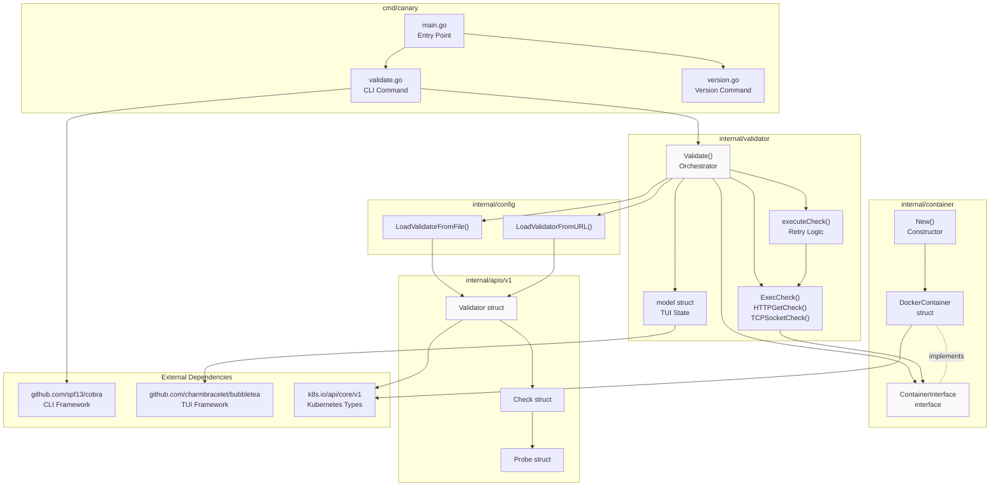
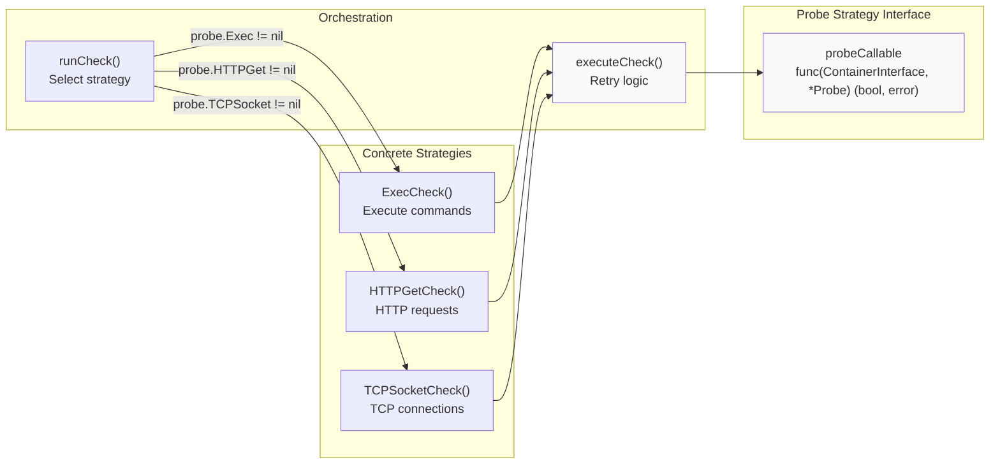
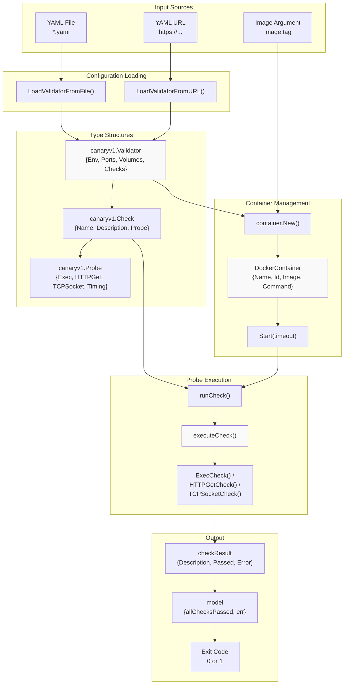

<!-- source: DeepWiki mcp.deepwiki.com · repo NVIDIA/container-canary · page 3 Architecture · fetched 2026-10-26 -->

# Architecture

Relevant source files

The following files were used as context for generating this wiki page:

- [Makefile](Makefile)
- [examples/gpu.yaml](examples/gpu.yaml)
- [internal/container/docker.go](internal/container/docker.go)
- [internal/container/docker_test.go](internal/container/docker_test.go)
- [internal/validator/validator.go](internal/validator/validator.go)
- [main.go](main.go)

This document provides an overview of container-canary's internal architecture and design patterns. It explains how the major components are organized, how they interact, and the key abstractions that enable extensibility and testability.

For detailed information about specific components, see:
- System Components: [System Components](#3.1)
- Validation Flow: [Validation Flow](#3.2)
- Container Abstraction: [Container Abstraction](#3.3)
- Probe Execution: [Probe Execution](#3.4)
- Terminal UI: [Terminal UI](#3.5)

For information about the validator manifest format and API types, see [API Reference](#5).

## Architectural Overview

Container-canary follows a **layered architecture** pattern with clear separation between user interface, orchestration logic, container runtime abstraction, and configuration management. The design prioritizes modularity, testability, and extensibility.

The system is organized into the following layers:

| Layer | Purpose | Key Packages |
|-------|---------|--------------|
| **Interface Layer** | User interaction via CLI and TUI | `cmd/canary`, `internal/validator` (TUI components) |
| **Orchestration Layer** | Coordinates validation workflow | `internal/validator` |
| **Execution Layer** | Implements probe execution strategies | `internal/validator` (probe functions) |
| **Container Abstraction** | Provides runtime-agnostic container operations | `internal/container` |
| **Configuration Layer** | Loads and parses validator manifests | `internal/config` |
| **API Types** | Defines data structures for manifests | `internal/apis/v1` |

### Package Structure and Dependencies

The following diagram shows the package organization and dependency relationships, using actual package paths and key exported types:

**Sources**: [internal/validator/validator.go:18-37](), [internal/container/docker.go:1-26](), [main.go:20-24](), [Makefile:7-10]()

## Core Design Patterns

### 1. Interface-Based Container Abstraction

The `ContainerInterface` provides a clean abstraction over container runtime operations. The `DockerContainer` struct in [internal/container/docker.go:15-26]() implements this interface, isolating Docker-specific logic from the validation orchestration.

**Key Interface Methods (Implemented by DockerContainer):**
- `Start(timeoutSeconds int) error` - Launch container with startup validation [internal/container/docker.go:29-97]()
- `Remove() error` - Clean up container resources [internal/container/docker.go:111-114]()
- `Exec(command ...string) (string, error)` - Execute commands inside container [internal/container/docker.go:145-150]()
- `Status() (*ContainerInfo, error)` - Query container state [internal/container/docker.go:117-142]()
- `Logs() (string, error)` - Retrieve container logs [internal/container/docker.go:153-156]()

This abstraction enables:
- **Testability**: Mock implementations for unit testing without Docker (see [internal/container/docker_test.go:29-70]())
- **Extensibility**: Future support for other runtimes (containerd, podman) without changing validation logic
- **Isolation**: Validation orchestration in [internal/validator/validator.go]() remains independent of runtime details

**Sources**: [internal/container/docker.go:15-156](), [internal/container/docker_test.go:29-85]()

### 2. Bubbletea Model-View-Update Architecture

The Terminal UI uses the Elm-inspired Model-View-Update pattern provided by Bubbletea. The `model` struct encapsulates all UI state, and the validation logic is driven by message passing.

**Key Message Types Defined in [internal/validator/validator.go:44-60]():**

| Message Type | Purpose | Triggered By |
|--------------|---------|--------------|
| `configLoaded` | Configuration loaded or failed | `loadConfig()` [internal/validator/validator.go:101-129]() |
| `containerStarted` | Container successfully started | `startContainer()` [internal/validator/validator.go:131-142]() |
| `containerStopped` | Container removed | `shutdown()` [internal/validator/validator.go:144-152]() |
| `containerFailed` | Container operation failed | Any container error |
| `checkResult` | Individual check completed | `runCheck()` [internal/validator/validator.go:160-178]() |

This pattern enables asynchronous operations (container startup, check execution) while maintaining a responsive UI that can be canceled at any time.

**Sources**: [internal/validator/validator.go:44-60](), [internal/validator/validator.go:64-99]()

### 3. Strategy Pattern for Probe Execution

The validation system implements probe execution using a strategy pattern. The `probeCallable` function type in [internal/validator/validator.go:62]() defines the interface, and concrete implementations handle different probe types:

The dispatcher in [internal/validator/validator.go:160-178]() selects the appropriate strategy based on which probe field is populated in the `canaryv1.Probe` struct. The `executeCheck()` function in [internal/validator/validator.go:181-206]() wraps each strategy with consistent retry logic, timing, and threshold evaluation.

**Sources**: [internal/validator/validator.go:62](), [internal/validator/validator.go:160-178](), [internal/validator/validator.go:181-206]()

## Data Flow Architecture

The following diagram illustrates how data flows through the system from configuration loading to final result, using actual struct types and function names:

**Sources**: [internal/validator/validator.go:101-129](), [internal/validator/validator.go:131-142](), [internal/validator/validator.go:160-206](), [internal/container/docker.go:15-97]()

## Key Type Definitions

The following table maps the core data structures to their purposes and locations in the codebase:

| Type | Package | Purpose | Key Fields |
|------|---------|---------|------------|
| `Validator` | `internal/apis/v1` | Top-level manifest structure | `Env`, `Ports`, `Volumes`, `Command`, `Checks` |
| `Check` | `internal/apis/v1` | Individual validation check | `Name`, `Description`, `Probe` |
| `Probe` | `internal/apis/v1` | Probe configuration | `Exec`, `HTTPGet`, `TCPSocket`, timing parameters |
| `DockerContainer` | `internal/container` | Docker runtime wrapper | `Name`, `Id`, `Image`, `Command`, `Ports` |
| `model` | `internal/validator` | TUI state machine | `sub`, `configPath`, `spinner`, `allChecksPassed` |
| `checkResult` | `internal/validator` | Check execution result | `Description`, `Passed`, `Error` |

**Sources**: [internal/container/docker.go:15-26](), [internal/validator/validator.go:44-60](), [internal/validator/validator.go:76-87]()

## Concurrency Model

Container-canary uses Go channels for concurrent operations, particularly during check execution. The `Validate()` function in [internal/validator/validator.go:64-99]() creates a `model` struct that includes a `sub chan checkResult` channel.

**Concurrency Pattern:**
1. Main TUI runs in the `tea.Program` event loop [internal/validator/validator.go:88-89]()
2. Each check executes as a Bubbletea command (goroutine) [internal/validator/validator.go:160-178]()
3. Check results are sent on the `sub` channel [internal/validator/validator.go:175]()
4. `waitForChecks()` command in [internal/validator/validator.go:154-158]() receives from the channel and converts to TUI messages
5. The `model` updates its state based on received `checkResult` messages

**Sources**: [internal/validator/validator.go:64-99](), [internal/validator/validator.go:154-158](), [internal/validator/validator.go:160-178]()

## Extension Points

The architecture provides several extension points for future enhancements:

### 1. Additional Container Runtimes

Implement the container interface for other runtimes by following the pattern in [internal/container/docker.go](). This requires implementing `Start`, `Remove`, `Exec`, `Status`, and `Logs`.

### 2. Custom Probe Types

Add new probe strategies by:
1. Defining probe configuration in `canaryv1.Probe` struct
2. Implementing a new probe function matching `probeCallable` signature in [internal/validator/validator.go:62]()
3. Adding dispatch logic in `runCheck()` function in [internal/validator/validator.go:160-178]()

### 3. Build-time Customization

The `Makefile` uses `GO_LD_FLAGS` to inject versioning information at build time, allowing the binary to report its exact commit and build time [Makefile:7-10]().

**Sources**: [internal/container/docker.go:1-156](), [internal/validator/validator.go:62](), [internal/validator/validator.go:160-178](), [Makefile:7-10]()

## Configuration System

Container-canary uses a **declarative manifest-based configuration** system. Manifests are YAML files that define the validator specification.

**Loader Functions:**
- `LoadValidatorFromFile(path string)` - Load from local filesystem
- `LoadValidatorFromURL(url string)` - Load from HTTP/HTTPS URL  

The configuration loading is triggered by the `loadConfig()` command in [internal/validator/validator.go:101-129]() which dispatches to the appropriate loader based on whether the path contains `"://"` (URL) or not (file).

**Sources**: [internal/validator/validator.go:101-129]()

## Error Handling Strategy

Container-canary uses explicit error propagation with context-specific error messages:

1. **Container Errors**: Docker-specific errors like missing root privileges or failed startup are handled in [internal/container/docker.go:61-97]().
2. **Probe Errors**: Include check name and probe type context in [internal/validator/validator.go:172]().
3. **Timeout Errors**: Formatted with elapsed time in [internal/validator/validator.go:201-203]().

The `model` struct accumulates the final status, and `Validate()` returns the result to the CLI [internal/validator/validator.go:93-97]().

**Sources**: [internal/container/docker.go:61-97](), [internal/validator/validator.go:160-206](), [internal/validator/validator.go:93-97]()

---

