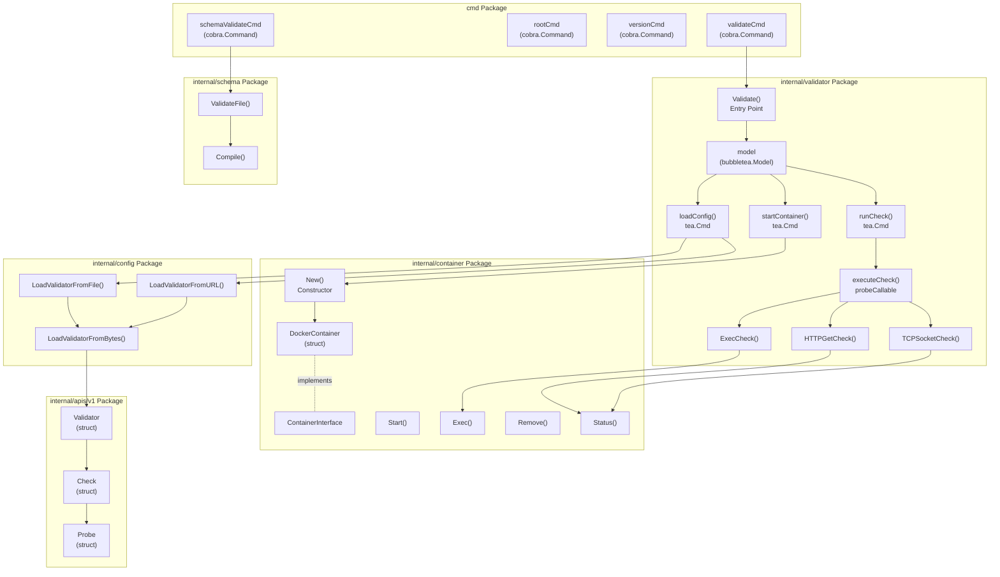

<!-- source: DeepWiki mcp.deepwiki.com · repo NVIDIA/container-canary · page 3.1 System Components · fetched 2026-10-26 -->

# System Components

<details>
<summary>Relevant source files</summary>

The following files were used as context for generating this wiki page:

- [cmd/validate.go](cmd/validate.go)
- [internal/config/load.go](internal/config/load.go)
- [internal/container/container.go](internal/container/container.go)
- [internal/schema/schema.go](internal/schema/schema.go)
- [internal/validator/validator.go](internal/validator/validator.go)

</details>


This document describes the major architectural components of container-canary and their responsibilities. The system is organized into five primary layers: the Command-Line Interface (CLI), the Validator Orchestrator, the Container Manager, the Configuration Loader, and the Schema Validator. Each component is implemented as a distinct Go package with well-defined interfaces and clear separation of concerns.

For details on how these components interact during validation execution, see [Validation Flow](#3.2). For implementation details of the container abstraction layer, see [Container Abstraction](#3.3). For probe execution mechanics, see [Probe Execution](#3.4).

## Component Architecture Overview

The following diagram maps the system's major components to their corresponding code entities:



**Sources:** [internal/validator/validator.go:1-219](), [cmd/validate.go:1-90](), [internal/container/container.go:1-50](), [internal/config/load.go:1-75](), [internal/schema/schema.go:1-64]()

## Component Summary Table

| Component | Package | Primary Types / Functions | Responsibility |
|-----------|---------|--------------------------|----------------|
| CLI Commands | `cmd` | `validateCmd`, `rootCmd` | User interface, argument parsing, command dispatch |
| Validator Orchestrator | `internal/validator` | `model`, `Validate()`, `executeCheck()` | Orchestrates validation workflow, manages TUI |
| Container Manager | `internal/container` | `ContainerInterface`, `DockerContainer` | Container lifecycle management, command execution |
| Configuration Loader | `internal/config` | `LoadValidatorFromFile()`, `LoadValidatorFromURL()` | Manifest parsing and loading |
| Schema Validator | `internal/schema` | `ValidateFile()`, `Compile()` | Validates manifest YAML against JSON Schema |
| API Types | `internal/apis/v1` | `Validator`, `Check`, `Probe` | Data structures for validation configuration |

**Sources:** [internal/validator/validator.go:1-219](), [cmd/validate.go:1-90](), [internal/container/container.go:1-50](), [internal/config/load.go:1-75](), [internal/schema/schema.go:1-64]()

## CLI Layer (cmd Package)

The CLI layer is implemented using the Cobra command framework and serves as the primary user interface. The main command structure consists of:

### Command Structure

- **`rootCmd`** - Root command that initializes the application.
- **`validateCmd`** - Primary command for container validation [cmd/validate.go:29-61]().
- **`versionCmd`** - Displays version information.
- **`schemaValidateCmd`** - Validates a manifest file against the internal JSON schema.

### validateCmd Implementation

The `validateCmd` implements the following workflow:

1. **Argument Validation**: Uses custom `imageArg()` validator [cmd/validate.go:63-83]().
   - Verifies exactly one image argument is provided.
   - Checks Docker availability via `container.CheckForDocker()` [cmd/validate.go:72-74]().
   - Validates image exists before proceeding using `validator.CheckImage()` [cmd/validate.go:78-82]().

2. **Flag Processing**:
   - `--file`: Required manifest path or URL [cmd/validate.go:87]().
   - `--debug`: Keeps container running on failure for debugging [cmd/validate.go:88]().
   - `--startup-timeout`: Container startup timeout in seconds (default: 10) [cmd/validate.go:89]().

3. **Validation Invocation**: Delegates to `validator.Validate()` [cmd/validate.go:51]().

4. **Result Handling**: Returns appropriate exit codes based on validation outcome.

**Sources:** [cmd/validate.go:1-90]()

## Validator Orchestrator (internal/validator Package)

The validator orchestrator is the central coordination component, implemented as a Bubbletea terminal UI model. It manages the complete validation lifecycle from configuration loading through result reporting.

### model Struct

The `model` struct [internal/validator/validator.go:76-87]() maintains validation state:

| Field | Type | Purpose |
|-------|------|---------|
| `sub` | `chan checkResult` | Channel for asynchronous check results [internal/validator/validator.go:77]() |
| `configPath` | `string` | Path or URL to validator manifest |
| `containerStarted` | `bool` | Container lifecycle state tracking |
| `containerStartupTimeout` | `int` | Startup timeout in seconds |
| `spinner` | `spinner.Model` | Visual loading indicator |
| `progress` | `progress.Model` | Check progress bar with solid fill `#f2e63a` [internal/validator/validator.go:82]() |
| `allChecksPassed` | `bool` | Cumulative validation result |
| `debug` | `bool` | Debug mode flag |
| `image` | `string` | Target container image |
| `tty` | `bool` | TTY availability flag for input handling |

**Sources:** [internal/validator/validator.go:76-87]()

### Message-Based State Machine

The validator uses Bubbletea's message-passing architecture with the following message types [internal/validator/validator.go:44-60]():

- **`configLoaded`**: Carries parsed `Validator` configuration or error.
- **`containerStarted`**: Carries `ContainerInterface` instance.
- **`containerStopped`**: Signals successful cleanup.
- **`containerFailed`**: Carries error from container operations.
- **`checkResult`**: Carries individual check pass/fail result and description.

### Probe Execution with Retry Logic

The `executeCheck()` function [internal/validator/validator.go:181-206]() implements the core retry and threshold logic:

1. **Initial Delay**: Waits `probe.InitialDelaySeconds` before first attempt [internal/validator/validator.go:182]().
2. **Execution Loop**: Repeatedly executes probe method [internal/validator/validator.go:186-205]().
3. **Threshold Tracking**: 
   - Increments `passes` counter on success; resets `fails` [internal/validator/validator.go:192-193]().
   - Increments `fails` counter on failure; resets `passes` [internal/validator/validator.go:195-196]().
4. **Termination Conditions**:
   - `passes >= probe.SuccessThreshold` or `fails >= probe.FailureThreshold`: Returns current state [internal/validator/validator.go:198-200]().
   - Time exceeds `probe.TimeoutSeconds`: Returns timeout error [internal/validator/validator.go:201-203]().
5. **Retry Interval**: Sleeps `probe.PeriodSeconds` between attempts [internal/validator/validator.go:204]().

**Sources:** [internal/validator/validator.go:181-206]()

## Container Manager (internal/container Package)

The container management layer provides an abstraction over container runtime operations.

### ContainerInterface

The `ContainerInterface` defines the contract for container operations [internal/container/container.go:39-45]():

```go
type ContainerInterface interface {
    Start(timeoutSeconds int) error
    Remove() error
    Status() (*ContainerInfo, error)
    Exec(command ...string) (string, error)
    Logs() (string, error)
}
```

### Docker Implementation

The `New()` function [internal/container/container.go:47-50]() returns a `DockerContainer` (which implements `ContainerInterface`). It generates a unique name prefixed with `canary-runner-` followed by a UUID fragment [internal/container/container.go:48]().

**Sources:** [internal/container/container.go:1-50]()

## Configuration Loader (internal/config Package)

The configuration loader handles manifest ingestion from multiple sources.

### Loading Pipeline

- **`LoadValidatorFromURL(url string)`**: Fetches content via `http.Get()` and reads the body [internal/config/load.go:32-46]().
- **`LoadValidatorFromFile(path string)`**: Resolves absolute path and reads the file from disk [internal/config/load.go:48-64]().
- **`LoadValidatorFromBytes(b []byte)`**: Unmarshals YAML data into the `canaryv1.Validator` struct using `gopkg.in/yaml.v2` [internal/config/load.go:66-75]().

**Sources:** [internal/config/load.go:1-75]()

## Schema Validator (internal/schema Package)

The `internal/schema` package provides standalone validation of manifest files against the project's JSON Schema.

### Key Functions

- **`ValidateFile(schemaPath, manifestPath string)`**: 
  1. Compiles the schema at `schemaPath` [internal/schema/schema.go:18]().
  2. Reads and unmarshals the manifest at `manifestPath` using `yaml.v3` [internal/schema/schema.go:23-31]().
  3. Checks for deprecated or copied Kubernetes fields [internal/schema/schema.go:33]().
  4. Performs JSON Schema validation [internal/schema/schema.go:37]().

- **`Compile(schemaPath string)`**: Reads the schema file, parses it as JSON, and uses `jsonschema.NewCompiler()` to create a validator instance [internal/schema/schema.go:44-64]().

**Sources:** [internal/schema/schema.go:1-64]()

---

