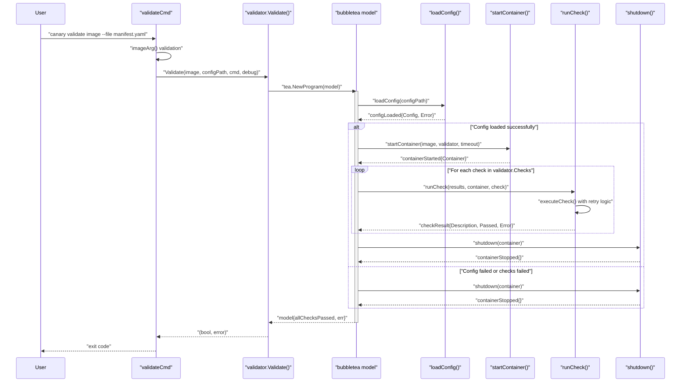
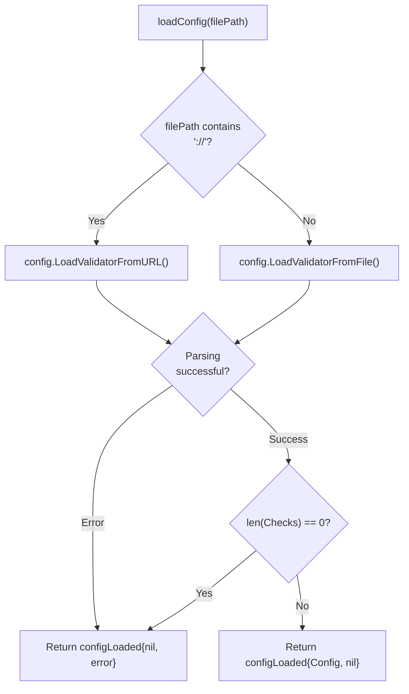
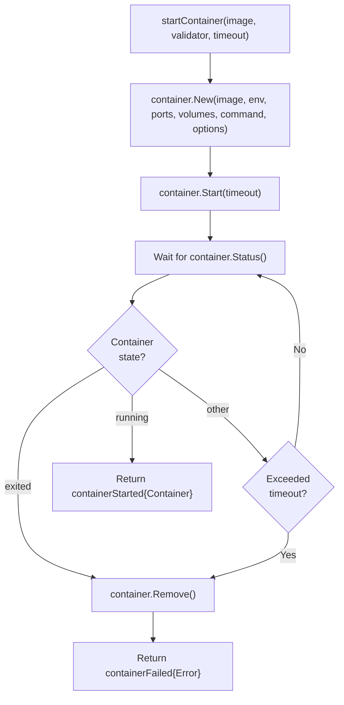
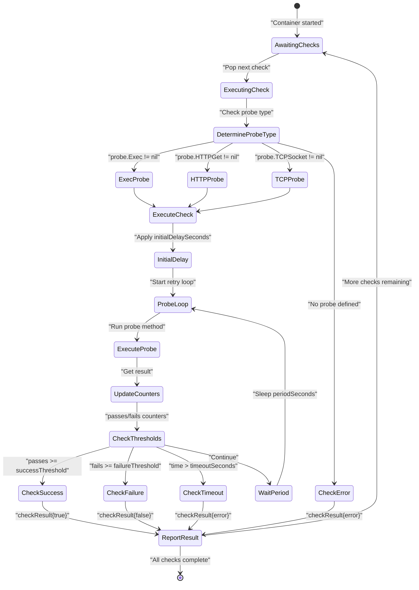
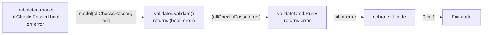

<!-- source: DeepWiki mcp.deepwiki.com · repo NVIDIA/container-canary · page 3.2 Validation Flow · fetched 2026-10-26 -->

# Validation Flow

<details>
<summary>Relevant source files</summary>

The following files were used as context for generating this wiki page:

- [cmd/validate.go](cmd/validate.go)
- [internal/config/load.go](internal/config/load.go)
- [internal/validator/validator.go](internal/validator/validator.go)

</details>


This document traces the complete validation workflow from CLI invocation through configuration loading, container lifecycle management, check execution, and result reporting. It describes the message-driven architecture using bubbletea and the state transitions that occur during validation.

For information about the CLI interface and command-line arguments, see [CLI Reference](#2.1). For details about probe execution mechanics and retry logic, see [Probe Execution](#3.4). For the container lifecycle abstraction, see [Container Abstraction](#3.3).

## Overview

The validation flow is implemented as an event-driven system using the [bubbletea](https://github.com/charmbracelet/bubbletea) TUI framework. The flow proceeds through five distinct phases:

| Phase | Primary Function | Message Types |
|-------|-----------------|---------------|
| **Initialization** | Parse CLI arguments, create TUI model | N/A |
| **Configuration Loading** | Load and parse validator manifest | `configLoaded` |
| **Container Startup** | Create and start target container | `containerStarted`, `containerFailed` |
| **Check Execution** | Execute probes sequentially | `checkResult` |
| **Cleanup** | Remove container | `containerStopped`, `containerFailed` |

The entire flow is orchestrated through message passing, enabling both interactive TUI display and programmatic status tracking.

**Sources:** [internal/validator/validator.go:64-219](), [cmd/validate.go:36-60]()

## Entry Point and Initialization

The validation process begins in the CLI command handler, which performs preliminary validation before delegating to the validator orchestrator.

### CLI Command Handler

[cmd/validate.go:29-60]() defines the `validateCmd` cobra command:

```bash
canary validate [IMAGE] --file <path-or-url> [--debug] [--startup-timeout <seconds>]
```

The command handler:
1. Validates that a manifest file/URL is provided via `--file` flag [cmd/validate.go:37-43]()
2. Checks for Docker availability via `container.CheckForDocker()` [cmd/validate.go:72-74]()
3. Verifies the target image exists locally via `validator.CheckImage()` [cmd/validate.go:78-82]()
4. Invokes `validator.Validate()` with the image, manifest path, and flags [cmd/validate.go:51-51]()
5. Returns exit code 0 on success, non-zero on failure [cmd/validate.go:56-59]()

### Validator Initialization

[internal/validator/validator.go:64-99]() creates the validation model and starts the bubbletea program:

```go
func Validate(image string, configPath string, cmd *cobra.Command, debug bool) (bool, error)
```

This function:
- Opens `/dev/tty` for TUI input, falling back to `stdin` if unavailable [internal/validator/validator.go:67-71]()
- Extracts the `--startup-timeout` flag [internal/validator/validator.go:72-75]()
- Creates a `model` struct containing the execution state, including a `sub` channel for `checkResult` messages [internal/validator/validator.go:76-87]()
- Initializes and runs the bubbletea program using `tea.NewProgram` [internal/validator/validator.go:88-89]()
- Returns the final validation result and any errors [internal/validator/validator.go:93-97]()

**Sources:** [cmd/validate.go:29-90](), [internal/validator/validator.go:64-99]()

## Message-Driven Architecture

The validation flow uses bubbletea's message-passing architecture, where each phase communicates through typed messages.

### Message Flow Diagram



### Message Type Definitions

[internal/validator/validator.go:44-60]() defines the internal message types used to drive the state machine:

| Message Type | Fields | Purpose |
|-------------|--------|---------|
| `checkResult` | `Description string`<br>`Passed bool`<br>`Error error` | Reports individual check outcome [internal/validator/validator.go:44-48]() |
| `containerFailed` | `Error error` | Reports container operation failure [internal/validator/validator.go:50-52]() |
| `containerStarted` | `Container ContainerInterface` | Signals container is ready [internal/validator/validator.go:53-55]() |
| `containerStopped` | (empty) | Signals cleanup complete [internal/validator/validator.go:56-56]() |
| `configLoaded` | `Config *canaryv1.Validator`<br>`Error error` | Delivers parsed configuration [internal/validator/validator.go:57-60]() |

**Sources:** [internal/validator/validator.go:44-60]()

## Configuration Loading Phase

The configuration loading phase retrieves and parses the validator manifest from either a local file or remote URL.



[internal/validator/validator.go:101-129]() implements `loadConfig()`:

- Checks if `filePath` contains `"://"` to distinguish URLs from local paths [internal/validator/validator.go:106-110]()
- Delegates to `config.LoadValidatorFromURL()` [internal/config/load.go:32-46]() or `config.LoadValidatorFromFile()` [internal/config/load.go:48-64]()
- The underlying `LoadValidatorFromBytes` uses `yaml.Unmarshal` to populate the `canaryv1.Validator` struct [internal/config/load.go:66-75]()
- Validates that at least one check is defined [internal/validator/validator.go:117-122]()
- Returns a `configLoaded` message with either the validator config or an error [internal/validator/validator.go:124-127]()

**Sources:** [internal/validator/validator.go:101-129](), [internal/config/load.go:32-75]()

## Container Startup Phase

After configuration loads successfully, the container startup phase creates and starts the target container with the specified runtime configuration.



### Container Startup Implementation

[internal/validator/validator.go:131-142]() implements `startContainer()`:

1. Creates a new `ContainerInterface` via `container.New()` with manifest-defined environment, ports, volumes, command, and runtime options [internal/validator/validator.go:133-133]()
2. Calls `container.Start(startupTimeout)` to initialize the runtime instance [internal/validator/validator.go:134-134]()
3. Returns `containerStarted` on success or `containerFailed` on error [internal/validator/validator.go:135-140]()

**Sources:** [internal/validator/validator.go:131-142]()

## Check Execution Phase

Once the container is running, checks execute sequentially in the order defined in the manifest.

### Check Execution State Machine



### Check Execution Code Path

[internal/validator/validator.go:160-178]() implements `runCheck()`:

1. Determines probe type by checking which field is non-nil in `check.Probe` [internal/validator/validator.go:165-171]()
2. Invokes `executeCheck(method, container, probe)` with the appropriate probe callable (`ExecCheck`, `HTTPGetCheck`, or `TCPSocketCheck`) [internal/validator/validator.go:166-170]()
3. Sends the resulting `checkResult` to the results channel [internal/validator/validator.go:175-175]()

### Retry and Threshold Logic

[internal/validator/validator.go:181-206]() implements `executeCheck()`:

- **Initial Delay**: Sleep for `probe.InitialDelaySeconds` [internal/validator/validator.go:182-182]()
- **Execution Loop**: Enters a loop that calls the probe `method` [internal/validator/validator.go:186-205]()
- **Thresholds**: Tracks consecutive `passes` and `fails`. Returns when either `SuccessThreshold` or `FailureThreshold` is reached [internal/validator/validator.go:191-199]()
- **Timeout**: Enforces `probe.TimeoutSeconds` across the entire retry lifecycle [internal/validator/validator.go:201-203]()
- **Period**: Sleeps for `probe.PeriodSeconds` between probe attempts [internal/validator/validator.go:204-204]()

**Sources:** [internal/validator/validator.go:160-206]()

## Cleanup and Result Reporting

After all checks complete (or on failure), the container is removed and results are reported.

### Cleanup Phase

[internal/validator/validator.go:144-152]() implements `shutdown()`:

- Calls `container.Remove()` to destroy the container instance [internal/validator/validator.go:146-146]()
- Returns `containerStopped{}` on success [internal/validator/validator.go:150-150]()

### Result Formatting

[internal/validator/validator.go:208-219]() implements `getStatus()`:
- Formats results using `passedStyle` (green) or `failedStyle` (red) based on the outcome and presence of errors [internal/validator/validator.go:209-218]()

### Final Result Propagation

The validation result flows back through the call stack:



[internal/validator/validator.go:88-97]() extracts the result from the bubbletea model after `p.Run()` completes.

**Sources:** [internal/validator/validator.go:88-97](), [internal/validator/validator.go:144-152](), [internal/validator/validator.go:208-219](), [cmd/validate.go:51-59]()

## Concurrency and Message Passing

The validation system uses goroutines and channels to manage concurrent operations while maintaining sequential check execution.

### Channel Usage

[internal/validator/validator.go:77]() creates a channel for check results:

```go
sub: make(chan checkResult)
```

[internal/validator/validator.go:154-158]() implements `waitForChecks()` which blocks on this channel, allowing the bubbletea loop to receive asynchronous probe results as messages.

Each check goroutine sends its result to this channel [internal/validator/validator.go:175-175](), which is then picked up by the model's update loop to progress the UI and trigger the next check or shutdown.

**Sources:** [internal/validator/validator.go:77](), [internal/validator/validator.go:154-158](), [internal/validator/validator.go:175-175]()

---

