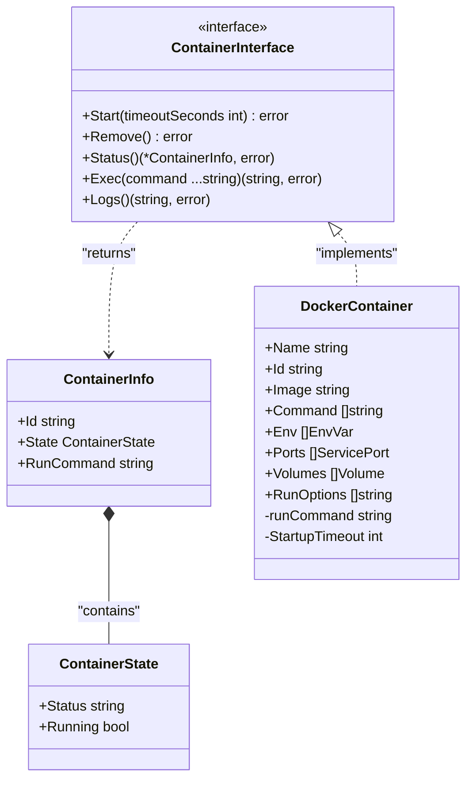
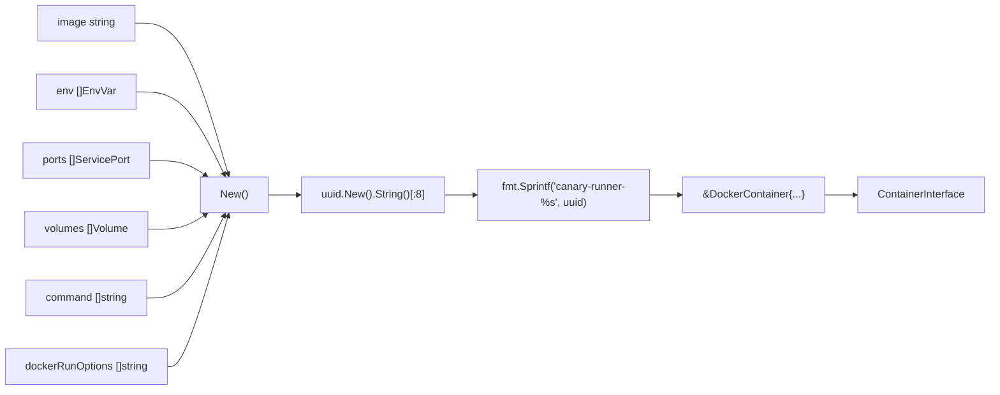
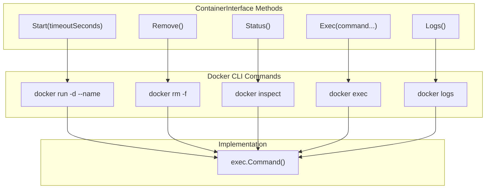
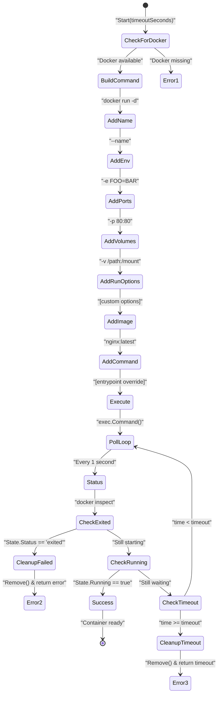
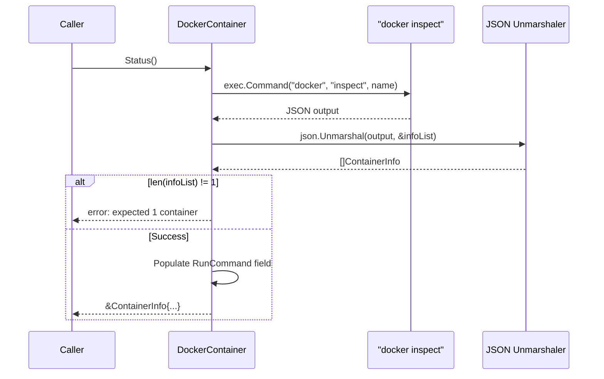
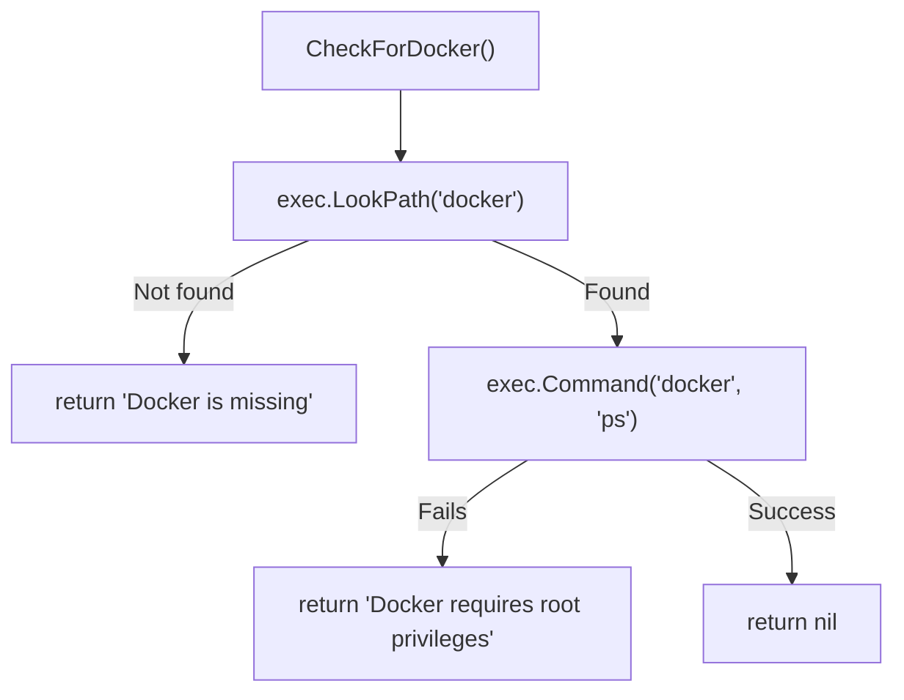
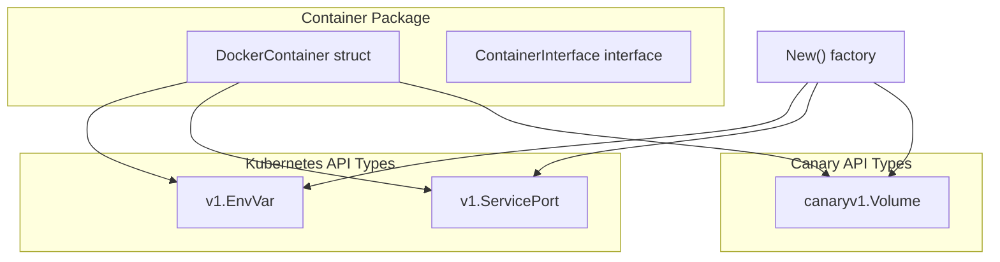

<!-- source: DeepWiki mcp.deepwiki.com · repo NVIDIA/container-canary · page 3.3 Container Abstraction · fetched 2026-10-26 -->

# Container Abstraction

<details>
<summary>Relevant source files</summary>

The following files were used as context for generating this wiki page:

- [examples/gpu.yaml](examples/gpu.yaml)
- [internal/container/container.go](internal/container/container.go)
- [internal/container/docker.go](internal/container/docker.go)
- [internal/container/docker_test.go](internal/container/docker_test.go)

</details>


This document describes the container abstraction layer in `container-canary`, which provides a clean interface for container lifecycle management and command execution. The abstraction isolates the validation logic from runtime-specific implementation details, currently supporting Docker through the `DockerContainer` implementation.

For information about how the container abstraction is used during validation, see [Validation Flow](). For details about probe execution within containers, see [Probe Execution]().

## Purpose and Design

The container abstraction layer serves two primary goals:

1.  **Decoupling**: Separates validation orchestration logic from container runtime implementation details.
2.  **Extensibility**: Enables future support for alternative container runtimes (podman, containerd, etc.) without modifying validation logic.

The abstraction is defined in [internal/container/container.go]() and implemented for Docker in [internal/container/docker.go]().

**Sources:** [internal/container/container.go:1-50](), [internal/container/docker.go:1-156]()

## ContainerInterface Definition

The `ContainerInterface` defines the contract for all container runtime implementations:



**Sources:** [internal/container/container.go:28-45](), [internal/container/docker.go:15-26]()

### Interface Methods

| Method | Purpose | Return Value |
| :--- | :--- | :--- |
| `Start(timeoutSeconds int)` | Launch container and wait for running state | `error` if startup fails or times out |
| `Remove()` | Force remove container | `error` if removal fails |
| `Status()` | Get container state and metadata | `*ContainerInfo` with runtime details |
| `Exec(command ...string)` | Execute command inside container | Command output as `string` |
| `Logs()` | Retrieve container logs | Log output as `string` |

**Sources:** [internal/container/container.go:39-45]()

## Container Factory

The `New` function creates container instances with automatically generated unique names:



The factory function signature:
[internal/container/container.go:47-50]()
```go
func New(image string, env []v1.EnvVar, ports []v1.ServicePort, volumes []canaryv1.Volume, command []string, dockerRunOptions []string) ContainerInterface {
	name := fmt.Sprintf("%s%s", "canary-runner-", uuid.New().String()[:8])
	return &DockerContainer{Name: name, Image: image, Command: command, Env: env, Ports: ports, Volumes: volumes, RunOptions: dockerRunOptions}
}
```

Container names follow the pattern `canary-runner-<8-char-uuid>` to prevent collisions during concurrent validations [internal/container/container.go:48-49]().

**Sources:** [internal/container/container.go:47-50]()

## DockerContainer Implementation

### Structure

The `DockerContainer` struct stores all configuration needed to launch and manage a Docker container:

| Field | Type | Purpose |
| :--- | :--- | :--- |
| `Name` | `string` | Unique container identifier |
| `Id` | `string` | Docker-assigned container ID |
| `Image` | `string` | Container image to run |
| `Command` | `[]string` | Entrypoint override |
| `Env` | `[]v1.EnvVar` | Environment variables |
| `Ports` | `[]v1.ServicePort` | Port mappings |
| `Volumes` | `[]canaryv1.Volume` | Volume mounts |
| `RunOptions` | `[]string` | Additional docker run flags |
| `runCommand` | `string` | Full docker run command executed |
| `StartupTimeout` | `int` | Container startup timeout |

**Sources:** [internal/container/docker.go:15-26]()

### Docker CLI Command Mapping

Each interface method maps to specific Docker CLI commands:



**Sources:** [internal/container/docker.go:29-156]()

### Start Method Implementation

The `Start` method implements a startup sequence with polling and timeout handling:



Key implementation details:

1.  **Docker Availability Check**: [internal/container/docker.go:61-63]() calls `CheckForDocker()` before attempting to start.
2.  **Command Construction**: [internal/container/docker.go:31-59]() builds the docker run command with all configuration.
3.  **Startup Polling**: [internal/container/docker.go:67-90]() polls container status every second until running or timeout.
4.  **Automatic Cleanup**: Failed or timed-out containers are automatically removed via `c.Remove()` [internal/container/docker.go:73](), [internal/container/docker.go:83]().

**Sources:** [internal/container/docker.go:29-97]()

### Command Construction Details

The `Start` method builds the docker run command in this order:

| Step | Code Location | Purpose |
| :--- | :--- | :--- |
| Base command | [internal/container/docker.go:31]() | `docker run -d` |
| Container name | [internal/container/docker.go:33]() | `--name <uuid-name>` |
| Environment variables | [internal/container/docker.go:35-37]() | `-e VAR=value` for each env var |
| Port mappings | [internal/container/docker.go:39-41]() | `-p hostPort:containerPort/protocol` |
| Volume mounts | [internal/container/docker.go:43-49]() | `-v path:mountPath` or `-v mountPath` |
| Custom run options | [internal/container/docker.go:51-53]() | User-specified docker run flags (e.g., `--gpus all`) |
| Image | [internal/container/docker.go:55]() | Target image name |
| Entrypoint override | [internal/container/docker.go:57-59]() | Custom command if specified |

**Sources:** [internal/container/docker.go:31-59](), [examples/gpu.yaml:8-10]()

## Container Lifecycle Operations

### Status Inspection

The `Status()` method retrieves detailed container information:



The method:
1.  Executes `docker inspect <name>` [internal/container/docker.go:119]().
2.  Unmarshals JSON into `[]ContainerInfo` [internal/container/docker.go:127]().
3.  Validates exactly one container returned [internal/container/docker.go:133-135]().
4.  Populates the `RunCommand` field with the stored docker run command [internal/container/docker.go:139]().

**Sources:** [internal/container/docker.go:117-142]()

### Command Execution

The `Exec()` method executes commands inside running containers:

[internal/container/docker.go:145-150]()
```go
func (c DockerContainer) Exec(command ...string) (string, error) {
	args := append([]string{"exec", c.Name}, command...)
	out, err := exec.Command("docker", args...).Output()
	return string(out), err
}
```

Usage pattern:
-   Input: Variadic command parts (e.g., `"uname", "-a"`).
-   Constructs: `docker exec <container-name> <command...>` [internal/container/docker.go:147-148]().
-   Returns: Standard output as string or error.

**Sources:** [internal/container/docker.go:145-150]()

### Log Retrieval

The `Logs()` method retrieves container stdout/stderr using `docker logs <name>` [internal/container/docker.go:153-156]().

**Sources:** [internal/container/docker.go:153-156]()

### Container Removal

The `Remove()` method forcefully removes containers using `docker rm -f` [internal/container/docker.go:111-114](). This is critical for cleanup after validation failures or timeouts [internal/container/docker.go:73](), [internal/container/docker.go:83]().

**Sources:** [internal/container/docker.go:111-114]()

## Docker Availability Check

The `CheckForDocker()` function validates Docker availability before operations:



Two-stage validation:
1.  **Binary check**: [internal/container/docker.go:100-102]() - Verifies `docker` command exists in PATH.
2.  **Execution check**: [internal/container/docker.go:104-106]() - Runs `docker ps` to verify Docker daemon access.

**Sources:** [internal/container/docker.go:99-108]()

## Testing

The container abstraction includes comprehensive tests in [internal/container/docker_test.go]():

### Test Coverage

| Test Function | Validation |
| :--- | :--- |
| `TestDockerContainer` | Full lifecycle: Start → Status → Exec → Remove [internal/container/docker_test.go:29-70]() |
| `TestDockerContainerRemoves` | Explicit container removal functionality [internal/container/docker_test.go:71-85]() |

The test suite validates:
1.  **Container startup**: nginx image starts successfully [internal/container/docker_test.go:40-42]().
2.  **Environment variables**: Passed correctly to container [internal/container/docker_test.go:31-33]().
3.  **Port mappings**: Configured as specified [internal/container/docker_test.go:34-36]().
4.  **Command execution**: `uname -a` returns string containing "Linux" [internal/container/docker_test.go:61-69]().
5.  **Status inspection**: `RunCommand` field populated correctly [internal/container/docker_test.go:54-59]().

**Sources:** [internal/container/docker_test.go:1-85]()

## Type Dependencies

The container package depends on external types for configuration:



Type usage:
-   **`v1.EnvVar`**: Kubernetes core API environment variable type [internal/container/docker.go:20]().
-   **`v1.ServicePort`**: Kubernetes core API port mapping type [internal/container/docker.go:21]().
-   **`canaryv1.Volume`**: Canary-specific volume mount type [internal/container/docker.go:22]().

**Sources:** [internal/container/docker.go:3-13](), [internal/container/docker.go:20-22]()

---

