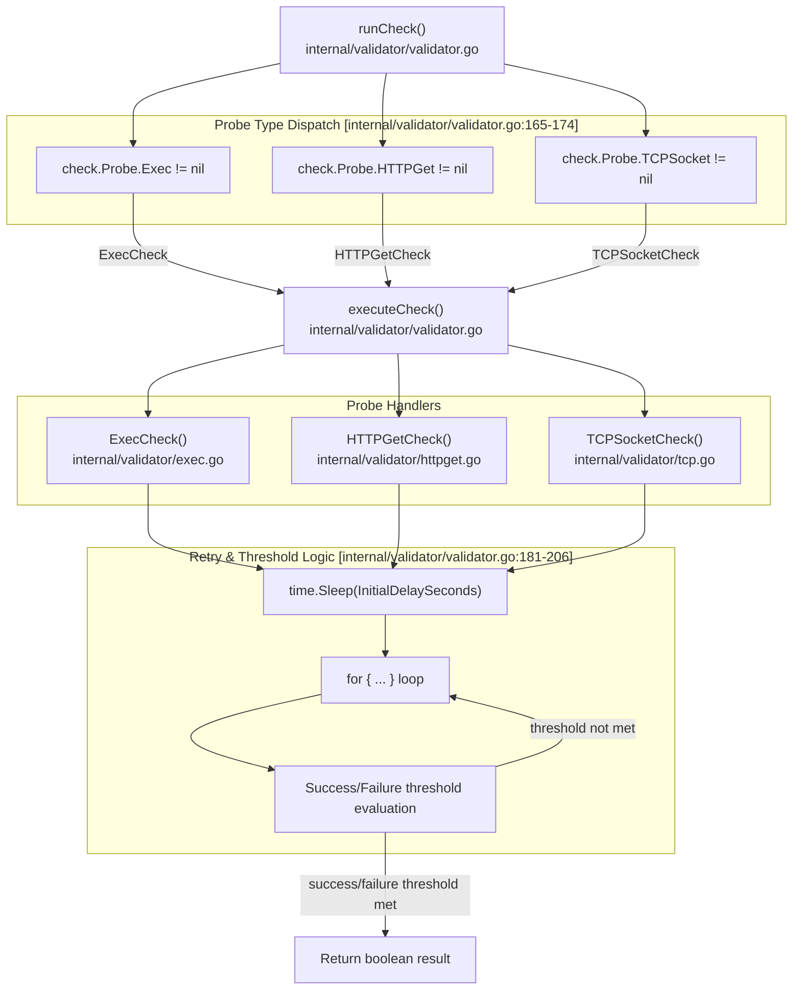
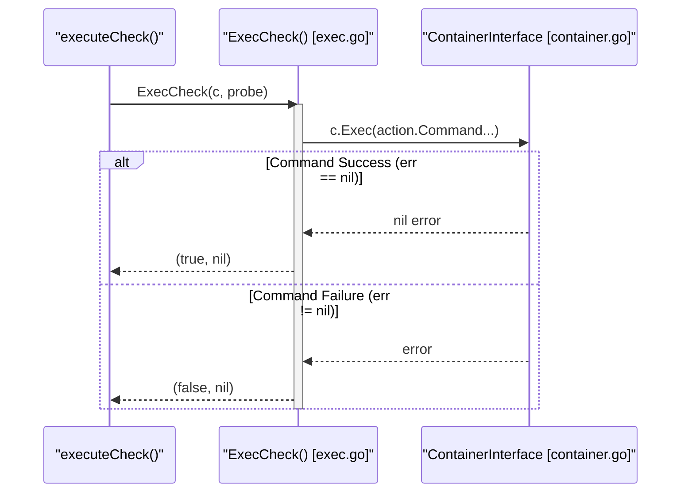
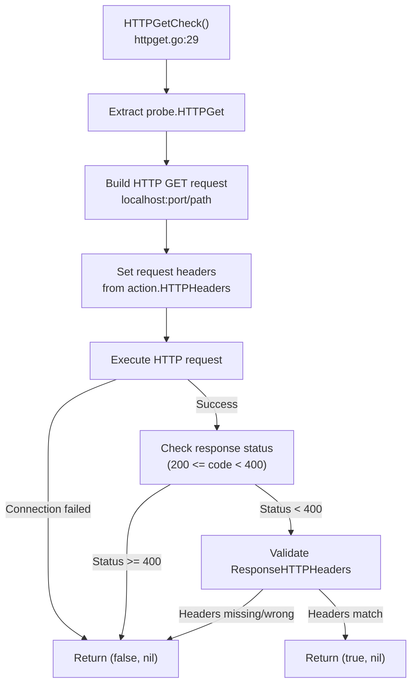
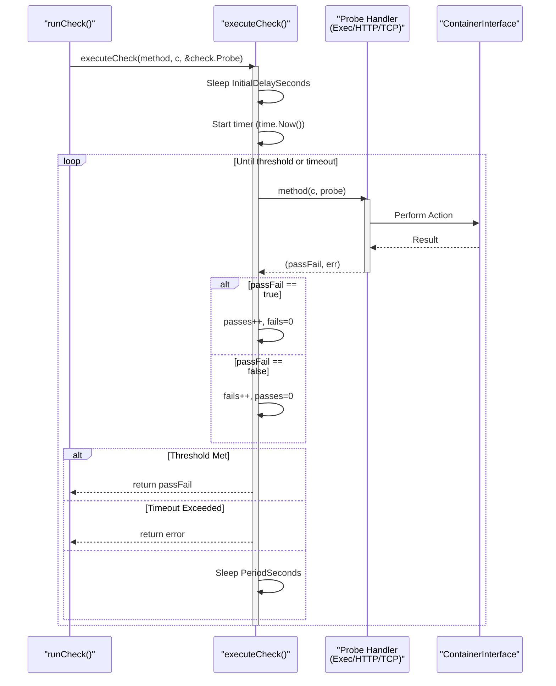

<!-- source: DeepWiki mcp.deepwiki.com · repo NVIDIA/container-canary · page 3.4 Probe Execution · fetched 2026-10-26 -->

# Probe Execution

<details>
<summary>Relevant source files</summary>

The following files were used as context for generating this wiki page:

- [examples/dask-scheduler.yaml](examples/dask-scheduler.yaml)
- [internal/validator/exec.go](internal/validator/exec.go)
- [internal/validator/httpget.go](internal/validator/httpget.go)
- [internal/validator/httpget_test.go](internal/validator/httpget_test.go)
- [internal/validator/tcp.go](internal/validator/tcp.go)
- [internal/validator/validator.go](internal/validator/validator.go)

</details>


## Purpose and Scope

This document details the internal probe execution architecture of container-canary, explaining how different probe types are dispatched, executed, and evaluated against configured thresholds. It covers the retry logic, threshold evaluation mechanism, and the implementation of each probe type (Exec, HTTP, TCP).

For information about configuring probes in validator manifests, see [Probe Types]() and [Probe Configuration](). For the complete validation workflow context, see [Validation Flow](). For API reference documentation of probe type definitions, see [Probe Type]().

## Probe Execution Architecture

The probe execution system is built around a flexible dispatching mechanism that routes probes to specialized handlers based on their type. All probe handlers share a common function signature (`probeCallable`) and execution framework that provides consistent retry logic and threshold evaluation.

### Logic Flow and Code Entities

The following diagram bridges the logical execution flow to the specific functions and files in the codebase.



**Sources:** [internal/validator/validator.go:160-206](), [internal/validator/exec.go:25-32](), [internal/validator/httpget.go:29-59](), [internal/validator/tcp.go:28-36]()

## Probe Type Dispatching

The `runCheck` function serves as the entry point for probe execution. It examines the probe configuration to determine which handler to invoke based on which action field is non-nil.

### Dispatch Logic

[internal/validator/validator.go:160-178]() implements the dispatching mechanism:

| Probe Type | Condition Check | Handler Function | Action Field |
|------------|----------------|------------------|--------------|
| Exec | `check.Probe.Exec != nil` | `ExecCheck` | `probe.Exec` |
| HTTP | `check.Probe.HTTPGet != nil` | `HTTPGetCheck` | `probe.HTTPGet` |
| TCP | `check.Probe.TCPSocket != nil` | `TCPSocketCheck` | `probe.TCPSocket` |

The dispatch logic at [internal/validator/validator.go:165-174]() evaluates each probe type in sequence and calls `executeCheck` with the appropriate handler.

### Probe Callable Interface

All probe handlers implement the `probeCallable` function signature defined at [internal/validator/validator.go:62]():

```go
type probeCallable func(container.ContainerInterface, *canaryv1.Probe) (bool, error)
```

This common interface enables polymorphic handling of different probe types within the unified retry/threshold framework.

**Sources:** [internal/validator/validator.go:62](), [internal/validator/validator.go:160-178]()

## Exec Probe Handler

The Exec probe handler executes commands inside the running container and evaluates success based on the command's exit code.



### Implementation

The `ExecCheck` function at [internal/validator/exec.go:25-32]() is the simplest probe handler:

1. Extracts the `Exec` action from the probe configuration [internal/validator/exec.go:26]().
2. Calls `c.Exec()` with the command arguments [internal/validator/exec.go:27]().
3. Returns `true` if the command exits successfully (exit code 0/nil error) [internal/validator/exec.go:31]().
4. Returns `false` if the command fails (non-zero exit code/error) [internal/validator/exec.go:29]().

Note that errors are intentionally returned as `(false, nil)` rather than `(false, err)` at [internal/validator/exec.go:29](). This allows the retry logic to continue attempting the check rather than failing immediately.

**Sources:** [internal/validator/exec.go:25-32](), [internal/validator/validator.go:188-190]()

## HTTP Probe Handler

The HTTP probe handler makes HTTP GET requests to the container and validates both the connection and optionally the response headers.



### Implementation Details

The `HTTPGetCheck` function at [internal/validator/httpget.go:29-59]() implements HTTP validation:

1. **Request Construction** [internal/validator/httpget.go:33-37](): Builds a GET request to `http://localhost:{port}{path}`.
2. **Request Headers** [internal/validator/httpget.go:40-42](): Applies custom headers from `HTTPHeaders` configuration.
3. **Request Execution** [internal/validator/httpget.go:43-46](): Makes the HTTP request.
4. **Status Code Check** [internal/validator/httpget.go:49-51](): Matches Kubernetes behavior where any code `< 400` is success.
5. **Response Header Validation** [internal/validator/httpget.go:52-57](): Verifies that all `ResponseHTTPHeaders` are present and match expected values.

### Header Validation

Response header validation at [internal/validator/httpget.go:52-57]() performs exact string matching. Headers are joined without separators using `strings.Join(val[:], "")` [internal/validator/httpget.go:54]().

**Sources:** [internal/validator/httpget.go:29-59](), [internal/validator/httpget_test.go:31-117]()

## TCP Probe Handler

The TCP probe handler attempts to establish a TCP connection to the container's exposed port. Success is determined solely by whether the connection can be established.

### Implementation

The `TCPSocketCheck` function at [internal/validator/tcp.go:28-36]() implements this logic:

1. Formats the address as `localhost:{port}` [internal/validator/tcp.go:30]().
2. Attempts a connection using `net.Dial("tcp", address)` [internal/validator/tcp.go:31]().
3. Returns `true` if the connection is established [internal/validator/tcp.go:35]().
4. Returns `false` if the connection fails [internal/validator/tcp.go:33]().

**Sources:** [internal/validator/tcp.go:28-36](), [internal/validator/validator.go:169-170]()

## Retry and Threshold Logic

The `executeCheck` function at [internal/validator/validator.go:181-206]() implements a retry mechanism that prevents false failures during container initialization and provides configurable success/failure criteria.

### Timing Parameters

| Parameter | Purpose | Implementation |
|-----------|---------|----------------|
| `InitialDelaySeconds` | Wait time before first probe execution | `time.Sleep(...)` at [internal/validator/validator.go:182]() |
| `TimeoutSeconds` | Maximum total execution time | `time.Since(start) > ...` at [internal/validator/validator.go:201]() |
| `PeriodSeconds` | Wait time between probe attempts | `time.Sleep(...)` at [internal/validator/validator.go:204]() |

### Threshold Parameters

| Parameter | Purpose | Implementation |
|-----------|---------|----------------|
| `SuccessThreshold` | Consecutive successes required to pass | `passes >= probe.SuccessThreshold` at [internal/validator/validator.go:198]() |
| `FailureThreshold` | Consecutive failures required to fail | `fails >= probe.FailureThreshold` at [internal/validator/validator.go:198]() |

### Counter Logic

The retry loop at [internal/validator/validator.go:186-205]() maintains two counters:

- **passes**: Incremented on success, reset to 0 on failure [internal/validator/validator.go:191-193]().
- **fails**: Incremented on failure, reset to 0 on success [internal/validator/validator.go:194-196]().

This ensures that thresholds require *consecutive* results. For example, with `SuccessThreshold: 3`, three consecutive successful probe executions are required.

**Sources:** [internal/validator/validator.go:181-206]()

## Complete Execution Sequence

The following diagram shows the complete probe execution sequence with all components:



**Sources:** [internal/validator/validator.go:160-206]()

## Error Handling

Probe handlers follow a consistent error handling pattern:

- **Action Failures**: Return `(false, nil)` (e.g., `net.Dial` fails or `HTTP` status is 404) to allow retry logic to continue [internal/validator/tcp.go:33](), [internal/validator/httpget.go:50]().
- **Execution Errors**: If the `method` itself returns a non-nil error to `executeCheck`, the process aborts immediately [internal/validator/validator.go:188-190]().
- **Timeout**: If thresholds aren't met within `TimeoutSeconds`, a specific timeout error is returned [internal/validator/validator.go:202]().

**Sources:** [internal/validator/validator.go:181-206](), [internal/validator/exec.go:25-32](), [internal/validator/httpget.go:29-59](), [internal/validator/tcp.go:28-36]()

---

