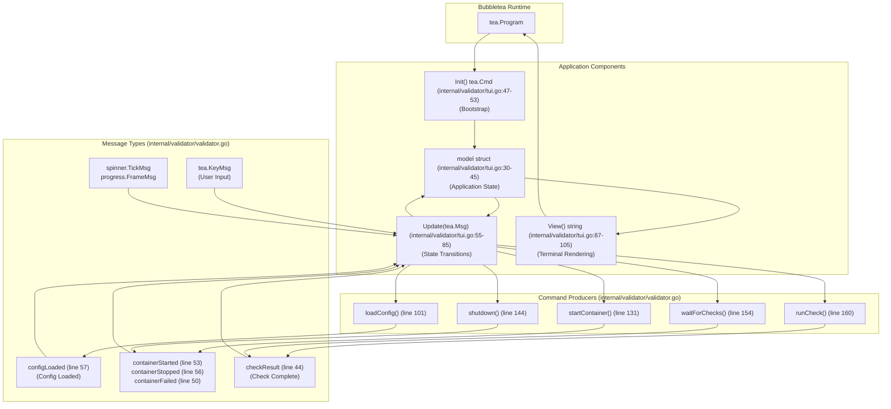
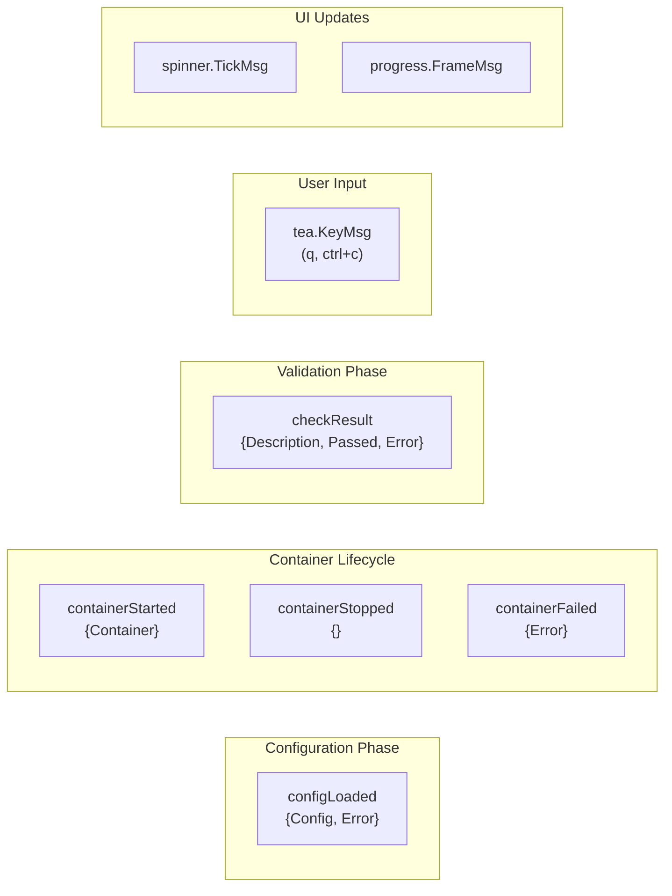
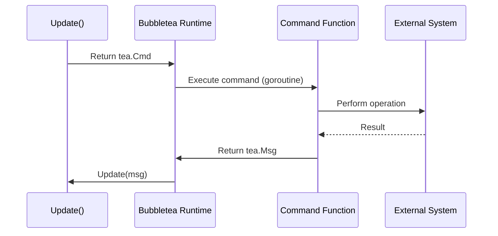
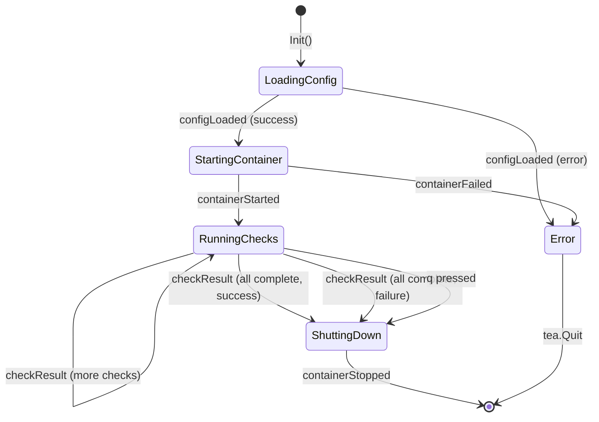

<!-- source: DeepWiki mcp.deepwiki.com · repo NVIDIA/container-canary · page 3.5 Terminal UI · fetched 2026-10-26 -->

# Terminal UI

Relevant source files

The following files were used as context for generating this wiki page:

- [go.mod](go.mod)
- [internal/validator/tui.go](internal/validator/tui.go)
- [internal/validator/validator.go](internal/validator/validator.go)

## Purpose and Scope

This document explains the Terminal UI (TUI) implementation in `container-canary`, which provides an interactive, real-time interface for container validation. The TUI is built using the [Bubbletea](https://github.com/charmbracelet/bubbletea) framework and follows the Elm architecture pattern.

For information about the overall validation workflow, see [Validation Flow](3.2). For details about probe execution logic independent of the UI, see [Probe Execution](3.4). For CLI command structure, see [CLI Reference](2.1).

**Sources**: [internal/validator/validator.go:1-219](), [internal/validator/tui.go:1-193]()

---

## Architecture Overview

The TUI implements the Elm architecture, a functional pattern consisting of three core components: `Model` (application state), `Update` (state transitions), and `View` (rendering). The system is event-driven, with `tea.Cmd` producing `tea.Msg` instances that trigger state updates.

### Elm Architecture in Container-Canary

**Sources**: [internal/validator/tui.go:30-105](), [internal/validator/validator.go:44-60, 64-99, 101-178]()

---

## Model State

The `model` struct in [internal/validator/tui.go:30-45]() maintains all application state during validation execution.

### Model Structure

| Field | Type | Purpose |
|-------|------|---------|
| `sub` | `chan checkResult` | Channel for receiving check results from concurrent executions [internal/validator/tui.go:31]() |
| `container` | `container.ContainerInterface` | Active container instance being validated [internal/validator/tui.go:32]() |
| `containerStarted` | `bool` | Flag indicating container is running [internal/validator/tui.go:33]() |
| `containerStartupTimeout` | `int` | Maximum seconds to wait for container startup [internal/validator/tui.go:34]() |
| `results` | `[]checkResult` | Accumulated results from completed checks [internal/validator/tui.go:35]() |
| `allChecksPassed` | `bool` | Aggregated pass/fail status across all checks [internal/validator/tui.go:36]() |
| `spinner` | `spinner.Model` | Bubbletea spinner for loading animations [internal/validator/tui.go:37]() |
| `progress` | `progress.Model` | Bubbletea progress bar for check execution [internal/validator/tui.go:38]() |
| `debug` | `bool` | Debug mode flag (leaves container running on failure) [internal/validator/tui.go:39]() |
| `image` | `string` | Container image being validated [internal/validator/tui.go:40]() |
| `validator` | `*canaryv1.Validator` | Parsed validator configuration [internal/validator/tui.go:41]() |
| `configPath` | `string` | Path or URL to validator manifest [internal/validator/tui.go:42]() |
| `err` | `error` | Error state for failed operations [internal/validator/tui.go:43]() |
| `tty` | `bool` | Whether output is a TTY (enables rich UI) [internal/validator/tui.go:44]() |

**Sources**: [internal/validator/tui.go:30-45]()

---

## Message Types

The TUI uses a type-safe message system where each message type represents a specific event. All messages implement the `tea.Msg` interface.

### Application-Level Messages

| Message Type | Fields | Triggered By |
|-------------|--------|--------------|
| `configLoaded` | `Config *canaryv1.Validator` `Error error` | `loadConfig()` command [internal/validator/validator.go:57-60]() |
| `containerStarted` | `Container container.ContainerInterface` | `startContainer()` command [internal/validator/validator.go:53-55]() |
| `containerStopped` | None | `shutdown()` command [internal/validator/validator.go:56]() |
| `containerFailed` | `Error error` | Container startup/shutdown errors [internal/validator/validator.go:50-52]() |
| `checkResult` | `Description string` `Passed bool` `Error error` | `runCheck()` command [internal/validator/validator.go:44-48]() |
| `tea.KeyMsg` | Key pressed | User keyboard input [internal/validator/tui.go:59-60]() |
| `spinner.TickMsg` | Frame data | Spinner animation timer [internal/validator/tui.go:73-76]() |
| `progress.FrameMsg` | Frame data | Progress bar animation timer [internal/validator/tui.go:77-80]() |

**Sources**: [internal/validator/validator.go:44-60](), [internal/validator/tui.go:55-85]()

---

## Command Functions

Commands are functions that return `tea.Cmd`, which the Bubbletea runtime executes asynchronously. When complete, they produce messages that are sent to the `Update()` method.

### Command Lifecycle Diagram

### Core Commands

#### `loadConfig(filePath string) tea.Cmd`

Located at [internal/validator/validator.go:101-129](), loads and parses the validator manifest from file or URL.

**Returns**: `configLoaded` message with parsed `*canaryv1.Validator` or error.

#### `startContainer(image, validator, timeout) tea.Cmd`

Located at [internal/validator/validator.go:131-142](), creates and starts the target container using `container.New` and `container.Start`.

**Returns**: `containerStarted` with `ContainerInterface` or `containerFailed` with error.

#### `runCheck(results chan, container, check) tea.Cmd`

Located at [internal/validator/validator.go:160-178](), executes a single validation check and sends result to the channel.

**Probe Routing**:
- `check.Probe.Exec` → `ExecCheck()` [internal/validator/validator.go:165-166]()
- `check.Probe.HTTPGet` → `HTTPGetCheck()` [internal/validator/validator.go:167-168]()
- `check.Probe.TCPSocket` → `TCPSocketCheck()` [internal/validator/validator.go:169-170]()

#### `shutdown(container) tea.Cmd`

Located at [internal/validator/validator.go:144-152](), removes the container using `container.Remove()`.

#### `waitForChecks(sub chan) tea.Cmd`

Located at [internal/validator/validator.go:154-158](), blocks waiting for check results from the channel.

**Sources**: [internal/validator/validator.go:101-178]()

---

## Update Flow

The `Update()` method at [internal/validator/tui.go:55-85]() processes all incoming messages and returns the updated model with any new commands to execute.

### State Transition Diagram

### Message Handlers

#### `handleKeypress(m model, msg tea.KeyMsg)`

Located at [internal/validator/tui.go:111-125](), processes keyboard input. "ctrl+c" or "q" sets `allChecksPassed = false` and triggers `shutdown()` if the container is running [internal/validator/tui.go:114-121]().

#### `handleConfigLoaded(m model, msg configLoaded)`

Located at [internal/validator/tui.go:127-139](), processes configuration loading. It calls `startContainer()` on success [internal/validator/tui.go:137]().

#### `handleContainerStarted(m model, msg containerStarted)`

Located at [internal/validator/tui.go:141-155](). It iterates through `m.validator.Checks` and launches `runCheck()` for each [internal/validator/tui.go:151-153]().

#### `handleCheckResult(m model, msg checkResult)`

Located at [internal/validator/tui.go:162-193](). If all checks are complete, it either calls `shutdown()` or leaves the container running if `debug` is enabled and checks failed [internal/validator/tui.go:171-181]().

**Sources**: [internal/validator/tui.go:55-193]()

---

## View Rendering

The `View()` method at [internal/validator/tui.go:87-105]() renders the current state. Rendering behavior depends on TTY detection.

### TTY vs Non-TTY Mode

| Mode | Detection | UI Elements |
|------|-----------|-------------|
| **TTY** | `/dev/tty` opens successfully | Spinner, progress bar, real-time updates |
| **Non-TTY** | `/dev/tty` fails to open | Text-only output via `tea.Printf()` |

The TTY detection occurs at [internal/validator/validator.go:65-71]().

### UI Components

**Spinner** ([internal/validator/validator.go:81]()):
- Usage: Config loading, container startup [internal/validator/tui.go:92, 96]().

**Progress Bar** ([internal/validator/validator.go:82]()):
- Usage: Real-time progress during check execution [internal/validator/tui.go:100]().
- Dynamic color: Green (`"10"`) if passing, red (`"9"`) if failing [internal/validator/tui.go:184-187]().

**Sources**: [internal/validator/tui.go:87-105](), [internal/validator/validator.go:64-88, 184-187]()

---

## Styling System

The TUI uses [lipgloss](https://github.com/charmbracelet/lipgloss) for terminal styling, defined at [internal/validator/validator.go:39-42]().

| Style | Color | Usage |
|-------|-------|-------|
| `helpStyle` | `"8"` (gray) | Help text [internal/validator/validator.go:39]() |
| `passedStyle` | `"10"` (green) | Successful results [internal/validator/validator.go:40]() |
| `failedStyle` | `"9"` (red) | Failed results, errors [internal/validator/validator.go:41]() |
| `highlightStyle` | `"6"` (cyan) | Image/Validator names [internal/validator/validator.go:42]() |

The `getStatus()` function at [internal/validator/validator.go:208-219]() applies these styles to check outcomes.

**Sources**: [internal/validator/validator.go:39-42, 208-219]()

---

## Initialization and Execution

The TUI is initialized and executed through the `Validate()` function at [internal/validator/validator.go:64-99]().

### Initialization Sequence

1.  **TTY Detection**: Tries to open `/dev/tty` [internal/validator/validator.go:67-71]().
2.  **Model Creation**: Initializes `model` with a `sub` channel and UI components [internal/validator/validator.go:76-87]().
3.  **Program Execution**: Starts `tea.NewProgram` and calls `p.Run()` [internal/validator/validator.go:88-89]().
4.  **Result Extraction**: Returns `allChecksPassed` and any `err` from the final model [internal/validator/validator.go:93-97]().

**Sources**: [internal/validator/validator.go:64-99]()

---

## Debug Mode Behavior

Debug mode is controlled by the `debug` boolean flag [internal/validator/tui.go:39]() and affects container cleanup.

### Container Lifecycle

If validation fails and `debug` is true, the `handleCheckResult` function skips the `shutdown(m.container)` command, leaving the container running for manual inspection [internal/validator/tui.go:177-180]().

### Verbose Output

In `handleContainerStarted`, if `debug` is enabled, the model prints the container's run command via `tea.Printf` [internal/validator/tui.go:146-149]().

**Sources**: [internal/validator/tui.go:146-149, 177-181]()

---

