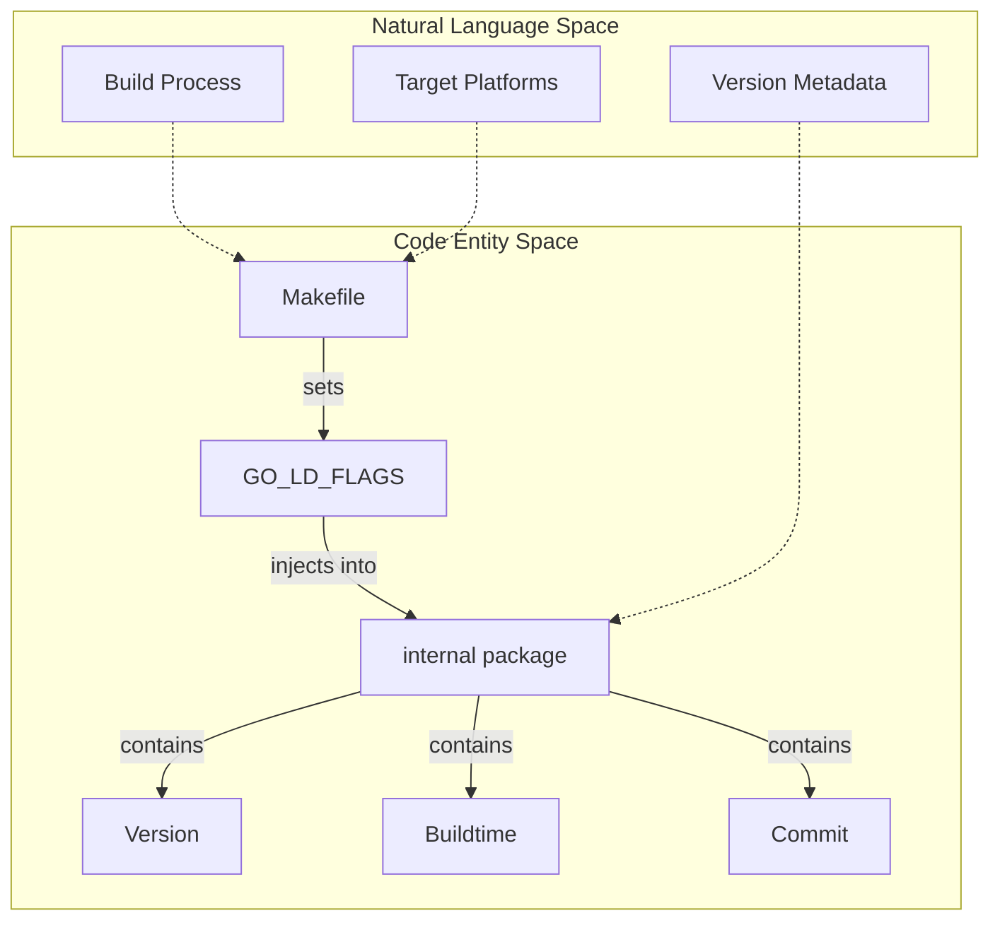
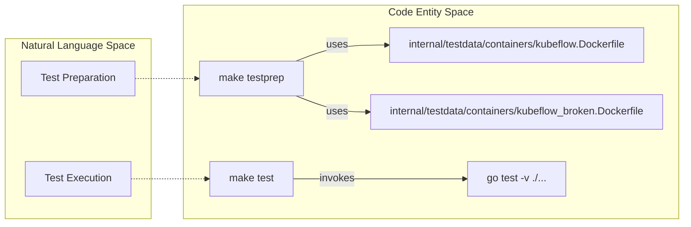

<!-- source: DeepWiki mcp.deepwiki.com · repo NVIDIA/container-canary · page 4 Developer Guide · fetched 2026-10-26 -->

# Developer Guide

Relevant source files

The following files were used as context for generating this wiki page:

- [.pre-commit-config.yaml](.pre-commit-config.yaml)
- [CONTRIBUTING.md](CONTRIBUTING.md)
- [Makefile](Makefile)
- [README.md](README.md)
- [main.go](main.go)

This guide provides comprehensive information for developers who want to contribute to `container-canary`. It covers setting up your development environment, building the project, running tests, maintaining code quality, and submitting contributions.

For information about the internal architecture and how components interact, see [Architecture](#3). For API type definitions and configuration loading functions, see [API Reference](#5).

---

## Development Prerequisites

Container-canary is written in Go and requires the following tools for development:

| Tool | Purpose | Minimum Version |
|------|---------|----------------|
| Go | Core language | 1.21.x |
| Make | Build automation | Any recent version |
| Docker | Test container runtime | Any recent version |
| golangci-lint | Code linting | Latest |
| pre-commit (optional) | Git hooks | Latest |

The project uses Go modules for dependency management.

**Sources**: [Makefile:37-38](), [CONTRIBUTING.md:7-8](), [CONTRIBUTING.md:41-48]()

---

## Building from Source

### Build System Architecture

The build system is centered around the `Makefile`, which provides targets for building, testing, and packaging the application. The build process embeds version metadata into the binary at compile time using Go linker flags.

**System to Code Mapping: Build Metadata Injection**

**Sources**: [Makefile:1-10]()

### Build Targets

The `Makefile` provides several targets for different build scenarios:

#### `make build`
Builds the binary for your current platform into `bin/canary`. The build command at [Makefile:15]() uses `go build` with linker flags that embed three metadata values into the `internal` package:
- `internal.Version` [Makefile:7]()
- `internal.Buildtime` [Makefile:8]()
- `internal.Commit` [Makefile:9]()

#### `make package`
Cross-compiles binaries for all supported platforms into the `bin/` directory at [Makefile:23-29](). Linux builds set `CGO_ENABLED=0` to avoid dynamic linking issues [Makefile:20-22]().

For more details, see [Building from Source](#4.1).

**Sources**: [Makefile:1-32](), [CONTRIBUTING.md:9-16]()

---

## Running Tests

### Test Infrastructure

The test suite requires Docker test containers that validate both passing and failing scenarios. Before running tests, you must build these containers using the `make testprep` target.

**System to Code Mapping: Test Container Lifecycle**

**Sources**: [Makefile:33-39](), [CONTRIBUTING.md:18-37]()

### Execution
1. **Prepare**: Run `make testprep` to build the required Docker images `container-canary/kubeflow:shouldpass` and `container-canary/kubeflow:shouldfail` [Makefile:36-39]().
2. **Run**: Execute `make test` to run the Go test suite [Makefile:33-34]().

For details, see [Running Tests](#4.2).

---

## Code Quality

### Linting and Formatting
The project enforces code quality standards using `golangci-lint` and `gofmt` [CONTRIBUTING.md:7-8, 41]().

### Pre-commit Hooks
Developers are encouraged to use `pre-commit` to check requirements automatically on commit [CONTRIBUTING.md:41-48](). The configuration in [.pre-commit-config.yaml:1-12]() includes:
- `golangci-lint`
- `trailing-whitespace`
- `end-of-file-fixer`

For details, see [Code Quality](#4.3).

---

## Contributing

### Developer Certificate of Origin (DCO)
We require that all contributors "sign-off" on their commits using the `--signoff` (or `-s`) option [CONTRIBUTING.md:50-67](). This certifies the contribution is your original work under the DCO 1.1 [CONTRIBUTING.md:71-94]().

### Process
1. Fork and clone the repository.
2. Ensure code is formatted with `gofmt`.
3. Verify all tests pass and linting is clean.
4. Sign-off every commit.

For details, see [Contributing](#4.4).

**Sources**: [CONTRIBUTING.md:1-94](), [README.md:38-39]()

---

