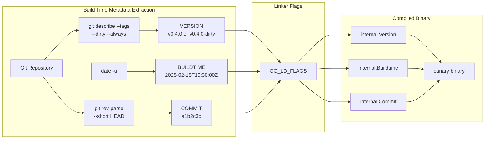
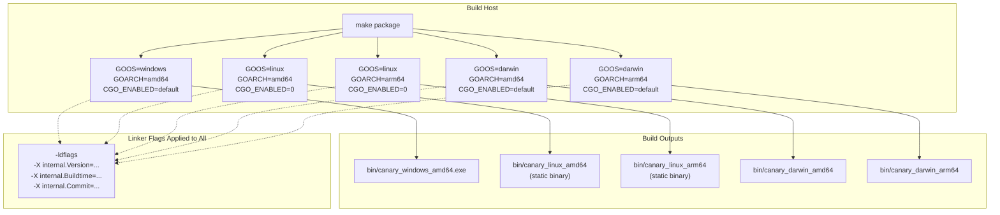
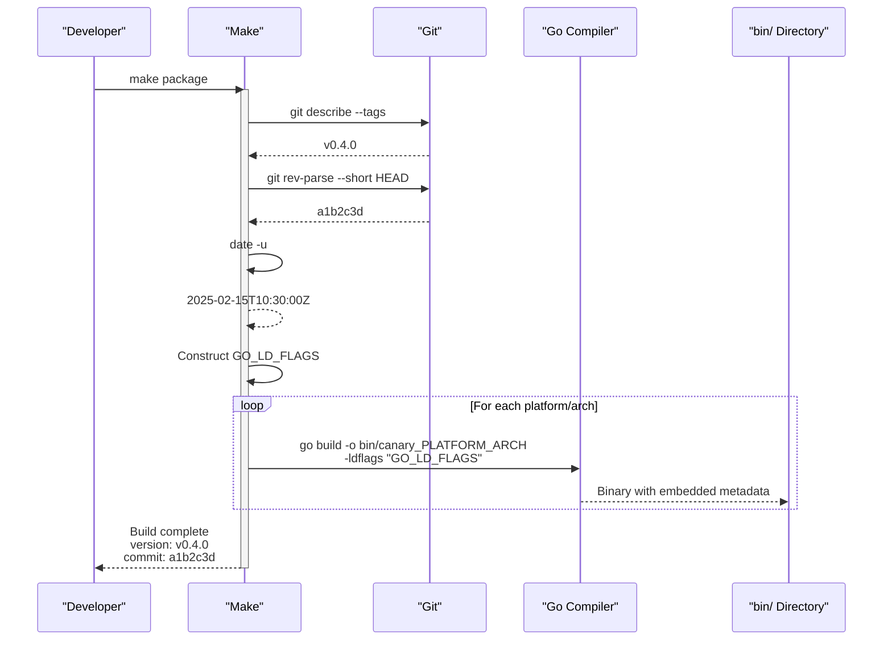
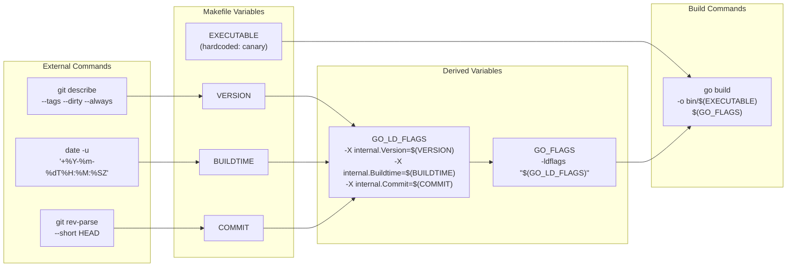

<!-- source: DeepWiki mcp.deepwiki.com · repo NVIDIA/container-canary · page 4.1 Building from Source · fetched 2026-10-26 -->

# Building from Source

<details>
<summary>Relevant source files</summary>

The following files were used as context for generating this wiki page:

- [Makefile](Makefile)
- [go.mod](go.mod)
- [internal/main.go](internal/main.go)
- [main.go](main.go)

</details>


This document explains how to build container-canary from source code using the Make build system. It covers build prerequisites, available Make targets, cross-platform compilation, and build metadata injection.

For information about installing pre-built binaries, see [Installation](#1.1). For information about the automated release build process, see [Release Process](#6.2).

---

## Prerequisites

Container-canary requires Go 1.25.0 or later. The project uses Go modules for dependency management and a Makefile-based build system for cross-platform compilation.

### Required Tools

- **Go 1.25.0+**: The minimum Go version specified in [go.mod:3]()
- **Git**: Required for version and commit hash extraction [Makefile:1-3]()
- **Make**: Standard GNU Make for executing build targets
- **Docker**: Required only for `make testprep` to build test containers [Makefile:36-39]()

### Dependency Resolution

All project dependencies are declared in [go.mod:5-16]() (direct dependencies) and [go.mod:18-53]() (transitive dependencies). Direct dependencies include `cobra` for CLI [go.mod:11](), `bubbletea` for the TUI [go.mod:7](), and `jsonschema` for validation [go.mod:10]().

**Sources**: [go.mod:1-53](), [Makefile:1-48]()

---

## Build System Overview

The build system is centered around a Makefile that provides multiple targets for different build scenarios. All builds inject metadata (version, commit hash, build timestamp) into the binary at compile time using Go linker flags.

### Build Metadata Injection

The build system extracts three pieces of metadata using shell commands:

```makefile
VERSION := $(shell git describe --tags --dirty --always)
BUILDTIME := $(shell date -u '+%Y-%m-%dT%H:%M:%SZ')
COMMIT := $(shell git rev-parse --short HEAD)
```
[Makefile:1-3]()

These values are embedded into the binary via linker flags [Makefile:7-10]() and correspond to variables defined in the `internal` package [internal/main.go:22-25]().

**Build Metadata Flow**



The linker flags `-X` option sets package variables at link time without modifying source code [Makefile:7-10]().

**Sources**: [Makefile:1-10](), [internal/main.go:18-27]()

---

## Available Make Targets

The Makefile provides several targets for different build and development workflows [Makefile:12-48]().

| Target | Purpose | Description |
|--------|---------|-------------|
| `build` | Single-platform build | Build for the current platform only |
| `package` | Cross-platform build | Build for all 5 supported platforms |
| `test` | Run tests | Execute the test suite with `go test` |
| `testprep` | Prepare test containers | Build Docker test containers |
| `all` | Default target | Run `test` and `package` |
| `version` | Display version | Print the current version string |
| `clean` | Clean artifacts | Remove binaries and clear test cache |
| `help` | Display help | Show all available targets |

### Target: `make build`

Builds a single binary for the current platform, placing it in `bin/canary` [Makefile:14-18]().

```bash
make build
# Output:
# built: bin/canary
# version: v0.4.0
# commit: a1b2c3d
```

### Target: `make package`

Cross-compiles binaries for all five supported platform/architecture combinations [Makefile:23-31]():

| Platform | Architecture | Binary Name | CGO Enabled |
|----------|-------------|-------------|-------------|
| Windows | amd64 | `canary_windows_amd64.exe` | Yes (default) |
| Linux | amd64 | `canary_linux_amd64` | No |
| Linux | arm64 | `canary_linux_arm64` | No |
| macOS (Darwin) | amd64 | `canary_darwin_amd64` | Yes (default) |
| macOS (Darwin) | arm64 | `canary_darwin_arm64` | Yes (default) |

**Sources**: [Makefile:12-31]()

---

## Platform-Specific Build Configuration

### Linux Static Linking

Linux builds explicitly disable CGO to create statically-linked binaries [Makefile:20-26]():

```makefile
env GOOS=linux GOARCH=amd64 CGO_ENABLED=0 go build ...
env GOOS=linux GOARCH=arm64 CGO_ENABLED=0 go build ...
```

This prevents runtime errors like `version GLIBC_2.32 not found` when running the binary on systems with older glibc versions than the build system. The comment at [Makefile:20-22]() explains this design decision.

### macOS and Windows Builds

macOS and Windows builds leave `CGO_ENABLED` at its default value (enabled), as these platforms have more stable system library ABIs and benefit from native C integration for certain operations.

**Cross-Compilation Architecture**



**Sources**: [Makefile:20-31]()

---

## Build Workflow

### Standard Development Build

For local development and testing:

```bash
# Clone the repository
git clone https://github.com/NVIDIA/container-canary.git
cd container-canary

# Build for current platform
make build

# Binary is placed in bin/canary
./bin/canary version
```

### Full Cross-Platform Build

For creating distribution artifacts:

```bash
# Build for all platforms
make package

# All binaries are in bin/
ls -l bin/
# canary_darwin_amd64
# canary_darwin_arm64
# canary_linux_amd64
# canary_linux_arm64
# canary_windows_amd64.exe
```

### Building with Tests

The default `make all` target runs both tests and cross-compilation [Makefile:12]():

```bash
make all
# Equivalent to:
# make test && make package
```

**Complete Build Process Flow**



**Sources**: [Makefile:1-31](), [main.go:22-24]()

---

## Verifying Build Metadata

After building, verify that version information is correctly embedded:

```bash
./bin/canary version
```

The `canary` entry point [main.go:22-24]() calls `cmd.Execute()`, which includes the `version` command. This command reads from the variables set by linker flags [Makefile:7-10]() in the `internal` package [internal/main.go:22-25]().

**Sources**: [Makefile:7-10](), [main.go:22-24](), [internal/main.go:22-27]()

---

## Cleaning Build Artifacts

Remove compiled binaries and clear Go's test cache:

```bash
make clean
```

This target [Makefile:43-45]():
- Removes all files matching `bin/canary*`
- Runs `go clean -testcache` to clear cached test results

**Sources**: [Makefile:43-45]()

---

## Build Variables Reference

The following Makefile variables control the build process:

| Variable | Source | Example Value | Purpose |
|----------|--------|---------------|---------|
| `VERSION` | `git describe` | `v0.4.0-dirty` | Semantic version with dirty flag |
| `BUILDTIME` | `date -u` | `2025-02-15T10:30:00Z` | UTC build timestamp |
| `COMMIT` | `git rev-parse` | `a1b2c3d` | Short commit hash (7 chars) |
| `EXECUTABLE` | Hardcoded | `canary` | Base binary name |
| `GO_LD_FLAGS` | Computed | `-X internal.Version=...` | Linker flags for metadata injection |
| `GO_FLAGS` | Computed | `-ldflags "..."` | Complete go build flags |

**Build Variable Flow**



**Sources**: [Makefile:1-10]()

---

## Troubleshooting

### Missing Git Repository

If building outside a Git repository, version extraction will fail. The `git describe --always` flag [Makefile:1]() ensures a fallback to the commit hash if no tags exist.

### Go Version Mismatch

If your Go version is older than 1.25.0, the build will fail. The [go.mod:3]() specifies the required Go version.

### CGO Build Failures on Linux

If `CGO_ENABLED=0` causes build failures, check if any new dependencies require CGO. The current dependencies [go.mod:5-16]() are compatible with static linking.

**Sources**: [go.mod:3-16](), [Makefile:1](), [Makefile:20-26]()

---

