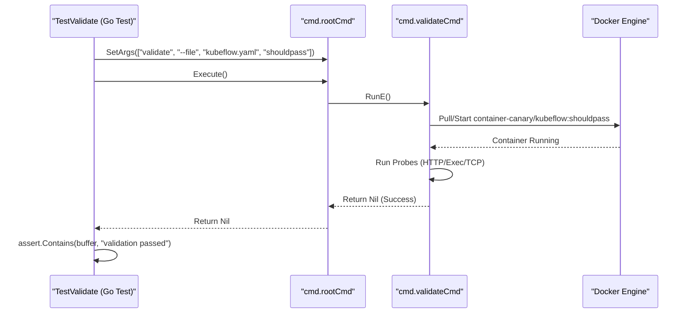

<!-- source: DeepWiki mcp.deepwiki.com · repo NVIDIA/container-canary · page 4.2 Running Tests · fetched 2026-10-26 -->

# Running Tests

<details>
<summary>Relevant source files</summary>

The following files were used as context for generating this wiki page:

- [Makefile](Makefile)
- [cmd/root.go](cmd/root.go)
- [cmd/root_test.go](cmd/root_test.go)
- [cmd/validate_test.go](cmd/validate_test.go)
- [cmd/version_test.go](cmd/version_test.go)
- [internal/config/load_test.go](internal/config/load_test.go)
- [internal/schema/contract_test.go](internal/schema/contract_test.go)
- [internal/testdata/containers/kubeflow.Dockerfile](internal/testdata/containers/kubeflow.Dockerfile)
- [internal/testdata/containers/kubeflow_broken.Dockerfile](internal/testdata/containers/kubeflow_broken.Dockerfile)
- [main.go](main.go)

</details>


This document explains the container-canary test suite, including test containers, running tests locally, and the validation logic used in automated testing.

## Test Suite Overview

The container-canary project employs a two-tiered testing strategy:

1.  **Unit Tests**: Test individual components in isolation, such as configuration loading [internal/config/load_test.go:26-59]() and schema contract validation [internal/schema/contract_test.go:12-23]().
2.  **Integration Tests**: Validate end-to-end workflows by invoking the CLI against real Docker containers [cmd/validate_test.go:27-38]().

All tests are written using the standard Go `testing` package with the `testify/assert` library for assertions [cmd/validate_test.go:24]().

### Test Organization Diagram

```mermaid
graph TB
    subgraph "Test_Organization"
        ["TestSuite"]
        
        ["TestSuite"] --> ["Unit_Tests"]
        ["TestSuite"] --> ["Integration_Tests"]
        
        ["Unit_Tests"] --> ["internal_config_TestValidator"]
        ["Unit_Tests"] --> ["internal_schema_TestPublishedContract"]
        
        ["Integration_Tests"] --> ["cmd_TestValidate"]
        ["Integration_Tests"] --> ["cmd_TestValidateFails"]
    end
    
    subgraph "Test_Dependencies"
        ["Test_Containers"]
        ["Docker_Runtime"]
        
        ["Test_Containers"] --> ["kubeflow_shouldpass"]
        ["Test_Containers"] --> ["kubeflow_shouldfail"]
    end
    
    subgraph "Execution_Entities"
        ["make_test"]
        ["make_testprep"]
        ["go_test_v"]
    end
    
    ["make_testprep"] --> ["Test_Containers"]
    ["Test_Containers"] --> ["Docker_Runtime"]
    
    ["Integration_Tests"] --> ["kubeflow_shouldpass"]
    ["Integration_Tests"] --> ["kubeflow_shouldfail"]
    
    ["make_test"] --> ["go_test_v"]
    ["go_test_v"] --> ["Unit_Tests"]
    ["go_test_v"] --> ["Integration_Tests"]
```

**Sources**: [Makefile:33-38](), [cmd/validate_test.go:27-50](), [internal/config/load_test.go:26-59]()

## Test Prerequisites

Before running tests, you must have Docker installed and the Docker daemon running. The integration tests depend on specific container images being present in the local Docker daemon.

### Building Test Containers

The integration tests require two pre-built test containers that simulate valid and invalid Kubeflow notebook environments. These containers must be built before running tests:

```bash
make testprep
```

This command executes the following build operations [Makefile:36-38]():

| Container Image | Dockerfile Source | Purpose |
| :--- | :--- | :--- |
| `container-canary/kubeflow:shouldpass` | `internal/testdata/containers/kubeflow.Dockerfile` | Properly configured environment (User: `jovyan`) [internal/testdata/containers/kubeflow.Dockerfile:9]() |
| `container-canary/kubeflow:shouldfail` | `internal/testdata/containers/kubeflow_broken.Dockerfile` | Misconfigured environment (User: `bob`) [internal/testdata/containers/kubeflow_broken.Dockerfile:10]() |

**Sources**: [Makefile:36-39](), [internal/testdata/containers/kubeflow.Dockerfile:1-16](), [internal/testdata/containers/kubeflow_broken.Dockerfile:1-19]()

## Running Tests Locally

### Using Make

The standard way to run the full suite is via the `Makefile` [Makefile:33-34]():

```bash
make test
```

This runs `go test -v ./...`, which discovers and executes all `_test.go` files in the repository.

### Cleaning Test State

If you encounter issues with cached results, use the `clean` target [Makefile:43-45]():

```bash
make clean
```
This removes build artifacts and clears the Go test cache via `go clean -testcache` [Makefile:45]().

**Sources**: [Makefile:33-48]()

## Integration Test Flow

The integration tests exercise the `rootCmd` [cmd/root.go:27]() by programmatically setting CLI arguments and capturing the standard output buffer.

### CLI Validation Sequence



**Sources**: [cmd/validate_test.go:27-38](), [cmd/root.go:43-48]()

## Detailed Test Implementation

### Configuration Loading Tests
Tests in `internal/config/load_test.go` verify that the YAML manifests are correctly unmarshaled into Go structs. They check for:
*   Correct metadata (Name, Description) [internal/config/load_test.go:32-33]().
*   Probe details, such as `HTTPGet` paths and ports [internal/config/load_test.go:49-50]().
*   Header validation for both request and expected response headers [internal/config/load_test.go:52-59]().

### CLI Command Tests
The `cmd` package tests verify the user-facing interface:
*   **`TestVersion`**: Ensures the `version` command outputs Version, Git Commit, and Build Time [cmd/version_test.go:27-42]().
*   **`TestValidate`**: Runs a successful validation against the `shouldpass` image [cmd/validate_test.go:27-38]().
*   **`TestValidateFails`**: Ensures the CLI returns an error when probes fail against the `shouldfail` image [cmd/validate_test.go:40-50]().
*   **`TestFileDoesNotExist`**: Validates error handling for missing manifest files [cmd/validate_test.go:52-62]().

### Schema Contract Tests
`internal/schema/contract_test.go` ensures the JSON schema remains self-contained and follows project standards:
*   Checks that the schema does not contain external `http` references that could break offline validation [internal/schema/contract_test.go:17-18]().
*   Verifies the `README.md` documentation contains the correct release-pinned schema URL pattern [internal/schema/contract_test.go:30]().

**Sources**: [internal/config/load_test.go:26-59](), [cmd/version_test.go:27-42](), [cmd/validate_test.go:27-62](), [internal/schema/contract_test.go:1-41]()

---

