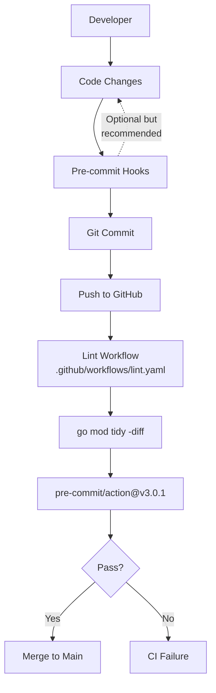
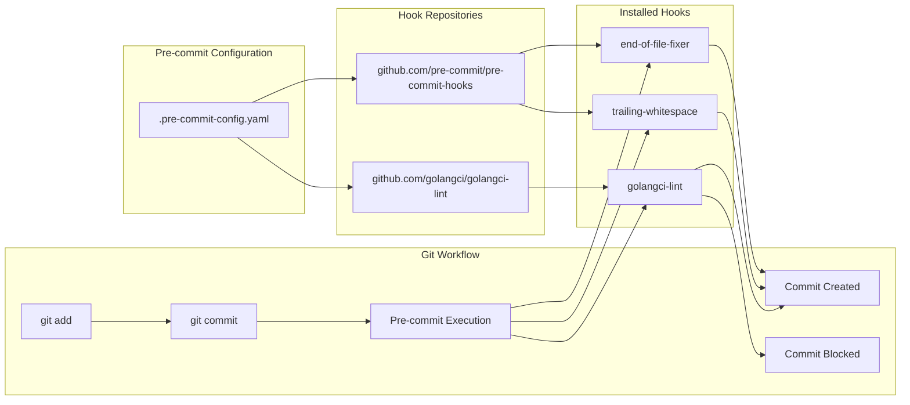
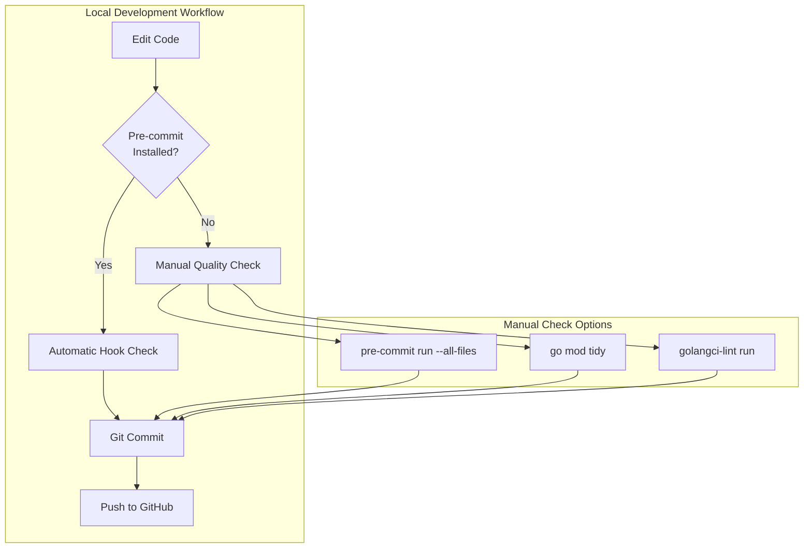

<!-- source: DeepWiki mcp.deepwiki.com · repo NVIDIA/container-canary · page 4.3 Code Quality · fetched 2026-10-26 -->

# Code Quality

<details>
<summary>Relevant source files</summary>

The following files were used as context for generating this wiki page:

- [.github/workflows/lint.yaml](.github/workflows/lint.yaml)
- [.pre-commit-config.yaml](.pre-commit-config.yaml)

</details>


This document explains the code quality standards, linting requirements, and automated quality enforcement for the `container-canary` project. It covers local development tools like pre-commit hooks, formatting requirements, and CI enforcement.

For information about running tests, see [4.2 Running Tests](). For the complete contribution workflow including DCO sign-off, see [4.4 Contributing](). For details on CI workflows, see [6.1 Continuous Integration]().

## Overview

`container-canary` enforces code quality through multiple layers: local pre-commit hooks, CI linting workflows, and required formatting standards. All code must pass `golangci-lint` checks and be formatted with `gofmt` before it can be merged.

## Code Quality Enforcement Pipeline



**Diagram: Code Quality Enforcement Flow** - This diagram shows how code quality is enforced both locally (optional) and in CI (mandatory). The pre-commit hooks provide early feedback to developers before code reaches CI.

Sources: [.github/workflows/lint.yaml:1-32](), [.pre-commit-config.yaml:1-12]()

## Linting Tools

### golangci-lint

The primary linting tool is `golangci-lint`, which aggregates multiple Go linters into a single tool. It checks for code style issues, potential bugs, and code complexity problems.

The tool is configured via [.pre-commit-config.yaml:4-7]() and runs automatically in CI via [.github/workflows/lint.yaml:31-32]().

**Linting Configuration:**

| Tool | Version | Purpose |
|------|---------|---------|
| golangci-lint | v2.12.2 | Comprehensive Go linting |
| trailing-whitespace hook | v6.0.0 | Remove trailing whitespace |
| end-of-file-fixer hook | v6.0.0 | Ensure files end with newline |

Sources: [.pre-commit-config.yaml:4-12]()

## Pre-commit Hook System



**Diagram: Pre-commit Hook Architecture** - This diagram maps the pre-commit configuration file to the actual hooks that execute during `git commit`, showing how [.pre-commit-config.yaml]() defines the quality gates.

Sources: [.pre-commit-config.yaml:1-12]()

### Installing Pre-commit Hooks

Pre-commit hooks are optional but strongly recommended for local development. They catch linting errors before they reach CI, saving time by providing immediate feedback.

To install the hooks locally:

```bash
$ pre-commit install
```

After installation, hooks run automatically on `git commit`. To manually run hooks on all files:

```bash
$ pre-commit run --all-files
```

Sources: [.pre-commit-config.yaml:1-3]()

## Code Formatting and Module Integrity

### gofmt Requirement

All Go code must be formatted with `gofmt`. This is enforced by `golangci-lint`, which includes formatters in its check suite.

### Go Module Hygiene

The CI pipeline ensures that the `go.mod` and `go.sum` files are up-to-date and clean by running a diff check on the module files.

```bash
go mod tidy -diff
```

This prevents PRs from being merged with unnecessary dependencies or missing checksums.

Sources: [.github/workflows/lint.yaml:28-29]()

## CI Enforcement

### Lint Workflow

The [.github/workflows/lint.yaml]() workflow enforces code quality on every push and pull request:

```yaml
on: [push, pull_request]
name: Lint
jobs:
  lint:
    runs-on: ubuntu-latest
    env:
      GOTOOLCHAIN: local
    steps:
      - name: Checkout source
        uses: actions/checkout@3d3c42e5aac5ba805825da76410c181273ba90b1 # v7.0.1
      - name: Install Go
        uses: actions/setup-go@b7ad1dad31e06c5925ef5d2fc7ad053ef454303e # v7.0.0
        with:
          go-version: 1.26.x
      - name: Check Go module files
        run: go mod tidy -diff
      - name: Run pre-commit
        uses: pre-commit/action@2c7b3805fd2a0fd8c1884dcaebf91fc102a13ecd # v3.0.1
```

**Key aspects:**

| Aspect | Details |
|--------|---------|
| Trigger | Every `push` and `pull_request` |
| Go Version | 1.26.x |
| Runner | ubuntu-latest |
| Module Check | `go mod tidy -diff` |
| Action | `pre-commit/action@v3.0.1` |
| Configuration Source | [.pre-commit-config.yaml]() |

The workflow uses the same pre-commit configuration as local development, ensuring consistency between local checks and CI enforcement.

Sources: [.github/workflows/lint.yaml:1-32]()

### Lint Failure Handling

When the lint workflow fails, it blocks PR merges. Common causes and solutions:

| Issue | Detection | Solution |
|-------|-----------|----------|
| Trailing whitespace | `trailing-whitespace` hook | Pre-commit auto-fixes this |
| Missing EOF newline | `end-of-file-fixer` hook | Pre-commit auto-fixes this |
| Lint violations | `golangci-lint` hook | Manual code corrections required |
| Unclean modules | `go mod tidy -diff` | Run `go mod tidy` locally |

Sources: [.pre-commit-config.yaml:8-12](), [.github/workflows/lint.yaml:28-32]()

## Local Quality Checks



**Diagram: Local Quality Check Workflow** - Shows the two paths for code quality verification: automatic (via pre-commit hooks) and manual (via explicit tool invocation).

Sources: [.pre-commit-config.yaml:1-12](), [.github/workflows/lint.yaml:28-32]()

## Summary

Code quality in `container-canary` is enforced through a layered approach:

1. **Local Development:** Optional pre-commit hooks provide immediate feedback.
2. **CI Enforcement:** Mandatory lint workflow blocks non-compliant PRs using `pre-commit/action`.
3. **Module Integrity:** Explicit checks for `go.mod` cleanliness.
4. **Consistent Configuration:** Same [.pre-commit-config.yaml]() used locally and in CI.
5. **Multiple Checks:** Linting, formatting, whitespace cleanup, and EOF fixing.

Sources: [.github/workflows/lint.yaml:1-32](), [.pre-commit-config.yaml:1-12]()

---

