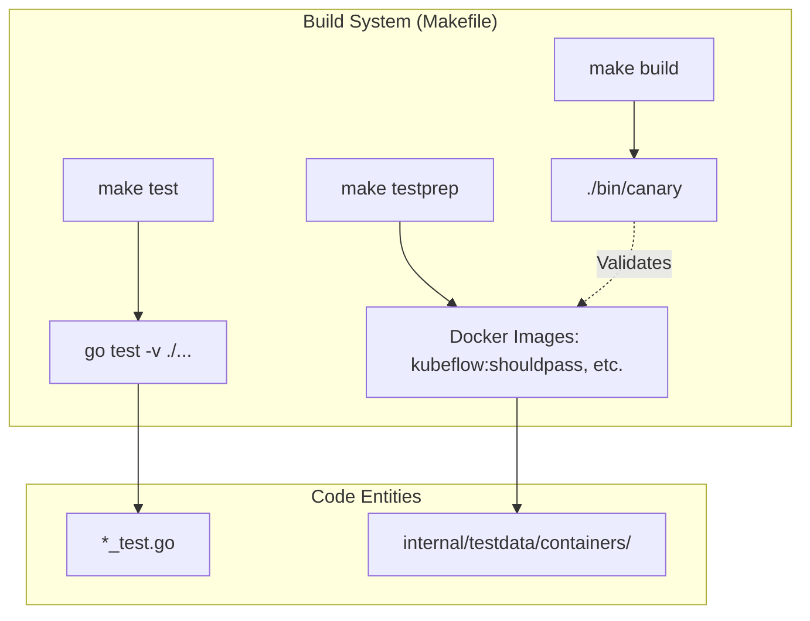
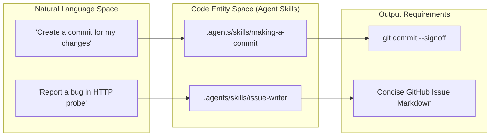

<!-- source: DeepWiki mcp.deepwiki.com · repo NVIDIA/container-canary · page 4.4 Contributing · fetched 2026-10-26 -->

# Contributing

<details>
<summary>Relevant source files</summary>

The following files were used as context for generating this wiki page:

- [.agents/skills/issue-writer/SKILL.md](.agents/skills/issue-writer/SKILL.md)
- [.agents/skills/making-a-commit/SKILL.md](.agents/skills/making-a-commit/SKILL.md)
- [.agents/skills/making-a-commit/agents/openai.yaml](.agents/skills/making-a-commit/agents/openai.yaml)
- [.github/CODEOWNERS](.github/CODEOWNERS)
- [.gitignore](.gitignore)
- [CONTRIBUTING.md](CONTRIBUTING.md)
- [README.md](README.md)
- [skills-lock.json](skills-lock.json)

</details>


This page guides contributors through the process of developing and submitting changes to `container-canary`. It covers the local development workflow, testing requirements, code quality standards, and the DCO sign-off process required for all contributions.

## Purpose and Scope

The `container-canary` project welcomes contributions that improve container validation capabilities. This document provides technical guidance on:
- Setting up the local Go development environment.
- Building and testing changes using the provided `Makefile`.
- Adhering to code quality standards and linting requirements.
- Fulfilling the mandatory Developer Certificate of Origin (DCO) sign-off.
- Utilizing specialized Agent Skills for automated tasks.

---

## Prerequisites

Contributors must have the following tools installed to build and validate the project:

| Tool | Purpose | Reference |
|------|---------|-----------|
| Go 1.21+ | Primary language for the project | [README.md:4]() |
| Docker | Required for `testprep` and running validation probes | [CONTRIBUTING.md:20-28]() |
| make | Task runner for builds and tests | [CONTRIBUTING.md:7]() |
| golangci-lint | Static analysis and linting | [CONTRIBUTING.md:39-41]() |
| pre-commit | Automated local git hooks | [CONTRIBUTING.md:41-48]() |

**Sources**: [CONTRIBUTING.md:7-41](), [README.md:4]()

---

## Development Workflow

The development workflow is centered around standard Go practices and a `Makefile` that handles container dependencies for testing.

### Building from Source

The project is compiled into a single binary. Use the `build` target to generate the executable:

```bash
make build
```
This executes `go build -o bin/canary .` [CONTRIBUTING.md:14-15]().

### Running Tests

Testing `container-canary` requires local Docker images to act as validation targets.

1.  **Build Test Containers**: Run `make testprep` to build the required Docker images from `internal/testdata/containers/` [CONTRIBUTING.md:23-28]().
2.  **Execute Tests**: Run `make test` to execute the Go test suite [CONTRIBUTING.md:33-37]().



**Sources**: [CONTRIBUTING.md:7-37]()

---

## Code Quality and Linting

The project enforces strict linting using `golangci-lint` and `gofmt` [CONTRIBUTING.md:7-41]().

### Pre-commit Hooks
Contributors are encouraged to use `pre-commit` to catch errors before pushing to CI:
1.  Install: `pre-commit install` [CONTRIBUTING.md:44-45]().
2.  Run manually: `pre-commit run --all-files` [CONTRIBUTING.md:47]().

---

## DCO Sign-off Requirement

All contributions **must** include a Developer Certificate of Origin (DCO) sign-off. This certifies that you have the legal right to submit the code under the project's license [CONTRIBUTING.md:52-54]().

### Signing Commits
Use the `-s` or `--signoff` flag when committing:
```bash
git commit -s -m "Add new probe type"
```
This appends `Signed-off-by: Your Name <your@email.com>` to the commit message [CONTRIBUTING.md:58-66]().

### Agent Skills for Automation
The repository includes specialized "Agent Skills" located in `.agents/skills/` to assist with common tasks while maintaining project standards:

- **Making a Commit**: The `making-a-commit` skill ensures every commit is DCO-signed by default [.agents/skills/making-a-commit/SKILL.md:1-8]().
- **Issue Writer**: The `issue-writer` skill helps draft concise, human-focused GitHub issues for bugs and enhancements [.agents/skills/issue-writer/SKILL.md:1-10]().



**Sources**: [.agents/skills/making-a-commit/SKILL.md:1-8](), [.agents/skills/issue-writer/SKILL.md:1-10](), [CONTRIBUTING.md:50-66]()

---

## Pull Request Validation

When a PR is submitted, GitHub Actions trigger the following workflows:
1.  **DCO Check**: Ensures all commits are signed-off.
2.  **Lint**: Runs `golangci-lint`.
3.  **Test**: Runs the test suite across a matrix of Go versions (1.21, 1.22, 1.23) [README.md:3]().

### Contribution Checklist
- [ ] Code formatted with `gofmt` [CONTRIBUTING.md:7]().
- [ ] `make build` and `make test` pass locally [CONTRIBUTING.md:14-37]().
- [ ] All commits signed with `git commit -s` [CONTRIBUTING.md:58-59]().
- [ ] New functionality includes corresponding tests.

**Sources**: [CONTRIBUTING.md:1-94](), [README.md:1-40](), [.github/CODEOWNERS:1]()

---

