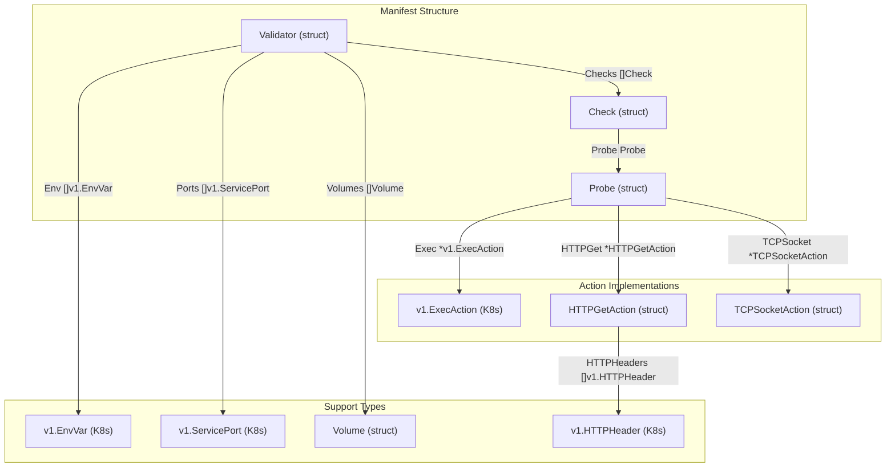
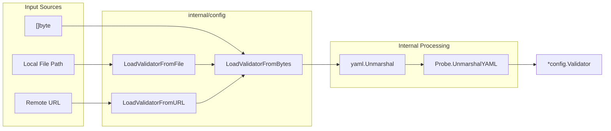

<!-- source: DeepWiki mcp.deepwiki.com · repo NVIDIA/container-canary · page 5 API Reference · fetched 2026-10-26 -->

# API Reference

Relevant source files

The following files were used as context for generating this wiki page:

- [internal/apis/v1/types.go](internal/apis/v1/types.go)
- [schema/container-canary.nvidia.com/v1/validator.schema.json](schema/container-canary.nvidia.com/v1/validator.schema.json)

This page provides complete reference documentation for the container-canary API, including the validator manifest schema and Go configuration loading functions. The API consists of type definitions in the `internal/apis/v1` package that define the structure of validator manifests, and loading functions in the `internal/config` package for parsing manifests from various sources.

For details on the specific fields and behaviors of each component, see the following child pages:
- [Validator Type](#5.1) — Detailed structure of the root manifest object.
- [Check Type](#5.2) — Reference for individual check definitions.
- [Probe Type](#5.3) — Reference for probe actions (exec, http, tcp) and timing.
- [Configuration Loading](#5.4) — Go API for loading manifests from files, URLs, or bytes.
- [Schema Validation](#5.5) — Internal validation logic and the JSON Schema contract.

## Type Hierarchy

The container-canary API defines a hierarchical structure of types that compose to form complete validator specifications. The Go types in `internal/apis/v1/types.go` correspond to the `Validator` schema defined in the project's JSON Schema.

### Natural Language to Code Mapping

This diagram bridges the manifest concepts to their respective Go entities and external Kubernetes type dependencies.

**Sources:** [internal/apis/v1/types.go:23-140](), [schema/container-canary.nvidia.com/v1/validator.schema.json:22-104]()

## Validator Type

The `Validator` type is the root object of a validator manifest. It defines metadata, runtime configuration, and the checks to perform. It includes fields for container environment setup such as `Env`, `Ports`, and `Volumes`.

For details, see [Validator Type](#5.1).

**Sources:** [internal/apis/v1/types.go:23-55](), [schema/container-canary.nvidia.com/v1/validator.schema.json:8-20]()

## Check Type

The `Check` type defines a single validation check within a validator. Each check contains a `Probe` that performs the actual validation logic (e.g., checking if a process is running or a port is open).

For details, see [Check Type](#5.2).

**Sources:** [internal/apis/v1/types.go:57-68](), [schema/container-canary.nvidia.com/v1/validator.schema.json:46-51]()

## Probe Type

The `Probe` type defines how a check is executed, including timing parameters (`initialDelaySeconds`, `timeoutSeconds`), thresholds, and the action to perform. The probe implementation supports exactly one action: `exec`, `httpGet`, or `tcpSocket`.

For details, see [Probe Type](#5.3).

**Sources:** [internal/apis/v1/types.go:70-88](), [schema/container-canary.nvidia.com/v1/validator.schema.json:52-71]()

## Configuration Loading

The `internal/config` package provides the entry points for the system to ingest manifests. It handles the translation from raw bytes or external files into the internal `Validator` Go struct.

### Loading Workflow

The following diagram shows how different input sources flow through the configuration loader to produce a validated `Validator` instance.

For details, see [Configuration Loading](#5.4).

**Sources:** [internal/config/load.go:32-75](), [internal/apis/v1/types.go:90-106]()

## Schema Validation

The `internal/schema` package (and the corresponding `validator.schema.json`) ensures that manifests conform to the expected structure before execution. The schema defines strict requirements, such as requiring `apiVersion`, `kind`, `name`, and at least one `check`.

For details, see [Schema Validation](#5.5).

**Sources:** [schema/container-canary.nvidia.com/v1/validator.schema.json:1-105]()

---

