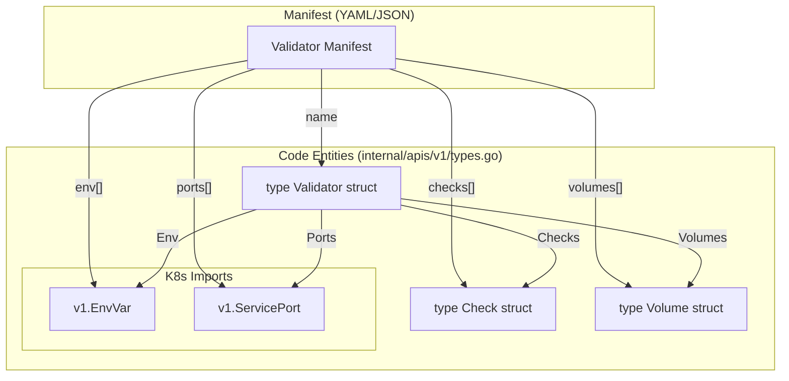
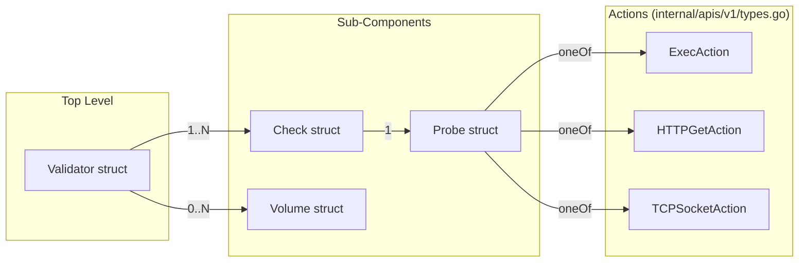

<!-- source: DeepWiki mcp.deepwiki.com · repo NVIDIA/container-canary · page 5.1 Validator Type · fetched 2026-10-26 -->

# Validator Type

<details>
<summary>Relevant source files</summary>

The following files were used as context for generating this wiki page:

- [internal/apis/v1/types.go](internal/apis/v1/types.go)
- [schema/container-canary.nvidia.com/v1/validator.schema.json](schema/container-canary.nvidia.com/v1/validator.schema.json)

</details>


## Purpose and Scope

This document provides complete technical reference documentation for the `Validator` type, the top-level configuration structure for `container-canary` validation manifests. The `Validator` type encapsulates all information needed to validate a container image, including metadata, runtime configuration, and the suite of validation checks.

**Sources:** [internal/apis/v1/types.go:1-140]()

## Overview

The `Validator` type is defined in the `config` package and serves as the root configuration object for container validation. It is designed to be serialized from YAML manifests and mirrors Kubernetes API conventions for familiarity, specifically leveraging types from `k8s.io/api/core/v1`.

The `Validator` combines three categories of information:
1.  **Metadata**: Descriptive information (name, description, documentation links).
2.  **Runtime Configuration**: Container execution parameters (environment variables, ports, volumes, command).
3.  **Validation Checks**: A list of specific `Check` objects to perform against the container.

**Sources:** [internal/apis/v1/types.go:22-55](), [schema/container-canary.nvidia.com/v1/validator.schema.json:4-21]()

## Type Definition

The `Validator` struct is defined in [internal/apis/v1/types.go:23-55]() as follows:

```go
type Validator struct {
	// The validator name.
	Name string

	// The validator description.
	Description string

	// A link to the documentation where the requirements are defined.
	Documentation string

	// A list of checks to perform validation against.
	Checks []Check

	// A list of environment variables to set on the container before starting.
	Env []v1.EnvVar

	// A list of ports to expose on the container.
	Ports []v1.ServicePort

	// A list of volumes to mount on the container.
	Volumes []Volume

	// A command to run in the container
	Command []string

	// Additional flags to pass to the docker CLI.
	DockerRunOptions []string  `yaml:"dockerRunOptions"`
}
```

### Validator Entity Mapping

This diagram bridges the YAML manifest structure (Natural Language/Configuration Space) to the Go internal types (Code Entity Space).



**Sources:** [internal/apis/v1/types.go:23-55](), [schema/container-canary.nvidia.com/v1/validator.schema.json:8-20]()

## Field Reference

| Field | Type | Required | YAML Key | Description |
| :--- | :--- | :--- | :--- | :--- |
| `Name` | `string` | **Yes** | `name` | Human-readable identifier for the validator. |
| `Description` | `string` | Optional | `description` | Brief description of what the validator checks. |
| `Documentation` | `string` | Optional | `documentation` | URL to external documentation defining requirements. |
| `Checks` | `[]Check` | **Yes** | `checks` | List of validation checks to perform. Must contain at least 1 item. |
| `Env` | `[]v1.EnvVar` | Optional | `env` | Environment variables to set in the container. |
| `Ports` | `[]v1.ServicePort` | Optional | `ports` | Ports to expose from the container. |
| `Volumes` | `[]Volume` | Optional | `volumes` | Volumes to mount in the container. |
| `Command` | `[]string` | Optional | `command` | Override the default container `ENTRYPOINT`/`CMD`. |
| `DockerRunOptions` | `[]string` | Optional | `dockerRunOptions` | Additional flags to pass to the docker CLI. |

**Sources:** [internal/apis/v1/types.go:23-55](), [schema/container-canary.nvidia.com/v1/validator.schema.json:7-21]()

### Field Details

#### Metadata Fields
*   **`Name`**: Used for identification in logs and output. [internal/apis/v1/types.go:26]().
*   **`Description`**: Provides context about the validator's purpose. [internal/apis/v1/types.go:30]().
*   **`Documentation`**: Links to authoritative documentation. The JSON schema enforces a `uri` format if provided. [schema/container-canary.nvidia.com/v1/validator.schema.json:13]().

#### Runtime Configuration Fields
*   **`Env`**: Uses a subset of Kubernetes `core/v1.EnvVar`. Only `name` and `value` are supported; `valueFrom` is not supported. [schema/container-canary.nvidia.com/v1/validator.schema.json:24-29]().
*   **`Ports`**: Uses a subset of Kubernetes `core/v1.ServicePort`. Only `port` and `protocol` (TCP, UDP, SCTP) are supported. [schema/container-canary.nvidia.com/v1/validator.schema.json:30-39]().
*   **`Volumes`**: Uses a custom `Volume` type to mount host paths or create empty volumes. [internal/apis/v1/types.go:133-140]().
*   **`Command`**: Overrides the container's default execution command. [internal/apis/v1/types.go:50]().
*   **`DockerRunOptions`**: Passes arbitrary flags directly to `docker run`, providing an escape hatch for advanced Docker configurations (e.g., `--gpus all`, `--privileged`). [internal/apis/v1/types.go:54]().

#### Validation Configuration Fields
*   **`Checks`**: The core validation specification. Each check defines a `Probe` to execute. [internal/apis/v1/types.go:37]().

## Supporting Types

### Volume Type
The `Volume` type defines how data is presented to the container during validation.

```go
type Volume struct {
	// Path to mount in the container
	MountPath string `yaml:"mountPath,omitempty"`

	// Path to mount from host, will use empty volume if omitted
	Path string `yaml:"path,omitempty"`
}
```

**Sources:** [internal/apis/v1/types.go:133-140]()

### Type Relationships and Data Flow

This diagram illustrates the relationship between the `Validator` and its child types, showing how configuration flows into the validation engine.



**Sources:** [internal/apis/v1/types.go:23-88](), [schema/container-canary.nvidia.com/v1/validator.schema.json:65-69]()

## JSON Schema Constraints

The `Validator` type is governed by a JSON schema that enforces several strict requirements:
1.  **Required Fields**: `apiVersion`, `kind`, `name`, and `checks` must be present. [schema/container-canary.nvidia.com/v1/validator.schema.json:7]()
2.  **API Version**: Must be exactly `container-canary.nvidia.com/v1`. [schema/container-canary.nvidia.com/v1/validator.schema.json:9]()
3.  **Kind**: Must be exactly `Validator`. [schema/container-canary.nvidia.com/v1/validator.schema.json:10]()
4.  **No Extraneous Fields**: `unevaluatedProperties: false` is set on the root object to prevent typos in manifest keys. [schema/container-canary.nvidia.com/v1/validator.schema.json:21]()

**Sources:** [schema/container-canary.nvidia.com/v1/validator.schema.json:1-21]()

---

