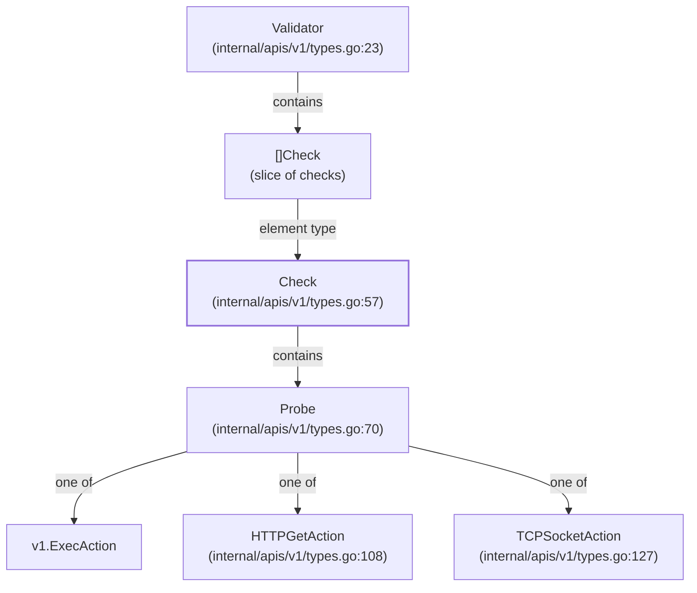
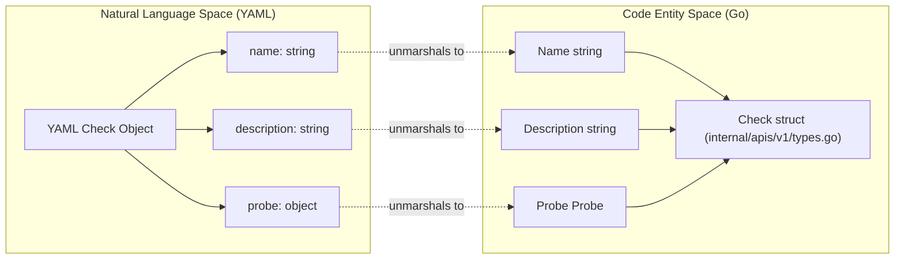
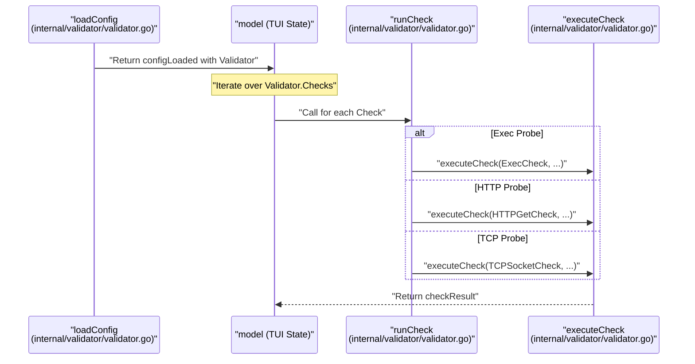

<!-- source: DeepWiki mcp.deepwiki.com · repo NVIDIA/container-canary · page 5.2 Check Type · fetched 2026-10-26 -->

# Check Type

<details>
<summary>Relevant source files</summary>

The following files were used as context for generating this wiki page:

- [internal/apis/v1/types.go](internal/apis/v1/types.go)
- [internal/validator/validator.go](internal/validator/validator.go)

</details>


## Purpose and Scope

This document provides a complete reference for the `Check` type, which represents an individual validation test within a container-canary validator manifest. A check encapsulates a single validation requirement along with its associated probe configuration.

For information about the parent `Validator` type that contains checks, see [Validator Type](#5.1). For detailed information about the `Probe` type and probe execution logic, see [Probe Type](#5.3).

---

## Type Definition

The `Check` type is defined in [internal/apis/v1/types.go:57-68]() and represents a single validation test to be performed against a container.

### Structure

```go
type Check struct {
    // The check name.
    // +optional
    Name string

    // The check description.
    // +optional
    Description string

    // A probe to run.
    Probe Probe
}
```

### Field Descriptions

| Field | Type | Required | Purpose |
|-------|------|----------|---------|
| `Name` | `string` | Optional | Human-readable identifier for the check. Used in CLI output and logs to identify which validation is running. |
| `Description` | `string` | Optional | Extended description of what the check validates. Supports Unicode characters and emojis for enhanced readability in terminal output. |
| `Probe` | `Probe` | Required | The actual validation logic to execute. Contains timing configuration, thresholds, and the probe action (exec, httpGet, or tcpSocket). |

**Sources:** [internal/apis/v1/types.go:57-68]()

---

## Type Hierarchy and Relationships

### Container Structure



**Diagram: Check Type in Type Hierarchy**

The `Check` type serves as the middle layer between the `Validator` (which defines overall container validation requirements) and the `Probe` (which defines specific validation actions). Each `Validator` contains a slice of `Check` objects [internal/apis/v1/types.go:37](), and each `Check` contains exactly one `Probe` configuration [internal/apis/v1/types.go:67]().

**Sources:** [internal/apis/v1/types.go:23-68]()

---

## YAML Configuration Format

### Basic Structure

In validator manifest files, checks are defined under the `checks` key as a YAML list:

```yaml
checks:
  - name: check-identifier
    description: Human-readable description
    probe:
      # probe configuration
```

### Field Mapping



**Diagram: YAML to Go Type Mapping for Check**

**Sources:** [internal/apis/v1/types.go:57-68]()

---

## Check Processing Flow

### Validation Execution

The validation logic iterates through all checks defined in the `Validator` config. The `runCheck` function [internal/validator/validator.go:160-178]() is responsible for dispatching the check to the appropriate execution method based on the probe type.



**Diagram: Check Processing During Validation**

### Execution Logic

When a check is executed via `executeCheck` [internal/validator/validator.go:181-206](), it follows a strict lifecycle:
1. **Initial Delay**: Waits for `probe.InitialDelaySeconds` [internal/validator/validator.go:182]().
2. **Retry Loop**: Executes the probe method repeatedly [internal/validator/validator.go:186]().
3. **Threshold Evaluation**:
    - If successful runs reach `probe.SuccessThreshold`, the check passes [internal/validator/validator.go:198-200]().
    - If failed runs reach `probe.FailureThreshold`, the check fails [internal/validator/validator.go:198-200]().
4. **Timeout**: If the total time exceeds `probe.TimeoutSeconds`, the check returns an error [internal/validator/validator.go:201-203]().

**Sources:** [internal/validator/validator.go:160-206](), [internal/apis/v1/types.go:70-81]()

---

## Design Considerations

### Optional Metadata
Both `Name` and `Description` fields are marked as optional in the Go struct comments [internal/apis/v1/types.go:59-64](). This allows for minimal manifests where only the probe logic is required.

### Single Probe Constraint
Each `Check` contains exactly one `Probe` field [internal/apis/v1/types.go:67](). The `runCheck` function uses an `if/else` block to determine which probe type is active [internal/validator/validator.go:165-174](). If a check is defined without any known probe actions (Exec, HTTPGet, or TCPSocket), it returns an error result [internal/validator/validator.go:172]().

### Result Reporting
Results are communicated back to the UI via the `checkResult` struct [internal/validator/validator.go:44-48](), which includes the check's `Description`, a boolean `Passed` status, and any `Error` encountered during execution.

**Sources:** [internal/apis/v1/types.go:57-68](), [internal/validator/validator.go:44-48](), [internal/validator/validator.go:160-178]()

---

## Summary Table

| Aspect | Detail |
|--------|--------|
| **Definition Location** | [internal/apis/v1/types.go:57-68]() |
| **Parent Type** | `Validator` ([internal/apis/v1/types.go:23-55]()) |
| **Child Type** | `Probe` ([internal/apis/v1/types.go:70-88]()) |
| **Execution Entrypoint** | `runCheck` ([internal/validator/validator.go:160]()) |
| **Retry Controller** | `executeCheck` ([internal/validator/validator.go:181]()) |
| **Required Fields** | `Probe` |
| **Optional Fields** | `Name`, `Description` |

**Sources:** [internal/apis/v1/types.go:57-88](), [internal/validator/validator.go:160-206]()

---

