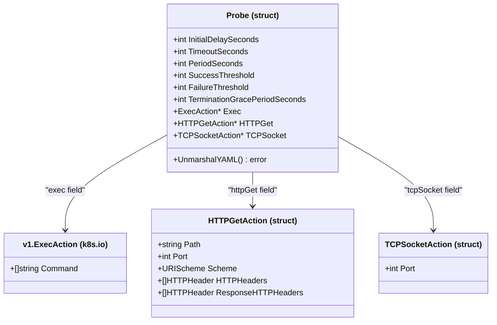
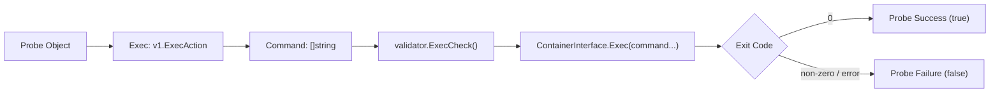
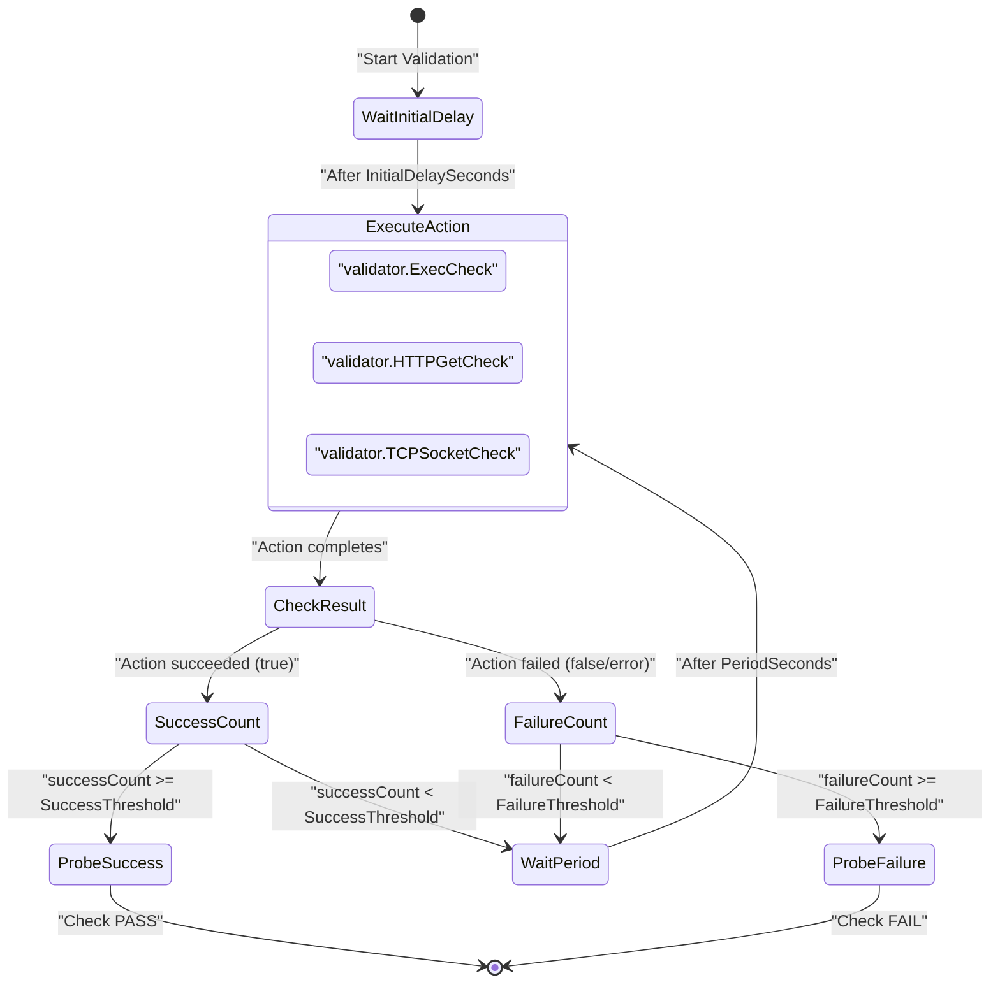

<!-- source: DeepWiki mcp.deepwiki.com · repo NVIDIA/container-canary · page 5.3 Probe Type · fetched 2026-10-26 -->

# Probe Type

<details>
<summary>Relevant source files</summary>

The following files were used as context for generating this wiki page:

- [examples/dask-scheduler.yaml](examples/dask-scheduler.yaml)
- [internal/apis/v1/types.go](internal/apis/v1/types.go)
- [internal/validator/exec.go](internal/validator/exec.go)
- [internal/validator/httpget.go](internal/validator/httpget.go)
- [internal/validator/tcp.go](internal/validator/tcp.go)

</details>


## Purpose and Scope

This page provides a complete API reference for the `Probe` type, which defines validation logic within a `Check`. A Probe specifies *how* to validate a container, including timing parameters, success/failure thresholds, and one of three action types: `Exec`, `HTTPGet`, or `TCPSocket`.

For information about how Probes fit within Checks, see [Check Type](5.2). For details on the Validator that contains Checks, see [Validator Type](5.1). For guidance on writing probe configurations, see [Probe Configuration](2.2.3).

## Probe Type Definition

The `Probe` type is defined in [internal/apis/v1/types.go:70-88]() and specifies both the validation action and the retry/threshold behavior.

**Natural Language to Code Entity Mapping**


**Sources:** [internal/apis/v1/types.go:70-131]()

## Field Reference

### Timing Parameters

| Field | Type | Default | Description |
|-------|------|---------|-------------|
| `InitialDelaySeconds` | `int` | `0` | Number of seconds to wait after container starts before executing the first probe |
| `TimeoutSeconds` | `int` | `30` | Number of seconds after which the probe times out |
| `PeriodSeconds` | `int` | `1` | How often (in seconds) to perform the probe |
| `TerminationGracePeriodSeconds` | `int` | `30` | Grace period for container termination |

**Sources:** [internal/apis/v1/types.go:71-81](), [internal/apis/v1/types.go:90-106]()

### Threshold Parameters

| Field | Type | Default | Description |
|-------|------|---------|-------------|
| `SuccessThreshold` | `int` | `1` | Minimum consecutive successes for the probe to be considered successful after having failed |
| `FailureThreshold` | `int` | `1` | Minimum consecutive failures for the probe to be considered failed after having succeeded |

These thresholds control retry behavior. For example, with `SuccessThreshold: 3`, the probe must succeed 3 consecutive times before the check passes. This is useful for containers that may be temporarily unavailable during startup.

**Sources:** [internal/apis/v1/types.go:77-79](), [internal/apis/v1/types.go:90-106]()

## Probe Action Types

Exactly one of the following action types must be specified in each Probe.

### ExecAction

Executes a command inside the container and checks the exit code. The probe succeeds if the command returns exit code 0.

**Code Execution Logic**


**Type:** `*v1.ExecAction` (imported from `k8s.io/api/core/v1`) [internal/apis/v1/types.go:20]()

**Fields:**
- `Command` (`[]string`): Command and arguments to execute inside the container.

**Implementation:** The exec probe is handled by `ExecCheck` in [internal/validator/exec.go:25-32](), which invokes the `Exec` method on the `ContainerInterface`. It returns `true` if the command succeeds (no error) and `false` otherwise [internal/validator/exec.go:28-31]().

**Sources:** [internal/apis/v1/types.go:83](), [internal/validator/exec.go:25-32]()

### HTTPGetAction

Performs an HTTP GET request against the container and validates the response status and headers.

**Type:** `*HTTPGetAction` (defined in [internal/apis/v1/types.go:108-125]())

**Fields:**

| Field | Type | Required | Description |
|-------|------|----------|-------------|
| `Path` | `string` | No | Path to access on the HTTP server (defaults to `/`) |
| `Port` | `int` | Yes | Port number to access (1-65535) |
| `Scheme` | `v1.URIScheme` | No | Protocol scheme (`HTTP` or `HTTPS`, defaults to `HTTP`) |
| `HTTPHeaders` | `[]v1.HTTPHeader` | No | Custom headers to include in the request |
| `ResponseHTTPHeaders` | `[]v1.HTTPHeader` | No | Headers expected in the response; probe fails if any are missing or have incorrect values |

**Implementation:** The HTTP probe is handled by `HTTPGetCheck` in [internal/validator/httpget.go:29-59]().
1. It initializes an `http.Client` and constructs a request to `http://localhost:{port}{path}` [internal/validator/httpget.go:33-34]().
2. Sets request headers from `HTTPHeaders` [internal/validator/httpget.go:40-42]().
3. Matches Kubernetes behavior: treat any 2xx or 3xx (code < 400) as success [internal/validator/httpget.go:31-32]().
4. If `ResponseHTTPHeaders` are provided, it iterates through them and ensures the response contains matching keys and values [internal/validator/httpget.go:52-57]().

**Sources:** [internal/apis/v1/types.go:108-125](), [internal/validator/httpget.go:29-59]()

### TCPSocketAction

Attempts to open a TCP connection to the container. The probe succeeds if the connection is established.

**Type:** `*TCPSocketAction` (defined in [internal/apis/v1/types.go:127-131]())

**Fields:**

| Field | Type | Required | Description |
|-------|------|----------|-------------|
| `Port` | `int` | Yes | Port number to connect to (1-65535) |

**Implementation:** Handled by `TCPSocketCheck` in [internal/validator/tcp.go:28-36](). It uses `net.Dial("tcp", address)` to attempt a connection to `localhost:{port}` [internal/validator/tcp.go:30-31]().

**Sources:** [internal/apis/v1/types.go:127-131](), [internal/validator/tcp.go:28-36]()

## Default Values

The `Probe` type implements a custom `UnmarshalYAML` method in [internal/apis/v1/types.go:90-106]() that sets default values for all timing and threshold parameters:

| Field | Default Value |
|-------|---------------|
| `InitialDelaySeconds` | `0` |
| `TimeoutSeconds` | `30` |
| `PeriodSeconds` | `1` |
| `SuccessThreshold` | `1` |
| `FailureThreshold` | `1` |
| `TerminationGracePeriodSeconds` | `30` |

**Sources:** [internal/apis/v1/types.go:90-106]()

## Probe Execution Flow

The validation logic uses the thresholds and timing parameters to determine the final state of a `Check`.



**Sources:** [internal/apis/v1/types.go:70-88](), [internal/validator/exec.go:25-32](), [internal/validator/httpget.go:29-59](), [internal/validator/tcp.go:28-36]()

## YAML Configuration Examples

### Minimal HTTP Probe
Used in `dask-scheduler` example to verify the dashboard is up [examples/dask-scheduler.yaml:14-20]().
```yaml
checks:
  - name: dashboard
    probe:
      httpGet:
        path: /
        port: 8787
      failureThreshold: 30
```

### TCP Probe
Used in `dask-scheduler` example to verify communication port [examples/dask-scheduler.yaml:21-26]().
```yaml
checks:
  - name: comm
    probe:
      tcpSocket:
        port: 8786
      failureThreshold: 30
```

**Sources:** [examples/dask-scheduler.yaml:14-26]()

---

