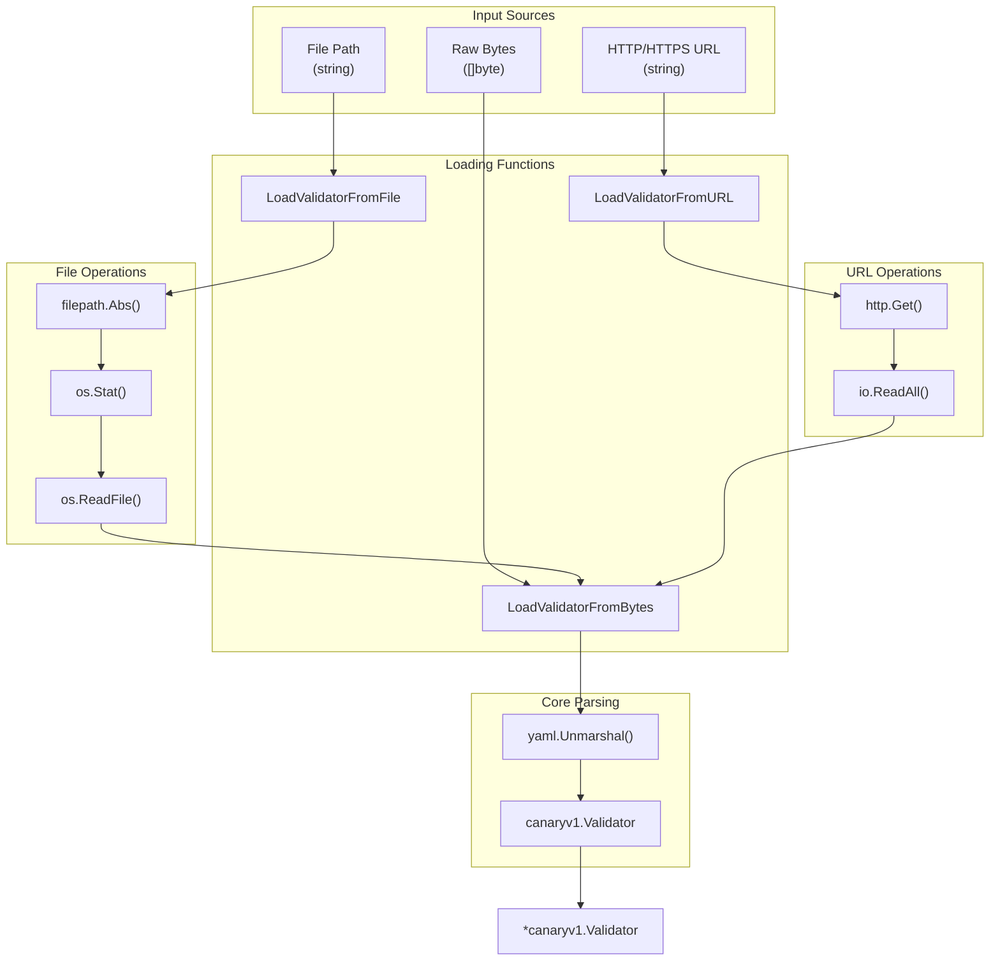
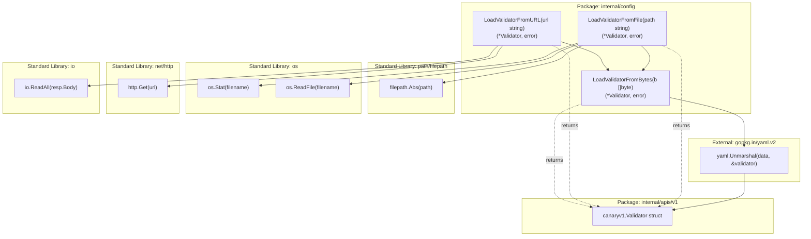

<!-- source: DeepWiki mcp.deepwiki.com · repo NVIDIA/container-canary · page 5.4 Configuration Loading · fetched 2026-10-26 -->

# Configuration Loading

<details>
<summary>Relevant source files</summary>

The following files were used as context for generating this wiki page:

- [internal/config/load.go](internal/config/load.go)
- [internal/config/load_test.go](internal/config/load_test.go)

</details>


## Purpose and Scope

This document describes the configuration loading functions provided by the `internal/config` package. These functions are responsible for loading validator manifests from different sources (files, URLs, or raw bytes) and unmarshaling them into `Validator` objects defined in the `internal/apis/v1` package.

For information about the structure and fields of the `Validator` type itself, see [Validator Type](#5.1). For details about the manifest YAML structure, see [Writing Validator Manifests](#2.2).

**Sources:** [internal/config/load.go:1-75]()

---

## Overview

The configuration loading system provides three primary functions that all produce the same output type but accept different input sources:

| Function | Input Source | Use Case |
|----------|-------------|----------|
| `LoadValidatorFromFile` | Local file path | Standard local manifest files |
| `LoadValidatorFromURL` | HTTP/HTTPS URL | Remote manifest files (e.g., from GitHub) |
| `LoadValidatorFromBytes` | Raw byte slice | Testing, in-memory manifests, or custom sources |

All three functions follow a converging architecture where `LoadValidatorFromFile` and `LoadValidatorFromURL` ultimately delegate to `LoadValidatorFromBytes` for the actual YAML parsing. This design ensures consistent parsing behavior regardless of the input source.

**Sources:** [internal/config/load.go:32-75]()

---

## Configuration Loading Flow



**Diagram: Configuration Loading Architecture**

This diagram illustrates how all loading paths converge to `LoadValidatorFromBytes`, which performs the actual YAML unmarshaling. The file and URL loaders are essentially thin wrappers that handle source-specific I/O operations before delegating to the bytes loader.

**Sources:** [internal/config/load.go:32-75]()

---

## Loading Functions

### LoadValidatorFromFile

```go
func LoadValidatorFromFile(path string) (*canaryv1.Validator, error)
```

Loads a validator manifest from a local file system path.

**Implementation Details:**

1. **Path Resolution** [internal/config/load.go:49-52](): Converts the input path to an absolute path using `filepath.Abs()`. This ensures consistent path handling regardless of the current working directory.
2. **Existence Check** [internal/config/load.go:54-56](): Verifies the file exists using `os.Stat()`. Returns a formatted error message if the file is not found.
3. **File Reading** [internal/config/load.go:58-61](): Reads the entire file contents using `os.ReadFile()`.
4. **Delegation** [internal/config/load.go:63](): Delegates to `LoadValidatorFromBytes()` for YAML parsing.

**Error Conditions:**
- Path cannot be resolved to absolute path.
- File does not exist (returns: `"no such file %s"` [internal/config/load.go:55]()).
- File cannot be read (permissions, I/O errors).
- YAML parsing failures (propagated from `LoadValidatorFromBytes`).

**Sources:** [internal/config/load.go:48-64]()

---

### LoadValidatorFromURL

```go
func LoadValidatorFromURL(url string) (*canaryv1.Validator, error)
```

Loads a validator manifest from an HTTP or HTTPS URL. This enables remote manifest loading, commonly used for fetching validator definitions from version control repositories.

**Implementation Details:**

1. **HTTP Request** [internal/config/load.go:33-36](): Issues a GET request using the standard library `http.Get()`.
2. **Response Body Reading** [internal/config/load.go:38-43](): Reads the complete response body using `io.ReadAll()`. The response body is properly closed using `defer resp.Body.Close()`.
3. **Delegation** [internal/config/load.go:45](): Delegates to `LoadValidatorFromBytes()` for YAML parsing.

**Error Conditions:**
- Network connectivity failures.
- HTTP errors (4xx, 5xx status codes).
- Response body read failures.
- YAML parsing failures (propagated from `LoadValidatorFromBytes`).

**Sources:** [internal/config/load.go:32-46]()

---

### LoadValidatorFromBytes

```go
func LoadValidatorFromBytes(b []byte) (*canaryv1.Validator, error)
```

The core loading function that parses YAML bytes into a `Validator` object. Both `LoadValidatorFromFile` and `LoadValidatorFromURL` ultimately call this function.

**Implementation Details:**

1. **Struct Initialization** [internal/config/load.go:67](): Creates an empty `canaryv1.Validator` struct.
2. **YAML Unmarshaling** [internal/config/load.go:69-72](): Uses `gopkg.in/yaml.v2` to unmarshal the byte slice into the validator struct. The YAML library handles field mapping based on struct tags defined in the `canaryv1` package.
3. **Result Return** [internal/config/load.go:74](): Returns a pointer to the populated validator struct.

**YAML Library:**
The function uses `gopkg.in/yaml.v2` [internal/config/load.go:29](), which provides:
- Struct tag-based field mapping.
- Type conversion for basic types.
- Error reporting for malformed YAML.

**Sources:** [internal/config/load.go:66-75]()

---

## Function Dependency Map



**Diagram: Code Entity Dependencies**

This diagram maps the loading functions to their concrete dependencies in code. Each function is shown with its exact signature, and edges indicate function calls or data flow.

**Sources:** [internal/config/load.go:1-75]()

---

## Error Handling

All loading functions return errors following Go's standard error handling pattern. Error propagation flows as follows:

### Error Categories

| Category | Source | Example |
|----------|--------|---------|
| **File System Errors** | `LoadValidatorFromFile` | File not found, permission denied |
| **Network Errors** | `LoadValidatorFromURL` | Connection timeout, DNS failure |
| **HTTP Errors** | `LoadValidatorFromURL` | 404 Not Found, 500 Internal Server Error |
| **YAML Parsing Errors** | `LoadValidatorFromBytes` | Invalid YAML syntax, type mismatch |

### Error Wrapping

The functions do not wrap errors with additional context. Errors are returned directly from the underlying operations:
- `filepath.Abs()` errors are returned as-is [internal/config/load.go:50-52]().
- `os.Stat()` errors trigger a custom formatted error: `"no such file %s"` [internal/config/load.go:55]().
- `os.ReadFile()` errors are returned as-is [internal/config/load.go:59-61]().
- `http.Get()` errors are returned as-is [internal/config/load.go:34-36]().
- `io.ReadAll()` errors are returned as-is [internal/config/load.go:41-43]().
- `yaml.Unmarshal()` errors are returned as-is [internal/config/load.go:70-72]().

**Sources:** [internal/config/load.go:32-75]()

---

## Testing Coverage

The test suite in `internal/config/load_test.go` validates the loading functionality by:

1. **Loading Example Manifest**: Loads `../../examples/kubeflow.yaml` using `LoadValidatorFromFile` [internal/config/load_test.go:29]().
2. **Verifying Metadata**: Checks `name` and `description` fields (e.g., `validator.Name` should be "kubeflow") [internal/config/load_test.go:32-33]().
3. **Verifying Checks**: Ensures the `Checks` array is populated and validates individual check properties [internal/config/load_test.go:35-40]().
4. **Verifying Probe Details**: Validates probe configuration including:
   - `InitialDelaySeconds` [internal/config/load_test.go:42]().
   - `HTTPGet` paths and ports [internal/config/load_test.go:49-50]().
   - Request and Response HTTP headers [internal/config/load_test.go:52-58]().

The test demonstrates that the loader correctly unmarshals all levels of the validator structure, from top-level metadata to deeply nested probe configurations.

**Sources:** [internal/config/load_test.go:26-59]()

---

## Validation and Type Safety

### No Runtime Validation

The loading functions perform **no semantic validation** of the loaded validator. They only ensure:
- YAML is syntactically valid.
- Field types match the struct definition.

Semantic validation (e.g., ensuring at least one check exists, validating probe configurations) is the responsibility of the `internal/schema` package.

### Type Safety

Type safety is enforced at compile time through the Go type system:
- All three functions return `*canaryv1.Validator` [internal/config/load.go:32,48,66]().
- The YAML library maps fields based on struct tags.
- Type mismatches during unmarshaling result in errors.

This design ensures that successfully loaded validators conform to the `Validator` type structure, but does not guarantee they are logically valid or complete.

**Sources:** [internal/config/load.go:66-75]()

---

