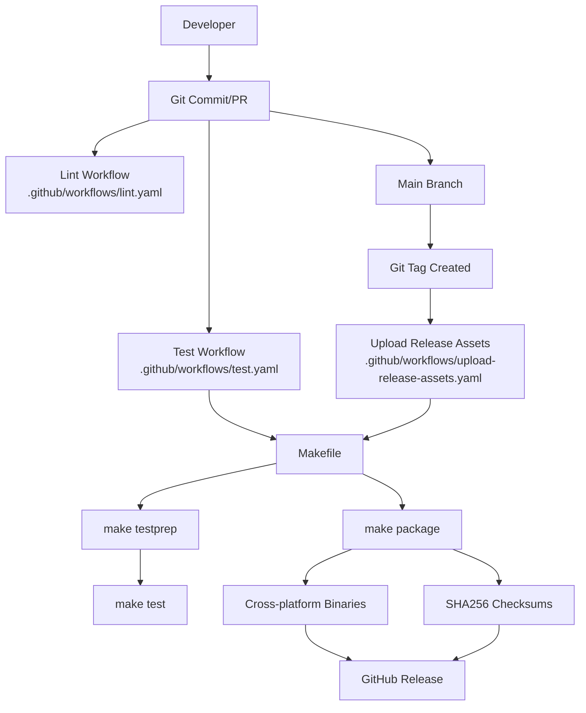
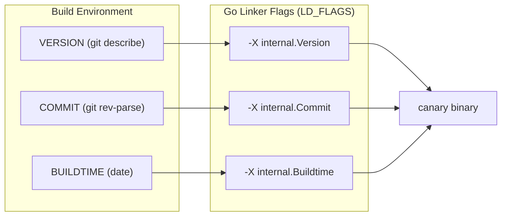

<!-- source: DeepWiki mcp.deepwiki.com · repo NVIDIA/container-canary · page 6 CI/CD and Releases · fetched 2026-10-26 -->

# CI/CD and Releases

Relevant source files

The following files were used as context for generating this wiki page:

- [.github/workflows/lint.yaml](.github/workflows/lint.yaml)
- [.github/workflows/test.yaml](.github/workflows/test.yaml)
- [.github/workflows/upload-release-assets.yaml](.github/workflows/upload-release-assets.yaml)

This page documents the automated testing, building, and release pipelines for `container-canary`. It covers the GitHub Actions workflows that ensure code quality, the build system for cross-platform binaries, and the automated release process. For information about building from source manually, see [Building from Source](#4.1). For information about code quality tools and pre-commit hooks, see [Code Quality](#4.3).

## Overview

The `container-canary` project implements a fully automated CI/CD pipeline that ensures every commit is tested across multiple Go versions, builds are reproducible, and releases are automatically generated with cross-platform binaries and checksums.

**Sources:** [.github/workflows/test.yaml:1-37](), [.github/workflows/lint.yaml:1-32](), [.github/workflows/upload-release-assets.yaml:1-47]()

## Continuous Integration Workflows

For details, see [Continuous Integration](#6.1).

### Test Workflow
The test workflow runs automatically on every push and pull request. It utilizes a matrix strategy to ensure compatibility across multiple Go versions.

- **Trigger**: Runs on `push` and `pull_request` [.github/workflows/test.yaml:1]().
- **Matrix**: Tests Go versions `1.25.x` and `1.26.x` on `ubuntu-latest` [.github/workflows/test.yaml:17-19]().
- **Execution**: Runs `make testprep` to build test containers followed by `make test` to execute the suite [.github/workflows/test.yaml:34-37]().

### Lint Workflow
The lint workflow ensures code style and module integrity.
- **Go Modules**: Runs `go mod tidy -diff` to verify that `go.mod` and `go.sum` are up to date [.github/workflows/lint.yaml:29]().
- **Pre-commit**: Executes `pre-commit/action` to run all configured hooks (e.g., formatting, static analysis) [.github/workflows/lint.yaml:31-32]().

**Sources:** [.github/workflows/test.yaml:1-37](), [.github/workflows/lint.yaml:1-32]()

## Release Process

For details, see [Release Process](#6.2).

The release process is automated via GitHub Actions and triggers whenever a new release is published in the repository.

### Asset Building and Upload
When a release is published [.github/workflows/upload-release-assets.yaml:2-4](), the `Upload Release Assets` workflow:
1.  Checks out the code and sets up Go `1.26.x` [.github/workflows/upload-release-assets.yaml:24-31]().
2.  Runs `make package` to generate cross-platform binaries [.github/workflows/upload-release-assets.yaml:34]().
3.  Calculates `SHA256` checksums for all generated binaries in the `bin/` directory [.github/workflows/upload-release-assets.yaml:35-40]().
4.  Uploads the binaries and checksum files to the GitHub Release using the `gh` CLI [.github/workflows/upload-release-assets.yaml:41-47]().

**Sources:** [.github/workflows/upload-release-assets.yaml:1-47]()

## Build Metadata

For details, see [Build Metadata](#6.3).

### Version Embedding
`container-canary` embeds versioning and build information directly into the binary during the build process using Go linker flags (`-ldflags`). This allows the `version` command to provide precise provenance data.

The workflow environment variables like `GOTOOLCHAIN: local` are used to ensure the build environment respects the local toolchain settings during these automated runs [.github/workflows/test.yaml:21](), [.github/workflows/lint.yaml:16](), [.github/workflows/upload-release-assets.yaml:22]().

**Sources:** [.github/workflows/test.yaml:21](), [.github/workflows/upload-release-assets.yaml:22](), [.github/workflows/upload-release-assets.yaml:32-40]()

---

