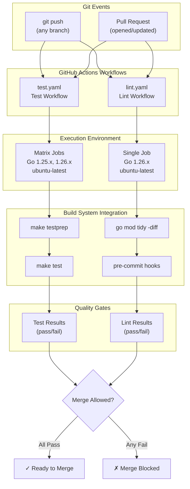
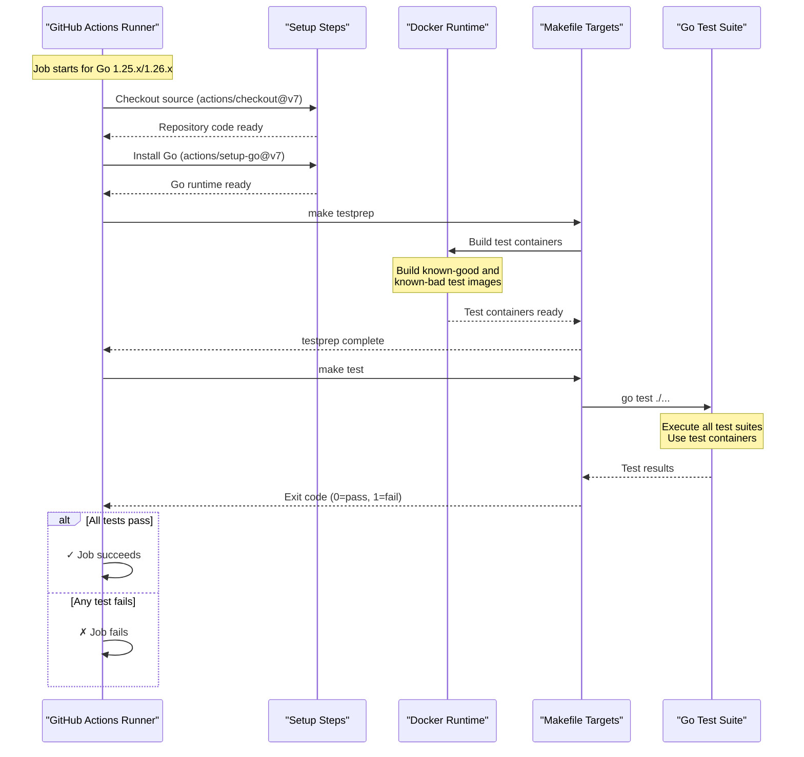
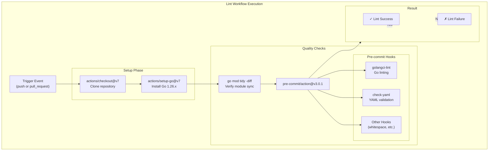
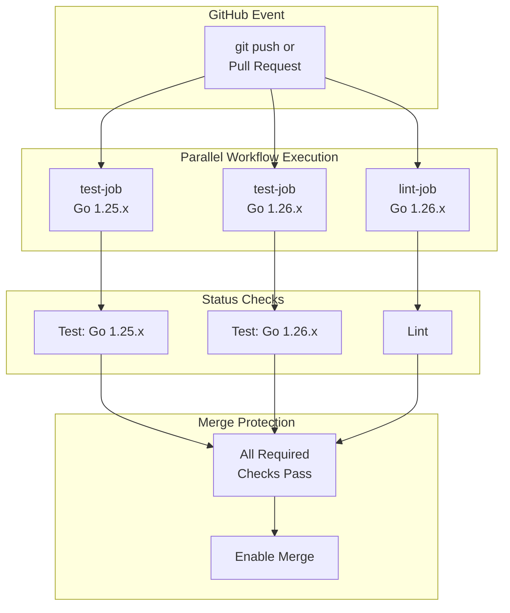

<!-- source: DeepWiki mcp.deepwiki.com · repo NVIDIA/container-canary · page 6.1 Continuous Integration · fetched 2026-10-26 -->

# Continuous Integration

<details>
<summary>Relevant source files</summary>

The following files were used as context for generating this wiki page:

- [.github/workflows/lint.yaml](.github/workflows/lint.yaml)
- [.github/workflows/test.yaml](.github/workflows/test.yaml)

</details>


## Purpose and Scope

This document describes the continuous integration (CI) system used by `container-canary` to ensure code quality and functionality. The CI system consists of two primary GitHub Actions workflows that execute on every push and pull request: test execution across multiple Go versions and automated code linting.

For information about the release automation process, see [Release Process](#6.2). For details on how build metadata is embedded during compilation, see [Build Metadata](#6.3). For local testing and code quality tools, see [Running Tests](#4.2) and [Code Quality](#4.3).

**Sources:** [.github/workflows/test.yaml:1-37](), [.github/workflows/lint.yaml:1-32]()

---

## CI System Overview

The `container-canary` CI system implements two automated quality gates that execute on all code changes:

| Workflow | File | Primary Purpose | Execution Time |
|----------|------|-----------------|----------------|
| Test | `.github/workflows/test.yaml` | Verify functionality across multiple Go versions | ~2-5 minutes |
| Lint | `.github/workflows/lint.yaml` | Enforce code quality and formatting standards | ~1-2 minutes |

Both workflows are triggered by the same events (`on: [push, pull_request]`) ensuring that every commit and pull request undergoes comprehensive validation before merging.

**Sources:** [.github/workflows/test.yaml:1-2](), [.github/workflows/lint.yaml:1-2]()

---

## Workflow Trigger Architecture



**Diagram: CI Workflow Trigger and Execution Flow**

Both workflows execute in parallel when triggered, with failure in either workflow blocking merge approval. The test workflow runs parallel matrix jobs, while the lint workflow executes a single job. Both workflows use `concurrency` groups to cancel in-progress runs when a new push occurs on the same reference [.github/workflows/test.yaml:7-9](), [.github/workflows/lint.yaml:7-9]().

**Sources:** [.github/workflows/test.yaml:1-22](), [.github/workflows/lint.yaml:1-17]()

---

## Test Workflow

The test workflow (`test.yaml`) validates `container-canary` functionality across multiple Go compiler versions using a matrix strategy.

### Matrix Configuration

```yaml
strategy:
  fail-fast: false
  matrix:
    go-version: [1.25.x, 1.26.x]
    os: [ubuntu-latest]
```

The `fail-fast: false` configuration ensures all matrix jobs complete even if one fails, providing comprehensive test results across all Go versions [.github/workflows/test.yaml:15-18]().

**Sources:** [.github/workflows/test.yaml:14-19]()

### Test Execution Steps



**Diagram: Test Workflow Execution Sequence**

The workflow executes four distinct steps:

1. **Source Checkout** ([.github/workflows/test.yaml:23-26]()): Clones the repository using `actions/checkout@v7`.
2. **Go Installation** ([.github/workflows/test.yaml:28-31]()): Uses `actions/setup-go@v7` to install the matrix-specified Go version. The environment variable `GOTOOLCHAIN: local` is set to ensure the specific version is used [.github/workflows/test.yaml:21]().
3. **Test Container Build** ([.github/workflows/test.yaml:33-34]()): Executes `make testprep` to build Docker test containers.
4. **Test Execution** ([.github/workflows/test.yaml:36-37]()): Runs `make test` to execute the full test suite.

**Sources:** [.github/workflows/test.yaml:20-37]()

---

## Lint Workflow

The lint workflow (`lint.yaml`) enforces code quality and formatting standards using Go module checks and the pre-commit framework.

### Workflow Configuration



**Diagram: Lint Workflow Hook Execution**

The lint workflow consists of four primary steps:

1. **Repository Checkout** ([.github/workflows/lint.yaml:18-21]()): Clones the source code.
2. **Go Installation** ([.github/workflows/lint.yaml:23-26]()): Installs Go 1.26.x.
3. **Module File Check** ([.github/workflows/lint.yaml:28-29]()): Runs `go mod tidy -diff` to ensure `go.mod` and `go.sum` are up-to-date and synchronized.
4. **Pre-commit Execution** ([.github/workflows/lint.yaml:31-32]()): Runs all configured pre-commit hooks via `pre-commit/action@v3.0.1`.

**Sources:** [.github/workflows/lint.yaml:12-32]()

---

## Workflow Job Dependencies and Execution



**Diagram: Workflow Job Execution and Status Reporting**

All workflow jobs execute in parallel with no inter-job dependencies. The matrix strategy in the test workflow creates independent jobs from a single workflow definition [.github/workflows/test.yaml:14-19]().

**Sources:** [.github/workflows/test.yaml:11-19](), [.github/workflows/lint.yaml:11-13]()

---

## Integration with Build System

Both CI workflows delegate to Make targets defined in the project's Makefile, ensuring that CI execution matches local development workflows:

| Workflow | Step | Target/Command | Purpose |
|----------|------|----------------|---------|
| Test | Build test containers | `make testprep` | Prepare Docker images for testing [.github/workflows/test.yaml:34]() |
| Test | Run tests | `make test` | Execute Go test suite [.github/workflows/test.yaml:37]() |
| Lint | Module check | `go mod tidy -diff` | Ensure dependencies are clean [.github/workflows/lint.yaml:29]() |
| Lint | Pre-commit | `pre-commit/action` | Execute linting and formatting [.github/workflows/lint.yaml:32]() |

**Sources:** [.github/workflows/test.yaml:33-37](), [.github/workflows/lint.yaml:28-32]()

---

## Execution Environment

Both workflows execute on `ubuntu-latest` runners provided by GitHub Actions. 

- **Permissions**: Workflows are granted `contents: read` permissions [.github/workflows/test.yaml:4-5](), [.github/workflows/lint.yaml:4-5]().
- **Timeouts**: The test workflow has a 30-minute timeout [.github/workflows/test.yaml:13](), while the lint workflow is limited to 10 minutes [.github/workflows/lint.yaml:14]().
- **Go Toolchain**: Both workflows set `GOTOOLCHAIN: local` to enforce the version specified in the workflow rather than allowing Go to automatically download newer toolchains [.github/workflows/test.yaml:21](), [.github/workflows/lint.yaml:16]().

**Sources:** [.github/workflows/test.yaml:1-21](), [.github/workflows/lint.yaml:1-16]()

---

## Multi-Version Go Testing Strategy

The test workflow validates `container-canary` against specific Go versions:

```yaml
go-version: [1.25.x, 1.26.x]
```

This strategy:
- **Ensures compatibility** with current and previous Go compiler versions.
- **Catches version-specific bugs** before they affect users.
- **Validates backward compatibility** as new Go versions release.

The `.x` suffix in version specifications (e.g., `1.26.x`) instructs the `setup-go` action to use the latest patch release of that minor version [.github/workflows/test.yaml:17]().

**Sources:** [.github/workflows/test.yaml:14-18]()

---

