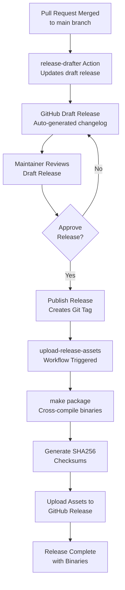
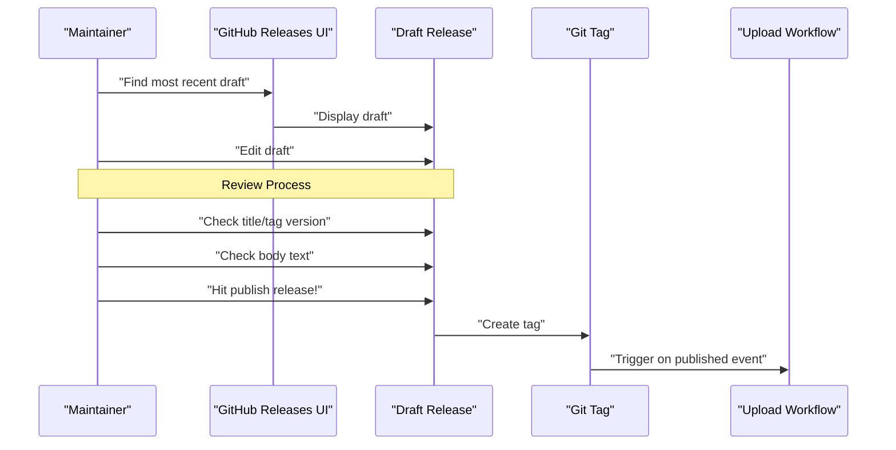
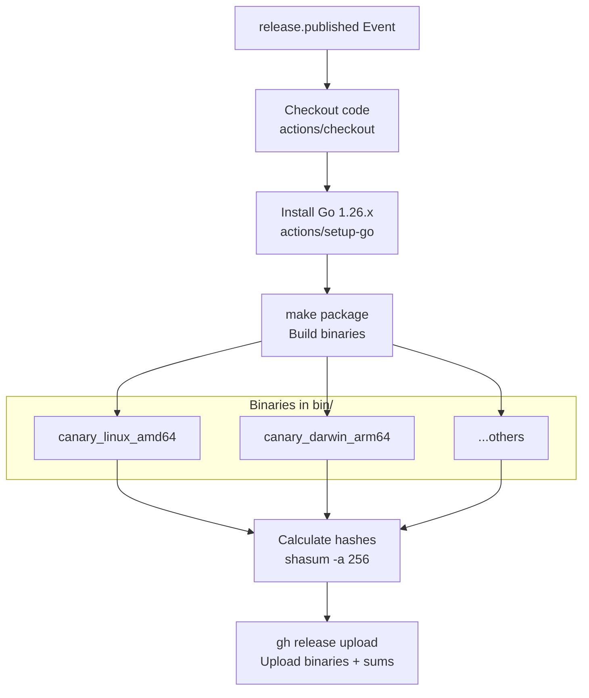

<!-- source: DeepWiki mcp.deepwiki.com · repo NVIDIA/container-canary · page 6.2 Release Process · fetched 2026-10-26 -->

# Release Process

<details>
<summary>Relevant source files</summary>

The following files were used as context for generating this wiki page:

- [.github/release-drafter.yml](.github/release-drafter.yml)
- [.github/workflows/release-drafter.yaml](.github/workflows/release-drafter.yaml)
- [.github/workflows/upload-release-assets.yaml](.github/workflows/upload-release-assets.yaml)
- [MAINTAINING.md](MAINTAINING.md)
- [examples/README.md](examples/README.md)

</details>


This document describes the automated and manual steps involved in creating and publishing releases of `container-canary`. The release process includes automated changelog generation, manual release approval, cross-platform binary building, and asset distribution through GitHub Releases.

For information about build metadata (version, commit, buildtime) embedded in binaries, see [Build Metadata](#6.3). For CI/CD workflows that run on every commit, see [Continuous Integration](#6.1).

## Overview

The `container-canary` release process follows a semi-automated workflow that balances automation with manual control. Release drafts are automatically created and maintained as pull requests are merged, but maintainers manually review and publish releases. Once published, asset building and distribution is fully automated.

### High-Level Workflow
Title: Release Pipeline Overview


**Sources:** [MAINTAINING.md:7-21](), [.github/workflows/upload-release-assets.yaml:1-6](), [.github/workflows/release-drafter.yaml:1-9]()

## Automated Release Draft Generation

The Release Drafter GitHub Action automatically creates and updates draft releases as pull requests are merged to the `main` branch. This action runs on triggers defined in [.github/workflows/release-drafter.yaml:6-17]():

| Trigger Event | Purpose |
|---------------|---------|
| `push` to `main` | Update draft release with merged PRs |
| `pull_request` | Auto-label PRs for changelog categorization |
| `pull_request_target` | Support PR auto-labeling from forks |

### Changelog Generation

The release drafter uses PR labels to categorize changes and determine version bumps. Configuration is defined in [.github/release-drafter.yml:1-30]():

**Change Categories:**

| Label | Changelog Section | Version Impact |
|-------|------------------|----------------|
| `enhancement` | Enhancements | Minor version bump |
| `bug` | Bug Fixes | Patch version bump |
| `documentation` | Documentation and code quality | Patch version bump |
| `breaking` | N/A | Major version bump |

**Auto-labeling:** Pull requests that modify `*.md` files are automatically labeled as `documentation` [.github/release-drafter.yml:27-30]().

### Release Template

Each draft release includes a structured template with:

1. **What's Changed** section - Auto-generated changelog from PR titles [.github/release-drafter.yml:32-34]()
2. **Installation** section - Instructions with platform-specific download commands [.github/release-drafter.yml:36-42]()
3. **Verification** - Download verification instructions using SHA256 checksums [.github/release-drafter.yml:44-50]()

**Sources:** [.github/workflows/release-drafter.yaml:1-33](), [.github/release-drafter.yml:1-67]()

## Manual Release Publishing

Maintainers follow a review and publish workflow documented in [MAINTAINING.md:13-19]():

### Publishing Steps

Title: Maintainer Release Interaction


**Review Checklist:**
1. Verify title and tag match the desired version (e.g., `v1.2.3`) [MAINTAINING.md:17]()
2. Review auto-generated changelog for accuracy [MAINTAINING.md:18]()
3. Publish release to create the git tag [MAINTAINING.md:19]()

Once published, the `release.published` event triggers the asset upload workflow [.github/workflows/upload-release-assets.yaml:1-4]().

**Sources:** [MAINTAINING.md:13-21](), [.github/workflows/upload-release-assets.yaml:1-4]()

## Automated Asset Building

The `upload-release-assets.yaml` workflow builds binaries for all supported platforms when a release is published. The workflow runs on `ubuntu-latest` and uses Go `1.26.x` [.github/workflows/upload-release-assets.yaml:17-31]().

### Build Process Flow

Title: Asset Building and Distribution Flow


**Sources:** [.github/workflows/upload-release-assets.yaml:1-47]()

### Binary Packaging and Checksums

The workflow executes `make package` to generate the binaries [.github/workflows/upload-release-assets.yaml:34](). After building, it iterates through all files in the `bin/` directory starting with `canary_` and generates SHA256 checksums [.github/workflows/upload-release-assets.yaml:35-40]():

```bash
cd bin
for f in canary_*; do
    shasum -a 256 "$f" > "$f".sha256sum;
done
```

### Asset Upload

The `gh` CLI tool is used to upload all files to the release. The workflow extracts the tag name from `GITHUB_REF` and uploads all `canary_*` files (both binaries and checksums) [.github/workflows/upload-release-assets.yaml:42-47]():

```bash
cd bin
tag_name="${GITHUB_REF##*/}"
gh release upload "$tag_name" canary_*
```

**Sources:** [.github/workflows/upload-release-assets.yaml:32-47](), [MAINTAINING.md:21-23]()

## Release Artifacts

Upon completion, each GitHub release contains the following artifacts:

### File Structure
- **Binaries:** Cross-compiled executables for supported platforms (Linux, macOS, Windows).
- **Checksums:** `.sha256sum` files for every binary to allow user verification [.github/workflows/upload-release-assets.yaml:39]().

### User Verification
Users can verify download integrity using the instructions provided in the release notes template [.github/release-drafter.yml:44-50]():

```console
$ curl -L https://github.com/NVIDIA/container-canary/releases/download/v$VERSION/canary_linux_amd64.sha256sum > canary_linux_amd64.sha256sum
$ sha256sum --check --status canary_linux_amd64.sha256sum
```

**Sources:** [.github/release-drafter.yml:36-67](), [.github/workflows/upload-release-assets.yaml:35-40]()

---

