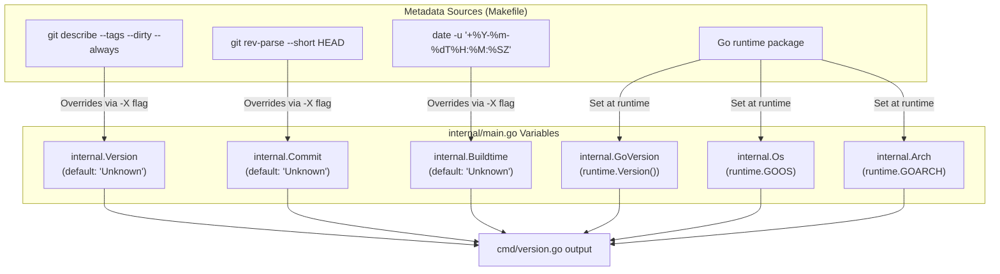
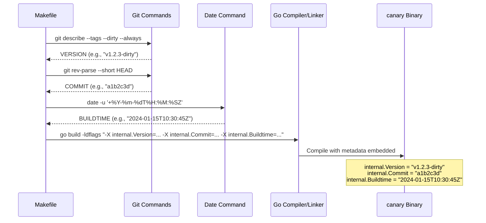
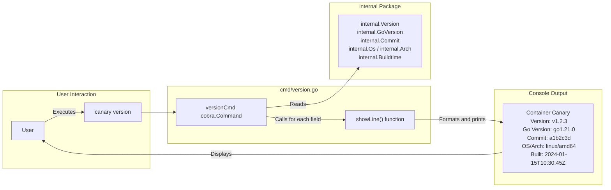

<!-- source: DeepWiki mcp.deepwiki.com · repo NVIDIA/container-canary · page 6.3 Build Metadata · fetched 2026-10-26 -->

# Build Metadata

<details>
<summary>Relevant source files</summary>

The following files were used as context for generating this wiki page:

- [Makefile](Makefile)
- [cmd/version.go](cmd/version.go)
- [internal/main.go](internal/main.go)
- [main.go](main.go)

</details>


This document explains how container-canary embeds build-time information into compiled binaries and makes it available at runtime. Build metadata includes version information, git commit hash, and build timestamp, which are injected during compilation using Go linker flags.

## Overview

Container-canary uses Go's linker flag mechanism (`-ldflags -X`) to inject metadata into the binary at compile time. This approach eliminates the need for external version files or runtime version detection, ensuring that every binary contains accurate build information regardless of how it was compiled.

**Sources:** [Makefile:7-10](), [internal/main.go:22-27]()

## Build Metadata Variables

The build metadata is stored in package-level variables within the `internal` package. These variables are initialized with default values but are intended to be overridden at link time.

### Data Flow: Code Entity Space

The following diagram maps the flow from build-time shell commands to the Go variables defined in the `internal` package.



### Variable Definitions

| Variable | Default Value | Override Source | Purpose |
|----------|---------------|-----------------|---------|
| `Version` | `"Unknown"` | `git describe --tags --dirty --always` | Git tag or commit description |
| `GoVersion` | `runtime.Version()` | Not overridden | Go compiler version |
| `Buildtime` | `"Unknown"` | `date -u` (ISO 8601) | Build timestamp in UTC |
| `Commit` | `"Unknown"` | `git rev-parse --short HEAD` | Short git commit hash |
| `Os` | `runtime.GOOS` | Not overridden | Target operating system |
| `Arch` | `runtime.GOARCH` | Not overridden | Target architecture |

Three variables (`Version`, `Commit`, `Buildtime`) are overridden at link time, while three others (`GoVersion`, `Os`, `Arch`) are determined automatically by the Go `runtime` package.

**Sources:** [internal/main.go:20-27]()

## Metadata Extraction and Injection

The `Makefile` orchestrates metadata extraction from the git repository and build environment, then passes this information to the Go compiler via linker flags.



### Makefile Variable Definition

The `Makefile` defines three shell-evaluated variables at the top of the file:

```makefile
VERSION := $(shell git describe --tags --dirty --always)
BUILDTIME := $(shell date -u '+%Y-%m-%dT%H:%M:%SZ')
COMMIT := $(shell git rev-parse --short HEAD)
```

These variables are evaluated once when `make` is invoked and remain constant throughout the build process.

**Sources:** [Makefile:1-3]()

### Linker Flag Construction

The extracted metadata is passed to the Go linker using the `-X` flag, which sets the value of string variables at link time:

```makefile
GO_LD_FLAGS += -X github.com/nvidia/container-canary/internal.Version=$(VERSION)
GO_LD_FLAGS += -X github.com/nvidia/container-canary/internal.Buildtime=$(BUILDTIME)
GO_LD_FLAGS += -X github.com/nvidia/container-canary/internal.Commit=$(COMMIT)
GO_FLAGS = -ldflags "$(GO_LD_FLAGS)"
```

The `-X` flag format is: `-X importpath.name=value`

- **Import path:** `github.com/nvidia/container-canary/internal`
- **Variable names:** `Version`, `Buildtime`, `Commit`
- **Values:** Substituted from `Makefile` variables.

**Sources:** [Makefile:7-10]()

### Build Invocation

The linker flags are applied during all build targets:

```makefile
build: ## Build for the current platform
	go build -o bin/$(EXECUTABLE) $(GO_FLAGS) .

package: ## Build for all platforms
	env GOOS=windows GOARCH=amd64 go build -o bin/$(EXECUTABLE)_windows_amd64.exe $(GO_FLAGS) .
	env GOOS=linux GOARCH=amd64 CGO_ENABLED=0 go build -o bin/$(EXECUTABLE)_linux_amd64 $(GO_FLAGS) .
    # ... additional platforms
```

The `$(GO_FLAGS)` variable, which contains the linker flags, is included in every `go build` invocation, ensuring metadata is embedded in all platform builds.

**Sources:** [Makefile:14-28]()

## Runtime Access via Version Command

The embedded metadata is exposed to users through the `version` subcommand, implemented in `cmd/version.go`.

### Execution Flow: CLI to Internal Metadata

This diagram illustrates how the `versionCmd` interacts with the `internal` package to display build info.



### Version Command Implementation

The `versionCmd` is a `cobra.Command` that reads metadata from the `internal` package and formats it for display:

```go
var versionCmd = &cobra.Command{
	Use:   "version",
	Short: "Print the version of containercanary",
	Long:  ``,
	Run: func(cmd *cobra.Command, args []string) {
		cmd.Println("Container Canary")
		showLine(cmd, "Version", internal.Version)
		showLine(cmd, "Go Version", internal.GoVersion)
		showLine(cmd, "Commit", internal.Commit)
		showLine(cmd, "OS/Arch", fmt.Sprintf("%s/%s", internal.Os, internal.Arch))
		showLine(cmd, "Built", internal.Buildtime)
	},
}
```

The `showLine` helper function formats each metadata field with consistent spacing:

```go
func showLine(cmd *cobra.Command, title string, value string) {
	cmd.Printf(" %-16s %s\n", fmt.Sprintf("%s:", title), value)
}
```

**Sources:** [cmd/version.go:27-43]()

## Cross-Platform Build Considerations

The build metadata system works identically across all supported platforms. The `package` target builds for five platform/architecture combinations:

| Platform | Architecture | Binary Name | CGO Setting |
|----------|--------------|-------------|-------------|
| Windows | amd64 | `canary_windows_amd64.exe` | Default |
| Linux | amd64 | `canary_linux_amd64` | `CGO_ENABLED=0` |
| Linux | arm64 | `canary_linux_arm64` | `CGO_ENABLED=0` |
| macOS (Darwin) | amd64 | `canary_darwin_amd64` | Default |
| macOS (Darwin) | arm64 | `canary_darwin_arm64` | Default |

### Static Linking for Linux

Linux builds set `CGO_ENABLED=0` to avoid dynamic linking against `libc`. This prevents issues where the binary might fail to run on older systems due to missing `GLIBC` versions. The metadata embedding mechanism works identically with or without CGO.

**Sources:** [Makefile:20-28]()

## Implementation Notes

### Version String Format
The `VERSION` variable uses `git describe --tags --dirty --always`:
- Returns the most recent tag.
- Appends `-dirty` if working directory has uncommitted changes.
- Falls back to the short commit hash if no tags exist.

**Sources:** [Makefile:1]()

### Timestamp Format
The `BUILDTIME` uses ISO 8601 format in UTC (`date -u '+%Y-%m-%dT%H:%M:%SZ'`).

**Sources:** [Makefile:2]()

### Short Commit Hash
The `COMMIT` variable uses `git rev-parse --short HEAD` to produce an abbreviated commit hash.

**Sources:** [Makefile:3]()

### Build-Time Verification
The `Makefile` includes targets to display the extracted metadata during the build process:

```makefile
build: ## Build for the current platform
	go build -o bin/$(EXECUTABLE) $(GO_FLAGS) .
	@echo built: bin/$(EXECUTABLE)
	@echo version: $(VERSION)
	@echo commit: $(COMMIT)
```

**Sources:** [Makefile:14-18]()

---
**Sources:** [Makefile:1-32](), [internal/main.go:18-27](), [cmd/version.go:18-47]()

---

