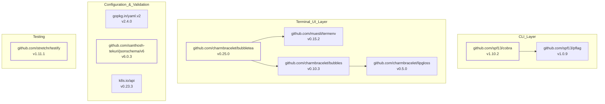
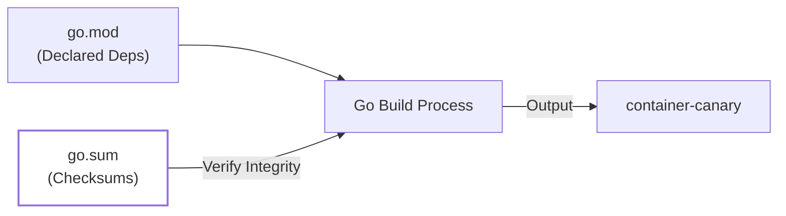

<!-- source: DeepWiki mcp.deepwiki.com · repo NVIDIA/container-canary · page 7 Dependencies · fetched 2026-10-26 -->

# Dependencies

Relevant source files

The following files were used as context for generating this wiki page:

- [go.mod](go.mod)
- [go.sum](go.sum)

This document provides a comprehensive reference for `container-canary`'s external dependencies, their purposes, and the project's dependency management strategy. It covers both direct and indirect dependencies, version constraints, and how dependencies map to functional components.

For information about building the project and managing dependencies during development, see [Building from Source](#4.1). For details on API types and interfaces, see [API Reference](#5).

---

## Dependency Overview

Container-canary uses Go modules for dependency management and maintains a dependency footprint focused on CLI interaction, terminal UI, YAML configuration parsing, and Kubernetes API type compatibility. Notably, the project leverages the `jsonschema` library for manifest validation against a defined schema.

**Dependency Categories:**
- **CLI Framework**: Command-line interface construction
- **Terminal UI**: Interactive text-based user interface
- **Configuration & Validation**: YAML parsing and JSON Schema validation
- **Kubernetes Types**: API type definitions for probe specifications
- **Testing**: Unit and integration test utilities

**Sources:** [go.mod:1-16]()

---

## Dependency Architecture

### Functional Mapping

**Sources:** [go.mod:6-16](), [go.mod:38-41]()

---

## Core Dependencies

For detailed information on the specific libraries and their integration into the core logic, see [Core Dependencies](#7.1).

### CLI Framework: Cobra
Container-canary uses `github.com/spf13/cobra` to handle command parsing and flag management. This is the entry point for all user interactions.
**Sources:** [go.mod:11]()

### Terminal UI: Bubble Tea Ecosystem
The validation progress is rendered using `github.com/charmbracelet/bubbletea` and its associated styling libraries like `lipgloss`.
**Sources:** [go.mod:6-8]()

### Schema Validation: jsonschema
A key architectural component is the use of `github.com/santhosh-tekuri/jsonschema/v6` to ensure that validator manifests conform to the project's specification before execution.
**Sources:** [go.mod:10]()

### Kubernetes API Types
The project embeds `k8s.io/api` types (specifically `v1.Handler`) to define probes, allowing users to use familiar syntax for `exec`, `httpGet`, and `tcpSocket` checks.
**Sources:** [go.mod:15]()

---

## Dependency Management

For details on Go module maintenance and the purpose of lock files, see [Dependency Management](#7.2).

### Go Version Requirements
The project requires Go **1.25.0**. This ensures access to modern language features and security updates.
**Sources:** [go.mod:3]()

### Dependency Verification
The `go.sum` file serves as the project's lock file, containing cryptographic checksums for all direct and transitive dependencies to ensure reproducible builds and supply chain security.

**Checksum Verification:**

**Sources:** [go.sum:1-81]() (truncated)

---

## Indirect Dependencies

Container-canary relies on several supporting libraries for terminal handling, logging, and system-level operations.

| Category | Key Packages | Purpose |
|----------|--------------|---------|
| **Terminal Support** | `github.com/muesli/termenv`, `github.com/mattn/go-isatty` | Environment detection and ANSI support |
| **System** | `golang.org/x/sys`, `golang.org/x/term` | Low-level OS calls and terminal control |
| **Kubernetes Utils** | `k8s.io/apimachinery`, `k8s.io/klog/v2` | Common type machinery and logging |
| **Text/Unicode** | `github.com/rivo/uniseg`, `github.com/mattn/go-runewidth` | Unicode segmentation and display width |

**Sources:** [go.mod:18-53]()

---

## License and Compatibility

All major dependencies are selected based on permissive open-source licenses (MIT, Apache-2.0, BSD-3-Clause) to ensure the project remains accessible for broad distribution. The use of Kubernetes `v0.23.3` types provides a stable API baseline for container probes that is compatible with most modern container runtimes.

**Sources:** [go.mod:15-16]()

---

