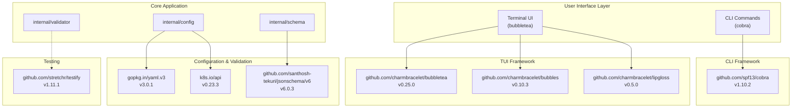
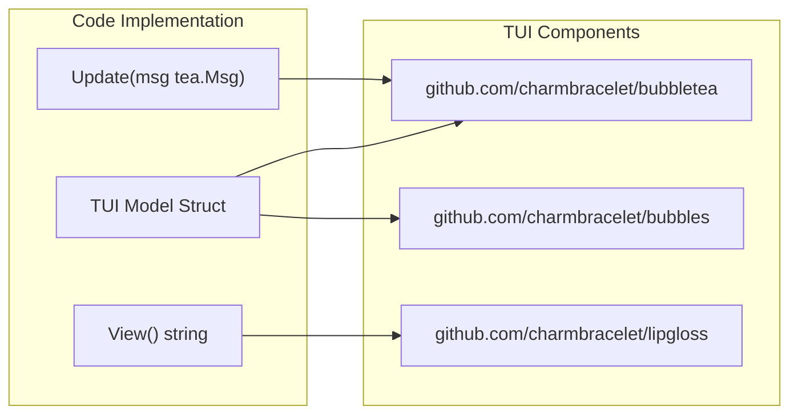
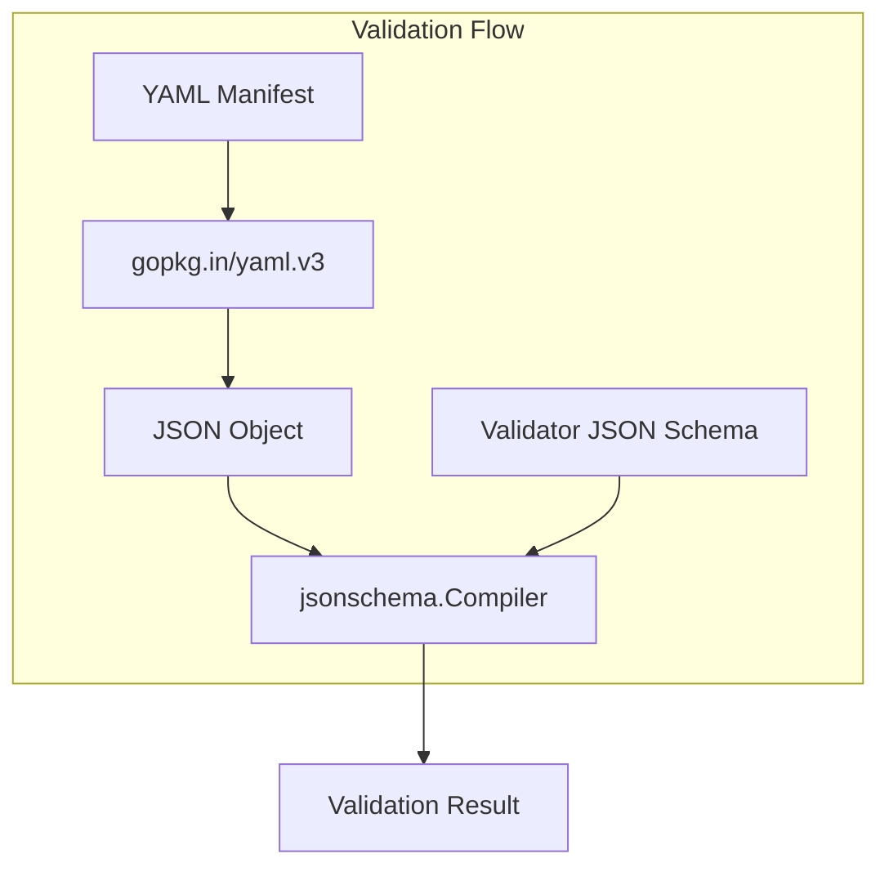

<!-- source: DeepWiki mcp.deepwiki.com · repo NVIDIA/container-canary · page 7.1 Core Dependencies · fetched 2026-10-26 -->

# Core Dependencies

Relevant source files

The following files were used as context for generating this wiki page:

- [go.mod](go.mod)
- [go.sum](go.sum)

## Purpose and Scope

This document describes the core external dependencies used by `container-canary` and their roles within the system architecture. It covers the primary libraries for CLI framework, terminal UI, configuration parsing, API types, and JSON schema validation. For information about the build system and toolchain, see [Building from Source](#4.1). For details on how dependencies are managed and updated, see [Dependency Management](#7.2).

---

## Dependency Architecture Overview

Container-canary is built on a foundation of specialized external libraries. The dependency structure separates concerns into distinct layers: user interface (CLI and TUI), configuration management, container abstractions, and validation logic.

**Sources:** [go.mod:5-16]()

---

## CLI Framework: Cobra

Container-canary uses **Cobra** (`github.com/spf13/cobra v1.10.2`) as its command-line interface framework. Cobra provides the structure for the `canary validate`, `canary schema-validate`, and `canary version` commands.

### Key Features Used

| Feature | Usage in Container-Canary |
|---------|---------------------------|
| Command Hierarchy | Root command with subcommands (`validate`, `version`, `schema-validate`) |
| Flag Parsing | `--file`, `--url`, `--format`, `--no-color` flags |
| Help Generation | Automatic help text for all commands |

**Sources:** [go.mod:11]()

---

## Terminal UI Framework: Bubbletea Ecosystem

Container-canary's interactive terminal UI is built on the **Bubbletea** framework (`github.com/charmbracelet/bubbletea v0.25.0`), which implements the Elm Architecture pattern.

### Component Breakdown

| Package | Version | Purpose |
|---------|---------|---------|
| `bubbletea` | v0.25.0 | Core framework for terminal event loops and rendering |
| `bubbles` | v0.10.3 | Reusable TUI components like `spinner.Model` and `progress.Model` |
| `lipgloss` | v0.5.0 | Styling engine for terminal text, colors, and layouts |

**Sources:** [go.mod:6-8]()

---

## Configuration and Schema Validation

### Kubernetes API Types

**k8s.io/api** (v0.23.3) provides the structural definitions for probes. Container-canary reuses these types to ensure compatibility with standard Kubernetes semantics.

| Type | Source | Usage |
|------|--------|-------|
| `Probe` | `k8s.io/api/core/v1` | Base probe structure (timing, thresholds) |
| `ExecAction` | `k8s.io/api/core/v1` | Definition for command-based probes |
| `HTTPGetAction` | `k8s.io/api/core/v1` | Definition for HTTP-based probes |

**Sources:** [go.mod:15]()

### JSON Schema Validation

**jsonschema/v6** (`github.com/santhosh-tekuri/jsonschema/v6 v6.0.3`) is a critical dependency used to validate validator manifests against the project's JSON schema contract.

**Sources:** [go.mod:10](), [go.mod:14]()

---

## Testing Framework: Testify

**github.com/stretchr/testify** (v1.11.1) is used for unit and integration testing, providing the `assert` and `require` packages for verifying code behavior.

**Sources:** [go.mod:12]()

---

## Summary of Core Dependencies

| Dependency | Version | Purpose |
|------------|---------|---------|
| `github.com/spf13/cobra` | v1.10.2 | CLI entry point and flag management |
| `github.com/charmbracelet/bubbletea` | v0.25.0 | Interactive TUI lifecycle |
| `github.com/santhosh-tekuri/jsonschema/v6` | v6.0.3 | Manifest schema enforcement |
| `k8s.io/api` | v0.23.3 | Kubernetes-compatible probe types |
| `gopkg.in/yaml.v3` | v3.0.1 | YAML manifest deserialization |
| `github.com/google/uuid` | v1.6.0 | Unique identification for container instances |

**Sources:** [go.mod:5-16]()

---

