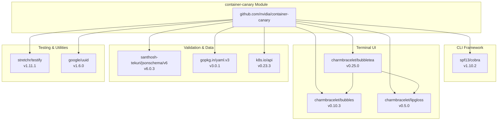
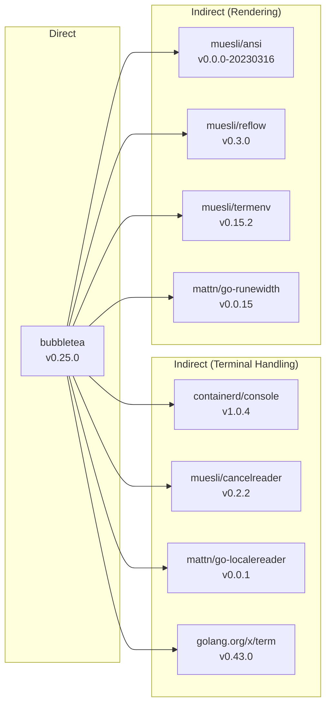
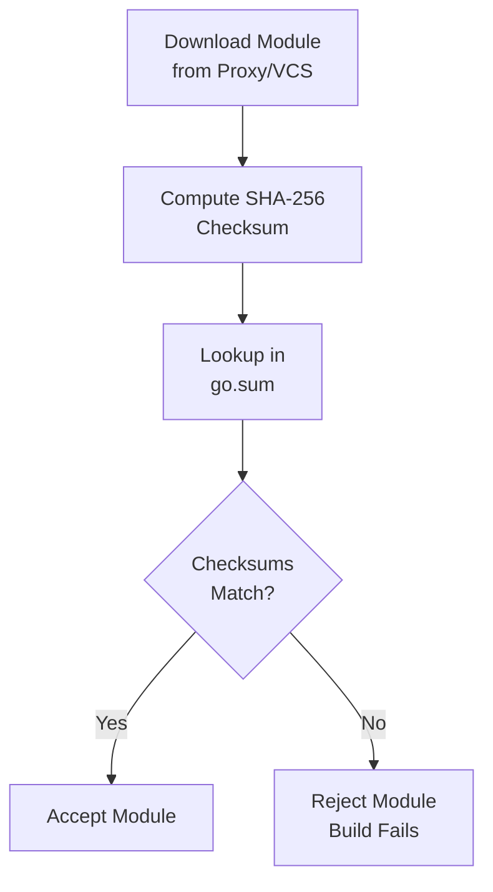

<!-- source: DeepWiki mcp.deepwiki.com · repo NVIDIA/container-canary · page 7.2 Dependency Management · fetched 2026-10-26 -->

# Dependency Management

<details>
<summary>Relevant source files</summary>

The following files were used as context for generating this wiki page:

- [.github/workflows/lint.yaml](.github/workflows/lint.yaml)
- [go.mod](go.mod)
- [go.sum](go.sum)

</details>


## Purpose and Scope

This document describes the dependency management strategy used by `container-canary`, including the Go module system, dependency versioning, and the purpose of each major dependency. For information about the core dependencies' usage in the codebase, see [Core Dependencies]().

Container-canary uses Go modules as its dependency management system. This provides reproducible builds, explicit versioning, and cryptographic verification of dependencies.

---

## Go Module Configuration

The project's dependency configuration is defined in two primary files at the repository root:

| File | Purpose | Location |
|------|---------|----------|
| `go.mod` | Module definition and dependency declarations | [go.mod:1-53]() |
| `go.sum` | Cryptographic checksums for dependency verification | [go.sum:1-81]() |

### Module Identity

The module is identified as `github.com/nvidia/container-canary` with a minimum Go version requirement of `1.25.0`:

```go
module github.com/nvidia/container-canary

go 1.25.0
```

**Sources:** [go.mod:1-3]()

---

## Dependency Categories

### Direct Dependencies Structure



**Sources:** [go.mod:5-16]()

---

## Direct Dependencies

The project declares direct dependencies serving specific architectural purposes:

### CLI and User Interface Dependencies

| Package | Version | Purpose |
|---------|---------|---------|
| `github.com/spf13/cobra` | v1.10.2 | Command-line interface framework for `validate` and `version` commands |
| `github.com/charmbracelet/bubbletea` | v0.25.0 | Terminal UI framework implementing the Elm architecture |
| `github.com/charmbracelet/bubbles` | v0.10.3 | Reusable TUI components (progress bars, spinners, viewports) |
| `github.com/charmbracelet/lipgloss` | v0.5.0 | Terminal styling and layout library |

### Validation and Data Processing

| Package | Version | Purpose |
|---------|---------|---------|
| `github.com/santhosh-tekuri/jsonschema/v6` | v6.0.3 | JSON Schema validation for validator manifests |
| `gopkg.in/yaml.v3` | v3.0.1 | YAML parsing and serialization for manifest files |
| `k8s.io/api` | v0.23.3 | Kubernetes API types for probe definitions (ExecAction, HTTPGetAction, TCPSocketAction) |

The `k8s.io/api` dependency provides type compatibility with Kubernetes probe specifications, enabling users to leverage familiar syntax from Kubernetes pod definitions.

### Testing and Utilities

| Package | Version | Purpose |
|---------|---------|---------|
| `github.com/stretchr/testify` | v1.11.1 | Testing assertions and mocking framework |
| `github.com/google/uuid` | v1.6.0 | UUID generation for container identification |

**Sources:** [go.mod:5-16]()

---

## Indirect Dependencies

Indirect dependencies are transitive dependencies required by the direct dependencies listed above. These are explicitly tracked in `go.mod` for reproducibility.

### Dependency Chain Example



### Major Indirect Dependency Categories

**Kubernetes Dependencies:**
- `k8s.io/apimachinery` v0.23.3 - API machinery for Kubernetes object serialization [go.mod:48]()
- `k8s.io/klog/v2` v2.30.0 - Structured logging used by Kubernetes libraries [go.mod:49]()
- `sigs.k8s.io/json` v0.0.0-20211020170558 - JSON serialization for Kubernetes types [go.mod:51]()

**Terminal and Console:**
- `github.com/containerd/console` v1.0.4 - Console handling [go.mod:21]()
- `github.com/muesli/termenv` v0.15.2 - Terminal environment detection [go.mod:38]()
- `golang.org/x/term` v0.43.0 - Terminal control [go.mod:45]()

**Sources:** [go.mod:18-53]()

---

## Dependency Verification with go.sum

The `go.sum` file contains cryptographic checksums (SHA-256 hashes) for all dependencies and their specific versions. This file enables:

1. **Integrity Verification**: Ensures downloaded modules match expected content.
2. **Reproducible Builds**: Guarantees identical builds across environments.
3. **Supply Chain Security**: Detects tampering or unexpected changes in dependencies.

### Structure of go.sum Entries

Each module version has two entries:

```
github.com/charmbracelet/bubbletea v0.25.0 h1:bAfwk7jRz7FKFl9RzlI...
github.com/charmbracelet/bubbletea v0.25.0/go.mod h1:EN3QDR1T5ZdWmdfDzYcqO...
```

- **First entry**: Hash of the module's content (source code).
- **Second entry**: Hash of the module's `go.mod` file.

### Verification Process



**Sources:** [go.sum:1-81]()

---

## Version Management

### Go Version Requirements

The project specifies a minimum Go version of `1.25.0` in `go.mod` [go.mod:3](). However, the CI environment (GitHub Actions) uses `1.26.x` for linting and module verification [ .github/workflows/lint.yaml:26]().

### Continuous Integration Checks

The `lint` workflow includes a specific step to ensure that `go.mod` and `go.sum` are properly maintained and synchronized:

```yaml
- name: Check Go module files
  run: go mod tidy -diff
```

This ensures that any pull request containing unsynchronized or unnecessary dependencies will fail CI.

**Sources:** [.github/workflows/lint.yaml:28-29]()

---

## Dependency Update Process

### Common Update Operations

**Update a specific dependency:**
```bash
go get github.com/spf13/cobra@latest
go mod tidy
```

**Verify and clean up dependencies:**
```bash
go mod verify    # Verify checksums against go.sum
go mod tidy      # Remove unused dependencies and add missing ones
```

### Best Practices

When working with dependencies in `container-canary`:

1. **Always commit both `go.mod` and `go.sum`**: Both files must be committed together to maintain reproducibility.
2. **Run `go mod tidy` before committing**: Ensures `go.mod` and `go.sum` are synchronized and minimal.
3. **Review dependency changes**: Check for unexpected transitive dependency additions when updating direct dependencies.
4. **CI Verification**: The `lint.yaml` workflow automatically enforces that the module files are "tidy" using the `-diff` flag [ .github/workflows/lint.yaml:29]().

**Sources:** [go.mod:1-53](), [.github/workflows/lint.yaml:28-29]()

---

