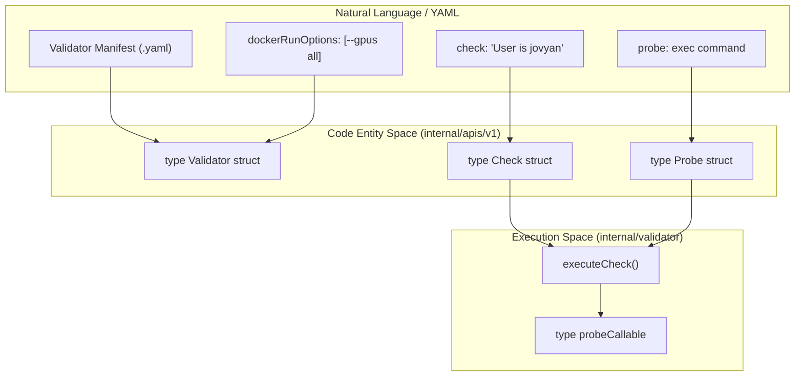
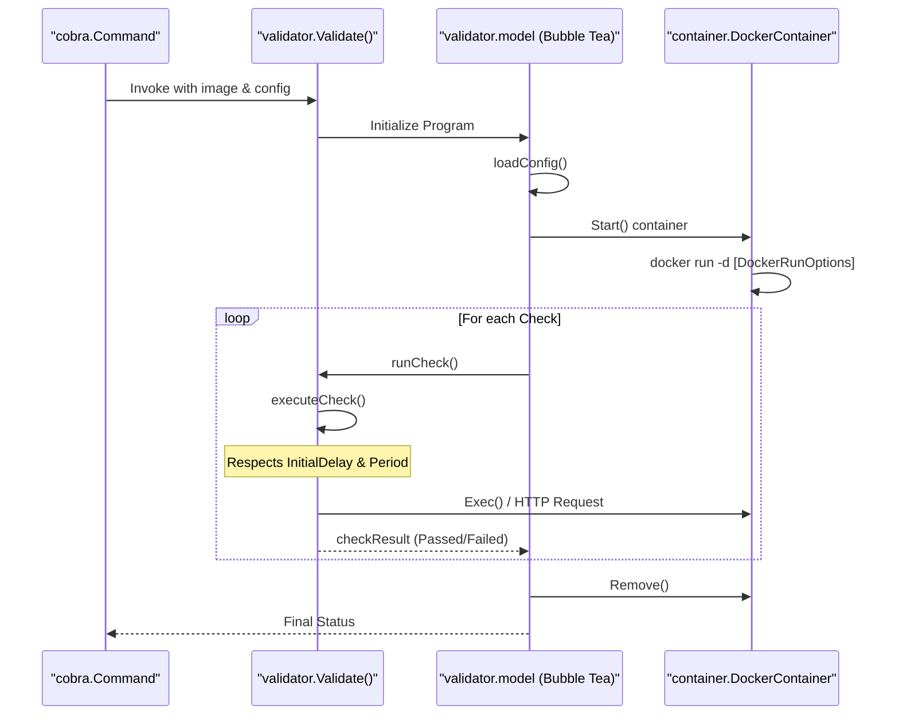

<!-- source: DeepWiki mcp.deepwiki.com · repo NVIDIA/container-canary · page 8 Glossary · fetched 2026-10-26 -->

# Glossary

Relevant source files

The following files were used as context for generating this wiki page:

- [CONTRIBUTING.md](CONTRIBUTING.md)
- [README.md](README.md)
- [examples/gpu.yaml](examples/gpu.yaml)
- [go.mod](go.mod)
- [internal/apis/v1/types.go](internal/apis/v1/types.go)
- [internal/container/docker.go](internal/container/docker.go)
- [internal/container/docker_test.go](internal/container/docker_test.go)
- [internal/schema/schema.go](internal/schema/schema.go)
- [internal/validator/validator.go](internal/validator/validator.go)

This page provides technical definitions for terms, jargon, and architectural concepts specific to the `container-canary` codebase. It serves as a reference for onboarding engineers to understand how natural language requirements map to internal Go entities.

## Core Concepts

### Validator
The top-level configuration object that defines the environment and the set of requirements a container must satisfy. It is represented by the `Validator` struct and is typically loaded from a YAML manifest.

*   **Implementation**: `Validator` struct in [internal/apis/v1/types.go:23-55]().
*   **Key Fields**:
    *   `Checks`: A slice of validation requirements [internal/apis/v1/types.go:37]().
    *   `DockerRunOptions`: Arbitrary flags passed to the `docker run` command [internal/apis/v1/types.go:54]().
    *   `Env`, `Ports`, `Volumes`: Runtime configurations applied to the test container [internal/apis/v1/types.go:40-46]().

### Check
A discrete requirement defined within a Validator. Each check has a human-readable description and a technical `Probe` to verify the requirement.

*   **Implementation**: `Check` struct in [internal/apis/v1/types.go:57-68]().
*   **Data Flow**: The `Validate` function iterates through these checks and spawns Bubble Tea commands via `runCheck` [internal/validator/validator.go:160-178]().

### Probe
The active mechanism used to verify a `Check`. Probes in `container-canary` are modeled after Kubernetes liveness/readiness probes.

*   **Implementation**: `Probe` struct in [internal/apis/v1/types.go:70-88]().
*   **Probe Types**:
    *   **Exec**: Runs a command inside the container via `docker exec` [internal/validator/probes.go]().
    *   **HTTPGet**: Performs an HTTP request against a port in the container [internal/validator/probes.go]().
    *   **TCPSocket**: Checks if a TCP port is open and accepting connections [internal/validator/probes.go]().
*   **Thresholds**: Probes use `SuccessThreshold` and `FailureThreshold` to determine a final pass/fail state after multiple attempts [internal/validator/validator.go:181-206]().

### Container Interface
An abstraction layer that allows the validator to interact with different container runtimes. Currently, the primary implementation is for Docker.

*   **Interface Definition**: `ContainerInterface` in [internal/container/container.go]().
*   **Docker Implementation**: `DockerContainer` struct in [internal/container/docker.go:15-26]().

---

## Technical Mapping: Manifest to Code

The following diagram illustrates how YAML manifest properties map to specific Go structures and functions during the validation lifecycle.

**Entity Mapping Diagram**

**Sources**: [internal/apis/v1/types.go:23-88](), [internal/validator/validator.go:62-62](), [internal/validator/validator.go:181-206]()

---

## Validation Lifecycle

The validation process moves through several states, managed by the Bubble Tea `model`.

**Validation Flow Diagram**

**Sources**: [internal/validator/validator.go:64-99](), [internal/validator/validator.go:131-142](), [internal/validator/validator.go:160-178](), [internal/container/docker.go:29-97]()

---

## Jargon & Abbreviations

| Term | Definition | Code Pointer |
| :--- | :--- | :--- |
| **DCO** | Developer Certificate of Origin. Requirement for all commits to be signed off (`-s`). | [CONTRIBUTING.md:52-68]() |
| **InitialDelay** | The number of seconds to wait after the container starts before performing the first probe. | [internal/apis/v1/types.go:71]() |
| **PeriodSeconds** | How often (in seconds) to perform the probe. | [internal/apis/v1/types.go:75]() |
| **SuccessThreshold** | Minimum consecutive successes for the probe to be considered successful after having failed. | [internal/apis/v1/types.go:77]() |
| **FailureThreshold** | Minimum consecutive failures for the probe to be considered failed after having succeeded. | [internal/apis/v1/types.go:79]() |
| **TUI** | Terminal User Interface. `container-canary` uses the Bubble Tea framework for its interactive output. | [internal/validator/validator.go:29-32]() |
| **Schema Validation** | The process of verifying a Validator YAML against the official JSON schema before execution. | [internal/schema/schema.go:17-41]() |

**Sources**: [internal/apis/v1/types.go:70-81](), [internal/schema/schema.go:1-13](), [CONTRIBUTING.md:50-70]()