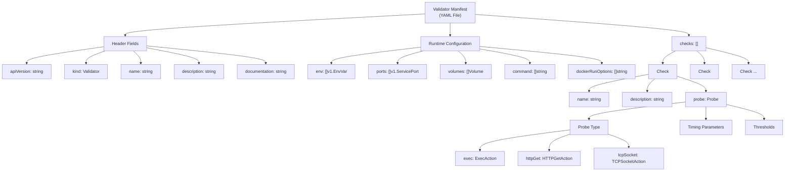
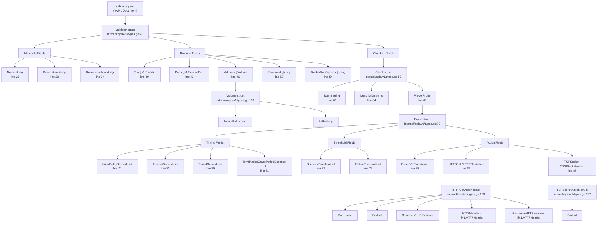
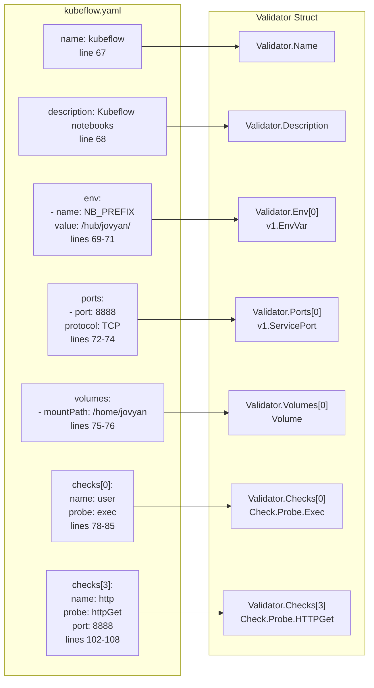

<!-- source: DeepWiki mcp.deepwiki.com · repo NVIDIA/container-canary · extra page Manifest Structure · fetched 2026-10-26 -->

# Manifest Structure

<details>
<summary>Relevant source files</summary>

The following files were used as context for generating this wiki page:

- [CONTRIBUTING.md](CONTRIBUTING.md)
- [README.md](README.md)
- [internal/apis/v1/types.go](internal/apis/v1/types.go)
- [schema/container-canary.nvidia.com/v1/validator.schema.json](schema/container-canary.nvidia.com/v1/validator.schema.json)

</details>


This page details the YAML structure of validator manifests used by container-canary. A validator manifest defines the complete specification for validating a container image, including metadata, runtime configuration, and validation checks. For information about specific probe types and their configuration, see [Probe Types](#2.2.2) and [Probe Configuration](#2.2.3). For complete API type references, see [Validator Type](#5.1).

## Overview

Validator manifests are YAML files that follow a Kubernetes-style API structure with `apiVersion`, `kind`, and typed fields. The manifest defines:
- **Metadata**: Descriptive information about the validator (name, description, documentation)
- **Runtime Configuration**: Container execution environment (environment variables, ports, volumes, command)
- **Checks**: List of validation checks to execute against the container

**Sources**: [internal/apis/v1/types.go:22-55](), [README.md:63-126]()

## Top-Level Manifest Structure

### Manifest Header Fields

```yaml
apiVersion: container-canary.nvidia.com/v1
kind: Validator
name: kubeflow
description: Kubeflow notebooks
documentation: https://www.kubeflow.org/docs/components/notebooks/container-images/#custom-images
```

| Field | Type | Required | Purpose |
|-------|------|----------|---------|
| `apiVersion` | string | Yes | API version, currently `container-canary.nvidia.com/v1` |
| `kind` | string | Yes | Resource type, must be `Validator` |
| `name` | string | Yes* | Identifier for the validator |
| `description` | string | No | Human-readable description of what is validated |
| `documentation` | string | No | URL to external documentation defining requirements |

\* The JSON Schema requires `name` to be present and non-empty.

**Sources**: [internal/apis/v1/types.go:24-34](), [schema/container-canary.nvidia.com/v1/validator.schema.json:7-13]()

### Hierarchical Structure Diagram



**Sources**: [internal/apis/v1/types.go:22-55](), [internal/apis/v1/types.go:57-68](), [internal/apis/v1/types.go:70-88](), [schema/container-canary.nvidia.com/v1/validator.schema.json:8-19]()

## Runtime Configuration Section

The runtime configuration section defines how the container should be started before validation begins. These fields correspond to the `Validator` struct definition.

### Environment Variables

```yaml
env:
  - name: NB_PREFIX
    value: /hub/jovyan/
```

Environment variables use a subset of the Kubernetes `v1.EnvVar` type. The schema specifically supports literal `name` and `value` fields; `valueFrom` is not supported.

**Type Mapping**: `Env []v1.EnvVar` at [internal/apis/v1/types.go:40]()
**Schema Constraint**: [schema/container-canary.nvidia.com/v1/validator.schema.json:23-29]()

### Port Exposures

```yaml
ports:
  - port: 8888
    protocol: TCP
```

Ports use a subset of the Kubernetes `v1.ServicePort` type. The `port` (integer 1-65535) and `protocol` (TCP, UDP, or SCTP) are required by the schema.

**Type Mapping**: `Ports []v1.ServicePort` at [internal/apis/v1/types.go:43]()
**Schema Constraint**: [schema/container-canary.nvidia.com/v1/validator.schema.json:30-39]()

### Volume Mounts

```yaml
volumes:
  - mountPath: /home/jovyan
  - mountPath: /tmp/data
    path: /host/path/to/data
```

Volumes define filesystem mounts. The `Volume` type supports:
- `mountPath`: Path inside the container (required)
- `path`: Path on the host (optional; if omitted, an empty volume is created)

**Type Mapping**: `Volumes []Volume` at [internal/apis/v1/types.go:46](), [internal/apis/v1/types.go:133-140]()

### Container Command

```yaml
command:
  - /bin/bash
  - -c
  - jupyter lab --allow-root
```

Overrides the container's default entrypoint/command.

**Type Mapping**: `Command []string` at [internal/apis/v1/types.go:50]()

### Docker Run Options

```yaml
dockerRunOptions:
  - --privileged
  - --cap-add=SYS_ADMIN
```

Additional flags passed directly to the Docker CLI. This maps to the `dockerRunOptions` YAML key.

**Type Mapping**: `DockerRunOptions []string` at [internal/apis/v1/types.go:54]()

**Sources**: [internal/apis/v1/types.go:39-54](), [schema/container-canary.nvidia.com/v1/validator.schema.json:14-18]()

## Checks Section

The `checks` section is a list of validation checks to perform. The schema requires at least one check to be defined.

### Check Structure

```yaml
checks:
  - name: user
    description: 👩 User is jovyan
    probe:
      exec:
        command: ["/bin/sh", "-c", "[ $(whoami) = jovyan ]"]
```

| Field | Type | Required | Purpose |
|-------|------|----------|---------|
| `name` | string | Yes | Identifier for the check |
| `description` | string | No | Human-readable description displayed during execution |
| `probe` | Probe | Yes | Probe definition specifying how to validate |

**Sources**: [internal/apis/v1/types.go:57-68](), [schema/container-canary.nvidia.com/v1/validator.schema.json:46-51]()

## Type Mapping: YAML to Go Structs

### Complete Type Hierarchy Diagram



**Sources**: [internal/apis/v1/types.go:22-140]()

## Concrete Example: Mapping YAML to Code

The following diagram maps actual YAML content from the `kubeflow.yaml` example to the corresponding Go struct fields:



**Sources**: [README.md:63-126](), [internal/apis/v1/types.go:22-55]()

## Probe Field Defaults

The `Probe` type implements custom YAML unmarshalling to provide sensible defaults for timing and threshold fields when they are not specified in the manifest.

| Field | Default Value | Purpose |
|-------|---------------|---------|
| `initialDelaySeconds` | 0 | No delay before first probe execution |
| `timeoutSeconds` | 30 | Maximum time for probe execution |
| `periodSeconds` | 1 | Interval between probe retries |
| `successThreshold` | 1 | Consecutive successes required |
| `failureThreshold` | 1 | Consecutive failures before giving up |
| `terminationGracePeriodSeconds` | 30 | Grace period for container shutdown |

These defaults are set in the `UnmarshalYAML` method.

**Sources**: [internal/apis/v1/types.go:90-106]()

## Complete Field Reference Table

| YAML Path | Go Type | Struct Location | Required | Description |
|-----------|---------|-----------------|----------|-------------|
| `apiVersion` | string | N/A | Yes | API version identifier |
| `kind` | string | N/A | Yes | Must be "Validator" |
| `name` | string | `Validator.Name` | Yes | Validator identifier |
| `description` | string | `Validator.Description` | No | Human-readable description |
| `documentation` | string | `Validator.Documentation` | No | URL to requirements documentation |
| `env[]` | `[]v1.EnvVar` | `Validator.Env` | No | Environment variables |
| `ports[]` | `[]v1.ServicePort` | `Validator.Ports` | No | Port exposures |
| `volumes[]` | `[]Volume` | `Validator.Volumes` | No | Volume mounts |
| `volumes[].mountPath` | string | `Volume.MountPath` | Yes | Container mount path |
| `volumes[].path` | string | `Volume.Path` | No | Host path (empty volume if omitted) |
| `command[]` | `[]string` | `Validator.Command` | No | Container command override |
| `dockerRunOptions[]` | `[]string` | `Validator.DockerRunOptions` | No | Additional docker run flags |
| `checks[]` | `[]Check` | `Validator.Checks` | Yes | List of validation checks (min 1) |
| `checks[].name` | string | `Check.Name` | Yes | Check identifier |
| `checks[].description` | string | `Check.Description` | No | Check description |
| `checks[].probe` | `Probe` | `Check.Probe` | Yes | Probe specification |
| `checks[].probe.exec` | `*v1.ExecAction` | `Probe.Exec` | No* | Exec probe action |
| `checks[].probe.httpGet` | `*HTTPGetAction` | `Probe.HTTPGet` | No* | HTTP probe action |
| `checks[].probe.tcpSocket` | `*TCPSocketAction` | `Probe.TCPSocket` | No* | TCP probe action |

\* Exactly one probe action type must be specified per probe (enforced by `oneOf` in JSON Schema).

**Sources**: [internal/apis/v1/types.go:22-140](), [schema/container-canary.nvidia.com/v1/validator.schema.json:1-105]()

---

