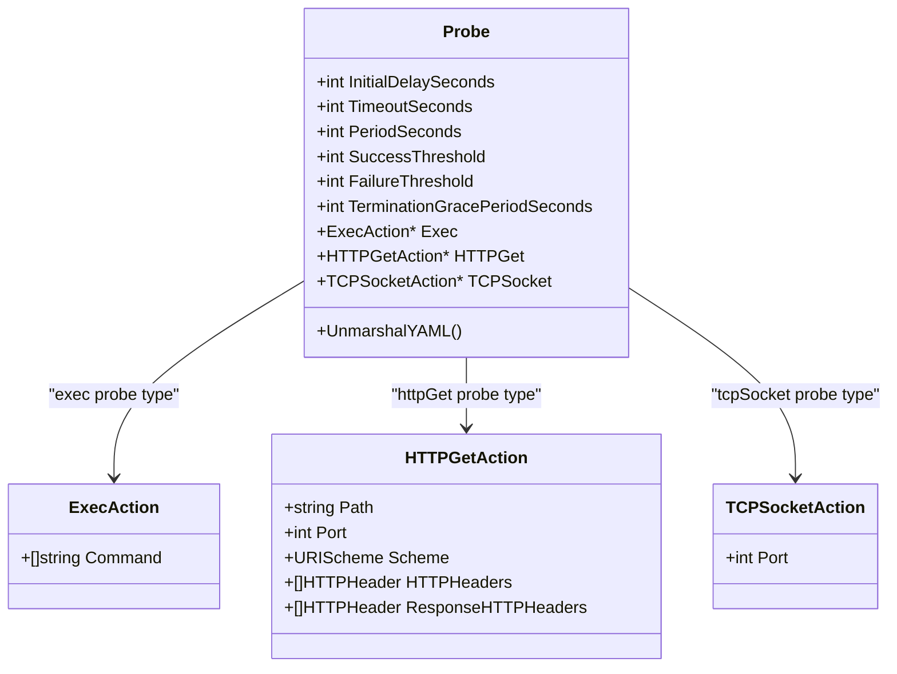
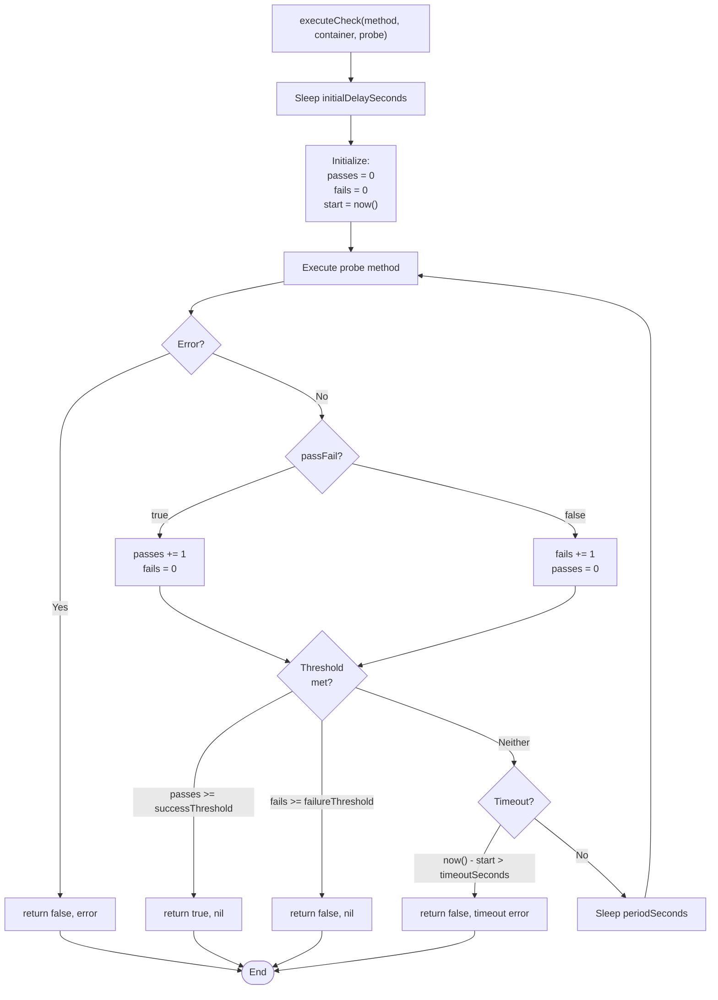

<!-- source: DeepWiki mcp.deepwiki.com · repo NVIDIA/container-canary · extra page Probe Configuration · fetched 2026-10-26 -->

# Probe Configuration

<details>
<summary>Relevant source files</summary>

The following files were used as context for generating this wiki page:

- [CONTRIBUTING.md](CONTRIBUTING.md)
- [README.md](README.md)
- [internal/apis/v1/types.go](internal/apis/v1/types.go)
- [internal/validator/validator.go](internal/validator/validator.go)

</details>


This page documents the timing parameters and threshold settings that control probe execution behavior. These configuration options apply to all probe types (exec, httpGet, and tcpSocket) and control when probes execute, how often they retry, and what determines success or failure.

For information about the different probe types and their specific action parameters, see [2.2.2 Probe Types](). For the overall manifest structure, see [2.2.1 Manifest Structure]().

## Configuration Parameters Overview

All probes share a common set of configuration parameters defined in the `Probe` struct. These parameters control the timing and threshold behavior of probe execution, regardless of the probe type.

| Parameter | Type | Default | Description |
|-----------|------|---------|-------------|
| `initialDelaySeconds` | int | 0 | Delay before first probe execution |
| `timeoutSeconds` | int | 30 | Total time allowed for probe to succeed |
| `periodSeconds` | int | 1 | Interval between probe execution attempts |
| `successThreshold` | int | 1 | Consecutive successes required for overall success |
| `failureThreshold` | int | 1 | Consecutive failures required for overall failure |
| `terminationGracePeriodSeconds` | int | 30 | Grace period before termination (currently unused) |

**Sources:** [internal/apis/v1/types.go:70-88]()

## Probe Entity Mapping

The following diagram maps the configuration parameters defined in the `Probe` struct to their roles within the execution logic.



The `Probe` struct contains both the timing/threshold configuration (covered on this page) and one of the three action types that define what the probe actually does.

**Sources:** [internal/apis/v1/types.go:70-88]()

## Timing Parameters

### initialDelaySeconds

The `initialDelaySeconds` parameter specifies the delay (in seconds) before the first probe execution begins. This allows time for the container to initialize before validation starts.

- **Type:** `int`
- **Default:** `0`
- **Use Case:** Set this when containers need startup time before they are ready to be validated

The delay is applied once at the start of probe execution in the `executeCheck` function:

```go
time.Sleep(time.Duration(probe.InitialDelaySeconds) * time.Second)
```

**Sources:** [internal/apis/v1/types.go:71](), [internal/validator/validator.go:182]()

### timeoutSeconds

The `timeoutSeconds` parameter defines the maximum total duration (in seconds) for the probe to succeed. If the probe does not meet its success threshold within this time, it fails with a timeout error.

- **Type:** `int`
- **Default:** `30`
- **Behavior:** Total elapsed time from probe start, excluding `initialDelaySeconds`.

The timeout check occurs on each iteration of the retry loop within `executeCheck`:

```go
if time.Since(start) > time.Duration(probe.TimeoutSeconds)*time.Second {
    return false, fmt.Errorf("check timed out after %d seconds", probe.TimeoutSeconds)
}
```

**Sources:** [internal/apis/v1/types.go:73](), [internal/validator/validator.go:201-203]()

### periodSeconds

The `periodSeconds` parameter specifies the interval (in seconds) between probe execution attempts. After each probe execution, the system waits this duration before attempting the next execution.

- **Type:** `int`
- **Default:** `1`

The period is enforced at the end of each retry loop iteration:

```go
time.Sleep(time.Duration(probe.PeriodSeconds) * time.Second)
```

**Sources:** [internal/apis/v1/types.go:75](), [internal/validator/validator.go:204]()

## Threshold Parameters

### successThreshold

The `successThreshold` parameter specifies how many consecutive successful probe executions are required before the overall check is considered successful.

- **Type:** `int`
- **Default:** `1`
- **Behavior:** Resets to 0 on any failure.

The success counter increments on each successful probe execution and resets to 0 on failures:

```go
if passFail {
    passes += 1
    fails = 0
} else {
    fails += 1
    passes = 0
}
if passes >= probe.SuccessThreshold || fails >= probe.FailureThreshold {
    return passFail, err
}
```

**Sources:** [internal/apis/v1/types.go:77](), [internal/validator/validator.go:191-199]()

### failureThreshold

The `failureThreshold` parameter specifies how many consecutive failed probe executions are required before the overall check is considered failed.

- **Type:** `int`
- **Default:** `1`
- **Behavior:** Resets to 0 on any success.

Like success threshold, the failure counter increments on failures and resets on success.

**Sources:** [internal/apis/v1/types.go:79](), [internal/validator/validator.go:194-199]()

## Default Values

Default values are set during YAML unmarshaling via the `UnmarshalYAML` method on the `Probe` type in `internal/apis/v1/types.go`. If configuration parameters are omitted from the manifest, these defaults are applied:

```go
raw := rawProbe{
    InitialDelaySeconds:           0,
    TimeoutSeconds:                30,
    PeriodSeconds:                 1,
    SuccessThreshold:              1,
    FailureThreshold:              1,
    TerminationGracePeriodSeconds: 30,
}
```

**Sources:** [internal/apis/v1/types.go:90-106]()

## Probe Execution Logic

The `executeCheck` function in `internal/validator/validator.go` orchestrates probe execution with timing and threshold logic.

### Logic Flow Diagram



**Key Behaviors:**

1. **Initial Delay**: Applied once before any probe execution [internal/validator/validator.go:182]().
2. **Counters Reset**: Success counter resets on failure; failure counter resets on success [internal/validator/validator.go:191-197]().
3. **Threshold Evaluation**: Check passes as soon as success threshold is met, fails as soon as failure threshold is met [internal/validator/validator.go:198-200]().
4. **Timeout**: Total elapsed time (excluding initial delay) is checked before each sleep period [internal/validator/validator.go:201-203]().
5. **Periodic Retry**: `periodSeconds` delay occurs between each probe attempt [internal/validator/validator.go:204]().

**Sources:** [internal/validator/validator.go:181-206]()

## Validation and Error Handling

### Timeout Errors

When a probe exceeds `timeoutSeconds`, it returns a formatted timeout error:

```
"check timed out after %d seconds"
```

This occurs when neither success nor failure thresholds are met within the allowed time.

### Probe Execution Errors

If the probe execution itself (the `probeCallable`) encounters a system error (e.g., Docker API failure, network connectivity issues), the check immediately fails and returns the error. This bypasses threshold logic:

```go
passFail, err := method(c, probe)
if err != nil {
    return false, err
}
```

**Sources:** [internal/validator/validator.go:62](), [internal/validator/validator.go:187-190]()

## terminationGracePeriodSeconds

The `terminationGracePeriodSeconds` parameter is defined in the `Probe` struct and defaulted to 30 seconds during unmarshaling, but it is currently not utilized in the `executeCheck` or container lifecycle logic.

**Sources:** [internal/apis/v1/types.go:81](), [internal/apis/v1/types.go:98]()

---

**Sources:** [internal/apis/v1/types.go:70-106](), [internal/validator/validator.go:181-206]()

---

