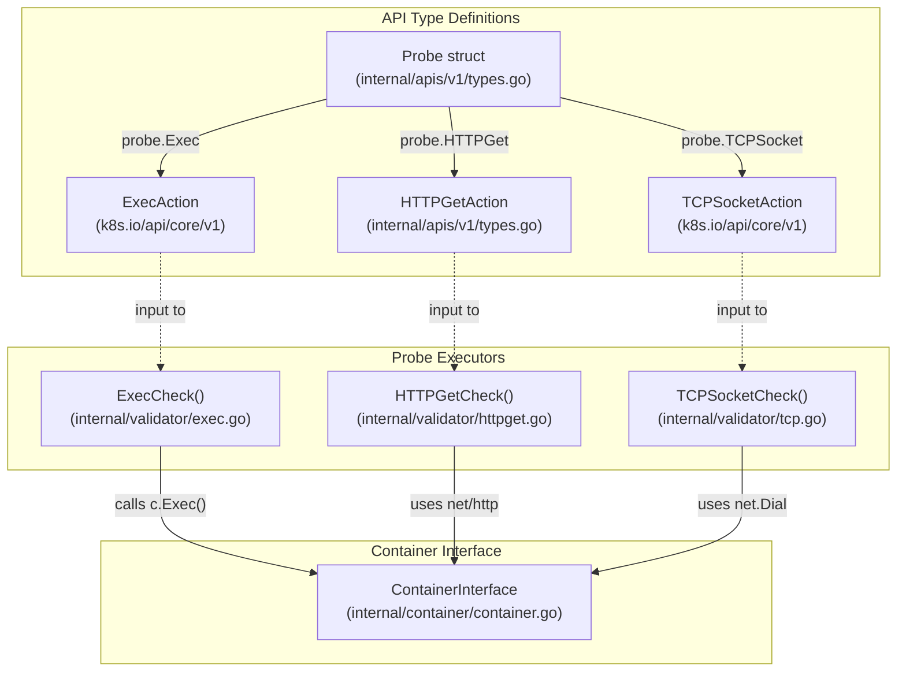
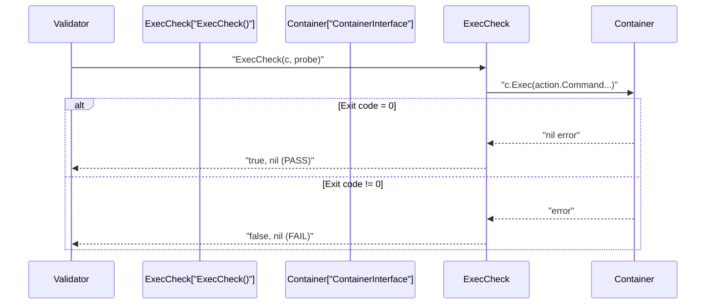
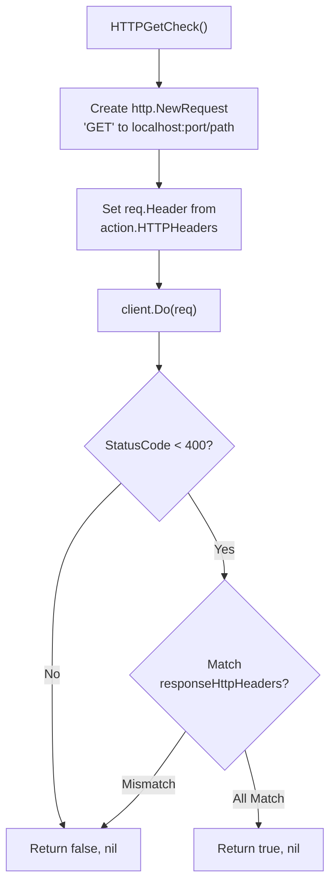
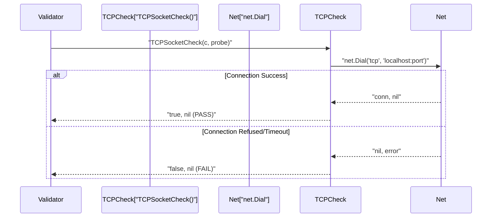

<!-- source: DeepWiki mcp.deepwiki.com · repo NVIDIA/container-canary · extra page Probe Types · fetched 2026-10-26 -->

# Probe Types

<details>
<summary>Relevant source files</summary>

The following files were used as context for generating this wiki page:

- [CONTRIBUTING.md](CONTRIBUTING.md)
- [README.md](README.md)
- [examples/dask-scheduler.yaml](examples/dask-scheduler.yaml)
- [internal/validator/exec.go](internal/validator/exec.go)
- [internal/validator/httpget.go](internal/validator/httpget.go)
- [internal/validator/tcp.go](internal/validator/tcp.go)

</details>


This page documents the three probe types available in `container-canary` for validating container behavior: **Exec**, **HTTPGet**, and **TCPSocket**. Each probe type provides a different method for checking that a container meets specific requirements.

For information about configuring probe timing parameters, thresholds, and retry logic, see [Probe Configuration](#2.2.3). For the overall structure of validator manifests, see [Manifest Structure](#2.2.1).

## Overview

Container Canary borrows the probe concept from Kubernetes, where probes are used to check container health. In `container-canary`, probes are repurposed to validate that a container image meets platform requirements [README.md:128-128](). Each check in a validator manifest contains exactly one probe, which defines how to test a specific requirement.

The three probe types provide different validation strategies:

| Probe Type | Purpose | Validation Method | Common Use Cases |
|------------|---------|-------------------|------------------|
| **Exec** | Execute commands inside the container | Command exit code (0 = pass) | User/UID validation, package checks, filesystem verification |
| **HTTPGet** | Make HTTP requests to container services | HTTP status code (<400 = pass) + optional header validation | Web service availability, routing, CORS headers |
| **TCPSocket** | Test TCP connectivity | TCP connection success | Port availability, service listening |

**Sources:** [README.md:33-37](), [internal/validator/exec.go:25-32](), [internal/validator/httpget.go:29-59](), [internal/validator/tcp.go:28-36]()

## Probe Type Architecture

The following diagram shows how probe types are defined and dispatched within the codebase:

**Probe Dispatcher Architecture**


The `Probe` struct contains three optional pointer fields corresponding to the three probe types. The validator's check execution logic dispatches to the appropriate probe handler function.

**Sources:** [internal/validator/exec.go:25-25](), [internal/validator/httpget.go:29-29](), [internal/validator/tcp.go:28-28]()

## Exec Probe

The Exec probe type executes a command inside the running container and validates the exit code. If the command exits with code `0`, the check passes. Any non-zero exit code results in a failed check [internal/validator/exec.go:27-31]().

### Structure

An Exec probe uses the `ExecAction` type, which contains a single field:

```yaml
probe:
  exec:
    command:
      - /bin/sh
      - -c
      - "[ $(whoami) = jovyan ]"
```

The `command` field is a string array representing the command and its arguments to execute [README.md:82-85]().

### Implementation

The `ExecCheck` function in `internal/validator/exec.go` implements Exec probe validation:

**Exec Validation Flow**


The implementation calls `c.Exec(action.Command...)` on the container interface [internal/validator/exec.go:27-27](). If the command execution returns an error (non-zero exit code), the check returns `false` [internal/validator/exec.go:28-30]().

**Sources:** [internal/validator/exec.go:25-32]()

### Common Use Cases

**User and Permission Checks:**
```yaml
- name: user
  description: 👩 User is jovyan
  probe:
    exec:
      command:
        - /bin/sh
        - -c
        - "[ $(whoami) = jovyan ]"
```
[README.md:78-85]()

**Home Directory Verification:**
```yaml
- name: home
  description: 🏠 Home directory is /home/jovyan
  probe:
    exec:
      command:
        - /bin/sh
        - -c
        - "[ $HOME = /home/jovyan ]"
```
[README.md:94-101]()

## HTTPGet Probe

The HTTPGet probe type makes an HTTP GET request to a specified port and path on the container. The check passes if the response status code is less than 400 and any specified response headers match [internal/validator/httpget.go:31-51]().

### Structure

The `HTTPGetAction` allows for request headers and response header validation:

```yaml
probe:
  httpGet:
    path: /
    port: 8888
    httpHeaders:  # Optional request headers
      - name: X-Custom-Header
        value: "foo"
    responseHttpHeaders:  # Optional response header validation
      - name: Access-Control-Allow-Origin
        value: "*"
```

**Sources:** [README.md:105-107](), [README.md:122-124]()

### Implementation

The `HTTPGetCheck` function in `internal/validator/httpget.go` implements HTTP probe validation:

**HTTP Validation Flow**


The implementation:
1. Creates an HTTP GET request to `http://localhost:{port}{path}` [internal/validator/httpget.go:34-34]().
2. Sets request headers from `action.HTTPHeaders` [internal/validator/httpget.go:40-42]().
3. Matches the Kubernetes kubelet behavior: treats any 2xx or 3xx response as success [internal/validator/httpget.go:31-32]().
4. Validates that each header in `responseHttpHeaders` exists in the response with the exact value [internal/validator/httpget.go:52-57]().

**Sources:** [internal/validator/httpget.go:29-59]()

### Common Use Cases

**CORS Header Validation:**
```yaml
- name: allow-origin-all
  description: "🔓 Sets 'Access-Control-Allow-Origin: *' header"
  probe:
    httpGet:
      path: /
      port: 8888
      responseHttpHeaders:
        - name: Access-Control-Allow-Origin
          value: "*"
```
[README.md:116-125]()

## TCPSocket Probe

The TCPSocket probe type attempts to establish a TCP connection to a specified port on the container. The check passes if the connection succeeds [internal/validator/tcp.go:31-36]().

### Structure

The `TCPSocketAction` contains a port number:

```yaml
probe:
  tcpSocket:
    port: 8786
```
[examples/dask-scheduler.yaml:24-25]()

### Implementation

The `TCPSocketCheck` function in `internal/validator/tcp.go` implements TCP probe validation:

**TCP Validation Flow**


The implementation uses `net.Dial("tcp", address)` to attempt a connection to `localhost:{port}` [internal/validator/tcp.go:30-31](). If an error occurs during dialing, the check fails [internal/validator/tcp.go:32-34]().

**Sources:** [internal/validator/tcp.go:28-36]()

### Common Use Cases

**Dask Comm Port Validation:**
```yaml
- name: comm
  description: ⛓ Exposes Dask comm on port 8786
  probe:
    tcpSocket:
      port: 8786
    failureThreshold: 30
```
[examples/dask-scheduler.yaml:21-26]()

## Probe Type Comparison

| Aspect | Exec Probe | HTTPGet Probe | TCPSocket Probe |
|--------|------------|---------------|-----------------|
| **Validation Method** | Command exit code | HTTP status + headers | TCP connection |
| **Success Criteria** | Exit code == 0 | Status < 400 & headers match | Connection success |
| **Code Entity** | `ExecCheck` | `HTTPGetCheck` | `TCPSocketCheck` |
| **Source File** | `internal/validator/exec.go` | `internal/validator/httpget.go` | `internal/validator/tcp.go` |

**Sources:** [internal/validator/exec.go:25-32](), [internal/validator/httpget.go:29-59](), [internal/validator/tcp.go:28-36]()

---

