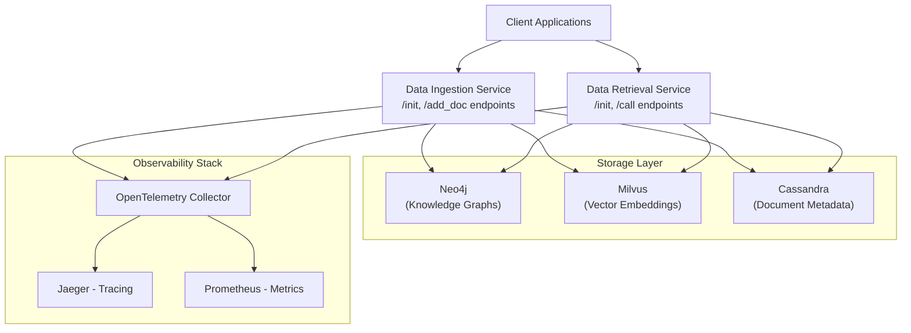
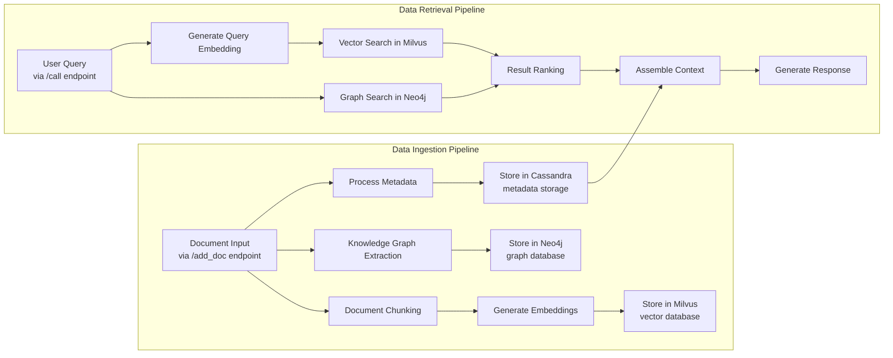
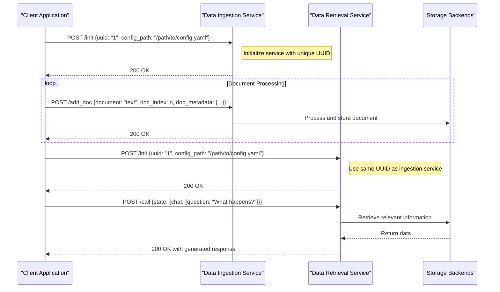
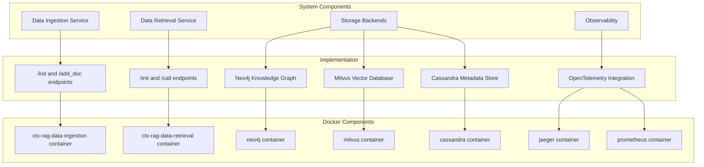
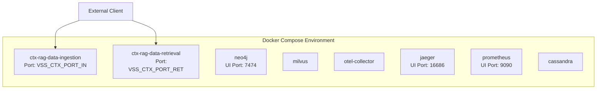

<!-- source: DeepWiki mcp.deepwiki.com · repo NVIDIA/context-aware-rag · page 1 Context-Aware RAG Overview · fetched 2026-10-26 -->

# Context-Aware RAG Overview

Relevant source files

The following files were used as context for generating this wiki page:

- [README.md](README.md)

## Purpose and Scope

Context-Aware RAG is a flexible library designed by NVIDIA to build customized data ingestion and retrieval pipelines for Retrieval Augmented Generation (RAG). This document provides a high-level overview of the system's architecture, components, and data flow. For detailed information about specific components, please refer to their respective documentation pages:

- For system architecture details, see [System Architecture](#2)
- For data ingestion specifics, see [Data Ingestion Service](#2.1)
- For data retrieval specifics, see [Data Retrieval Service](#2.2)
- For GraphRAG capabilities, see [GraphRAG Capabilities](#2.4)

Sources: [README.md:19-34]()

## Key Components

Context-Aware RAG consists of several core components that work together to provide a complete RAG solution:

| Component | Description | Wiki Reference |
|-----------|-------------|---------------|
| Data Ingestion Service | Processes and stores documents from various sources | [#2.1](#2.1) |
| Data Retrieval Service | Handles queries and generates context-aware responses | [#2.2](#2.2) |
| Storage Backend Systems | Includes Neo4j, Milvus, and Cassandra for different data storage needs | [#2.3](#2.3) |
| GraphRAG Capabilities | Extracts knowledge graphs from documents to enhance retrieval | [#2.4](#2.4) |
| Observability Features | Provides monitoring via OpenTelemetry, Jaeger, and Prometheus | [#2.5](#2.5) |

Sources: [README.md:25-31]()

## System Architecture

The system follows a microservices architecture pattern with dedicated services for data ingestion and retrieval, supported by specialized storage backends and comprehensive observability.

Sources: [README.md:113-142]()

## Data Processing Workflow

The following diagram illustrates the data flow through the Context-Aware RAG system, from document ingestion to query response generation:

Sources: [README.md:146-219]()

## API Communication Pattern

The Context-Aware RAG services follow a consistent API pattern for initialization and data processing:

Sources: [README.md:156-218]()

## Codebase Organization to System Component Mapping

The following diagram maps the conceptual components of the Context-Aware RAG system to their actual implementation in the codebase:

Sources: [README.md:113-142]()

## System Deployment Overview

Context-Aware RAG is designed to be deployed as a set of Docker containers, managed via Docker Compose:

Sources: [README.md:85-144]()

## Getting Started

To begin using Context-Aware RAG, you'll need to:

1. Install prerequisites (Git, uv)
2. Clone the repository
3. Set up a virtual environment
4. Install the package
5. Configure environment variables
6. Deploy using Docker Compose

For detailed deployment instructions, see the [Deployment Guide](#4) and [Docker Deployment](#4.1) pages.

Examples for using the Data Ingestion and Data Retrieval services are provided in the README:

- Data Ingestion: Initialize the service and add documents
- Data Retrieval: Initialize the service with the same UUID and send queries

Sources: [README.md:45-219]()

## Key Features and Benefits

Context-Aware RAG provides several advantages for building RAG pipelines:

1. **Flexible Integration**: Seamlessly integrates with existing data processing workflows
2. **Customizable Pipelines**: Build tailored data ingestion and retrieval pipelines
3. **Knowledge Graph Enhanced Retrieval**: Leverages graph relationships for better context understanding
4. **Comprehensive Observability**: Monitor and troubleshoot with OpenTelemetry-compatible tools
5. **Containerized Deployment**: Easy deployment using Docker Compose

Sources: [README.md:25-34]()

---

