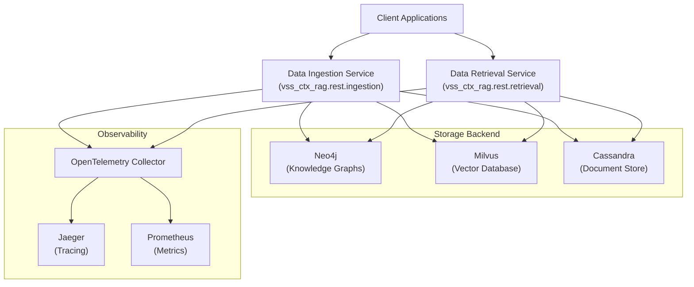
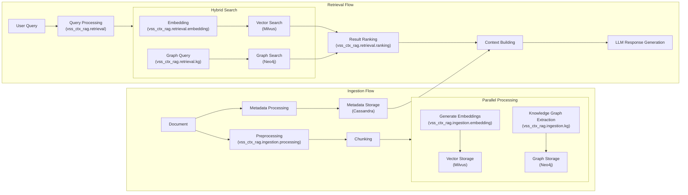
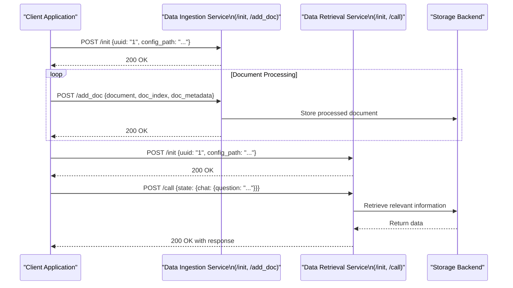
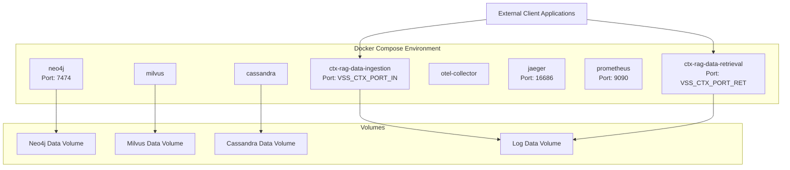
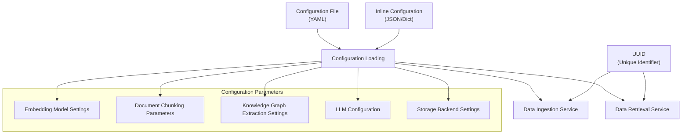

<!-- source: DeepWiki mcp.deepwiki.com · repo NVIDIA/context-aware-rag · page 2 System Architecture · fetched 2026-10-26 -->

# System Architecture

<details>
<summary>Relevant source files</summary>

The following files were used as context for generating this wiki page:

- [README.md](README.md)

</details>


This document describes the high-level architecture of the NVIDIA Context-Aware RAG system, presenting the core components and their interactions. For detailed information about specific components, please refer to the dedicated pages for [Data Ingestion Service](#2.1), [Data Retrieval Service](#2.2), [Storage Backend Systems](#2.3), [GraphRAG Capabilities](#2.4), and [Observability Features](#2.5).

## Core Architecture Overview

The Context-Aware RAG system follows a microservices architecture designed for scalability, flexibility, and maintainability. The system consists of two primary services that interact with a multi-modal storage layer and are monitored through a comprehensive observability stack.

### System Components Diagram



Sources: [README.md:115-142]()

## Key Components

The system architecture consists of these principal components:

1. **Data Ingestion Service**: Processes and stores documents in the appropriate storage systems.
2. **Data Retrieval Service**: Retrieves relevant information based on user queries.
3. **Storage Backend**:
   - Neo4j: Stores knowledge graphs for semantic connections
   - Milvus: Manages vector embeddings for semantic search
   - Cassandra: Stores document content and metadata
4. **Observability Stack**:
   - OpenTelemetry: Collects telemetry data
   - Jaeger: Provides distributed tracing capabilities
   - Prometheus: Monitors system metrics

Sources: [README.md:27-31](), [README.md:118-142]()

## Data Processing Workflow

The system operates through two main workflows: ingestion and retrieval. Both services coordinate to provide an efficient RAG (Retrieval Augmented Generation) pipeline.

### Data Flow Diagram



Sources: [README.md:27-31]()

## Service Communication

The services in Context-Aware RAG communicate through REST APIs, with both the Data Ingestion and Data Retrieval services exposing endpoints for client applications to interact with.

### Service Interaction Diagram



Sources: [README.md:147-219]()

## API Structure

Both services expose REST APIs with similar initialization patterns but different operational endpoints:

| Service | Endpoint | Purpose | Parameters |
|---------|----------|---------|------------|
| Data Ingestion | `/init` | Initialize service with configuration | `uuid`, `config_path` or `context_config` |
| Data Ingestion | `/add_doc` | Add document to the system | `document`, `doc_index`, `doc_metadata` (optional) |
| Data Retrieval | `/init` | Initialize service with configuration | `uuid`, `config_path` or `context_config` |
| Data Retrieval | `/call` | Process query and retrieve relevant information | `state` containing query information |

Sources: [README.md:154-191](), [README.md:204-218]()

## Deployment Architecture

The system is designed for containerized deployment using Docker and Docker Compose, with each component running in its own container.

### Deployment Diagram



Sources: [README.md:103-144]()

## Configuration Management

The system uses a configuration file approach that allows customizing both services. Configuration can be provided in two ways:

1. **File-based configuration**: Using the `config_path` parameter
2. **Inline configuration**: Using the `context_config` parameter

Both services must be initialized with the same UUID to ensure they operate on the same data context.

### Configuration Flow



Sources: [README.md:156-162](), [README.md:205]()

## Integration Points

The Context-Aware RAG system is designed to integrate with existing workflows through these key integration points:

1. **Client Applications**: Connect via REST APIs
2. **Storage Systems**: Leverage standard clients for Neo4j, Milvus, and Cassandra
3. **LLM Providers**: Support for multiple LLM providers (NVIDIA, OpenAI)
4. **Observability**: Integration with OpenTelemetry-compatible monitoring tools

### Environment Configuration

The system requires setting environment variables for proper operation:

```
NVIDIA_API_KEY         # If using NVIDIA LLMs
NVIDIA_VISIBLE_DEVICES # GPU device ID
OPENAI_API_KEY         # If using OpenAI LLMs
VSS_CTX_PORT_RET       # Data Retrieval Service port
VSS_CTX_PORT_IN        # Data Ingestion Service port
```

Sources: [README.md:93-101]()

## Summary

The NVIDIA Context-Aware RAG architecture provides a comprehensive framework for building customized data ingestion and retrieval pipelines. The microservices-based design, coupled with a multi-modal storage approach and robust observability features, enables flexible and powerful RAG implementations for various use cases.

Each component in the architecture plays a specific role, from processing and storing documents to retrieving relevant information based on user queries. The system's modular design allows for easy customization and extension to meet specific requirements.

---

