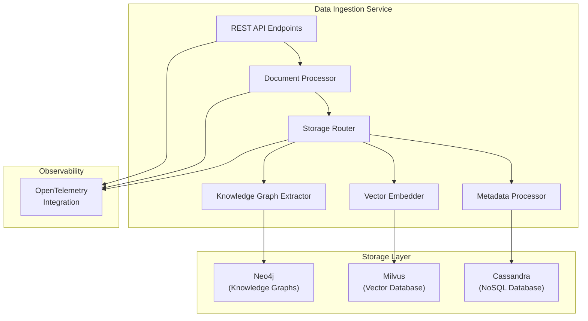
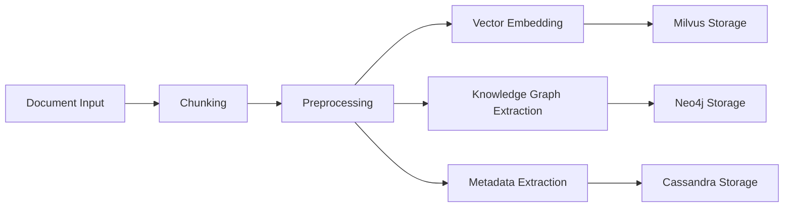
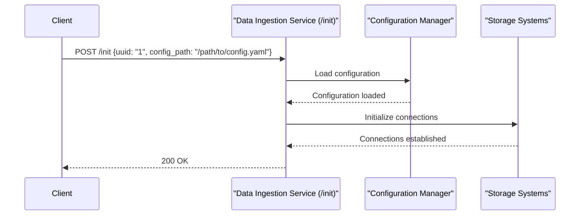
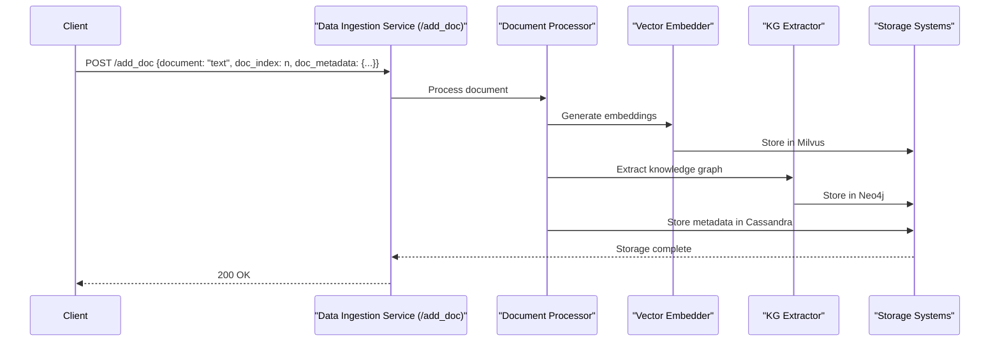
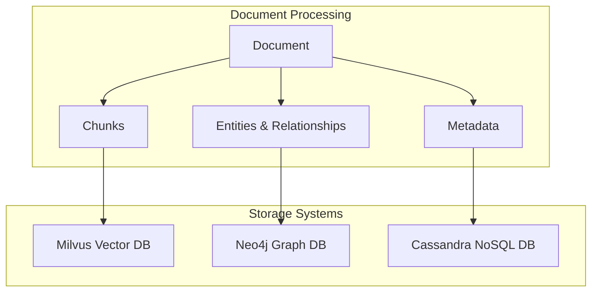
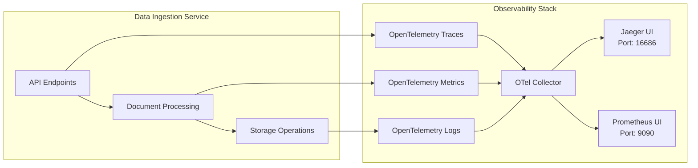
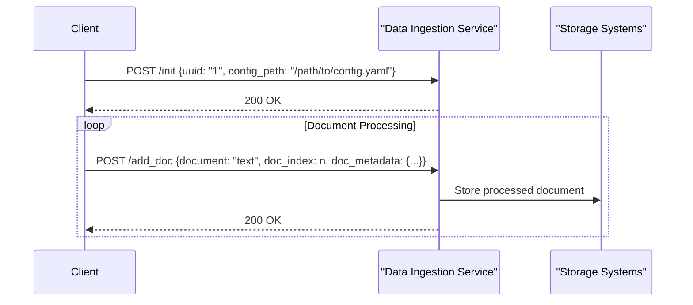

<!-- source: DeepWiki mcp.deepwiki.com · repo NVIDIA/context-aware-rag · page 2.1 Data Ingestion Service · fetched 2026-10-26 -->

# Data Ingestion Service

<details>
<summary>Relevant source files</summary>

The following files were used as context for generating this wiki page:

- [README.md](README.md)

</details>


## Purpose and Scope

The Data Ingestion Service is a core component of the Context-Aware RAG system responsible for processing documents, extracting knowledge, and storing information in the system's storage backends. This service enables users to add data from various sources into the RAG pipeline, making it available for subsequent retrieval operations. For information about retrieving data from the system, see [Data Retrieval Service](#2.2).

Sources: [README.md:26-28]()

## Architecture Overview

The Data Ingestion Service functions as a standalone microservice that exposes HTTP endpoints for clients to submit documents. It transforms raw documents into structured data and distributes this information across multiple specialized storage systems to support different query patterns and retrieval strategies.



Sources: [README.md:21-31]()

## Document Processing Pipeline

The Data Ingestion Service processes documents through a series of steps before storing them in the appropriate backends:



Sources: [README.md:19-23]()

## API Endpoints

The Data Ingestion Service exposes two primary REST API endpoints:

### 1. Initialization Endpoint

The `/init` endpoint initializes the service with a unique identifier and optional configuration.



**Request Parameters:**
- `uuid` (required): A unique identifier for the session
- `config_path` (optional): Path to a configuration file
- `context_config` (optional): Configuration provided directly in the request

**Example Request:**
```json
{
  "uuid": "1",
  "config_path": "/app/config/config.yaml"
}
```

Sources: [README.md:156-165]()

### 2. Document Addition Endpoint

The `/add_doc` endpoint accepts documents for processing and storage.



**Request Parameters:**
- `document` (required): The text content to be processed
- `doc_index` (required): A sequential index for the document
- `doc_metadata` (optional): Additional metadata about the document

**Example Request:**
```json
{
  "document": "User1: I went hiking to Mission Peak",
  "doc_index": 4,
  "doc_metadata": {"is_last": false, "timestamp": "2023-05-20T14:30:00Z"}
}
```

Sources: [README.md:168-190]()

## Storage Integration

The Data Ingestion Service writes to three primary storage backends, each serving a specific purpose in the retrieval pipeline:

| Storage System | Purpose | Data Stored |
|----------------|---------|-------------|
| Milvus | Vector database for similarity search | Document chunk embeddings |
| Neo4j | Graph database for knowledge relationships | Entities, relationships, and attributes |
| Cassandra | NoSQL database for structured metadata | Document metadata and indexes |



Sources: [README.md:126-142]()

## Configuration Options

The Data Ingestion Service can be configured through a YAML configuration file or direct context configuration. The configuration controls:

1. Document chunking strategies
2. Embedding model selection and parameters
3. Knowledge graph extraction settings
4. Storage backend connection parameters
5. Preprocessing pipelines

The configuration can be provided in three ways:
- Through the `config_path` parameter in the `/init` endpoint
- Directly through the `context_config` parameter in the `/init` endpoint
- Via environment variables

Sources: [README.md:156-162]()

## Integration with Observability

The Data Ingestion Service integrates with OpenTelemetry to provide comprehensive observability:



The service emits metrics, traces, and logs that can be viewed through:
- Jaeger UI for distributed tracing visualization (port 16686)
- Prometheus UI for metrics monitoring (port 9090)

Sources: [README.md:132-140]()

## Deployment

The Data Ingestion Service can be deployed using Docker and is typically run alongside other Context-Aware RAG components using Docker Compose.

### Docker Container

The service is containerized as `ctx-rag-data-ingestion` and exposes the port defined by the `VSS_CTX_PORT_IN` environment variable.

### Environment Variables

Key environment variables for the Data Ingestion Service include:

- `VSS_CTX_PORT_IN`: The port on which the service listens
- `NVIDIA_API_KEY`: Required if using NVIDIA AI models
- `OPENAI_API_KEY`: Required if using OpenAI models

Sources: [README.md:93-101](), [README.md:116-120]()

## Usage Example

The following example demonstrates initializing the Data Ingestion Service and adding documents:

1. Initialize the service with a unique UUID:
```
POST /init
{
  "uuid": "1",
  "config_path": "/app/config/config.yaml"
}
```

2. Add documents to be processed:
```
POST /add_doc
{
  "document": "User1: I went hiking to Mission Peak",
  "doc_index": 4,
  "doc_metadata": {"is_last": false}
}
```

Sources: [README.md:146-190]()

## Client Communication Flow



Sources: [README.md:146-190]()

---

